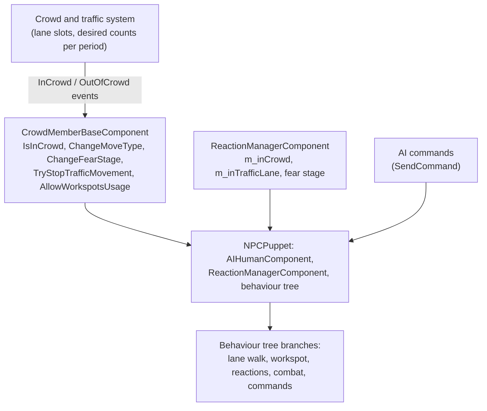

# Crowd adoption, NPC identity and density: directing the game's own people

**Maturity: Draft.** Static research for **Cyberpunk 2077 2.31**, 25 October 2026. It answers three Story Engine questions (V17 and V11 in the [runtime requirements](../research/story-engine/runtime-requirements.md)): how the game's crowd drives a person and how a mod can take one over and hand it back; what stays the same about a community-spawned NPC across a sector unload and reload; and how crowd density is set and which of those routes a mod can reach. **[source/binary]** Located the crowd, reaction and aggressive-crowd code paths, the persistent "stub" record every community NPC carries, the game's own community-NPC key, and a runtime density modifier with its clamp. **[hypothesis]** Whether AI commands move a live lane-walking crowd member, whether the stub's entity ids survive a reload, and what the density modifier scales are all unproven and are listed as session rows in §6. Nothing here has been seen in the running game.

Grades: **[source]** the hash-pinned decompiled 2.31 script corpus, pinned framework source or the RTTI dump; **[binary]** the executable, as an RVA; **[resource]** extracted game data read earlier; **[wiki]** the Modding Docs; **[hypothesis]** inference or a proposed contract. Builds on [population and affiliations](population-and-affiliations.md) (communities, crowd pools), [NPC direction](npc-direction.md) (AI commands), [navigation and safety](navigation-and-safety.md) (method, native boundaries), [game events](game-events.md) and [world and streaming](world-and-streaming.md).

## 1. Sources and boundaries

- **Scripts [source]:** the private 2.31 corpus described in the [corpus manifest](../research/story-engine/quest-corpus-e-manifest.json), decompiled with redscript-cli 0.5.31 from `final.redscripts` (16,035,530 bytes, SHA-256 `2119046f3f3466206d8a16a4803b0ef0f3c90926ab689f9abbd5b8e42e28ee86`, rechecked against the installed file). Every `.script` path and line below is inside that corpus; `orphans.script` holds the native class declarations. Copied to task scratch and read there; no decompiler was run.
- **Executable [binary]:** `PATH_TO_GAME/bin/x64/Cyberpunk2077.exe`, 59,945,608 bytes, SHA-256 `a7de82945c03e041fc7339fcf9066224d98db2f5d80fea50f7947bb350a60991` (the build [navigation and safety](navigation-and-safety.md#1-sources-and-boundaries) used). Bounded Capstone 5.0.9 disassembly. Every address is an **RVA**, not a hook constant, and must be revalidated before use.
- **Frameworks and dumps [source]:** [RED4ext.SDK `ad7277714ad30d6885d7050c5ba24fa0102f6920`](https://github.com/WopsS/RED4ext.SDK/tree/ad7277714ad30d6885d7050c5ba24fa0102f6920) (generated headers, cited relative to `include/RED4ext/Scripting/Natives/Generated/`); the `red-dump-json` RTTI listing (class, property and function listings with property flags, exported by psiberx with wopss's RTTIDumper; the local clone at commit `a8e529900db3a3618eab5f308fa9b1b0a607eca8`), which is how persistent-property flags are read; [Appearance Menu Mod `54272353`](https://github.com/MaximiliumM/appearancemenumod) for what a mod already does to crowd members; Modding Docs `a54b0873`.
- **Boundary:** no game or game-tool launch, extraction, process-memory access, native invocation or input. The crowd and companion behaviour **trees** are data resources that were not extracted, so which branch a command takes inside them is read from script tasks and SDK node names, not from the trees. The TweakDB side reuses the earlier name-to-type map of all 176,196 base records ([population and affiliations](population-and-affiliations.md#sources)). Scratch was `xfs-scratch/research-v17`, deleted at the end.

## 2. Answers at a glance

| Question | Answer | Grade |
|---|---|---|
| **Q1. What drives a crowd member?** | A **full AI puppet** (`NPCPuppet` with an `AIHumanComponent`, a reaction component and a behaviour tree) **plus** a native `CrowdMemberBaseComponent` that holds a slot in the traffic-lane system. Lane walking, fear and workspot use are behaviour-tree steps fed by that component. There is no separate cheap simulation mode for a lane walker. | [source] §3.1 |
| Do AI commands reach it? | The script path is open (`AIComponent.SendCommand`), and the game has a command made to return an NPC to the crowd (`AIJoinCrowdCommand`). That a **live lane walker obeys** a move command is not shown. | [source] reach; [hypothesis] effect |
| How does the game detach and re-attach one? | Three routes. **Fear:** stim → fear stage → flee / walk-away / surrender behaviours, still in the crowd. **Aggressive crowd:** attitude hostile + injected threat → combat, then `UnregisterAggressiveCrowd` and a self-directed stim to walk off. **Prevention:** `ReactionSystem.TryAndJoinTraffic` puts a unit back on a lane. | [source] §3.2 |
| Can a mod trigger it on purpose? | Yes for the **stop and rejoin levers** (`TryStopTrafficMovement`, `AllowWorkspotsUsage`, `ChangeMoveType`, `TryAndJoinTraffic`, `SendDrirectStimuliToTarget`, `AIJoinCrowdCommand`), all public script calls. The aggressive-crowd entry is private to the reaction component and means combat. | [source] §3.3 |
| **Q2. A stable key?** | **Community NPCs: yes, probably.** Each carries a persistent stub record with its community instance's entity id and its entry name; the game's own `NPCReference` and `CheckStubData` use exactly that pair, and a native returns each entry's fixed entity ids. **Lane-crowd pedestrians have none** and their entities are pooled and reused. Stability across a reload is [hypothesis] with strong circumstantial support. | [source/binary] §4 |
| **Q3. Density?** | No TweakDB record controls it. It is baked per time period into the world's crowd data, with **one runtime lever**: `CommunitySystem.ChangeDensityModifier(Float)`, clamped to **0.01 to 1.0**, so it can only **thin** the crowd. Local thinning has `EnableDynamicCrowdNullArea`. Faction shares are not a parameter anywhere. | [source/binary] §5 |

## 3. Q1: how the crowd drives a person, and how to adopt one

### 3.1 What a crowd member is



- **A crowd member is an ordinary AI puppet.** `CrowdMemberComponent` is a native component on the puppet (`ScriptedPuppet.GetCrowdMemberComponent()` returns it, `scriptedPuppet.script:1042`). Its script surface is `ChangeFearStage`, `ChangeMoveType`, `IsInCrowd`, `IsBlockedInTraffic`, `SetThreatLastKnownPosition`, `TryChangeMovementDirection`, `TryStopTrafficMovement`, `GetMovementDirection`, `CheckEmptyPath`, `CheckIsMoving`, `AllowWorkspotsUsage`, `OnCrowdReaction`, `CheckTrafficPath` (`orphans.script:24142–24175`; the SDK holds it opaque, `game/CrowdMemberComponent.hpp`, `0x210` bytes) [source].
- **Lane walking is a behaviour-tree step, not a separate system.** The SDK names the tree nodes: `MoveAlongTrafficPath`, `FindClosestPointOnTrafficPath`, the conditions `ShouldEnterCrowd`, `InstantJoinTraffic`, `WaitJoinTraffic`, `PrepareReservedCrowdWorkspot` (`AI/behavior/*Definition.hpp`) [source]. Script tasks in the same trees tune it: `SetTrafficLaneMovementParams` writes the path direction and closest point arguments, sets the move type and fear stage, and its `Deactivate` calls `TryStopTrafficMovement` (`aiStimReactionTask.script:290–322`); `TryStopMovingOnTrafficLane` (`:889–893`); conditions `IsCrowdNPC`, `IsAggressiveCrowd`, `WasNPCForcedToJoinCrowd` (`aiCheckNPCState.script:259–297`) and `IsBlockedInTraffic` (`aiStimReactionCondition.script:393`) [source]. Whether a *command* branch outranks the lane branch is inside the unextracted tree [hypothesis].
- **Two separate "in the crowd" signals.** `ScriptedPuppet.IsCrowd()` is **live**: with script precedence it reads `(record.isCrowd || has component) ? component.IsInCrowd() : false` (`scriptedPuppet.script:1425–1427`, whose decompiled text drops the parentheses). The reaction component **caches** it as `m_inCrowd`, refreshed only on `ReevaluatePresetEvent` (`reactionComponent.script:4601–4603, 4948–4951`), while `m_inTrafficLane` follows the native events `InCrowd` / `OutOfCrowd` (`:5278–5288`, `orphans.script:46396–46400`) [source]. Both callbacks have script bodies, so the bridge can observe each lane join and leave by wrapping them; the events carry no payload.
- **Entities are pooled.** The SDK declares `gameCrowdEntityReuseEvent`, and the reaction component handles `AIPuppetSwappedEvent` (`reactionComponent.script:5264–5269`), so a crowd entity can be reused for another person. The scripts do not say when [source/hypothesis].
- **Crowd members also use workspots** (sitting, smoking, vendor stands) through `AllowWorkspotsUsage` and traffic workspot definitions (`AI/TrafficWorkspotDefinition.hpp`, `TrafficExternalWorkspotDefinition.hpp`), which is how a crowd person "goes to a place and uses a workspot" without a command [source].

### 3.2 What the game itself does to a crowd member

| Trigger | What happens | Citation | Back in the crowd? |
|---|---|---|---|
| Stimulus (gunshot, bump, aiming, hazard) | The reaction component picks a fear phase (0 to 3), sets `ChangeFearStage`, `SetThreatLastKnownPosition`, `AllowWorkspotsUsage(false)`, raises the high-level state to Fear, then queues a behaviour output: `Flee`, `WalkAway`, `Surrender`, `CallPolice`, `Bump`. | `reactionComponent.script:2164–2238, 2544–2700` | The member stays a crowd member and the traffic system runs the flee (`RegisterFearReaction` task calls `AddTrafficRunnersDirectly` when `IsInTrafficLane`, else `RegisterFearReaction`, `aiStimReactionTask.script:368–387`). De-escalation returns to `Relaxed`. |
| Ragdoll / hit | `TryStopTrafficMovement()` | `NPCPuppet.script:1990–2003`, `aiHitReactionTasks.script:232–233` | After recovery. |
| **Aggressive crowd** (player armed, near, in front, no heat) | `ReactionSystem.TryRegisteringAggressiveNPC(npc, checkLos)` (native, bounded registry), then `AIActionHelper.TryChangingAttitudeToHostile`, senses and tracker on, `InjectThreat`, `SetWasAggressiveCrowd(true)`. The tree's `CrowdCombatConditions` then selects combat. | `reactionComponent.script:2463–2542, 2983–3040` | Leaving Combat state calls `CallUnregisterAggressiveNPC` (1 s delay) → `TryUnregisteringAggressiveNPC`, senses and tracker off, threats cleared, attitude neutral (`:4836–4838`, `NPCPuppet.script:4263–4300`); `CrowdWalkAwayAfterCombat` sends an `AreaEffect` stim to itself so it walks off (`aiStimReactionTask.script:896–903`). |
| **Prevention** units on foot | `JoinTrafficOnFoot` task: `ReactionSystem.TryAndJoinTraffic(npc, threatPosition, runInTraffic)` | `preventionSystemAIHelperClasses.script:514–535` | Yes, onto the nearest lane. |
| Quest graph | `AIJoinCrowdCommand` (quest "Join Crowd", `questJoinCrowdParams.repeatCommandOnInterrupt`); a quest crowd manager can disable the crowd or carve null areas (§5). | `orphans.script:47190`, `questAICommandNodeCategories.script:26`, SDK `quest/*` | Yes, that command's purpose. |
| Follower role | `AIRole`s are only `None`, `Patrol`, `Follower` (`orphans.script:9171`); AMM gives a crowd NPC `AIFollowerRole` once and respawns it rather than change role a second time. | AMM `Modules/spawn.lua:690–750`, `Modules/util.lua:870–885` | n/a: respawn. |

So the game's own "detach to full AI and re-attach" is: **a reaction output or a hostile threat takes the person off the lane branch; a de-escalation, a self-directed stim, `TryAndJoinTraffic` or `AIJoinCrowdCommand` puts them back.** Everything it does is a public script call except the aggressive-crowd decision (private methods on the reaction component, and a combat outcome anyway).

### 3.3 What a mod can pull

| Lever | Reach | Effect on a lane walker | Grade |
|---|---|---|---|
| `puppet.GetCrowdMemberComponent().TryStopTrafficMovement()` | Public native | Stops lane movement (the game's own response to ragdoll, hits and call-police). | [source] |
| `…AllowWorkspotsUsage(false)` | Public native | Stops the crowd taking workspots; the game sets it when a person is scared. | [source] |
| `…ChangeMoveType(n"walk"/"jog"/"normal"/"panic"/"stop")` | Public native | Lane speed; the names are the ones the game passes (`reactionComponent.script:3242, 4986–5023`, `vehicles.script:690–698`). | [source] |
| `…TryChangeMovementDirection()`, `GetMovementDirection()`, `CheckIsMoving()`, `IsBlockedInTraffic()` | Public native | Reverse direction on a lane; read lane state. | [source] |
| `AIComponent.SendCommand(AIMoveToCommand / AIFollowTargetCommand / AIHoldPositionCommand / AIUseWorkspotCommand)` | Public; the same calls the bridge already makes on its actors | **Unproven on a lane walker.** `isCrowd:false` clones obey ([NPC direction §8](npc-direction.md#8-session-15-on-bridge-088-23-october-2026)); a live walker has the lane branch active. | [source]; [hypothesis] |
| `AIJoinCrowdCommand` | Native class, derived from `AIMoveCommand`, listed in the game's move-command set (`aiActionHelper.script:1291`) | Intended inverse of the above. Fields: none. | [source]; [hypothesis] |
| `ReactionSystem.TryAndJoinTraffic(npc, Vector3 threat, Bool run)` | Public native | Finds a lane near the NPC and posts a join request; prevention uses it. Handler `0x2666ce4` [binary]; what the request does inside the traffic system is not decoded. | [source/binary] |
| `StimBroadcasterComponent.SendDrirectStimuliToTarget(owner, stimType, target)` | Public | Drives the reaction pipeline on one person (`Bump`, `AreaEffect`, …), as `CrowdWalkAwayAfterCombat` does. | [source] |
| `ReactionSystem.MarkDespawnCandidate / UnmarkDespawnCandidate(id)` | Public native | Tells the crowd system a person may be recycled; the fear code marks, `OnSwapped` unmarks. | [source] |
| Reaction preset (`SetReactionPreset`, private in script) | AMM reaches it from CET; the bridge keeps a directed person quiet through its existing reaction wraps ([NPC direction §9](npc-direction.md#9-session-16-on-bridge-089-23-october-2026)) | Quiet or aggressive reactions. | [source] |
| Aggressive-crowd entry, `TriggerReactionBehaviorForCrowd` | **Private** to the reaction component | Not a clean entry: hostile attitude and combat. Do not use. | [source] |

### 3.4 A bounded design for the bridge: adopt, direct, release

**Principle:** treat adoption as taking a person off the lane branch with the game's own stop levers, driving them with the commands the bridge already has, and returning them with the game's own return routes. Use no role change (it breaks a second time), no combat route and no hostile attitude. Everything is reversible and logged.

1. **Eligibility** (exactly `npc.pick`'s today, [NPC direction §2](npc-direction.md#2-spawning-and-choosing)): plain passer-by of the street crowd, not busy, no protection reason. Add a **population read** (§4): whether the person has a community stub (a *community* person) or none (a *lane-crowd* person).
2. **Snapshot** the entity id, record, appearance, `IsCrowd()`, `IsInCrowd()`, the cached lane flag from the wrapped events, fear stage, workspot, position, and the stub pair if present.
3. **Adopt:** `TryStopTrafficMovement()`, `AllowWorkspotsUsage(false)`, the bridge's existing reaction stand-down, `UnmarkDespawnCandidate` (a held person must not be recycled while V is near), then **observe**: an `OutOfCrowd` event or `IsInCrowd() == false` is the signal that the lane branch has let go. State `adopted` only after that, otherwise `adopt_failed` and the bridge falls back to a spawned stand-in (route (a)).
4. **Direct:** the existing `npc.move / follow / turn / place` commands, plus `AIUseWorkspotCommand` for a placed workspot. Re-check the person every tick, as `npc.pick` does, and give up on a combat state, a scene, a fear stage above Relaxed or a vehicle mount.
5. **Release**, in this order, each a session row: (i) cancel owned commands and restore the reaction preset; (ii) `AIJoinCrowdCommand`; (iii) if still off-lane after 5 s, `TryAndJoinTraffic(npc, V's position, false)`; (iv) if that fails, walk out of sight and let the game despawn. Release is complete when `IsInCrowd()` is true again and no command is executing.
6. **Do not adopt during** combat, heat, aggressive-crowd registration (`ReactionSystem.IsRegisteredAsAggressive`) or any fear stage above Relaxed.

Risks and unknowns: a stopped lane walker may be recycled by the crowd system anyway; a command may be ignored while the lane branch is active; a held person blocks the lane for others. The aggregate crowd stays consistent only because adoption is rare (the engine drives people who matter, [V17](../research/story-engine/runtime-requirements.md)).

## 4. Q2: a stable identity key

### 4.1 Community NPCs carry a persistent stub; crowd pedestrians do not

- **The record [source].** The RTTI dump gives `gameEntityStubComponentPS` the properties `entityLocalPosition`, `entityLocalRotation`, `spawnerId` (a `gameCommunityID`, which is one `entEntityID`), `ownerCommunityEntryName`, `selectedAppearanceName` and `selectedColorVariantName`, **every one flagged persistent** (bit `0x10000000` of the property flags, SDK `CProperty.hpp`). Script reads it with `GetSpawnerID()` and `GetOwnerCommunityEntryName()` (`orphans.script:34401–34407`); the SDK's `GetPSComponentName()` is the component name.
- **The game's own key [source].** `NPCstubData { spawnerID: EntityID, entryID: CName }` (`orphans.script:32181`). `NPCPuppet.CheckStubData` reads the puppet's stub through the persistency system and compares the pair (`NPCPuppet.script:766–775`):

  ```
  let id = CreatePersistentID(npc.GetEntityID(), gameEntityStubComponentPS.GetPSComponentName());
  let ps = GameInstance.GetPersistencySystem(game).GetConstAccessToPSObject(id, n"gameEntityStubComponentPS") as gameEntityStubComponentPS;
  ps.GetSpawnerID() == data.spawnerID && ps.GetOwnerCommunityEntryName() == data.entryID
  ```

  The pair is authored as an `NPCReference { communitySpawner: NodeRef, entryName: CName }`, resolved with `ResolveNodeRef` and a cast to `EntityID` (`securitySystemMisc.script:376–390`), and used by the stim broadcaster and the security system to address "specific NPCs" (`stimBroadcasterComponent.script:296–325`, `securitySystemController.script:2282–2330`).
- **Fixed entity ids [source/binary].** `GetFixedEntityIdsFromSpawnerEntityID(spawnerEntityId, entryNames, game) -> [EntityID]` (`orphans.script:35464`) turns the pair into entity ids. The security system and `CommunityProxyPS` then message those NPCs with `QueuePSEvent(Cast<PersistentID>(entityId), n"ScriptedPuppetPS", …)` (`squadNode.script:170–205`), so the puppet's persistent state is **keyed by its entity id** and is reachable without the NPC being streamed. The native (handler `0x560468` → `0x3f30b4` → `0x4d36f0`) looks the community up by its entity id, matches entries by name (entry name read at `[[entry+0x40]+0x50]`, skipping entries flagged disabled at `[[entry+0x30]+0xb1] & 2`), and appends, per entry, the ids in a member array at `entry+0x60` (each at `+0x40`) and an id at `entry+0x38` (`0x3c038c`). With no names it returns every enabled entry's ids (`0x3bff04`). So ids belong to the *entry and its members*, not to a free pool [binary]; the **derivation** of those ids (for instance a hash of community id, entry name and index) was not decoded [hypothesis].
- **Lane-crowd pedestrians [hypothesis].** The crowd is created from `crowdEntries` (lane-fragment creation data, §5), not from community `entries`; nothing in the scripts gives such a person a spawner or entry, the SDK's crowd-reuse event suggests pooling, and `NPCstubData` is used only for community-addressed NPCs. A lane walker therefore has **no stable key**: session-bound identity only.

### 4.2 The key, and what changes between reloads

| Part | Read with | Stable across a sector reload? | Grade |
|---|---|---|---|
| Community instance | stub `spawnerId`, a 64-bit entity id that is the community node's global id | Yes: it is the world node's id, and `registry` instances are fixed ([population §3.2](population-and-affiliations.md#32-the-registry-what-the-world-actually-holds)) | [source/resource] |
| Entry | stub `ownerCommunityEntryName`, the authored `entryName` | Yes: authored data | [source] |
| Ordinal | the puppet's index in `GetFixedEntityIdsFromSpawnerEntityID(spawner, [entry])` | **Probably**, if that list's order and ids are fixed. | [hypothesis] |
| Entity id | `puppet.GetEntityID()` | **Probably** equal to one of the fixed ids for a community NPC: the PS is keyed by it. Row CA6 checks. | [hypothesis] |
| Appearance | stub `selectedAppearanceName`, `selectedColorVariantName` (persistent) | Stored, so likely **kept** (contradicts the re-roll reading in [population §8](population-and-affiliations.md#8-persistent-and-ephemeral)) | [source]; [hypothesis] effect |
| Position | stub `entityLocalPosition/Rotation` (persistent), but the wiki says a quantity below the spot count re-picks spots each sector load | Conflict: the stored pose may be the last pose rather than the assigned spot. Row CA7. | [source] vs [wiki] |
| Spot | none in the stub | Not part of the key. | [source] |

**Proposed key for the Story Engine:** `person_key = (spawnerId, entryName, ordinal)` for community NPCs, with the entity id kept as a cross-check; for lane-crowd pedestrians `person_key = session binding` only (the engine's P3 fallback). The bridge exposes it as one read (`npc.identity`): stub pair, fixed-id list and index, population kind (`community` / `lane_crowd` / `spawned`), `savable` flag from the record, and null for anything it cannot read. Two scopes matter and are tested separately: surviving a **sector unload and reload in one session** (the persistency system holds the PS in memory) and surviving **a save and load** (only if the record is `savable`, [population §8](population-and-affiliations.md#8-persistent-and-ephemeral)).

**Practical consequence for V17:** adopt **community** people for anyone the simulation must recognise later (they have keys, keep a look and have fixed ids the game itself addresses), and use lane-crowd people only for moments. A background pedestrian filler from a `Background` community is still a community NPC with a key even though its record says `isCrowd`; the stub read, not the record flag, decides (row CA1).

## 5. Q3: density, hour of day and faction shares

### 5.1 Where the numbers live

- **Authored crowd data [source/resource].** A crowd template phase holds `charactersData` (`characterRecordId` + weight), a `density`, and per time period (`CrowdPhaseTimePeriod`, SDK `game/CrowdPhaseTimePeriod.hpp`): `density` (float), `Density` (a CName) with `useDensityPreset`, `workspotsUsage` (float), `mergeMode` (`Average` or `Override`), `crowdType` (`Pedestrian`, `Vehicle`, `AV`), `charactersData` and `reducedCharactersData` (a thinner cast). Population §3.1 recorded the per-period densities of one region; this page adds the preset indirection and `workspotsUsage`.
- **Compiled per lane [source].** `worldTrafficLaneCrowdFragment { desiredSlotCountsPerTimePeriod[4], crowdCreationDataIndex, laneX1, laneX2 }` inside each lane's crowd creation info, indexing the registry's `gameCrowdCreationData` (908 entries, [population §3.2](population-and-affiliations.md#32-the-registry-what-the-world-actually-holds)). Hour of day is therefore four baked bands per lane fragment; the bands follow the world clock, so setting the time moves the density with no further call.
- **No TweakDB record controls density [resource].** A scan of all 176,196 base record names and types for crowd, density, traffic, population, pedestrian and ambient found only movement packages (`Crowds.*`, 14 `CrowdSettingsPackageBase`, 25 `CrowdSlotMovementPatternBase`, 27 `CrowdSlotMovementSettingsBase`), crowd character records and AI actions; no density preset type. The `Density` CName's presets are not in the TweakDB, so they are in a resource or the executable [hypothesis]. **A TweakXL file cannot change street density.**
- **Faction and gang shares are not a parameter [source/resource].** They are the *result* of which community entries have which quantities per period (`dynamic_events`, `open_world/community`), the character weights in `charactersData`, and the dynamic events that fire. The district record's `gangs` flat feeds only the map's gang panel ([places §3.3](places.md#33-what-the-data-says-about-gangs-danger-and-the-numbers-on-the-regions)). `DynamicSpawnSystem` pools are TweakDB `WeightedCharacter` weights, and a TweakXL file can change them, but they decide **chase** units, not street people ([population §3.6](population-and-affiliations.md#36-chases-and-other-dynamic-spawns)).
- **Static change means replacing world data.** The crowd and community data sit in the streaming sectors and the first always-loaded sector's registry. A mod that edits one would replace a huge shared file and collide with every other world mod, so the project does not do it; it also cuts against the rule never to reshape a user's mod setup.
- **The player's own setting [binary].** `CrowdDensity` is one of the game's in-game graphics config variables (the string sits among `MirrorQuality`, `AntiAliasing` and the shadow variables, `0x300dbe8`, referenced at `0x20e6247`). It is the Low / Medium / High control in the graphics menu [hypothesis for the values]. A mod **reads** it and never writes it ([Respect the player's settings](../research/story-engine/runtime-requirements.md), C2).

### 5.2 The runtime levers [source/binary]

| Lever | Script surface | What it does | Grade |
|---|---|---|---|
| **Density modifier** | `GameInstance.GetCommunitySystem(game).ChangeDensityModifier(Float)`, `ResetDensityModifier()` (`orphans.script:11371, 50152–50154`) | Stores a float at `[[communitySystem+0xd0]+0x720]`; the handler (`0x2645a68`) **clamps to 0.01 to 1.0** (constants `0.01f` at `0x31eefb0`, `1.0f` at `0x31ef3d0`); reset (`0x2645cb8`) writes 1.0. No script calls it. **It can only thin the crowd.** What it scales (pedestrians, vehicles, community people), whether it applies to people already spawned and whether it survives a save are **not decoded**: no reader of the field was found among the 83 instructions in `.text` that use an offset `0x720`. | [binary]; [hypothesis] scope |
| **Null area (local clear)** | `EnableDynamicCrowdNullArea(Box local, WorldTransform, Bool savable, Float duration) -> Uint64`; `DisableCrowdNullArea(Uint64)` (`orphans.script:50148–50150`) | Carves a box out of the crowd, optionally saved, with a duration. The handler (`0x2645b68`) hands the arguments to a manager at `[[communitySystem+0xd0]+0x680]`. Use `savable:false`. | [binary]; [hypothesis] effect |
| Quest crowd nodes | `questCrowdManagerNodeType_ControlCrowd { Enable \| Disable, distantCrowdOnly }`, `EnableNullArea`, `questInstancedCrowdControl { crowdVariantTag, enable }` | The same controls as authored quest steps. Not callable from script; they need an injected phase. | [source] |
| Prevention crowd | `PreventionSpawnSystem.TogglePreventionCrowdSpawns(Bool)` | Police pedestrian spawns only. | [source] |

### 5.3 A design for V11

- **Thin globally** with `ChangeDensityModifier(m)`, `m` in `[0.01, 1]` (an early-hours street, a curfew, an emergency), never above 1. Always **compose with the player's** `CrowdDensity`: the effective density is the setting times `m`.
- **Thin locally** with a short null area around a scene (a fight, a street vignette): `savable:false` and a finite duration, so nothing outlives the scene.
- **Add locally** with XF's own actors (route (a)), because the game offers no way to raise density. The pattern that follows: null area to clear the street, then place the story's people, then disable the area at the end.
- **Shares by hour, faction and gang** are the Story Engine's own data. It *reads* the game's baked shares ([population §6](population-and-affiliations.md#6-where-the-gangs-are-placement-by-district)) and renders any difference as a few adopted community people, never as a mutated density table.
- **Always restore:** `ResetDensityModifier()` and `DisableCrowdNullArea(id)` on the kill switch, handover, a load and bridge teardown, with the ids kept in the bridge's own registry. Whether the modifier survives a load is row CA8.

## 6. Session-card rows (maintainer-run; batch with the next Story Engine session)

Capture the usual per-call evidence (frame, sim time, entity ids) and the friction log. `P` is a passer-by from `npc.list`'s pickable set, `C` a community NPC (a vendor, a ripperdoc's regular, a bench sitter).

| Row | Do | Expect | If not |
|---|---|---|---|
| CA1 | For 12 pickable people near V, read `IsCrowd()`, `GetCrowdMemberComponent().IsInCrowd()`, the cached lane flag (wrap `OnInCrowd`/`OnOutOfCrowd`), the stub pair via `GetConstAccessToPSObject`, `GetAIRole()` and workspot. | Walking passers-by: in crowd, stub null. Sitters and smokers: in a community with a stub, possibly `IsInCrowd` false. | Stub present on lane walkers (then the crowd also uses communities), or the read returns a non-null stub for clones (then the key cannot separate kinds). Record both. |
| CA2 | Hold a lane walker: `TryStopTrafficMovement()` + `AllowWorkspotsUsage(false)`; watch 30 s. | Stops; stays; `OutOfCrowd` fires or `IsInCrowd` flips. | Walks on, or is recycled within seconds: lane walkers cannot be held this way; record the time. |
| CA3 | On a held walker, `AIMoveToCommand` 8 m away. | Walks there, `GetCommandState` reaches Success, no lane return. | Command Enqueued forever or ignored: the lane branch outranks commands; route (a) stays the default. |
| CA4 | Release by each route, one person each: cancel only; `AIJoinCrowdCommand`; `TryAndJoinTraffic(npc, V, false)`; a self-directed `AreaEffect` stim. Time to lane walking; `IsInCrowd` afterwards. | At least one returns the person to the lane within 5 s. | A person stands (as the 20 s of [NPC direction §8](npc-direction.md#8-session-15-on-bridge-088-23-october-2026)); record which route fixes it. |
| CA5 | Hold one person 100 m away from V's walk, return. | Same entity id, same place, still held. | Gone or replaced: the crowd system reclaimed it; record the distance and time. |
| CA6 | For a community NPC: `npc.identity`; call `GetFixedEntityIdsFromSpawnerEntityID(spawner, [entry])`; is the NPC's entity id in the list, at which index? | Yes, one index. | No: ids are not the puppet's; the key is the pair and the index only. |
| CA7 | Stream out and back (walk 300 m and return, or fast travel and return). Then save, load, return. Compare entity id, stub pair, appearance, color variant, position, index. | Same pair and index; same look; position near the spot. | A different index or look: the key is session-only for that kind; note whether `savable` explains it. |
| CA8 | At a busy street in daylight, `ChangeDensityModifier(0.3)`; count people and vehicles by `scene_read` at 0, 10, 30, 60 s; reset; repeat with 1.5 (expect clamp). Then save and load with it set. | Fewer new spawns, existing people unchanged; 1.5 reads as 1.0; reset restores. | Nothing changes (it scales something other than pedestrians), or it survives a load (the bridge must reset on load). |
| CA9 | `EnableDynamicCrowdNullArea` 30 m × 30 m around V with `savable:false`, 60 s; watch the people inside; `DisableCrowdNullArea`. | Inside people leave or stop appearing; the area ends on time. | Existing people stay: a null area only blocks new spawns. |
| CA10 | Read the `CrowdDensity` config variable through the settings system, at each of its three values (maintainer changes it). | A readable value that changes the CA8 baseline. | Unreadable: log its group name for the next session. |

## 7. Open questions

1. Whether a move command moves a live lane walker, and what the tree does with the lane afterwards (CA2, CA3).
2. How community entity ids are derived, and whether they equal the puppet's entity id (CA6, CA7).
3. What `ChangeDensityModifier` scales, and where the `0x720` field is read.
4. Which resource holds the `Density` CName presets that `useDensityPreset` selects.
5. What `AIPuppetSwappedEvent` and `CrowdEntityReuseEvent` do to an adopted person's entity.
6. Whether `savable: false` community records keep their stub across a save/load.

## Related pages

[Population and affiliations](population-and-affiliations.md) · [NPC direction](npc-direction.md) · [NPC reactions](npc-reactions.md) · [Navigation and safety](navigation-and-safety.md) · [World and streaming](world-and-streaming.md) · [Game events](game-events.md) · [Runtime access](runtime-access.md) · [Save files](save-files.md) · [Runtime requirements V11, V17](../research/story-engine/runtime-requirements.md)

**Knowledge used:** [population and affiliations](population-and-affiliations.md) (communities, registry, crowd entries; §3.2 and §8 gain the stub and density notes below), [NPC direction](npc-direction.md) (AI commands, `npc.pick` eligibility, release and reaction findings), [navigation and safety](navigation-and-safety.md) (method, pins, native-boundary style), [game events](game-events.md) (native-wrap limits), [runtime access](runtime-access.md) and [world and streaming](world-and-streaming.md) (the Codeware spawn path). Found incomplete: NPC direction listed crowd-NPC command handling as unknown without noting the crowd-return command or the lever set; population §8 had no NPC persistence evidence; both are updated.
