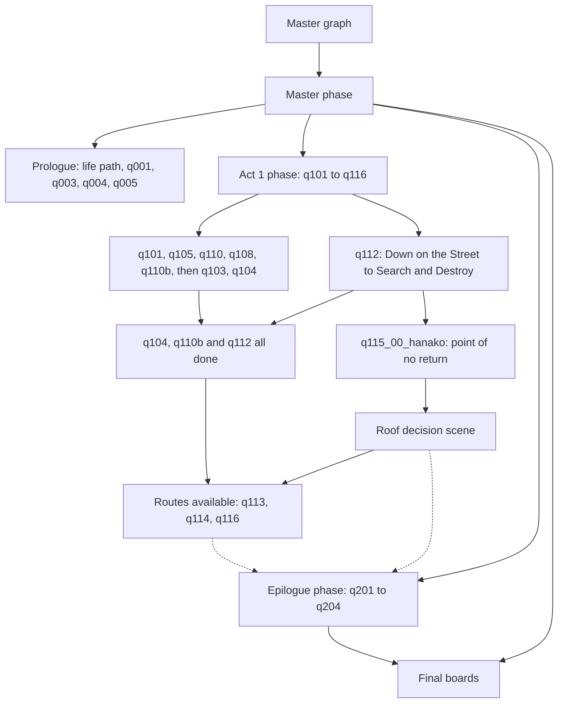

# Main-story progress as game state

*Spoiler notice: this page describes the base game's and Phantom Liberty's plot structure, character fates and endings.*

**Maturity: Draft.** How Cyberpunk 2077 records where V is in the main story: which facts, quest phases and journal states mark each stretch of the story and its turning points, which characters' fates the game stores, where the point of no return sits, and which endings stay open. Consolidated on 22 October 2026 from the game's own quest resources (game 2.31): the master quest graph, 737 main-story quest and phase files serialised with WolvenKit CLI 9.0.1, and 132 main-story scenes examined for the facts they set and test. Nothing here has been seen in the running game; the [questions for a game session](#questions-only-the-game-can-answer) say what to check.

This page answers: *given a save, which story windows are open (alive and allied, before the point of no return, still on the Nomad route), and which fact names and conditions say so?*

Evidence grades used on this page, besides the knowledge base's [shared grades](README.md#rules-for-knowledge-pages):

- **[resource]** is observed in the extracted quest, phase or scene resources (the fact name, the node that writes or tests it, and the comparison).
- **[wiki]** is the Modding Docs. **[community]** is a published guide's claim, not checked against the files.
- Fact meanings are read from the names and the surrounding tests. A name is not a specification: it is graded [resource] for *where and how it is used* and [hypothesis] for *what it means*, until the game confirms it.

## Sources

| Source | Version studied | Used for |
|---|---|---|
| Game quest resources: `cyberpunk2077.quest` and its phase, every phase under `main_quests` (prologue, part 1, epilogue), the Phantom Liberty (`ep1`) main-quest phases and quest graphs q301 to q307 | 2.31 (JSON header game version 2310) | Facts written and tested, journal states, phase structure and gating. 737 files, 441 base and 296 Phantom Liberty |
| Game scene resources under the same folders (132 scenes that mention a story-state fact) | 2.31 | Where choices write facts. Examined in a scratch folder, not kept |
| [Cyberpunk 2077 Modding Wiki](https://github.com/CDPR-Modding-Documentation/Cyberpunk-Modding-Docs), `for-mod-creators-theory` | `a54b0873` | [Quests: facts and files](https://github.com/CDPR-Modding-Documentation/Cyberpunk-Modding-Docs/blob/a54b0873/for-mod-creators-theory/files-and-what-they-do/file-formats/quests-.scene-files/quests-facts-and-files.md) (what facts are) and [Reference: Quest Ids](https://github.com/CDPR-Modding-Documentation/Cyberpunk-Modding-Docs/blob/a54b0873/for-mod-creators-theory/references-lists-and-overviews/reference-quest-ids.md) (journal path to quest title) |
| RPG Site, [Cyberpunk 2077 endings guide](https://www.rpgsite.net/feature/10580-cyberpunk-2077-endings-every-ending-epilogue-plus-how-to-get-them) | read 22 October 2026 | [community] Which side quests and choices each ending needs; the point of no return's description |
| Other knowledge pages | — | [Quests and story](quests-and-story.md) (node vocabulary, the journal, facts as a script interface), [save files](save-files.md) (`FactsDB` stores FNV-1a 32-bit hashes of fact names) |

How the corpus was made, with the tool, commands, game version and hashes of every file, is in [the corpus manifest](../research/story-engine/quest-corpus-a-manifest.json). The serialised files themselves are private, are not tracked and are never packaged. The machine-readable form of the tables below is [main-story-facts.json](../research/story-engine/main-story-facts.json).

## 1. The short answers

- **Progress is mostly plain facts.** Each main quest sets `qNNN_active` and `qNNN_done` (sometimes `_started`, `_finished`, `_completed`) in its own phase files, and later phases and scenes test them [resource]. A fact never set reads 0 ([wiki], [quests and story §2.4](quests-and-story.md#24-facts)).
- **The journal is a second, separate record.** Quest-level entries are made `Active`, `Succeeded`, `Failed` or `Inactive` by journal nodes inside the same phases [resource]. A reader can use either; the facts are the more reliable one for "has this happened", because they are written in one place per quest and tested in many.
- **The structure is in the phase graph.** The master graph is two nodes. It starts the master phase, which starts four story phases (prologue, act 1, epilogue, final boards) and the side-content phases [resource]. Act 1 chains the quests with fact conditions and joins [resource].
- **Character fates are separate facts, usually written by scenes.** Whether Takemura, Mitch, Rogue or Saul is alive, and whom V romanced, are single facts such as `q112_takemura_dead` or `q115_judy_romance_chosen`. Most are written by a choice scene, not a phase, so they are found by reading scenes as well as phases [resource].
- **The point of no return is one fact:** `q115_point_of_no_return`, written in the first phase of the Nocturne sequence (`q115_00_hanako`). The same phase wires 19 journal quests to `Failed`: 18 Phantom Liberty main-quest entries and the Epistrophy side quest [resource].
- **Which ending plays is not a fact.** The roof decision scene writes flags (`q115_02_hanako_help`, `q115_02_panam_help`, `q115_v_johnny_solo_ending`, `q115_suicide_option`) but the epilogue is chosen by scene exit sockets into the phase graph. What *makes an option available* is mostly side-quest facts (`sq027_done`, `sq027_failed`, `sq027_panam_ratted_out`, `sq031_done`, `sq032_johnny_friend`) that the roof scene tests [resource]. How they combine needs the game to confirm.
- **Romance is stored twice.** `sq027_panam_lover`, `sq028_kerry_relationship`, `sq029_river_lover` and `sq030_judy_lover` are written by the romance side quests (not in the main-quest files), and the roof scene copies the chosen partner into `q115_<name>_romance_chosen` [resource].
- **Phantom Liberty has its own spine** (`q301` to `q307`), split after `q304` by the fact `q304_songbirds_path`, and it sets the same point-of-no-return fact when its aftermath starts [resource].

## 2. How the game records progress

### 2.1 Fact conventions in the main story

| Convention | Seen as | Notes |
|---|---|---|
| Quest spine | `q001_done`, `q101_active`, `q115_done` | `_active` goes 1 when the quest starts and 0 at its end (`=1` then `=0` in the cleanup phase); `_done` goes 1 at the end. Some are written as "add 1" nodes, so a value can exceed 1 (`q104_done`, `q112_done`, `q202_done`). Test `> 0`, never `== 1` |
| Sub-quest spine | `q105_01_done` to `q105_04_done`, `q301_00_done` to `q301_06_done` | One per chapter of a multi-part quest |
| Character fate | `q112_takemura_dead`, `q116_rogue_dead`, `q104_mitch_rescued` | One fact per person. Polarity differs by fact (`_dead` is 1 when dead, `_rescued` is 1 when saved); read the name |
| Choice flag | `q115_02_panam_help`, `q304_songbirds_path`, `q115_suicide_ending` | Set once by the scene or phase where the choice is made |
| Romance and relationship | `sq029_river_lover`, `q115_judy_romance_chosen` | Set by side quests, copied into `q115_*` at the roof scene |
| Content switches | `radio_on`, `tv_on`, `air_traffic_off`, `<npc>_default_on` | Not story state. They turn world content on and off around quests, and are noise for a progress reader |
| Phantom Liberty switches | `ep1_installed`, `ep1_standalone`, `ep1_active`, `ep1_side_content` | Whether the expansion is present, started as a standalone game, switched on, and whether Dogtown side content is open |
| Test harness | `*_chicken_test`, `*_debug`, `q115_test_def_*`, `*_var_test_def` | Phases and scenes that set up a state for developers. Ignore them as a source of truth |

The comparison in a test matters. Most story facts are tested `> 0` or `>= 1`; a few are tested for equality (`== 0`) to mean "not yet" or "absent" (`q104_mitch_rescued == 0` on the final boards).

### 2.2 The journal

Journal nodes name a path such as `quests/main_quest/act_01/q112_01_old_friend` and wire one of four states [resource]. Quest-level entries (class `gameJournalQuest`) carry the story's skeleton; the titles are in the [wiki's quest-id list](https://github.com/CDPR-Modding-Documentation/Cyberpunk-Modding-Docs/blob/a54b0873/for-mod-creators-theory/references-lists-and-overviews/reference-quest-ids.md). Main-story paths are `quests/main_quest/prologue/…`, `…/act_01/…` and `…/epilogues/…`; the long-running tracker quests are under `quests/meta/…`; Phantom Liberty's are under `ep1/quests/main_quest/…`. The journal also records phone contacts: after a story event the contact gets conversations such as `contacts/takemura/q112_09_takemura_alive`, so a message can stand in as a trace of the event [resource].

## 3. The progression map

### 3.1 The structure

[resource] The master graph (`cyberpunk2077.quest`) has two nodes and runs the master phase (`cyberpunk2077.questphase`). That phase contains the prologue, act 1, epilogue and final-boards phases, and the side-content, minor-quest and bug-fix phases. Act 1 (`act_1.questphase`) holds the chain, read from its graph: `q101` leads to `q105`, which starts `q110`; `q110` starts `q108`, and `q108` starts `q110b`; `q103` leads to `q104` (gated by `q103_done`); `q112_abduction` is its own branch. The routes `q113` (Arasaka) and `q114` (Nomad), and `q116_mikoshi` after `q114`, are reachable only once `q104`, `q110b` and `q112_abduction` have all finished (an AND of the three). The Nocturne sequence (`q115_afterlife`) is started separately; its first phase reads a fact written at the end of `q112`. Dotted edges are not facts: which epilogue starts is decided by scene exits into the epilogue phase's input sockets, which this study did not resolve.

### 3.2 Stages, their facts and journal quests

Quest titles are from the [wiki's quest-id list](https://github.com/CDPR-Modding-Documentation/Cyberpunk-Modding-Docs/blob/a54b0873/for-mod-creators-theory/references-lists-and-overviews/reference-quest-ids.md). "Written in" names the phase file that writes the fact [resource]; the nodes' own conditions were not traced, so a fact may be written on one branch of a phase only.

| Stage | Journal quests (title) | Start and end facts | Written in | Gate or note |
|---|---|---|---|---|
| Life path | `q000_street_kid` The Streetkid; `q000_nomad` The Nomad; `q000_corpo` The Corpo-Rat; `q000_tutorial` Practice Makes Perfect | `q000_<path>_background`, `q000_done` | `q000_kid`, `q000_nomad`, `q000_corpo`; `q000` | Life path is read later: `q000_nomad_background` by the roof scene, `q000_corpo_background` by the Arasaka-route scenes |
| Prologue 1 | `q001_intro` The Rescue; `q001_01_victor` The Ripperdoc; `q001_02_dex` The Ride | `q001_done` (set in cleanup) | `q001_cleanup` | `Succeeded` wired in `q001_ride_to_mb` and `q001_ripperdoc` |
| Prologue 2 | `q003_maelstrom` The Pickup; `q003_stout` | `q003_active`, `q003_done` | `q003`, `q003_end` | Maelstrom fates written here (section 4) |
| Prologue 3 | `q004_braindance` The Information | `q004_start`, `q004_done` | `q004_nightclub`, `q004_after_bd` | The prologue phase reads `q003_done` and `q004_done` |
| Prologue 4 | `q005_heist` The Heist | `q005_start`, `q005_done` | `q005_01_plan`, `q005_09_no_tell_motel` | End of the prologue; `q005_done` is read only by the epilogue holograms |
| Act 1 opening | `q101_01_firestorm` Love Like Fire; `q101_resurrection` Playing for Time | `q101_active`, `q101_done` | `q101_j_01_concert`, `q101_cleanup` | Unlocks `q105` and `q103` |
| Act 1 | `q103_warhead` Ghost Town | `q103_active`, `q103_done` | `q103` | `q103_done` gates `q104` in `act_1` |
| Act 1 | `q104_01_sabotage` Lightning Breaks; `q104_02_av_chase` Life During Wartime | `q104_active`, `q104_done` | `q104` | One of the three conditions for the Act 1 close |
| Act 1 | `q105_dollhouse` Automatic Love; `q105_02_jigjig` The Space in Between; `q105_03_braindance_studio` Disasterpiece; `q105_04_judys` Double Life | `q105_01_done` to `q105_04_done`, `q105_done` | `q105_dollhouse`, `q105_fingers`, `q105_braindance_floor_02`, `q105_judys`, `q105_complete` | `q105_complete` starts `q110`; `q110` starts `q108` |
| Act 1 | `q108_johnny` Never Fade Away | `q108_active`, `q108_done` | `q108_johnny`, `q108_07_finale` | Sets `sq025_disabled = 1` (the Epistrophy side quest is `sq025`); starts `q110b` when it ends |
| Act 1 | `q110_voodoo` I Walk the Line; `q110_01_voodooboys`; `q110_03_cyberspace` Transmission | `q110_started`, `q110_active`, `q110_done` | `q110`, `q110b` | `q110b` is entered from `q108` and also sets `ep1_active = 1`: Phantom Liberty content starts here |
| Act 1 | `q112_01_old_friend` Down on the Street; `q112_02_industrial_park` Gimme Danger; `q112_03_dashi_parade` Play It Safe; `q112_04_hideout` Search and Destroy | `q112_active`, `q112_done` | `q112_abduction` and its phases; the later chapters `Succeeded` in `q112_01_market`, `q112_07_safe_house`, `q112_08_shotgun` | Takemura's fate is written in the safe-house scenes; `q112_hanako_meeting_set_up` is written by `q112_11_shotgun` |
| Turning point | `quests/meta/02_sickness` Nocturne Op55N1 | `q115_point_of_no_return` | `q115_00_hanako` | Section 6 |
| Roof decision | (none of its own) | `q115_02_*_help`, `q115_*_romance_chosen`, `q115_no_return` | scene `q115_02b_ripperdoc_roof` | Section 7 |
| Arasaka route | `q113_rescuing_hanako` Last Caress; `q113_corpo` Totalimmortal | `q113_active` | `q113` | Tests `q112_takemura_dead` 28 times: Takemura's state shapes it |
| Nomad route | `q114_01_nomad_initiation` We Gotta Live Together; `q114_02_maglev_line_assault` Forward to Death; `q114_03_attack_on_arasaka_tower` Belly of the Beast | `q114_started`, `q114_active`, `q114_done` | `q114_00_victor_connection`, `q114_new_camp`, `q114_02_main_attack` | `q114_done` is read by `q116` and by the final boards |
| Johnny route | `q115_afterlife` For Whom the Bell Tolls; `q115_rogues_last_flight` Knockin' on Heaven's Door; `quests/meta/09_solo` (Don't Fear) The Reaper | `q115_active`, `q115_done`; `q115_jungle_weyland_saved`; `q115_did_it_solo` | `q115_afterlife`, `q115_05_jungle`, `q115_solo_the_mikoshi` | The assault phases run `q115_03_afterlife` to `q115_07_netrunners_nest`; the solo phases are `q115_solo_*` |
| Mikoshi | `q116_cyberspace` Changes | `q116_active`, `q116_done` | `q116_smasher`, `q116_mikoshi` | Reads `q114_done`, `q115_jungle_weyland_saved`, `q115_did_it_solo` to pick its variant |
| Epilogues | `q201_heir` Where Is My Mind?; `q202_nomads` All Along the Watchtower; `q203_legend` Path of Glory; `q204_reborn` New Dawn Fades | `q201_active` and `q201_done` to `q204_done` | each epilogue's main phase | The `q204_reborn` phase reads `q201_done` to `q203_done` and `q115_suicide_ending` |
| Final boards | (none) | reads `q114_done`, `q305_done`, `q306_done`, `q306_finale_deal_done` and some 25 character facts | `final_boards` | Section 4 lists what it reads |

### 3.3 Phantom Liberty

[resource] `ep1_main_quests.questphase` chains `q301` to `q302` to `q303` to `q304`, then branches on `q304_songbirds_path`: when it is below 1 the `q305` route (Black Steel In The Hour of Chaos, Somewhat Damaged) runs, otherwise the `q306` route (The Killing Moon). The aftermath `q307` starts when either `q305_songbird_alive > 0` or `q306_finale_deal_done > 0`, unless `q307_aborted > 0` cuts it. The standalone start (`ep1_standalone`) feeds the same graph and also gates the first act-1 quests, which wait for the `00_hook/talk_songbird` journal entry. The `q307` quest graph sets both `q115_point_of_no_return = 1` and `q307_main_game_killed = 1`.

| Journal quest (title) | Facts and journal | Note |
|---|---|---|
| `q301_crash` Dog Eat Dog; `q301_finding_myers` Hole in the Sky; `q301_q302_rescue_myers` Spider and the Fly | `q301_00_active/done` to `q301_06_done`, `q301_done` | `q301_00_active` is read by `q112_abduction`: the expansion's first call arrives during Act 1 |
| `q302_reed` Lucretia My Reflection | `q302_done` | `q302_jacob_killed` written in two scenes |
| `q303_baron` The Damned; `q303_hands` Get It Together; `q303_songbird` You Know My Name | `q303_done` | |
| `q304_deal` Firestarter; `q304_netrunners`; `q304_stadium` | `q304_done`, `q304_songbirds_path` | The path fact is written in the lab scene `q304_07b_lab` |
| `q305` route: `q305_prison_convoy`, `q305_bunker`, `q305_border_crossing`, `q305_reed_epilogue`, `q305_postcontent` | `q305_done`, `q305_songbird_alive` | `q305_songbird_alive` is written by the finale scene `q305_10_songbird_finale` |
| `q306` route: `q306_devils_bargain` The Killing Moon; `q306_reed_epilogue`; `q306_somi_epilogue`; `q306_postcontent` | `q306_done`, `q306_finale_deal_done`, `q306_reed_killed`, `q306_reed_trusted`, `q306_somi_betrayed` | `q306_reed_killed` is written in the finale scene `q306_10_finale` |
| `q307_before_tomorrow` Who Wants to Live Forever; `q307_tomorrow` Things Done Changed | `q307_done`, `q307_main_game_killed`, `q307_aborted` | `q307_before_tomorrow` is made `Succeeded` in `q307_03_hospital` |

## 4. Characters whose state the game tracks

Each row is a fact the final boards, the epilogues or later quests read. "Where it is written" says what the extracted files show; **not found** means the files here do not contain the writer, which is then a side quest (outside this study) or script [hypothesis].

| Person | Fact | Where it is written | What reads it |
|---|---|---|---|
| Brick, Dum Dum, Royce (Maelstrom) | `q003_brick_dead`, `q003_dumdum_dead`, `q003_royce_dead` | prologue phases `q003_end`, `q003_militech_combat`, `q003_royce_bossfight` | `q204_columbarium_holograms` |
| Woodman | `q105_woodman_dead` | `q105_dollhouse` | `q204_columbarium_holograms` |
| Fingers | `q105_fingers_dead` | not found | `q204_columbarium_holograms` |
| Mitch (Aldecaldos) | `q104_mitch_rescued` | scene `q104_05_av_debris` | final boards (`== 0`), `q104` and `q114` scenes |
| Placide | `q110_placide_dead` | `q110_07b_placide_combat` | none found |
| Takemura | `q112_takemura_dead` | scenes `q112_000_setup`, `q112_10_safe_house` | the Arasaka route (28 tests), `q115`, `q201`, `q307`, final boards |
| Oda | `q112_oda_dead` | scene `q112_08_parade_speech` | `q113` |
| Weyland | `q115_jungle_weyland_saved` | `q115_05_jungle`, `q115_05_jungle_weyland` | `q116`, `q203`, the jungle phases |
| Weyland | `q115_weyland_dead` | not found | `q204_columbarium_holograms` |
| Rogue | `q116_rogue_dead` | scene `q116_01_adam_smasher` | `q204`, final boards |
| Saul | `q116_saul_dead` | scene `q116_01_adam_smasher` | final boards (`== 0`) |
| River | `sq021_river_dead`, `sq021_river_hates_v`, `sq021_sobchak_friend` | not found | `q201`, `q204`, final boards, `q307` |
| Randy | `sq021_randy_saved` | not found | final boards, `q201` |
| Songbird (PL) | `q305_songbird_alive` | scene `q305_10_songbird_finale` | final boards, `ep1_main_quests`, `q307` start |
| Reed (PL) | `q306_reed_killed`, `q306_reed_trusted` | scene `q306_10_finale`; `q306_03c-02_undergroundpassage` | final boards (`< 1`) |
| Somi (PL) | `q306_somi_betrayed` | `q306_05_launchpad` | `q306` |
| Jacob, Kurt (PL) | `q302_jacob_killed`, `q304_kurt_dead` | scenes `q302_04_squot`, `q302_07_oath`; `q304_08b_escape_songbird` | `q302` reads Jacob's; none found for Kurt's |
| Side-quest fates | `sq011_patricia_dead`, `sq011_dumdum_dead`, `sq023_bill_killed`, `sq024_claire_dead`, `sq024_sampson_dead`, `sq026_maiko_dead`, `sq026_hiromi_dead`, `sq031_ruby_dead`, `sq031_grayson_dead` | not found | the epilogue holograms (`q204_columbarium_holograms`) and `q203` |

The final boards phase reads, as "good news" and "bad news" panels: `sq017_done`, `sq018_01_mama_welles_talked`, `sq021_done`, `q201_earth`, `sq006_done`, `sq006_fact_truth_hurts`, the four `q115_*_romance_chosen` facts, `sq027_panam_ratted_out`, `sq027_done`, `sq004_done`, `sq030_done`, `sq030_broken`, `sq031_done`, `sq021_randy_saved`, `q104_mitch_rescued`, `sq021_river_dead`, `q305_songbird_alive`, `q306_finale_deal_done`, `q305_done`, `q306_done`, `q306_reed_killed`, `q112_takemura_dead`, `sq031_rogue_met_johnny`, `q116_rogue_dead`, `q114_done` and `q116_saul_dead`, plus the tarot-card journal states [resource]. That list is the game's own short list of whose fate matters for the ending, and so a good default for "windows on the story".

## 5. Romance and relationships

[resource] Four romances exist. Each has a "lover" fact written by its own side quests, and the roof decision scene copies the chosen partner into a `chosen` fact.

| Partner | Lover fact (side quests) | Chosen fact (roof scene) | Negative flags |
|---|---|---|---|
| Panam | `sq027_panam_lover` | `q115_panam_romance_chosen` | `sq027_panam_ratted_out`, `sq027_failed` |
| Kerry | `sq028_kerry_relationship` | `q115_kerry_romance_chosen` | `sq028_kerry_dislike`, `sq028_kerry_ignored` |
| River | `sq029_river_lover` | `q115_river_romance_chosen` | `sq021_river_hates_v`, `sq021_river_dead` |
| Judy | `sq030_judy_lover` | `q115_judy_romance_chosen` | `sq030_failed`, `sq030_broken` |

Observations [resource]:

- The roof scene tests all four lover facts (`> 0` and `>= 1`) and writes all four chosen facts with "add 1". Whether more than one can be set depends on the scene's conditions, not traced.
- The chosen facts are read by the `q202` convoy and border scenes, by `q203_penthouse`, `q204_00_setup` and `q307_02_coma`, and by the final boards. The lover facts are read by `q114`, `q302` and `q307` (so that Phantom Liberty and its aftermath know who V is with).
- The Phantom Liberty chapters send a text from whoever V is with after the crash: the `contacts/judy/q301_rom_after_crash`, `contacts/river_ward/q301_rom_after_crash`, `contacts/kerry_eurodyne/q302_rom_after_crash` and `contacts/panam/q302_rom_after_crash` conversations, with the flags `q301_romance_judy_texted`, `q301_romance_river_texted` and `q302_romance_kerry_texted` [resource]. A phone conversation in the journal is therefore also a trace of a romance.
- Nothing in these files stores "friend" as distinct from "lover" except `sq021_sobchak_friend` and `sq032_johnny_friend`; whether the other characters have friend flags is an open question.

## 6. The point of no return

[resource] The fact is `q115_point_of_no_return`.

- **Where it is set.** `q115_00_hanako` sets it to 1 after a game-manager node, a wait for `holo_setup_started == 0` (no holocall in progress) and a time delay. The phase name and the Embers elevator flag it also sets point to the meeting with Hanako [hypothesis]. The same phase sets `q115_embers_elevator_unlocked`, `air_traffic_off`, and a few presentation flags (`q115_ponr_pop_up_closed`, `show_ponr_cinematic`, `loaded_ponr_save`, `added_ponr_rewards`), so the warning pop-up, the cinematic and the reward step are part of that phase. The phase reads `q112_hanako_meeting_set_up`, written by `q112_11_shotgun`.
- **Other writers.** `act_1.questphase` (in a sub-graph beside `q115_test_def_start_ripperdoc`, probably a developer start [hypothesis]), `q307` (Phantom Liberty's aftermath sets it when it starts) and `q307_01_pickup`; and a developer phase, `q202_chicken_test`.
- **What it changes.** `q115_00_hanako` wires `Failed` on 19 journal quests: Dog Eat Dog, Spider and the Fly, Lucretia My Reflection, The Damned, Get It Together, You Know My Name, Firestarter, I've Seen That Face Before, Birds with Broken Wings, Leave in Silence, Somewhat Damaged, This Corrosion, Black Steel In The Hour of Chaos, Four Score and Seven, The Killing Moon, From Her to Eternity, Through Pain to Heaven, Unfinished Sympathy, and the Epistrophy side quest. It makes `quests/meta/02_sickness` (Nocturne Op55N1) `Active`; that quest becomes `Succeeded` in `q114_00_victor_connection` and `q115_02_ripperdoc`. `act_1` wires seven `quests/meta` tracker entries (`01_climbing_the_ladder` and `03_haru_kasai` to `08_headhunter`) to `Failed`.
- **What reads it.** Open-world content that wants to know whether V can still wander: the `q103_emmerick_routine`, `q112_text_messages` and `q114_msg_panam_ending_hook` phases, the Phantom Liberty root phase, and `q305`, `q306`, `q307`'s opt-in and pickup phases (nine phases in all). The text messages that the Nomad route sends depend on it.
- **Two flags, not one.** The roof scene also writes `q115_no_return` (add 1), a different fact, which only `q114_nomads` reads. They are easy to confuse; `q115_point_of_no_return` is the one every other phase tests.
- **How it behaves in game** [community]. The guide describes the moment as meeting Hanako at Embers in Nocturne Op55N1, with a warning and an autosave when approaching the building. That fits the files: the autosave and pop-up flags live in `q115_00_hanako`. Which save the autosave is, and when the fact becomes 1 relative to the warning, are open (questions 2 to 4 below).

## 7. Endings: which stay open and how

### 7.1 What the files show

[resource] The route after the point of no return is a router inside `q115_afterlife`: its inputs are `InQ113`, `InQ114`, `InSolo`, `InAfterlife`, `InPills`, `InRipperdoc`, `InRipperdocRoof` and `InAfterSex`, and the roof scene `q115_02b_ripperdoc_roof` writes the choice flags before sending the story to one of them.

| Roof flag written | Reading |
|---|---|
| `q115_02_hanako_help` (+1) | V takes Hanako's help; the story goes to the Arasaka route (`q113`) |
| `q115_02_panam_help` (+1) and `q115_call_panam_done` | V calls Panam; the story goes to the Nomad route (`q114`) |
| `q115_v_johnny_solo_ending` (=1) | V goes with Johnny; the story goes to the Johnny route (`q115_03_afterlife` onward, or the solo phases) |
| `q115_suicide_option` (=1) offered; `q115_suicide_ending` (=1) written by `q115_02_ripperdoc` | The suicide ending (read by `q204_reborn`) |
| `q115_02b_made_final_choice` (=1) | A choice was made |

The mapping from flag to route is [hypothesis] (names plus the phases that follow); the epilogue each route reaches is chosen by scene exits, not facts. What the files do show is which facts the roof scene *tests*, which is what decides whether an option is offered:

| Option | Facts the roof scene tests | Observed comparisons |
|---|---|---|
| Call Panam | `sq027_done`, `sq027_failed`, `sq027_panam_ratted_out`, `sq027_panam_lover`, `q000_nomad_background` | `sq027_done` at least 1 (three tests); `sq027_failed == 0` and `sq027_panam_ratted_out == 0` (two each) |
| Go with Johnny and Rogue | `sq031_done`, `sq032_johnny_friend` | `sq031_done >= 1` (two tests); `sq032_johnny_friend` above 0 / at least 1 (three tests) |
| Say goodbye to a partner | the four `lover` facts | above 0 and at least 1 |
| Suicide | `q115_suicide_option`, a disabled twin `q115_suicide_option_TEMPDISABLE` | `== 1` |
| Phantom Liberty offer | `q307_active`, `q307_*` facts | above 0 |

So, by these tests, the Nomad route is open when Panam's side-quest chain is done, has not failed, and she has not been betrayed; the Johnny route needs Chippin' In (`sq031_done`) done and a friendly Johnny for its secret variant [hypothesis; the exact AND/OR of the tests is not resolved]. The scene tests no side-quest fact for the Arasaka route (only its own `q115_02b_hanako_initial` flag), which agrees with the guide's "available by default" [community; hypothesis for the files].

### 7.2 What the guide says

[community] The RPG Site guide describes five outcomes: the Arasaka ending (epilogue Where Is My Mind?); the Johnny and Rogue assault (Path of Glory, or New Dawn Fades); the Panam and Aldecaldos ending (All Along the Watchtower, or New Dawn Fades); a secret Johnny ending (the Reaper quest, then Path of Glory, New Dawn Fades, or none); and a "put it to rest" outcome with no epilogue. It names Tapeworm, Chippin' In and Blistering Love as the Johnny route's side-quest prerequisites and Riders on the Storm, With a Little Help from My Friends and Queen of the Highway as Panam's; and it says the Hellman or Takemura choice in the Arasaka route depends on whether Takemura was saved in Search and Destroy.

How this lines up with the files:

- The four epilogue quests (`q201` to `q204`) match the epilogues named; `q204_reborn` reads `q201_done` to `q203_done` to pick its variant, which fits "New Dawn Fades" being the shared outcome [hypothesis].
- The Takemura dependency matches the 28 tests of `q112_takemura_dead` in `q113` and the test in `q201_heir` [resource].
- The secret ending matches the `quests/meta/09_solo` quest (`Succeeded` in `q115_solo_the_mikoshi`, `Failed` in `q115_death`) and the `sq032_johnny_friend` tests [resource].

### 7.3 When an ending closes

| When | What closes | Evidence |
|---|---|---|
| Before the point of no return | Nothing in the main story: every route's prerequisites are side-quest facts that can still be earned | [hypothesis] The roof scene is the first place the main-story files test them |
| At the point of no return | All open Phantom Liberty main quests, and Epistrophy | 19 `Failed` journal edges in `q115_00_hanako` [resource] |
| At the roof decision | The routes not chosen | [hypothesis] The scene writes the choice flags and `q115_no_return`, then exits to one router input |
| After the Smasher fight (Nomad route) | `q116_rogue_dead` and `q116_saul_dead` are written | scene `q116_01_adam_smasher` [resource] |
| At the Mikoshi (Johnny route) | `q115_did_it_solo` or `q115_jungle_weyland_saved` fix the later variants | `q116`, `q203` read them [resource] |

## 8. Evaluating a story window on a save

A window is a condition on facts. With the tables above:

1. Read the save's `FactsDB` (the Save Explorer already lists tables; names are hashes). Hash each name in the data table with FNV-1a 32 (`main-story-facts.json` has the hashes) and look it up. A missing hash means the fact is 0.
2. A stretch of the story is "before X" when `X_done` is 0 or absent, and "after X" when it is above 0. The `_active` facts are only reliable for the quest that is running.
3. Examples (all [hypothesis] until the game confirms them):

| Window | Condition |
|---|---|
| Before the heist is done | `q005_done == 0` |
| Act 1 in progress | `q005_done > 0` and `q115_point_of_no_return == 0` |
| After the point of no return | `q115_point_of_no_return > 0` |
| While Takemura is alive | `q112_done > 0` and `q112_takemura_dead == 0` (he is not met before Down on the Street) |
| On the Nomad route | `q115_02_panam_help > 0` and `q114_done == 0` |
| After the Nomad assault | `q114_done > 0` |
| Romanced Judy | `sq030_judy_lover > 0` |
| Phantom Liberty is on | `ep1_installed > 0` and `ep1_active > 0` |

Two cautions. A state fact can be written long after the event (Takemura's is written in the safe-house scenes, not at the shooting). And a fact that is never set reads 0, so "alive" read as `_dead == 0` is also true for a save that has not reached the event.

## 9. The data table

The curated facts, with names, the phases and scenes that write them (with the value written: `=n` sets, `+n` adds) and where they are tested (with the comparison). It is a selection of 93 of the 3,687 distinct fact names found; the rest are puzzle, combat and content-switch flags. [main-story-facts.json](../research/story-engine/main-story-facts.json) carries the same rows with FNV-1a 32 hashes. No game text or assets are included.

#### Life path and prologue

| Fact | Reads as | Written (value) | Tested in (condition) |
|---|---|---|---|
| `q000_street_kid_background` | V's life path is Streetkid (read by Act 1 prologue phases) | `q000_kid` (=1) | `lizzies_q000` (>=1) |
| `q000_nomad_background` | V's life path is Nomad | `q000_nomad` (=1) | `lizzies_q000`; scene `q115_02b_ripperdoc_roof` (>=1) |
| `q000_corpo_background` | V's life path is Corpo | `q000_corpo` (=1) | `lizzies_q000`; scene `q113_06_saburo_office`, `q113_07_mikoshi` +3 (>=1) |

#### Progress markers (quest done and active flags)

| Fact | Reads as | Written (value) | Tested in (condition) |
|---|---|---|---|
| `q000_done` | Life-path prologue finished | `q000`, `q303.quest`, `q306.quest` (=1) | `lizzies_default`, `lizzies_q000`, `lizzies_scenes` +2 (>0 >=1) |
| `q001_done` | The Rescue / The Ripperdoc finished (set in cleanup) | `q001_cleanup`, `q303.quest` (+1,=1) | no reader in the extracted files  |
| `q003_done` | The Pickup finished | `q003_end` (=1) | `prologue`, `q003`, `q004_after_bd` +1 (>0 >=1) |
| `q004_done` | The Information finished | `q004_after_bd` (=1) | `prologue`, `q003`, `q003_end` +2 (>0) |
| `q005_done` | The Heist finished | `q005_09_no_tell_motel` (=1) | `q204_columbarium_holograms` (>0) |
| `q101_done` | Playing for Time / Love Like Fire finished | `q101_cleanup` (+1) | `q003_stout` (>0) |
| `q103_done` | Ghost Town finished (gates Lightning Breaks) | `q103` (=1) | `act_1` (>=1) |
| `q104_done` | Lightning Breaks / Life During Wartime finished | `q104`; scene `q112_000_setup` (+1) | `act_1`, `q112_00_secret_meeting`, `q112_03_infiltration` +2; scene `q110_14_alt`, `q307_ending_01_rogue` (==0 >0 >=1) |
| `q105_done` | Automatic Love chain finished | `q105_complete` (=1) | no reader in the extracted files  |
| `q108_done` | Never Fade Away finished | `q108_07_finale` (=1) | no reader in the extracted files  |
| `q110_done` | I Walk the Line / Transmission finished | `q110b` (=1) | `q105_msg_check_up`, `q110_persistent_content`, `q110_text_mesage_placide_post_quest` (>=1) |
| `q112_done` | Down on the Street chain finished | `q112_abduction`; scene `q112_11_shotgun` (+1) | no reader in the extracted files  |
| `q113_active` | Last Caress / Totalimmortal (Arasaka route) running | `q113` (=0,=1) | no reader in the extracted files  |
| `q114_done` | Nomad route (We Gotta Live Together .. Belly of the Beast) finished | `q114_02_main_attack` (=1) | `final_boards`, `q116_combat_smasher_bossfight`, `q116_cyberspace` +2; scene `q116_01_adam_smasher`, `q116_05_mikoshi` +1 (>0 >=1) |
| `q115_done` | For Whom the Bell Tolls finished | `q115_02_ripperdoc`, `q115_afterlife` (=1) | no reader in the extracted files  |
| `q116_done` | Changes finished | `q116_mikoshi` (=1) | no reader in the extracted files  |
| `q201_done` | Where Is My Mind? epilogue finished | `q201_heir` (=1) | `q204_reborn` (>0) |
| `q202_done` | All Along the Watchtower epilogue finished | `q202` (+1) | `q204_reborn` (>0) |
| `q203_done` | Path of Glory epilogue finished | `q203_legend` (+1) | `q204_reborn` (>0) |
| `q204_done` | New Dawn Fades epilogue finished | `q204_reborn` (=1) | `q204_reborn` (>0) |

#### Turning points

| Fact | Reads as | Written (value) | Tested in (condition) |
|---|---|---|---|
| `q112_hanako_meeting_set_up` | Hanako meeting arranged (read at the PONR phase) | scene `q112_11_shotgun`  | `q115_00_hanako` (>0) |
| `q116_smasher_defeated` | Smasher defeated | `q115_solo_smasher`, `q116_smasher` (=1) | no reader in the extracted files  |

#### Point of no return

| Fact | Reads as | Written (value) | Tested in (condition) |
|---|---|---|---|
| `q115_point_of_no_return` | The point of no return has passed | `act_1`, `q115_00_hanako`, `q307.quest` +1 (+1,=1) | `ep1_main_quests`, `q103_emmerick_routine`, `q112_text_messages` +6; scene `q307_00_pickup_holocall`, `q307_01_pickup` (>0 >=1) |
| `q115_no_return` | Second flag, set by the rooftop decision scene, read by the Nomad route | scene `q115_02b_ripperdoc_roof`  | `q114_nomads` (>0) |

#### Ending branch

| Fact | Reads as | Written (value) | Tested in (condition) |
|---|---|---|---|
| `q115_02_hanako_help` | V chose to go with Hanako (Arasaka route) | scene `q115_02b_ripperdoc_roof`  | no reader in the extracted files  |
| `q115_02_panam_help` | V chose to call Panam (Nomad route) | scene `q115_02b_ripperdoc_roof`  | scene `q115_02b_ripperdoc_roof`  |
| `q115_call_panam_done` | The call to Panam happened | scene `q115_02b_ripperdoc_roof`  | scene `q115_02b_ripperdoc_roof`, `q115_02c_holocalls`  |
| `q115_v_johnny_solo_ending` | V chose the Johnny-and-Rogue route | scene `q115_02b_ripperdoc_roof`  | scene `q115_02b_ripperdoc_roof`  |
| `q115_02b_made_final_choice` | A final choice was made on the roof | scene `q115_02b_ripperdoc_roof`  | scene `q115_02b_ripperdoc_roof`  |
| `q115_suicide_option` | The roof offers the suicide option | scene `q115_02b_ripperdoc_roof`  | scene `q115_02b_ripperdoc_roof`  |
| `q115_suicide_ending` | The suicide ending was taken | `q115_02_ripperdoc` (=1) | `q204_reborn` (>0) |
| `q115_jungle_weyland_saved` | Weyland saved during the Rogue's Last Flight assault | `q115_05_jungle`, `q115_05_jungle_weyland` (+1,=1) | `q115_05_jungle`, `q115_06_atrium`, `q115_07_netrunners_nest` +4 (>0) |
| `q115_weyland_dead` | Weyland dead (tested by the New Dawn Fades epilogue only) | not in the extracted files  | `q204_columbarium_holograms` (>0) |
| `q115_did_it_solo` | V finished the Tower solo with Johnny | `q115_solo_the_mikoshi` (=1) | `q116_cyberspace`, `q203_afterlife`; scene `q116_05_mikoshi`, `q116_05a_ripperdoc_roof` (>0) |

#### Characters: alive, dead, saved

| Fact | Reads as | Written (value) | Tested in (condition) |
|---|---|---|---|
| `q003_brick_dead` | Brick (Maelstrom) killed in The Pickup | `q003_end` (+1) | `q204_columbarium_holograms` (>0) |
| `q003_dumdum_dead` | Dum Dum (Maelstrom) killed in The Pickup | `q003_militech_combat` (=1) | `q003_militech_combat`, `q204_columbarium_holograms` (>0) |
| `q003_royce_dead` | Royce (Maelstrom) killed in The Pickup | `q003_royce_bossfight` (+1) | `q003_end`, `q003_militech_combat`, `q003_royce_bossfight` +1 (>0) |
| `q105_woodman_dead` | Woodman killed in Automatic Love | `q105_dollhouse` (=1) | `q204_columbarium_holograms` (>0) |
| `q105_fingers_dead` | Fingers killed in The Space in Between (tested only) | not in the extracted files  | `q204_columbarium_holograms` (>0) |
| `q104_mitch_rescued` | Mitch (Aldecaldos) rescued at the crash site | scene `q104_05_av_debris`  | `final_boards`, `q104_followup`; scene `q104_07c_nomads_arrive`, `q114_04_initiation` (==0 >0) |
| `q110_placide_dead` | Placide killed in I Walk the Line | `q110_07b_placide_combat` (=1) | no reader in the extracted files  |
| `q112_takemura_dead` | Takemura dead (1) or alive (0) after Search and Destroy | scene `q112_000_setup`, `q112_10_safe_house`  | `final_boards`, `q112_08_shotgun`, `q112_text_messages` +16; scene `q112_10_safe_house`, `q112_11_shotgun` +14 (>0 >=1 <1) |
| `q112_oda_dead` | Oda killed at the parade | scene `q112_08_parade_speech`  | `q113_10_jungle`, `q113_jungle_combat`; scene `q113_04_hanako_estate`, `q113_09_jungle_start` +2 (>0) |
| `q116_rogue_dead` | Rogue died in the Smasher fight | scene `q116_01_adam_smasher`  | `final_boards`, `q204_00_setup`; scene `q204_01_waking_up` (>0 <1) |
| `q116_saul_dead` | Saul died in the Smasher fight | scene `q116_01_adam_smasher`  | `final_boards` (==0) |
| `sq021_river_dead` | River dead | not in the extracted files  | `final_boards`, `q201_heir`, `q204_columbarium_holograms` (==0 ==1 >0) |
| `sq021_randy_saved` | Randy saved | not in the extracted files  | `final_boards`, `q201_heir` (==1 >=1) |

#### Romance

| Fact | Reads as | Written (value) | Tested in (condition) |
|---|---|---|---|
| `q115_panam_romance_chosen` | V's chosen partner at the roof is Panam | scene `q115_02b_ripperdoc_roof`  | `final_boards`, `q203_penthouse`, `q204_00_setup`; scene `q114_05_quiet_place`, `q114_10_tunnel` +4 (>0 >=1) |
| `q115_judy_romance_chosen` | V's chosen partner at the roof is Judy | scene `q115_02b_ripperdoc_roof`  | `final_boards`, `q202_04_convoy`, `q203_penthouse` +1; scene `q202_05_convoy`, `q202_06_border_running` +1 (>0 >=1) |
| `q115_kerry_romance_chosen` | V's chosen partner at the roof is Kerry | scene `q115_02b_ripperdoc_roof`  | `final_boards`, `q202_04_convoy`, `q203_penthouse` +1; scene `q202_05_convoy`, `q202_06_border_running` +1 (>0 >=1) |
| `q115_river_romance_chosen` | V's chosen partner at the roof is River | scene `q115_02b_ripperdoc_roof`  | `final_boards`, `q202_04_convoy`, `q203_penthouse` +1; scene `q202_05_convoy`, `q202_06_border_running` +1 (>0 >=1) |
| `sq027_panam_lover` | Panam is V's lover (set by her side quests) | not in the extracted files  | `q114_msg_panam_ending_hook`, `q302`, `q307_01_pickup` +1; scene `q115_00_johnny`, `q115_02b_ripperdoc_roof` +4 (>0 >=1) |
| `sq028_kerry_relationship` | Kerry relationship flag (read as a romance by the roof scene and Phantom Liberty) | not in the extracted files  | `q302`, `q307_01_pickup`, `q307_03_hospital`; scene `q115_02b_ripperdoc_roof`, `q201_05_cabin_day_7` +3 (>0 >=1) |
| `sq029_river_lover` | River is V's lover | not in the extracted files  | `q302`, `q307_01_pickup`, `q307_03_hospital`; scene `q103_07_ghost_town_drive`, `q115_02b_ripperdoc_roof` +4 (>0 >=1) |
| `sq030_judy_lover` | Judy is V's lover | not in the extracted files  | `q302`, `q307_01_pickup`, `q307_03_hospital`; scene `q103_07_ghost_town_drive`, `q115_02b_ripperdoc_roof` +3 (>0 >=1) |

#### Relationship flags

| Fact | Reads as | Written (value) | Tested in (condition) |
|---|---|---|---|
| `sq027_panam_ratted_out` | A negative Panam flag (name: 'ratted out'); read by the roof scene, the epilogue boards and Down on the Street | not in the extracted files  | `final_boards`, `q112_text_messages`, `q201_heir`; scene `q115_00_johnny`, `q115_02_ripperdoc` +2 (==0 ==1 >=1) |
| `sq027_done` | Panam side-quest chain finished (read by the roof scene) | not in the extracted files  | `final_boards`, `q112_text_messages`, `q114_nomad_scenes`; scene `q110_14_alt`, `q115_00_johnny` +4 (>0 >=1) |
| `sq027_failed` | Panam side-quest chain failed (read by the roof scene) | not in the extracted files  | scene `q115_00_johnny`, `q115_02b_ripperdoc_roof` +2  |
| `sq028_kerry_dislike` | Negative Kerry flag (name: 'dislike') | not in the extracted files  | `q201_heir` (==1) |
| `sq028_kerry_ignored` | Negative Kerry flag (name: 'ignored') | not in the extracted files  | `q201_heir` (==1) |
| `sq030_done` | Judy side-quest chain finished | not in the extracted files  | `final_boards`, `q201_heir` (==1 >=1) |
| `sq030_failed` | Judy side-quest chain failed | not in the extracted files  | `q201_heir` (==1) |
| `sq030_broken` | Judy flag (name: 'broken') | not in the extracted files  | `final_boards`, `q201_heir` (==1 >=1) |
| `sq021_river_hates_v` | Negative River flag (name: 'hates V') | not in the extracted files  | `q201_heir` (==1) |
| `sq021_sobchak_friend` | River friendship flag | not in the extracted files  | `q307_03_hospital` (>0) |
| `sq032_johnny_friend` | Johnny friendship flag (read by the roof scene and later quests) | not in the extracted files  | scene `q110_14_alt`, `q112_00b_secret_meeting` +4  |
| `sq031_rogue_met_johnny` | Rogue and Johnny have met (name: 'met Johnny') | not in the extracted files  | `final_boards`; scene `q203_05_afterlife`, `q307_ending_01_rogue` (>=1) |
| `sq031_done` | Chippin' In finished | not in the extracted files  | `final_boards`, `q112_text_messages`, `q204_00_setup`; scene `q110_14_alt`, `q115_00_johnny` +4 (>0 >=1) |

#### Phantom Liberty

| Fact | Reads as | Written (value) | Tested in (condition) |
|---|---|---|---|
| `ep1_installed` | Phantom Liberty is installed | `ep1.quest`, `ep1_standalone.quest` (=1) | `q110_01_fixer` (>0) |
| `ep1_standalone` | Phantom Liberty standalone start | `ep1_standalone.quest` (=1) | `act_1`, `q000_vr_tutorial_course_03`, `q001_fistfight_tutorial` +11 (>0 >=1 <1) |
| `ep1_active` | Phantom Liberty content is active | `q110b`, `q301.quest`, `q302.quest` +4 (+1,=1) | `cyberpunk2077` (>=1 <1) |
| `ep1_side_content` | Dogtown side content open | `ep1_main_quests`, `q302.quest`, `q303.quest` +3; scene `q302_04_squot` (+1,=1) | `q301`, `q301_escape_pod` (>=1) |
| `q301_00_done` | The Dog Eat Dog hook (holocall) finished | `q301`, `q301_hook` (=1) | `q301_border`, `q301_border_bugfixes` (>=1) |
| `q301_done` | PL quest 1 finished | `q301_shuttle`, `q306.quest` (=1) | no reader in the extracted files  |
| `q302_done` | PL quest 2 finished | `q302_08_call`, `q306.quest` (=1) | `q302_protest` (>0) |
| `q303_done` | PL quest 3 finished | `q303`, `q303.quest`, `q306.quest` (+1,=1) | `q303_06d_concert_braindance` (>0) |
| `q304_done` | PL quest 4 finished | `q304_09_cleanup`, `q306.quest` (=1) | `q304_gear_pickup`, `q304_statue_chat` (>=1) |
| `q304_songbirds_path` | Branch: Songbird's path chosen (read at the q305/q306 split) | scene `q304_07b_lab`  | `ep1_main_quests`, `q304_08_escape_both_combaat_reinforcements`, `q304_escape_gate_manager` +3 (==0 >=1 <1) |
| `q305_done` | PL Reed-route finale finished | `q305` (=1) | `final_boards`, `q307_ending_board` (>0) |
| `q305_songbird_alive` | Songbird alive after the Reed route | scene `q305_10_songbird_finale`  | `ep1_main_quests`, `final_boards` (>0) |
| `q306_done` | PL Songbird-route finale finished | `q306`, `q306_cleanup` (=1) | `final_boards`, `q306_persistent`, `q307_03_hospital`; scene `q307_00_pickup_holocall` (>0) |
| `q306_finale_deal_done` | The Songbird-route deal was made | `q306_06_epilogues`, `q306_msg_reed_launchpad_retreated_scenario`; scene `q306_09_monorail`, `q306_10_finale` (=1) | `ep1_main_quests`, `final_boards`, `q306_06_epilogues`; scene `q306_10_finale`, `q306_13b_epilogue_reed` (>0) |
| `q306_reed_killed` | Reed killed in the Songbird route | scene `q306_10_finale`  | `final_boards`; scene `q306_songbird_recording` (<1) |
| `q306_reed_trusted` | Reed trusted | `q306_03c-02_undergroundpassage` (=1) | no reader in the extracted files  |
| `q306_somi_betrayed` | Somi betrayed | `q306_05_launchpad` (=1) | `q306_persistent` (>0) |
| `q307_aborted` | Set by the roof scene; when above 0 the q307 phase is cut off from the Phantom Liberty graph | scene `q115_02b_ripperdoc_roof`  | `ep1_main_quests` (>0) |
| `q307_main_game_killed` | Set when the Phantom Liberty aftermath starts; read by its hospital and cab-ride phases | `cyberpunk2077`, `q307.quest` (=1) | `q307_03_hospital`, `q307_04_cabride` (>0) |
| `q307_done` | PL aftermath finished | `q307_cleanup` (=1) | no reader in the extracted files  |
| `q302_jacob_killed` | Jacob killed (tested only) | scene `q302_04_squot`, `q302_07_oath`  | `q302`, `q302_07_oath`, `q302_squat_persistent_content`; scene `q302_04_squot`, `q302_07_oath` (>=1) |
| `q304_kurt_dead` | Kurt killed | `q304_08b_escape_songbird` (=1) | no reader in the extracted files  |

## 10. What this study does not cover

- **Side quests, gigs and minor quests.** Their phases were not extracted (area H), so the writers of the `sq0xx` facts, and so the exact way romance is earned, are not here. The facts' *readers* in main-story files are.
- **Scene graphs.** Scenes were searched for facts (132 of the main-story scenes mention a story-state fact), not walked. Which dialogue option writes a fact is not resolved.
- **Node conditions.** The facts a phase writes are listed, but a write sits behind its own conditions that were not traced. "Written in" means "somewhere in that phase".
- **Scripts.** Script code that sets facts (ripperdoc visits, for example) is not covered.
- **Localisation.** Titles come from the wiki list, not the game's strings.

## Questions only the game can answer

For a booked session on the [runtime bridge](../projects/xf-runtime-bridge/README.md). All rows read facts with `world_state {facts: [...]}` (read only, at most 16 names per call; the nonexistent name reads 0). The maintainer picks the saves; `game_saves` lists them. `M` is the maintainer, `C` is Claude.

| # | Who | Do | Expect | If not |
|---|---|---|---|---|
| 1 | C | `game_status`; `world_state {facts: ["q999_not_a_fact", "q115_point_of_no_return"]}` on any loaded save | Both names come back, the made-up one as 0 | The bridge leaves unset facts out: record the shape of the answer, the rest of the card relies on 0 |
| 2 | C, M | `ask "Load a save from after the Heist and before Down on the Street."` [Done]; `world_state {facts: ["q005_done","q101_done","q112_done","q115_point_of_no_return","q114_done","q116_done"]}` | `q005_done` above 0, `q101_done` above 0, the other four 0 | Record every value; a nonzero `q112_done` or point-of-no-return fact breaks the stage table |
| 3 | C, M | `ask "Load a save from just after Search and Destroy, before you go to Embers."` [Done]; `world_state {facts: ["q112_done","q112_hanako_meeting_set_up","q115_point_of_no_return","q115_no_return"]}` | `q112_done` above 0, `q112_hanako_meeting_set_up` above 0, the last two 0 | `q112_hanako_meeting_set_up` reads 0: another writer, and the point-of-no-return phase would not start. Record |
| 4 | C, M | `ask "Walk to the door of Embers but do not go in."` [Done]; read `["q115_point_of_no_return","q112_hanako_meeting_set_up"]`; `ask "Go in and meet Hanako."` [Done]; read the same | At the door: point-of-no-return 0. After going in: above 0 | The fact flips earlier or later than V's position: record where V stood and the warning |
| 5 | C | Right after row 4, `game_saves` | A save made at the warning, which loads with `q115_point_of_no_return` 0 | No such save, or it already reads above 0: a pre-point save is not guaranteed; record the order |
| 6 | C, M | On a save after meeting Hanako, `ask "Open the journal. Are the Phantom Liberty quests Failed, gone, or still active?"` [Failed or gone, Still active, No expansion] | Failed or gone (19 `Failed` edges in `q115_00_hanako`) | Still active: the edges are conditional; record which quests |
| 7 | C, M | `ask "Is Takemura alive?"` [Alive, Dead, Not met yet]; `world_state {facts: ["q112_takemura_dead","q112_oda_dead","q112_done"]}` | Alive: `q112_takemura_dead` 0. Dead: above 0. Not met yet: all 0 | The value contradicts the answer: the polarity or the writer scene is not what section 4 says |
| 8 | C, M | `ask "Was Mitch rescued in Life During Wartime?"` [Rescued, Not rescued, Not played]; `world_state {facts: ["q104_mitch_rescued","q104_done"]}` | Rescued: `q104_mitch_rescued` above 0. Not rescued: 0 with `q104_done` above 0 | A rescued Mitch reading 0: another writer exists |
| 9 | C, M | `ask "Which Maelstrom members died in The Pickup?"` [Brick, Dum Dum, Royce, None, Not played]; `world_state {facts: ["q003_brick_dead","q003_dumdum_dead","q003_royce_dead","q003_done"]}` | The named people read above 0, the others 0 | Record the pattern; a fact reading 0 for a dead person is not the death flag |
| 10 | C, M | `ask "Is Woodman dead? Is Placide dead?"` [Both, Woodman only, Placide only, Neither]; `world_state {facts: ["q105_woodman_dead","q110_placide_dead","q105_fingers_dead"]}` | Matches the answer; `q105_fingers_dead` probably 0 (no writer in the files studied) | `q105_fingers_dead` above 0: find its writer |
| 11 | C, M | `ask "Which romances did you pursue?"` [Panam, Kerry, River, Judy, Several, None]; `world_state {facts: ["sq027_panam_lover","sq028_kerry_relationship","sq029_river_lover","sq030_judy_lover"]}` | Each pursued partner above 0, the others 0 | A partner above 0 with no romance: the fact also covers friendship; record the quest state |
| 12 | C, M | `ask "Which of these went wrong?"` [Panam betrayed, Kerry cold, River hostile, Judy broke up, None]; `world_state {facts: ["sq027_panam_ratted_out","sq027_failed","sq028_kerry_dislike","sq028_kerry_ignored","sq021_river_hates_v","sq030_failed","sq030_broken"]}` | The named problem reads above 0, the rest 0 | Record the pattern against what was played |
| 13 | C, M | On a save at the roof decision before choosing: `world_state {facts: ["q115_02_hanako_help","q115_02_panam_help","q115_v_johnny_solo_ending","q115_02b_made_final_choice","q115_no_return"]}`; `ask "Choose to call Panam."` [Done]; read the same | Before: all 0. After: `q115_02_panam_help` above 0, `q115_02b_made_final_choice` above 0, `q115_no_return` above 0, the Hanako and Johnny flags 0 | The flags differ: record which each choice writes; section 7.1's table is wrong for it |
| 14 | C, M | Same save reloaded, `ask "Choose Johnny and Rogue."` [Done]; read row 13's facts | `q115_v_johnny_solo_ending` above 0, `q115_02b_made_final_choice` above 0, `q115_02_panam_help` 0 | As row 13 |
| 15 | C, M | Same save reloaded, `ask "Choose Hanako."` [Done]; read row 13's facts | `q115_02_hanako_help` above 0, the others 0 | As row 13 |
| 16 | C, M | At the roof on two saves, one with Panam's side quests done and one without: `ask "Which options does the roof offer?"` [Hanako, Panam, Johnny and Rogue, Suicide, Partner goodbye, All]; read `["sq027_done","sq027_failed","sq027_panam_ratted_out","sq031_done","sq032_johnny_friend"]` | The Panam option appears only when `sq027_done` is above 0 and the failed and betrayed facts are 0; the Johnny option only when `sq031_done` is above 0 | The option shows or hides against this rule: record the five values and the options shown |
| 17 | C, M | After choosing a partner goodbye, `world_state {facts: ["q115_panam_romance_chosen","q115_judy_romance_chosen","q115_kerry_romance_chosen","q115_river_romance_chosen"]}` | Exactly the chosen partner above 0 | More than one above 0: the facts are not exclusive; record which |
| 18 | C, M | After the Arasaka jungle on the Johnny route, `ask "Did you save Weyland?"` [Yes, No]; `world_state {facts: ["q115_jungle_weyland_saved","q115_did_it_solo"]}` | Saved: `q115_jungle_weyland_saved` above 0 | The reverse reading: record the polarity |
| 19 | C, M | After the Smasher fight on the Nomad route, `ask "Who died?"` [Rogue, Saul, Both, Neither]; `world_state {facts: ["q116_rogue_dead","q116_saul_dead","q116_smasher_defeated","q114_done"]}` | Matches the answer; `q114_done` above 0 | Record the values |
| 20 | C, M | On a save after the credits of any ending, `ask "Which ending was it?"` [Arasaka, Nomads, Johnny and Rogue, New Dawn Fades, Suicide, Other]; `world_state {facts: ["q201_done","q202_done","q203_done","q204_done","q115_suicide_ending"]}` | The matching epilogue's `_done` above 0 (Nomads: `q202_done`) and the other three 0 | Two above 0: `q204_reborn` also marks earlier epilogues; record |
| 21 | C, M | On a save with the expansion, `ask "Did you start the expansion from the main game or as a standalone?"` [Main game, Standalone]; `world_state {facts: ["ep1_installed","ep1_standalone","ep1_active","ep1_side_content","q301_00_done"]}` | Main game: `ep1_installed` above 0, `ep1_standalone` 0. Standalone: `ep1_standalone` above 0 | Both 0: the switches are set elsewhere; record |
| 22 | C, M | After the lab scene in Firestarter, `ask "Which quest came next?"` [Black Steel In The Hour of Chaos, The Killing Moon]; `world_state {facts: ["q304_songbirds_path","q304_done"]}` | The Killing Moon: `q304_songbirds_path` above 0. Black Steel: 0 | The reverse reading: record the polarity |
| 23 | C, M | After the expansion's ending, `ask "Which route and outcome?"` [Black Steel route and Songbird alive, Black Steel route and Songbird dead, Killing Moon route and Reed killed, Killing Moon route and Reed alive]; `world_state {facts: ["q305_songbird_alive","q306_reed_killed","q305_done","q306_done","q307_main_game_killed","q307_aborted"]}` | Matches the answer; `q305_done` or `q306_done` above 0 | Record the values |
| 24 | C | With the Save Explorer's offline read of the same save open, compare the values of 12 fact names (rows 2, 7 and 11) with `world_state` | Identical values, so the offline read can be trusted | A difference: a hash or casing issue; record the names |

## Open questions

1. Where are the side-quest writers of `sq027`, `sq028`, `sq029`, `sq030` and `sq031` facts, and which facts distinguish "friend" from "lover"? This needs the side-quest phases and scenes (area H).
2. Which scene exit sockets pick the epilogue (`q201` to `q204`)? The scenes `q115_02b_ripperdoc_roof`, `q116_05a_ripperdoc_roof` and `q116_05_mikoshi` are the candidates.
3. Are `q115_02_*_help` read anywhere? They are written but not tested in the files studied.
4. What exact AND/OR do the roof-scene tests form for the Panam and Johnny options?
5. What is the exact order of the warning, the autosave and the `q115_point_of_no_return` write?
6. Where do `q105_fingers_dead`, `q115_weyland_dead`, `sq021_river_dead` and the other "tested only" character facts get written?
7. How many of the 3,687 fact names are written by script rather than quests? This feeds [save files](save-files.md) question 5: of the names found here, hashing them recovers those facts' names from any save.

## Related pages

[Quests and story](quests-and-story.md) · [Save files](save-files.md) · [Runtime access](runtime-access.md) · [World and streaming](world-and-streaming.md) · [P2 game-substrate plan](../research/story-engine/p2-game-substrate.md) · [Research queue](../research/backlog/research-queue.md)
