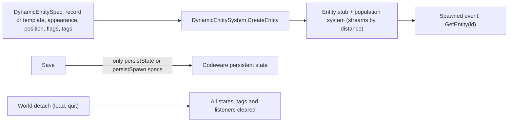
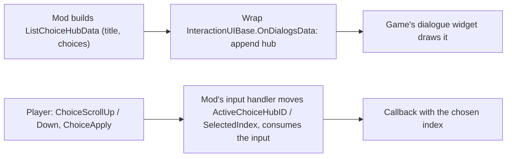

# NPC direction: spawning, moving, speaking and choices from a mod

**Maturity: Draft.** How a mod spawns or chooses an NPC, makes it walk, turn and follow through the game's AI commands, makes it speak (its own voice or text), gives it a face, a gaze and a gesture, offers V dialogue choices and receives the answer, and cleans up so nothing reaches a save. Consolidated on 30 September 2026 from the decompiled 2.31 script bundle (redscript-cli 0.5.31, `final.redscripts` SHA-256 `2119046f…ee86`), the game's REDmod TweakDB sources, Codeware (`v1.20.4`, `613a1cb8`), TweakXL (`v1.11.4`), ArchiveXL (`v1.27.3`), the Modding Docs at `a54b0873`, and installed mods read in place (Appearance Menu Mod 2.12.5 with its GitHub clone `5427235`, Native Interactions Framework f1.05b with its clone `041f17e`, keanuWheeze's InteractionUI module inside Immersive V Dialogue Expanded 1.1.0.0, Dark Future 2.0.3, Audioware 1.8.0, Immersive Food Vendors 1.2.2). Session 15 (23 October 2026, bridge 0.8.8) gave the first [runtime] results, gathered in §8; the rest is still [source]. Grades follow the [knowledge rules](README.md). The bridge design built on it (bridge 0.8.8, with session 15's fixes in 0.8.9), with provenance, commands, a first scenario and its in-game rows, is [NPC direction design](../research/runtime/npc-direction-design.md). Crowd reactions, voicesets and overhead barks are on [NPC reactions](npc-reactions.md).

Game-script citations are paths inside the decompiled bundle; installed-mod citations are paths inside the mod's folder in the mod manager (`mods/<mod name>/`).

## 1. The short answers

| Question | Answer | Grade |
|---|---|---|
| Can a mod spawn an NPC that never reaches a save? | Yes: Codeware's `DynamicEntitySystem` with `persistState` and `persistSpawn` off writes nothing at save time and clears everything at world detach | [source] |
| Can it make an NPC walk somewhere? | Yes: `AIMoveToCommand` through the NPC's AI component, with Walk, Run or Sprint, a stop distance and a facing target; a TweakXL clone of a crowd record with `isCrowd: false` walks, follows and turns on command | [runtime] session 15 (NA3 to NA5) |
| Can it make an NPC say something? | In the NPC's own voice, only a line its voiceset has for a generic trigger; any text as a subtitle or overhead line | [source] |
| Can it offer V dialogue choices and learn the answer? | Yes, without a scene: add a hub to the game's own dialogue widget and read the player's choice keys (the pick arrived, scrolling worked, nothing else reacted); or author a `.scene` with a choice node | [runtime] session 15 (NB5); [wiki] |
| Can it play a gesture? | A facial reaction yes; a body gesture through a workspot carrier entity | [source] |
| Do crowd NPCs obey commands? | Unknown; crowd NPCs are driven by the crowd system and change AI role only once, per AMM. A picked passer-by looks and speaks on request, and stood about 20 s after its release before walking on | [hypothesis]; [runtime] session 15 (NB8) |
| Does an NPC's own reaction system fight a mod's face and lines? | Yes: an NPC outside the crowd gives V the aggressive face and its voiceset's `greeting` bark whenever V comes close, stands in front of it or lingers, whatever its reaction preset unless the preset's type is NoReaction; its look-at twists the chest towards V and never ends by itself (§8) | [runtime] session 15 (NB1, NB2, NC1); [source] the mechanism |

## 2. Spawning and choosing

- **Spec and system:** `DynamicEntitySpec { recordID | templatePath, appearanceName, position, orientation, persistState, persistSpawn, alwaysSpawned, spawnInView, active, tags }`; `CreateEntity`, `DeleteEntity`, `IsSpawned`, `GetEntity`, `GetTagged`, `DeleteTagged`, and tag listeners receiving `Created`, `Deleted`, `Spawned`, `Despawned`, `Dead` [source] Codeware `scripts/World/DynamicEntitySpec.reds`, `DynamicEntitySystem.reds`, `DynamicEntityEvent.reds`.
- **Streaming:** a record spawn registers an entity stub with the population system, honouring `spawnInView` and `alwaysSpawned` [source] `src/App/World/DynamicEntitySystem.cpp:247-280`.
- **Persistence is opt-in:** save writes only specs with either persist flag; load respawns only `persistSpawn`; world detach clears all; a non-persistent spec gets a transient entity id [source] `DynamicEntitySystem.cpp:24-100, 282-325`.
- **Records:** crowd citizens derive from `Crowd_NPC_Base` (`isCrowd = true`, civilian attitude group, `ReactionPresets.Civilian_Neutral`, senses off at start); 122 records derive from it, several on Phantom Liberty templates [resource] REDmod `characters/bases/base_records.tweak:42-68`, `characters/npcs/records/crowds/communities.tweak`. A TweakXL clone (`$base`) can change such flags without touching the vanilla record [source] TweakXL `YamlReader.cpp:8`. Changing a vanilla record's flats at run time (as AMM does to arm its spawns) changes every NPC of that record for the session [source] AMM `Modules/spawn.lua:588-594`.
- **Friendly and unhurt:** `GetAttitudeAgent().SetAttitudeTowards(player, AIA_Friendly)`; `GodModeSystem.AddGodMode(id, Immortal, n"Default")` [source] AMM `Modules/director.lua:1426-1427`, `Modules/util.lua:906-916`. The same call takes `AIA_Neutral` or `AIA_Hostile`, and leaving god mode off leaves the NPC mortal; what a civilian archetype does when hostile (fight, flee, stand) is [hypothesis].
- **Reactions** come from the record's `reactionPreset`: the crowd base's is `ReactionPresets.Civilian_Neutral`; a TweakXL clone can carry a calmer one (the bridge's actors use `Civilian_NoReaction`) or keep the civilian's [resource] REDmod `characters/bases/base_records.tweak:42-68`.
- **Choosing an existing NPC:** `GameObject.GetNPCsAroundObject(range)` [source] `core/entity/gameObject.script:715-731`. Protection checks on `ScriptedPuppet` [source] `cyberpunk/puppet/scriptedPuppet.script`: `IsQuest()` (3000), `IsPlayerCompanion()` (1693), `IsBoss()` (1299), `IsVendor()` (1336), `IsCharacterPolice()` (1398), `IsCharacterChildren()` (1414), `IsCrowd()` (1425), `IsOnAutonomousAI()` (1603, false when the AI story tier is `Cinematic`); plus `SceneSystemInterface.IsEntityInScene` / `IsEntityInDialogue` [source] `orphans.script:32250-32252` and `WorkspotGameSystem.IsActorInWorkspot`. On objects of unknown type use only entity-level natives (the bridge 0.7 world-object rule, after a session-7 crash; [game crashes](game-crashes.md)). None of these reads a quest's reservation of an unmarked NPC (`IsQuest()` sees a quest mark or quest items only), so the bridge adopts only plain passers-by of the street crowd, and checks them again while it holds them.
- **Out of V's sight:** the active camera's position, forward, field of view and aspect are script-readable (`CameraSystem.GetActiveCameraWorldTransform`, `GetActiveCameraForward`, `GetActiveCameraFOV`, `GetAspectRatio`), so a point's place against the view cone can be computed; which axis the fov measures is unsettled, so take the wider reading. Static geometry between the camera and a point is `SpatialQueriesSystem.SyncRaycastByCollisionGroup(from, to, n"Static", …)`, and walkable ground near a point is `NavigationSystem.FindPointInSphereOnlyHumanNavmesh` after `IsNavmeshStreamedInLocation` [source] 2.31 scripts. Codeware's `spawnInView = false` only waits until the spot isn't on screen; it doesn't choose the spot [source]. Nothing here reads what V can hear.
- **Hiding someone else's NPC** for a moment and showing it again (a stand-in in its place) has no source-backed route yet: removing it can't be undone, and switching its mesh components off or changing its appearance leaves its AI and collision running [hypothesis].
- **Crowd NPCs** walk traffic lanes owned by the crowd system (`CrowdMemberComponent`: `IsInCrowd`, `TryStopTrafficMovement`, `ChangeMoveType`, `AllowWorkspotsUsage`) [source] `orphans.script:24142-24175`; AMM respawns a crowd NPC rather than change its role a second time [source] `Modules/util.lua:871-893`.

## 3. AI commands

| Command | Key fields | Grade |
|---|---|---|
| `AIMoveToCommand` | `movementTarget` / `facingTarget` (`AIPositionSpec`: an entity or a world position), `movementType` (Walk, Run, Sprint), `desiredDistanceFromTarget`, `finishWhenDestinationReached`, `ignoreNavigation`, `useStart`, `useStop`, `rotateEntityTowardsFacingTarget` | [source] `orphans.script:44519-44540, 29704-29720, 2-6` |
| `AIFollowTargetCommand` | `target`, `desiredDistance`, `tolerance`, `stopWhenDestinationReached`, `movementType`, `lookAtTarget`, `matchSpeed`, `teleport` | [source] `orphans.script:47171-47188` |
| `AIRotateToCommand` | `target`, `angleTolerance`, `angleOffset`, `speed` | [source] `:47141-47150` |
| `AIHoldPositionCommand` | `duration` | [source] `:28790-28793` |
| `AITeleportCommand` | `position`, `rotation`, `doNavTest` | [source] `:47349-47356` |
| `AIUseWorkspotCommand` | a *placed* workspot's `workspotNode` (node ref), `jumpToEntry`, `entryId`, `moveToWorkspot`, `forceEntryAnimName`, `movementType` | [source] `:47358-47376` |
| `AIEquipCommand`, `AIUnequipCommand`, `AIJoinCrowdCommand` | slot and item; none | [source] `:47378-47394, 47190` |

- All derive from `AICommand { id, state }`; moves add `removeAfterCombat`, `ignoreInCombat`, `alwaysUseStealth` [source] `:25056-25066, 28774-28781`. **There is no voice-over AI command**; speech is an event on the NPC [source].
- **Send, track, cancel:** `AIComponent.SendCommand`, `GetCommandState` (NotExecuting, Enqueued, Executing, Cancelled, Interrupted, Success, Failure), `IsCommandExecuting` / `IsCommandWaiting` by class, `StopExecutingCommand(cmd, success)`, `CancelCommand(cmd)`, `CancelCommandById`, `CancelOrInterruptCommand`; `AIHumanComponent.GetActiveCommandID(class)` [source] `core/components/aiComponent.script:14-34, 977-983`, `orphans.script:276-284`. The game's ForceMoveInCombat effector sends a move and, on cleanup, stops it if executing or cancels it if waiting [source] `core/gameplay/effectors/quickhackEffectors.script:883-925`.
- **AMM's Director** chains teleport, move, arrival by distance (< 1 m), look-at, voice trigger, facial reaction, pose and a hold per node [source] AMM `Modules/director.lua:1151-1377`. Arrival by distance suggests command state alone may not signal arrival [hypothesis].

## 4. Speech

- **Own voice:** `GameObject.PlayVoiceOver(npc, trigger, …)` queues `SoundPlayVo { voContext }`; the voice's voiceset scene plays a random line for that trigger with audio, subtitle and lip sync [source] `core/entity/gameObject.script:743-770` ([NPC reactions §3](npc-reactions.md#3-how-an-npc-picks-and-plays-a-voice-line)). AMM's Director offers 26 triggers [source] AMM `init.lua:2792-2830`.
- **Text:** `scnDialogLineData` on `UIGameData.ShowDialogLine`, types `Regular` (bottom subtitle with the speaker's name), `OverHead`, `OverHeadAlwaysVisible`, `Holocall`, `Narrator`, …; hidden by id [source] `orphans.script:7396-7410, 44905-44926` ([NPC reactions §4](npc-reactions.md#4-text-only-barks-and-subtitles-source)). No audio means no lip sync [hypothesis].
- **Custom audio:** Audioware's `AudioSystemExt.Play(event, entityID, emitter, lineType, settings)` and emitters [source] Audioware `r6/scripts/Audioware/Ext.reds:11-36`; needs a consenting voice.
- **The `Holocall` line type with no call** draws as a plain subtitle ("Caller: ...") without the holocall frame [runtime] session 15 (NB4); the frame belongs to the phone's call UI, so the bridge names that style `call_subtitle` (0.8.9).
- **Holocalls** are phone machinery plus an ordinary scene over it, started from a quest phase; the answer comes back as a fact [wiki] `modding-guides/quest/custom-video-holocalls.md` (`holocall-phase-3-answer-wait.png`).

## 5. Dialogue choices

- **Data:** `UIInteractions.DialogChoiceHubs` → `ListChoiceHubData { id, activityState, flags, isPhoneLockActive, title, choices, timeProvider }` → `ListChoiceData { localizedName, type, inputActionName, captionParts, timeProvider }`; `ActiveChoiceHubID`, `SelectedIndex` [source] `orphans.script:42023-42026, 54489-54517`. Codeware adds `hubPriority` [source] Codeware `scripts/Base/Addons/ListChoiceHubData.reds`. `InteractionUIBase` listens with `OnDialogsData`, `OnDialogsActivateHub`, `OnDialogsSelectIndex`, `OnInteractionData` [source] `cyberpunk/UI/interactions/interactionUIBase.script:32-89`.
- **Runtime hubs (no scene):** keanuWheeze's InteractionUI module overrides `OnDialogsData` to append its hub, handles the three choice actions from `PlayerPuppet.OnAction`, sets the active hub and index on the blackboard, consumes what it handles, and guards `OnDialogsSelectIndex`, `OnInteractionData` and `dialogWidgetGameController.OnDialogsActivateHub` [source] `…/ImmersiveVDialogueExpanded/modules/interactionUI.lua:117-413`. Six installed CET mods ship it.
- **In redscript:** `GameObject.RegisterInputListener(listener, n"ChoiceApply")` is how the tutorial popup hears the apply key; `ListenerAction.GetName/GetType`, `ListenerActionConsumer.Consume` [source] `gameObject.script:152`, `cyberpunk/UI/popups/tutorialGameController.script:105-108`, `orphans.script:31981-32023`. Whether a listener sees the scroll actions and whether consuming stops the native handling is [hypothesis].
- **Reading any pick:** `UIInteractions.LastAttemptedChoice` (`InteractionAttemptedChoice`), as Dark Future does [source] `DFInteractionSystem.reds:405-408, 1088-1101`.
- **Scene choices:** `scnChoiceNode` options, one output socket each, text from `screenplayStore.options[].locstringId`, optional actor reminders [wiki] `modding-guides/quest/scene-node-definitions.md` (Choice Nodes; its example image shows the ordinary widget). Mods start scenes from an ArchiveXL-injected phase through facts and hear the end through an `ActionEvent` on the player; NIF patches scenes at load to shift choice-node ids, retarget node refs and swap option text [source] NIF `modules/utils/resourceHelper.lua:47-146, 199-349`, `modules/classes/interaction.lua:88-142`. Custom scene text is registered with ArchiveXL `localization: subtitles:` [source] ArchiveXL `Localization/Config.cpp:8-36`; [resource] Immersive Food Vendors.
- **Runtime hub versus scene:** a runtime hub needs no authoring and touches no save; a scene adds the conversation state and camera, timed choices and reminders, voiced lines with lip sync and timeline animations, at the cost of authoring, an injected phase and facts in saves ([quests and story §2](quests-and-story.md#2-the-parts-of-a-mod-quest)).

## 6. Face, gaze and gestures

- **Face:** `AnimFeature_FacialReaction { category, idle }` applied as `FacialReaction` [source] `orphans.script:32382-32387`; AMM's labelled pairs (joy 3/5, smile 3/6, sad 3/3, surprise 3/8, anger 3/1, disgust 3/7, fear 3/11, interested 1/3, neutral 2/2) [source] AMM `init.lua:2832-2857`.
- **Gaze:** `LookAtAddEvent.SetEntityTarget(target, n"pla_default_tgt", offset)`, style, limits, head and chest parts; removed with `LookAtRemoveEvent.QueueRemoveLookatEvent(owner, event)` [source] `reactionComponent.script:3539-3600`, `core/events/lookAtEvents.script:2-10`; AMM `Modules/util.lua:762-804`.
- **Gestures:** `WorkspotGameSystem.PlayInDeviceSimple(carrier, npc, …)` then `SendJumpToAnimEnt(npc, clip, instant)`; `StopInDevice`, `SendFastExitSignal` [source] `orphans.script:18381-18420`. AMM spawns its own carrier entity and catalogues 43,963 clips per rig [source] AMM `Modules/anims.lua:328-400`; [resource] its `db.sqlite3` (table `workspots`: `anim_name`, `anim_rig`, `anim_comp`, `anim_ent`). Standing clips listed under the same name for both the Woman Average and Man Average rigs include `stand__2h_on_sides__01__talk__neutral__02`, `stand__2h_on_hip__01__talk__neutral__01`, `stand__2h_on_sides__01__crowd_wave__01`, `stand__2h_on_sides__01__shrug__01`, `stand__2h_front__01__nod__respectful__01`, `stand__arms_crossed_front__01`, `stand__2h_on_sides__01__facepalm__01` and `stand__2h_on_sides__01__check_phone__01` [resource] (AMM clone `5427235`); that they play through a carrier other than AMM's is [hypothesis].

## 7. Safety and clean-up

- Refuse in tier-3+ scenes, dialogue, combat, vehicles and busy states; never direct protected NPCs (§2).
- Non-persistent spawns never reach a save and vanish at a load [source] (§2); a save lock covers the rest.
- Release: cancel or stop commands, hide lines, withdraw a hub, remove look-ats, reset faces, stop workspots, delete by tag (AMM teleports its actors behind V first) [source] AMM `Modules/director.lua:1051-1091`.
- No facts or quest phases are needed for any of the runtime routes; the scene route adds both.

## 8. Session 15 on bridge 0.8.8 (23 October 2026)

The first run of NPC direction in the game, at a street in Little China and Kabuki ([card](../research/runtime/runtime-bridge-test-card.md#session-15-checks-bridge-088)). What it settled:

- **Spawning, walking, following, turning** work on the TweakXL clones: spawned 8.25 m ahead facing V; walked to V and arrived 2.13 m away; followed V; turned away and turned again as V circled; a place 10 m below V was refused `not_streamed` [runtime] NA1 to NA5.
- **Lines and choices:** the subtitle with the actor's name, the overhead bubble and the game's own dialogue widget with our hub all showed; the pick came back as `npc.choice` with its index and label; the hub went with `walked_away` when V left [runtime] NB2, NB3, NB5, NB6.
- **An in-world device screen is not a prompt.** At a vending machine's screen, with the hand cursor over an item, the interaction-prompt check saw nothing: our choices showed and stayed, and F bought from the machine [runtime] NB6b. A device screen raises no `InteractionChoiceHub`; the player state machine's `IsInteractingWithDevice`, `IsUIZoomDevice` and `IsControllingDevice` and the targeting system's look-at object (`TargetingSystem.GetLookAtObject`, a `Device` within reach) are the readable signs [source] `deviceBase.script:1540-1560`, `blackboardDefinitions.script:64-76`. 0.8.9 treats any of them as busy (refuse, and withdraw a live hub) [hypothesis until session 16].
- **The actor's own reactions win, and why.** With `reactions: quiet` (`ReactionPresets.Civilian_NoReaction`) the actor still turned "pissy", barked "whaddya want?" and "look, I'm waiting for a friend, okay?" over `npc.face`'s smile, and the `greeting` trigger played the same lines [runtime] NB1, NB2. The mechanism [source] `reactionComponent.script`:
  - the look-at reaction `TriggerFacialLookAtReaction` (2835-2874) gives an NPC outside the crowd (`m_inCrowd` false, as every `isCrowd: false` clone is) the aggressive face (category 3, idle 1; compare `SelectFacialEmotion`, 3456-3500) and plays the voiceset's `greeting`, every time;
  - it fires from the proximity look-at (`OnPlayerProximityStartEvent`, then `OnProximityLookatEvent` 2 s later, 5207-5260), the comfort zone (`OnDisturbingComfortZoneEvent`, V within 1 m in front, 3416-3433) and the repeat look-at (`OnRepeatLookatEvent`, 1005-1009, which checks no preset at all);
  - the preset guard `CanTriggerExpressionLookAt` (2919-2960) stops it only for presets whose type is NoReaction or Follower, and `Civilian_NoReaction` evidently isn't of that type;
  - its look-at (`ActivateReactionLookAt`, 3539-3600) twists the chest towards V at weight 2.0 within a 210-degree back limit, and for an NPC outside the crowd it starts without an end;
  - a face set from outside is cleared again by `ResetFacial` and `OnResetFacialEvent`.

  So a civilian's "greeting" is its curt line: the voiceset picks it, and nothing in the scripts asks for a friendlier one. 0.8.9 drives the system instead of fighting it: it wraps those five methods so they stand down for a quiet actor always and for any actor or pick while the bridge holds its face, look or a line, ends the reaction's look-at when it sends a walk, and pairs `greeting` with a held smile [hypothesis until session 16]. Whether a voiceset holds a warmer line under another trigger can't be read from the scripts; the voice data would say.
- **Walking backwards** (she approached V and left again facing the wrong way, "like she was possessed") [runtime] NC1. Two causes in the source: the reaction's chest-twisting look-at above, still on during the walk away, and the move to V sent with `rotateEntityTowardsFacingTarget`, which makes V a strafing target for the whole walk (`aiMoveToCommandHandler.script:317-324`); the game's own move-to-V sets the facing target only (`quickhackEffectors.script:911-918`). 0.8.9 does the same [hypothesis until session 16].
- **Speech before arrival:** in the scenario's second run her lines played while she was nowhere near V and the choices were refused `too_far` [runtime] NC1 redo: the arrival wait had passed. 0.8.9 refuses a line given `near_m` unless the NPC stands that close, and the scene stops early in plain words.
- **Stand-ins:** a hostile mortal stand-in was handed back in the fight, died and kept its body; its death record said `civilian: true` (the clone's class), so the probe now also reports the attitude towards V [runtime] ND3. The police answered the shooting and killed V.
- **Teardown:** the handover, the pause, the stop key and a load each left nothing behind [runtime] NE1 to NE4.
- **A released pick** stood about 20 s at a crossing before walking on [runtime] NB8; 0.8.9 tells a released crowd member to walk at its normal pace (`CrowdMemberBaseComponent.ChangeMoveType(n"normal")`, as the reaction component does after its own reactions, `reactionComponent.script:3241-3243`) [hypothesis].

## 9. Session 16 on bridge 0.8.9 (23 October 2026)

The second run, at the same street ([card](../research/runtime/runtime-bridge-test-card.md#n16-npc-direction-17-min)). 0.8.9's fixes for session 15 mostly held; two things did not, and one finding turned out to be a misreading. What it settled:

- **The reaction wraps hold** [runtime] N1. A smiling, looking actor stayed "Smiling and quiet" for 20 s face to face and while V walked round her: the five `ReactionManagerComponent` wraps keep the game's look-at reaction (the angry face, the bark, the chest twist) off an actor the bridge directs.
- **The greeting's words are the voice's own and vary** [runtime] N2. `npc_say {trigger: "greeting"}` came with a smile (the answer's `face: smile`) and this time the words were "Wow, where do you shop?"; session 15's were curt. Same voice, same trigger, different lines.
- **The scene's barks were its own greeting step, not the game's reaction** [runtime] N5, from the plugin log. In both runs exactly one voice line played, 0.2 s after `npc.arrived`, and it was the scene's own `npc.say {trigger: "greeting"}` step ("look, I'm waiting for a friend" in the first run, "whaddya want, friend?" in the second). The smile that step brought lasted 2.5 s, until the scene's next step set the face "interested" over it, which is why she never looked pleased. 0.8.9 had no log of the wraps at work, so whether the game's own reaction also tried is not known; 0.8.10 counts and logs every reaction held back (`npc-reactions` in the plugin log), takes the `greeting` trigger out of the scene, and sets the smile when she appears, before she walks. A civilian voiceset's `greeting` stays a lottery of curt and warm lines, so a scene that needs a warm greeting speaks it as a subtitle.
- **A walk away still goes backwards, though the walk to V no longer does** [runtime] N3, N5 (both runs). The release's move sent no facing target and no strafing flag (`faceV` is false for a walk to a point), so 0.8.9's two fixes (no `rotateEntityTowardsFacingTarget`, the reaction's look-at ended at the walk) were not what the release needed. What differs between the two walks is the actor's facing at the start: she stands facing V, and the way off is straight behind her. A move command alone does not turn a standing actor to a way behind it [hypothesis, consistent with both walks: the walk to V began facing V]; 0.8.10 begins any walk whose way is more than 80 degrees off her facing with a turn on the spot and sends the walk once she faces it (or after 3 s), for `npc.release` `walk_away` and `dissolve` and for `npc.move`. The follow's end needs nothing (it ends where the actor stands).
- **A device screen is not our hub's place** [runtime] N4. With the hand cursor on the machine's screen `npc.choices` was refused `choices_busy`; after stepping back the hub showed (STRANGER, "Still here." / "Bye."); with the cursor back on the screen it was withdrawn (`npc.choice {withdrawn: true, reason: "choices_busy"}`). The check of 0.8.9 (the player state machine and the looked-at `Device`) works.
- **A spawn beside a machine can stand unseen** [runtime] N4. An actor asked for 2 m ahead and 1.5 m aside at the machine was not in view ("what woman?"): the walkable point nearest the asked one (the navmesh snap reaches 2 m) was behind or inside the machine. 0.8.10 refuses to leave an actor asked for relative to V (`ahead_m`, `side_m`) where V's head has no sight line to her chest: it takes the nearest walkable spot with one within 4 m, says so (`moved_for_sight`), or refuses `no_visible_spot`. The ray tests the Static collision group, which may not include devices [hypothesis].
- **`call_subtitle` shows as "Caller: …"** [runtime] N7; the old `holocall` name was refused with the valid styles listed, and 0.8.10 names the new style in the refusal.
- **Teardown:** loading a save left no actor [runtime] N8. N6 (a released pick walks on) was not run: the wrong pick handle was used, and the only pickable passer-by was 25 m away in a crowd.

## 10. Session 17 on bridge 0.8.10 (23 October 2026)

The third run, on the same street ([card](../research/runtime/runtime-bridge-test-card.md#session-17-checks-bridge-0810)). Turn-first worked as far as it went; the backwards walk had another cause, found in the game's scripts.

- **A walk away still went backwards after a walk to V; one that never walked to V went forwards** [runtime] N1 against N2. In N1 the actor had first been sent to V (`npc.move {to: v}`, which sets V as the move's facing target); the release then sent its turn, then its walk 0.9 s later (`turns_first`, as designed): "she actually turned around this time, but then she swivelled back to face me and walked away backwards anyway". In N2 the actor had never walked to V and the dissolve's walk went forwards. The scene (N3) walks its actor to V first and walked her away backwards too.
- **Why: the facing target is a behaviour argument the move handler never clears** [source] `cyberpunk/ai/commands/aiMoveToCommandHandler.script`:47-51 writes `FacingTarget` into the behaviour only `if AIPositionSpec.IsEntity(typedCommand.facingTarget)`; a move without one leaves the earlier value in place, so V, set by the walk to V, steered every later walk (the spline handler, 131, writes `null` explicitly, which is how the game clears it). This fits N1 and N2 [runtime]; that the stale argument is what turns her to face V while she walks is the reading that fits both, not a measured mechanism [hypothesis]. The clear the game itself uses for its other arguments is `AIComponent.SetBehaviorArgument(name, ToVariant(null))` (`aiRole.script`:229, `targetTrackingComponent.script`:514); the argument's own name is the tree's and is not in the scripts [hypothesis: `FacingTarget`].
- **The smile did not show in the scene** [runtime] N3: "she seemed almost scowling", no bark (the scene's own greeting trigger was the bark; fixed in 0.8.10). The log shows the wraps holding the game's expression look-at check (once), the face reset (once) and the reaction look-at (four times) for the scene's actor; no scowl request (`TriggerFacialLookAtReaction`, category 3, idle 1) was recorded through those wrapped paths. That does not exclude other native writers or graph/mixer layers [binary/resource: [NPC face state](npc-face-state.md#6-session-17-explanation-and-discriminating-probe)]. The scene **submitted** smile 0.07 s after `npc.spawned` and again as "joy" 19 s later; there was no graph-input or evaluated-output read-back. The cause remains unresolved [hypothesis: early delivery before a graph was ready, a later write, or downstream graph/blending/clip behaviour; a plain spawn with a smile submitted seconds later held in session 16]. The bridge's `prepared` flag only records attitude/immortality preparation, not animation readiness [source: `XFRuntimeBridgeNpc.reds:889–908`]. R3 locates native controller receipt and typed graph-input writes and designs a probe to distinguish these cases; final-face assertions still need calibrated crops.
- **Reactions held** [runtime]: the counters work (`a1 held the game's reaction look-at (1)` and so on, at most six lines per actor), and show the game's look-at reaction trying at least six times on an actor the bridge directs.
- **Spawn at a machine** [runtime] N4: on the second try an actor 2 m ahead and 1.5 m aside at a vending machine was visible without `moved_for_sight`. **`holocall`** [runtime] N5: refused with "'holocall' is now called call_subtitle: use that."
- **Process** (not game behaviour): a scripted step that spawns must wait for the answer to the ask before it; the maintainer reached the machine late and an accidental punch started a fight.

## Open questions

1. ~~Does a TweakXL clone of a crowd record with `isCrowd: false` take commands like a named NPC?~~ Yes (§8).
2. Is `AICommandState.Success` reported on arrival?
3. ~~Does a redscript input listener see and consume the choice actions while a dialogue hub is shown?~~ Yes (§8); but an in-world device screen takes the apply key first.
4. Which reaction preset keeps a spawned actor calm and quiet to crime but still expressive? `Civilian_NoReaction` doesn't silence the look-at reaction (§8); a preset of the NoReaction type would, at the cost of every look-at.
5. ~~Does a spawned actor's own proximity reaction fight a mod's look-at and lines?~~ Yes, and the mechanism is known (§8); 0.8.9's wraps hold it back (§9). The game's reaction does still try (§10); the walk away went backwards because of a stale facing target (§10), which 0.8.11 clears and session 18 checks.
6. ~~Does the `Holocall` subtitle style render with no call in progress?~~ As a plain subtitle only (§4).
7. Which workspot clips play on every rig, and what is the smallest carrier resource that plays them?
8. What does a civilian clone do when made hostile and mortal? It died too fast to see (§8); shooting it did bring the police.
9. Is there a reversible way to hide another NPC for a scene (its look, AI and collision), so a stand-in can take its place?

## Related pages

[NPC reactions](npc-reactions.md) · [Quests and story](quests-and-story.md) · [Player control](player-control.md) · [Lip sync](lipsync.md) · [Facial expressions](facial-expressions.md) · [World and streaming](world-and-streaming.md) · [Runtime access](runtime-access.md) · [NPC direction design](../research/runtime/npc-direction-design.md) · [Channels to the player](player-channels.md) · [Population and affiliations](population-and-affiliations.md)
