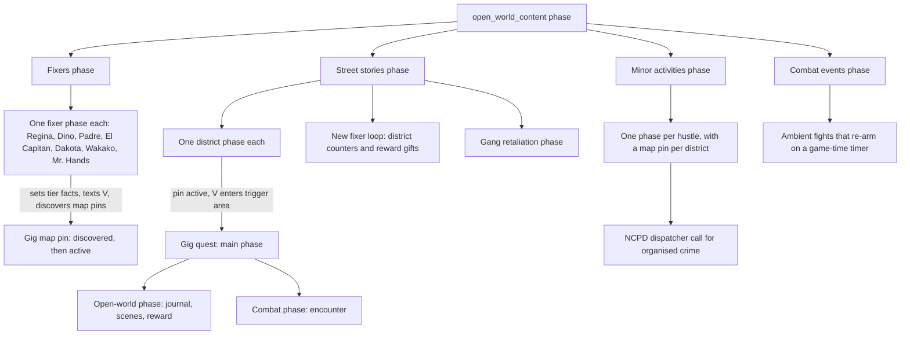

# Open-world activities: gigs, fixers, NCPD hustles

**Maturity: Draft.** How Cyberpunk 2077 structures its open-world work: how fixers offer gigs, what a gig is as a quest graph, how it pays, how the NCPD scanner hustles differ, and how all of them bring their people into the world. Consolidated on 22 October 2026 from the game's own quest resources (game 2.31): 1,256 quest and quest-phase files serialised with WolvenKit CLI 9.0.1, the cooked journal's objective entries, the English on-screen texts for labels, the TweakDB reward records read offline, and community guides for counts and names. Nothing here has been seen in the running game; the [questions for a game session](#questions-only-the-game-can-answer) say what to check.

This page answers: *what does a fixer's offer, a gig and a scanner hustle look like to the game, in facts, journal entries, phases, messages, rewards and spawns, so that we can mirror them, borrow their delivery channels, or write content that behaves like them?*

Evidence grades used on this page, besides the knowledge base's [shared grades](README.md#rules-for-knowledge-pages):

- **[resource]** is observed in the extracted quest or phase resources (the file and node are named), or in the TweakDB blob read offline.
- **[wiki]** is the Modding Docs. **[community]** is a published guide's claim, not checked against the files.
- Names are not specifications. A fact or objective name is graded [resource] for *where and how it is used* and [hypothesis] for *what it means*, until the game confirms it.
- **Runtime-proven: none yet.** Every claim about what the player sees or hears is a reading of the files.

## Sources

| Source | Version studied | Used for |
|---|---|---|
| Game quest resources under `base\open_world\street_stories` (every gig), `fixers`, `minor_activities`, `combat_events`, `phases`, and `base\quest\holocalls` (the fixer and dispatcher calls); the Phantom Liberty (`ep1\openworld`) fixers, street stories and minor activities | 2.31 (JSON header game version 2310) | Facts, journal paths, phases, spawns, scenes, rewards, gating. 1,256 files, 1,183 base and 73 Phantom Liberty. How the corpus was made, with the commands and a SHA-256 for every file, is in [the corpus manifest](../research/story-engine/quest-corpus-b-manifest.json); the serialised files are private and never tracked |
| TweakDB (`r6\cache\tweakdb.bin`), read with the Studio's flat reader | 2.31 | The 91 gig reward records and 180 hustle reward records: money, level experience, street-cred experience |
| Game scene resources | 2.31 | Only their file names, as the nodes name them. Scene contents were not read |
| Cooked journal (`base\journal\cooked_journal.journal`) | 2.31 | The objective entries under `quests/street_stories`, `quests/minor_activities` and the cyberpsycho quests: paths and the `optional` flag. Examined in a scratch folder, not kept |
| English on-screen texts (`base\localization\en-us\onscreens\onscreens.json`) | 2.31 | The map-pin type labels and hustle titles. Examined, not kept; only key names are recorded here |
| [Cyberpunk 2077 Modding Wiki](https://github.com/CDPR-Modding-Documentation/Cyberpunk-Modding-Docs), `for-mod-creators-theory` | `a54b0873` | [Reference: Quest Ids](https://github.com/CDPR-Modding-Documentation/Cyberpunk-Modding-Docs/blob/a54b0873/for-mod-creators-theory/references-lists-and-overviews/reference-quest-ids.md): gig, hustle and cyberpsycho titles and their kind |
| PowerPyx, [NCPD scanner hustles guide](https://powerpyx.com/?p=98075) | read 22 October 2026 | [community] Hustle counts by kind (112 assaults in progress, 17 organised crimes, 27 reported crimes) and the plain meaning of an assault |
| Other knowledge pages | — | [Quests and story](quests-and-story.md) (node vocabulary, the journal, facts), [main story as game state](main-story-state.md) (how facts, phases and journal states work in the main story), [terminals and arcade](terminals-and-arcade.md) (phone messages), [NPC direction](npc-direction.md) and [world and streaming](world-and-streaming.md) (communities and spawners) |

Not studied: side quests and minor quests (`mq`), city scenes, dynamic events, mini world stories, vendors, vehicle quests, courier and sandbox activities, and Phantom Liberty's combat zones. They share the machinery below but have their own phases.

## 1. The short answers

- **How a fixer offers a gig.** Not by a quest. A fixer has a *fixer phase* (`base\open_world\fixers\<fixer>\phases`) that sets difficulty-tier facts when the player has done enough work, texts the player about new work, and flips map pins from hidden to discovered. The gig's own phase waits until the pin is active, and V walking into a trigger area starts it [resource]. Section 3.
- **Gigs are quests with a fixed shape.** Each gig folder holds one `.quest` that runs one main phase, which runs an *open-world* phase (journal, scenes, rewards, outcome) and a *combat* phase (the encounter), plus bugfix and clean-up phases. The median gig has 377 nodes, 8 journal objectives, 4 scenes, and one reward record [resource]. Section 4.
- **The brief is a holocall, with a text as the fallback.** 68 of 70 gigs with a full structure play a fixer holocall scene on arrival and another at the end; if phone calls are muted or other content is active, the same words arrive as a text in the fixer's journal thread [resource]. Section 4.2.
- **Outcomes are facts plus alternative debriefs.** Every numbered gig sets `<id>_finished` when it ends and 18 set a failure fact (12 a plain `<id>_failed`, the rest optional-step, delivery or debrief variants); some pick a debrief by a "perfect" or "pacifist" fact and the reward record by a lethal or non-lethal route [resource]. The journal marks 58 of 652 gig objectives as optional (37 of 73 gigs have at least one), mostly bonus conditions such as staying unseen or not killing; the `perfect` and `pacifist` facts appear to track them. Section 4.4.
- **Pay is a TweakDB record, not part of the quest.** The quest names `QuestRewards.<gig>_completion`; the record holds eddies, level experience and street-cred experience [resource]. Reputation is street cred: there is no per-fixer reputation fact. Section 5.
- **Scanner hustles are a separate system.** Four kinds with their own tutorials and different delivery: 113 assaults in progress (the map-pin type is `GangWatch`), 27 reported crimes (hidden stashes), 17 suspected organised crime activities (outposts, briefed by the NCPD dispatcher) and 17 cyberpsycho hunts [resource]. Section 6.
- **People come from three spawn mechanisms.** Community templates (5,804 nodes across the open-world files), spawner nodes (1,769) and a small legacy form, all addressed by a node reference in the world, a named entry and an action: Activate, Deactivate, Reactivate, ResetKillCount [resource]. Section 7.

## 2. The system map

[resource] `base\open_world\phases\open_world_content.questphase` starts the community, street-stories, vendor, fixer, minor-activity, combat-event, fast-travel, radio, dynamic-event, city-scene, chat and mini-world-story phases side by side. `street_stories.questphase` starts one phase per region (Badlands, City Center, Heywood, Pacifica, Santo Domingo, Watson, Westbrook), then the DLC phase, the new-fixer-loop phase, and, the gang-retaliation phase. The same phase also waits for the main story's point of no return (`q115_point_of_no_return` above 0) and then reaches its own output node. Section 3.5 comes back to that.

## 3. How fixers offer gigs

### 3.1 The fixers

[resource] The pins each fixer phase discovers, and the district message and reward each owns:

| Fixer (contact) | Region and districts | Gig pins in the fixer phase | District reward message | Reward item seen |
|---|---|---|---|---|
| Regina Jones (`reggie`) | Watson: Kabuki, Little China, Northside | `kab_02` to `kab_08`, `kab_101`, `kab_102`, `kab_107`, `lch_01`, `lch_03`, `lch_05`, `lch_06`, `nid_01` to `nid_07`, `nid_12` | `watson_reward` | A cyberware (inventory tag `AdvancedSubdermalCoProcessor_Regina`) |
| Dino Dinovic (`dyno`) | City Center: Corpo Plaza, Downtown | `cpz_01`, `dtn_02` to `dtn_05` | `city_center_reward` | A car (Quadra Type-66), a weapon preset |
| Padre (Sebastian Padre Perez) | Heywood: Glen, Vista del Rey, Wellsprings | `gle_01`, `gle_03` to `gle_06`, `rey_01`, `rey_02`, `rey_06`, `rey_08`, `spr_01`, `spr_03`, `spr_06` | `heywood_reward` | A weapon preset (`Preset_Liberty_Padre`) |
| El Capitan (Muamar Reyes) | Santo Domingo: Arroyo, Rancho Coronado; Pacifica: West Wind Estates | `arr_01`, `arr_03`, `arr_05`, `arr_10`, `arr_11`, `rcr_01` to `rcr_05`, `wwd_05` | `santo_domingo_reward` | A car (Rayfield Caliburn) |
| Dakota Smith | Badlands: Inland Avenue | `ina_02` to `ina_09`, `ina_11` | `badlands_reward` | A truck (Thorton Mackinaw) |
| Wakako Okada | Westbrook: Charter Hill, Japantown; and `rey_09` | `hil_01`, `hil_06`, `hil_07`, `jpn_01`, `jpn_02`, `jpn_03`, `jpn_05`, `jpn_12` | `westbrook_reward` | A weapon preset (`Preset_Katana_Wakako`) |
| Mr. Hands | Pacifica: Coastview (`cvi_02`); Dogtown (section 9) | `cvi_02` | none in the base game | — |

The reward items sit in one shared phase, `street_stories_new_fixer_loop`; its Santo Domingo and City Center branches also carry a weapon preset (`Preset_Tactician_Dino`) and a debug item (`TEST.WoundedRifle`), so which item belongs to which fixer beyond the rows above is not traced [resource, hypothesis]. Some gigs are briefed by a contact other than the fixer who pinned them (Charter Hill's `hil_06` talks to Rogue; others talk to Karl Ginsky, Jake Estevez, Sergiej and others) [resource: the `contacts/<name>/<gig>/` journal paths].

[wiki] The title behind each gig id (for example `sts_wat_kab_02` = *Gig: Hippocratic Oath*) is in the quest-id reference; it lists 82 street stories labelled as gigs, base game and Phantom Liberty together.

### 3.2 Meeting a fixer

[resource] A fixer phase holds a *welcome* scene (`<fixer>\scenes\<fixer>_default.scene`, played face to face or as a holocall that switches to face to face: sockets `holo_to_face` and `Holocall INT/RET`), adds the fixer to the phone contacts (a phone-manager `AddRemoveContact` node), makes the fixer's location a journal point of interest (`points_of_interest/service_points/<region>_fixer`), and drops a welcome message in the thread (`contacts/<fixer>/<fixer>_global_msg/welcome_<district>`). Regina's phase answers the office intercom (a device condition, then `wat_fixer_door_unlocked` is set), spawns her co-workers with a community template, and holds the later tiers behind `reggie_visited` (where that is set is not traced). The fixer's presence itself is a spawn-set entry switched on by a fact (`wakako_default_on`, `reggie_default_on`, `padre_default_on`).

### 3.3 Which gigs are available: tiers, counters and street cred

[resource] Availability is a ladder of facts, set by the fixer phase and tested by the district phase.

1. **Start.** Nothing starts until the prologue has shown the street-stories tutorial: the fixer phase waits for `q001_show_sts_tut` at 1 or more (a debug fact, `debug_sts_start`, also opens it). Where that fact is written is not traced [unverified].
2. **Tier facts.** The fixer phase sets named facts per district: `sts_wat_kab_tier_1_1` … `tier_1_4`, `tier_2_1`, `tier_2_2`, `tier_3_1`, `tier_3_2`, plus a whole-tier fact `sts_wat_kab_tier_1` … `tier_4` (the same for `lch`, `nid` and every other district). The district phase links each gig pin to one tier fact [resource].
3. **Counters.** Each district keeps a counter fact (`wat_sts_counter`, `cct_sts_counter`, `hey_sts_counter`, `std_sts_counter`, `wbr_sts_counter`, `bls_sts_counter`). The new-fixer-loop phase adds 1 to it whenever one of the district's gigs sets `<id>_finished`, or `<id>_failed` for a few gigs that count both [resource: `street_stories_new_fixer_loop`].
4. **Texts at thresholds.** Regina's phase waits for `wat_sts_counter` to reach 5, 8, 11, 13, 15, 17 and 19. At each it waits 10 seconds, waits for the content lock to be free, waits 10 seconds again, texts a message (`regina_global_msg/new_sts_001`, `001b`, `001c`, `002`, `002b`, `003b`, `003`), then sets the next tier fact. So a text from the fixer *is* the unlock: the next batch of pins is set after the message is sent [resource]. The other fixers use `new_sts_001` to `003` at their own thresholds (Dakota's first is a counter of 2).
5. **Street cred gates the top tier.** The only street-cred tests in these files are the final tier of each region (`StreetCredTier.WatsonTier4`, `BadlandsTier4`) and Pacifica's tiers 2 to 4; reaching one sets the region's `tier_4` facts [resource]. The mapping of tier numbers to street-cred levels needs the TweakDB tier records [unverified].
6. **Pin discovery.** A pin's journal entry (`points_of_interest/street_stories/<gig>`) takes a *mappin phase* (`DiscoveredPhase`, then `CompletedPhase`) and an entry state (`Active`) from nodes in the fixer and district phases. The fixer phase makes a pin discovered only while the gig is unfinished (`IF <id>_finished`, on false) [resource].

### 3.4 Map markers, calls, messages and the journal

| Channel | What the files show |
|---|---|
| Map pin | One journal point-of-interest entry per gig: `points_of_interest/street_stories/<gig>`, moved through discovered, active and completed. 199 mappin-manager nodes appear in the gig files for objective markers [resource] |
| Fixer text | `contacts/<fixer>/<fixer>_global_msg/*` for welcomes, unlocks, district rewards and warnings. Sent by a phone-manager `SendMessage` node or made active as a journal conversation entry [resource] |
| Holocall | A scene node whose sockets include `Holocall INT` and `Holocall RET` (interrupted and returned) with the facts `holo_<fixer>_calls_v_start_activate` and `_end_activate` set around it [resource] |
| Journal | A gig quest `quests/street_stories/<region>/<district>/<gig>` with a `brief` description, objectives under `<gig>/<gig>/<objective>`, and the fixer's thread `contacts/<fixer>/<gig>/…` holding brief, debriefs and reward message [resource] |
| Briefing options | `SystemCondition/PhoneMuted_ConditionType` with group `fixer_briefs_and_debriefs` (gigs) or `ncpd_dispatcher` (organised-crime hustles), and a `holocall_muted_tutorial` phase [resource]. A player option behind it is likely; where it lives is not traced [hypothesis] |

### 3.5 After the point of no return

[resource] `street_stories.questphase` starts the district phases, the new-fixer loop and the gang-retaliation phase together. A separate branch waits for `q115_point_of_no_return` above 0 (the main story's point of no return, see [main-story state §6](main-story-state.md#6-the-point-of-no-return)) and then, after a short tick delay, reaches the phase's output node, which is how a sub-phase ends. What that does to the gigs and pins still running is not shown by the files; the reading that open-world gigs stop being offered after the point of no return fits it [hypothesis] and is one of the session questions.

## 4. Anatomy of a gig

### 4.1 Files and phases

[resource] A gig folder, with the identifier `sts_<region>_<district>_<nn>` (region and district abbreviated: `wat_kab`, `cct_dtn`, `std_arr`):

| File | Role |
|---|---|
| `<gig>.quest` (or `_quest.quest`) | Two or three nodes: set a test-definition fact, run the main phase, run `base\quest\holocalls\holocall_initializers` (the phone-call plumbing every gig loads) |
| main phase (`<gig>_phase`, `<gig>.questphase`, `…_quest_phase`) | Starts the open-world and combat phases; sometimes the only logic is that |
| open-world phase (`…_openworld`, `…_ow`) | Journal quest and objectives, scenes, brief and debrief, outcome facts, reward, content tokens, clean-up |
| combat phase (`…_combat`, `…_gameplay`) | The encounter: spawns, reinforcement waves, combat nodes, security-system conditions |
| prestate-control phase (`…_prestate_control`) | Holds world devices (doors, terminals) in their pre-gig state until the gig's tier fact is set [hypothesis from its device-manager nodes and tier tests] |
| bugfix phase | Patch nodes keyed by tracker ids (`CYB-638275` and similar fact names) that run once |

Across the 76 gig folders with real content: 413 files, 28,889 nodes. Of the 70 numbered gigs, the median has 377 nodes (minimum 143, maximum 1,392), 8 journal objectives (2 to 18) and 4 scenes (1 to 13); 59 load the holocall initialisers.

### 4.2 From pin to briefing to start

1. The district phase waits until the gig's pin is active, then runs the gig's main phase [resource] (`sts_wat_kabuki.questphase` links every Kabuki gig to its pin entry and tier fact).
2. In the open-world phase, a trigger-area condition (`IsInside`, activator the player, area `#kab_02_tr_main` and similar named areas) fires when V arrives [resource].
3. The phase then checks for a free content lock (`ContentLock_ConditionType isContentBlocked=0`) and whether fixer calls are muted. Unblocked: the prebrief holocall scene plays (`<gig>_holocall_prebrief.scene`). Blocked or muted: the quest-entry for the fixer's `brief` message is made active instead, with the same text in the thread [resource: `sts_wat_kab_02`, `sts_cct_cpz_01`, `sts_std_arr_11`, `sts_bls_ina_04`].
4. The gig's own quest entry and first objective become active and tracked, and a content-token *Block* node holds other gigs out until the matching *Unblock* [resource]. Content tokens are the game's way of keeping major content from overlapping [hypothesis].

### 4.3 The journal tree of a gig

[resource] The journal path of the gig is the root; its children are the quest description (`<gig>/brief`) and a sub-folder of objectives (`<gig>/<gig>/<objective>`). A gig drives them with journal nodes that wire the entry to `Active`, `Succeeded`, `Failed` or `Inactive`; the state is the name of the input socket the connection goes into. The 70 numbered gigs use 2 to 18 objective entries each in the quest nodes (the cooked journal holds 644 objective entries across 73 gig folders). The objective names of `sts_std_arr_11`, for example, are `get_inside`, `get_inside_megabuilding`, `delete`, `eliminate_lucius`, `get_out` and `get_to_the_drop_point`. Objectives are often wired in pairs: the next one goes `Active` as the previous goes `Succeeded`, with sub-objectives made `Inactive` when a branch is taken (`sts_hey_spr_01`).

### 4.4 Outcomes, failure and optional steps

- **Finish.** `<id>_finished` is set at the end by all 70 numbered gigs. 18 gigs set a failure fact: 12 a plain `<id>_failed` (`kab_02`, `kab_07`, `kab_08`, `dtn_02`, `dtn_04`, `rey_01`, `gle_01`, `ina_07`, `ina_08`, `nid_04`, `jpn_01`, and `sts_wat_kab_06_failed`), the rest variants such as `ina_05_optional_failed`, `kab_04_optional_failed` and `rcr_01_deliver_failed`. These facts are what the district counters and the fixer phases read [resource].
- **Failure paths.** The patient or target dies (`kab_02_patient_dead`), V leaves the area (a `DistanceCondition … Greater` that sets `kab_02_failed`), or a chase is lost. 24 gig files send a *warning* before failing: a random one of two fixer texts (`el_capitan_global_msg/sts_warning_fail_001` or `_002`) when V strays, then the failure if V stays away [resource: `sts_std_rcr_03`].
- **Alternate debriefs.** The fixer thread holds both `…_holocall_debrief_success` and `…_fail` (`sts_wat_kab_02`, `sts_bls_ina_04`), or `…_debrief_perfect` and `…_debrief_not_perfect` (`sts_std_arr_11`, `sts_wbr_hil_06`) selected by facts such as `arr_11_perfect` and `arr_11__not_perfect` [resource]. 15 gigs mention a "perfect" fact.
- **Alternate rewards.** 16 gigs mention a "pacifist" variant, and the reward record differs: `…_completion_pacifist`, `…_completion_stealth`, `…_alex_free`, or three outcomes for one gig (`sts_wat_nid_07_aaron_dead`, `_happy`, `_unconscious`) [resource].
- **Reward collection.** 16 gigs end by sending V to a *drop point*: a device whose `IsRewardCollected` function the quest waits on, with a `get_reward` objective and a `message_reward` text (`sts_hey_spr_01`, `sts_wbr_hil_06`, `sts_cct_dtn_02`). The rest pay directly through the reward node [resource].
- **Optional objectives.** [resource] The `optional` flag is on the *journal entry*, not on the quest node: the quest-node field of that name is set only in three Phantom Liberty gigs (`sts_ep1_08`, `sts_ep1_13`, `sts_ep1_06_zembinsky`). In the cooked journal, 58 of the 652 objectives under `quests/street_stories` are optional, spread over 37 of 73 gigs, with 3 of 232 hustle objectives. Typical names are conditions rather than tasks: `stealth`, `be_unseen`, `do_not_trigger_combat`, `dont_kill`, `avoid_combat`, `dont_damage_the_car`, `use_code`, `scan`. The quest tracks them with facts (`jpn_12_optional_code`, `ina_05_optional_failed`, `kab_04_optional_failed`) and the pacifist or perfect outcome facts, and the journal shows them as extra, skippable lines. Which optional objective feeds which outcome fact is not traced [hypothesis].
- **Gang retaliation.** 16 gigs set a retaliation fact (`sts_maelstroms_retaliation`, `sts_6thstreet_retaliation`, `sts_tygerclaws_retaliation`) when the player kills a particular target. The gang-retaliation phase then waits (30 seconds to 1 minute at a time), texts the fixer thread (`…/<gig>/gang_chase_<id>`) and spawns chase vehicles with the dynamic vehicle spawner. `sts_gang_retaliation_cancel` and `mws_chase_active` cancel it [resource].

### 4.5 Rewards, achievements and the district totals

See section 5 for the money. Most gigs also feed an achievement counter: a `questAchievementManager` node sets progress on `Achievements.YipMan` (Watson), `LikeFatherLIkeSon` (Heywood), `TradeUnion` (Santo Domingo), `LittleTokyo` (Westbrook), `NoMansLand` (Badlands), `Bladerunner` (City Center) or `ThisIsPacifica`, with a district fact (`wat_achievement`, `cct_achievement`) as the count [resource]. Hustles count towards the same district facts (`wat_achievement`, `cct_achievement`), so the achievement is for gigs and hustles together; Watson's reward fires at 59 [resource: `reggie.questphase`].

## 5. Rewards and reputation

[resource, TweakDB] A gig names a reward record, `QuestRewards.<gig>_completion`. The record has `currencyPackage`, `experience`, `items`, `achievement`, `statModifiers`, `recipes` and `photoModeItem` arrays; the packages point at further records whose `quantityModifiers` are `Additive` values. Read from the 91 gig records:

| Part | What the records hold |
|---|---|
| Eddies | 2,230 to 32,400 base; median 8,800. Median by district: Watson 3,000 to 6,170 (Northside 3,000, Little China 4,000, Kabuki 6,170), Westbrook 4,200 to 7,250, Heywood 8,300 to 19,900, Santo Domingo 14,500 to 16,600, Badlands 13,750, City Center 19,600 to 21,000, Pacifica 21,780 |
| Level experience | 1,000 in every gig record |
| Street-cred experience | 484 to 1,710. Watson gigs pay 484 to 906; Westbrook 979 to 1,710; every other district mostly 1,710 (exceptions 1,309 and 1,602) |
| Items | None in any gig completion record |
| Variants | Pacifist routes roughly double the money in two gigs (`sts_hey_gle_01`: 15,000 to 29,000; `sts_wbr_jpn_03`: 15,040 to 30,000) and raise it from 5,200 to 8,450 in a third (`sts_wbr_jpn_01`, the `alex_free` route); the other variants pay the same as the plain record. One outcome (`sts_wat_nid_07_aaron_dead`) pays no money |

The numbers are the *base* values in the record. Whether the player receives exactly that, or a scaled amount, is not shown by the files [hypothesis]; see the session rows. Hustle rewards are smaller: 752 to 7,950 eddies, level experience 300, street-cred experience 224 to 1,949 (section 6).

**Reputation.** [resource] No fact or record in these files stores trust or standing with a fixer. What a fixer "knows" about V is the district counter, the tier facts and the street-cred stat. Street cred rises through the street-cred experience each reward gives, and its tiers gate the last gigs in a region. A pure-fact approach to "this fixer likes me" would be an addition, not a mirror of the base game.

## 6. NCPD scanner hustles

### 6.1 The four kinds

[resource, community] The minor-activity folders (`base\open_world\minor_activities\<region>\<district>\ma_<region>_<district>_<nn>`) hold every scanner hustle. Each kind has a tutorial fact in its files, which separates them:

| Kind (community name) | Folders with its tutorial fact | Mark in the files | Delivery |
|---|---|---|---|
| Assault in progress | 113 `ma_gang_watch_tutorial` | A community spawned at the start, a reward, a loot item; no journal quest in most | No briefing; the pin appears and the fight starts when V nears it [hypothesis: the files show no brief] |
| Reported crime | 27 `ma_hidden_stash_tutorial` | A hidden stash and an on-screen item (`Items.ma_wat_lch_03_onscreen_03`) the player finds | A journal quest with `go_to_spot` and `loot` objectives |
| Suspected organised crime | 17 `ma_outpost_tutorial` | An outpost community, a security-system condition | A holocall from the NCPD dispatcher (`ma_wat_lch_01_holocall_brief.scene`), or a text in `contacts/ncpd_dispatcher/outposts/<id>` when the `ncpd_dispatcher` phone group is muted |
| Cyberpsycho sighting | 17 (a `psycho` community and scan conditions) | A scan condition on the psycho and on corpses, vision-mode clue states | Texts in `contacts/regina_jones/<id>/` (start, clue info, lethal or non-lethal choice), journal quest `quests/minor_quest/<id>` |

The folder counts line up with the community guide's counts (112 assaults, 27 reported, 17 organised) and the wiki's 17 cyberpsycho entries. The English on-screen texts confirm the mapping [resource]: the map-pin types `UI-MappinTypes-GangWatch`, `-HiddenStash`, `-Outpost` and `-HuntforPsycho` are labelled *Assault in Progress*, *Reported Crime*, *Suspected Organized Crime Activity* and *Cyberpsycho Sighting*, and `UI-MappinTypes-MinorActivity` is *NCPD Scanner Hustles*. An assault's help text says to defeat the enemies and take the loot, or take the loot unnoticed. The game also uses `Assault in Progress: <title>` for some titled hustles (`ma_wat_lch_14`).

### 6.2 How a hustle runs

[resource] Taking `ma_wat_lch_03` (Reported crime, *Worldly Possessions*) as the plain case: the phase spawns a community and two vehicle spawners, makes a journal quest with two objectives, waits for the stash to be looted, sets `ma_wat_lch_03_finished`, gives `QuestRewards.ma_wat_lch_03_completion`, sets the pin's mappin phase to `CompletedPhase`, and adds 1 to `ma_token`. A watcher phase in `open_world_minor_activities` waits for `ma_token` of 1 or more, fires a content-token *SpawnToken* node and resets the token to 0: finishing any hustle spawns more ambient content [resource; effect hypothesis]. A `SaveLock_ConditionType` test gates the start facts so a hustle does not start while saving is blocked.

District phases (`<district>_minor_activities.questphase`) list every hustle pin and release them in ticks (1, 2, 3, 4) so they do not all start in one frame. The pins need the district tier fact (`sts_wat_lch_tier_1`) and, for some (`ma_wat_lch_03`), `q101_enable_side_content`; cyberpsycho pins also need `ow_psychos_intro_done` [resource]. On finishing, `wat_achievement` goes up by 1.

### 6.3 Cyberpsychos in more detail

[resource] `ma_wat_kab_08` (*Lt. Mower*) has objectives `find_psycho` and `kill_psycho` (and `clues`, `check_shard`, `send_info` in a branch that finds the fate of the psycho's victims by scanning seven corpses). The psycho's health is tested at 50, 30 and 10 percent, next to clue-state nodes [resource: effect not traced]; civilians act as onlookers (spawned by a separate community). Finishing sets `ma_kab_08_finished` and `ow_psychos_done`, texts through Regina's thread, and has a lethal variant of the info text (`01b_ch_info_lethal`, `02b_msg_regina_lethal`). `open_world_cyberpsychos.questphase` is the shared controller [resource: files named; contents not traced].

### 6.4 Combat events

[resource] `base\open_world\combat_events` holds 256 phases (about 20 per district) with a different job: ambient fights between groups that re-arm. A combat-event phase reactivates a community, waits for it to be killed or defeated, rolls a randomizer for a delay of 12, 24 or 36 *game* hours, then resets the kill count and activates it again; a trigger area deactivates it when V leaves. So the world's ambient fights come back on a game-time cycle without a quest [resource]. Whether a combat event shows an "assault" marker is not shown; the matching of "assault in progress" to the `ma_gang_watch` hustles above is the better fit.

## 7. How activities spawn their people

[resource] Counts across the extracted base-game open-world files (street stories, minor activities, combat events, fixers):

| Mechanism | Node | Count | How it is addressed | Used for |
|---|---|---|---|---|
| Community template | `questCommunityTemplate_NodeType`, action Activate / Deactivate / Reactivate / ResetKillCount | 5,804 | A world node reference to a community (`#kab_02_com_chester`) and an *entry name* inside it (`chester`, `patient`, `driver`, `gang_car`, `enemy_004`) | Targets, guards, civilians, witnesses, reinforcement waves, ambient packs |
| Spawner | `questSpawner_NodeType` | 1,769 | A world node reference (`#kab_02_spwn_chester_car`, `#ina_04_...`) | Vehicles (cars, buses, vans), props |
| Spawn set | `questSpawnSet_NodeType` | 57 | A reference and an entry (`#reggie`, entry `reggie`) | Named characters such as fixers; their presence flag is a fact (`reggie_default_on`) |
| Legacy | `questLegacy_NodeType` | 120 | A community reference and entry (`#spr_01_com`, `enemy_004`) | The same, in the older node form, mostly in combat phases |
| Player vehicle | `questSpawnPlayerVehicle_NodeType`; in the retaliation phase, 16 `DynamicVehicleSpawn` and 34 despawn nodes | 84 | A vehicle record | Reward cars, retaliation chases |

Everything is *placed in the world files, activated by the quest*. The quest never creates a person from nothing: it switches on a community or spawner node that already exists in a streaming sector, named by a node reference such as `#cpz_01_com_arested`, and it deactivates the same reference at the end. Entry names choose which character of a community template appears. This is the same community machinery as in [world and streaming](world-and-streaming.md) (communities in always-loaded sectors) and the reason a mod that adds a gig needs world nodes or a dynamic spawner of its own [hypothesis; see [NPC direction](npc-direction.md) for the dynamic route].

Spawn volume per gig: median 17 spawn actions in the 70 numbered gigs (minimum 3, maximum 263 for `sts_std_arr_12`). A "deactivate on leaving the area, reactivate on return" cycle appears often (`sts_hey_spr_01`'s `spr_01_visited`).

## 8. A gig as the game's reference shape

For the Story Engine: a vanilla gig is a *medium* quest with these invariants, each a candidate for the composite's gig type [hypothesis, from the files].

1. A unique id and a pin (discovery, activation, completion).
2. A fixer-owned unlock condition (counter, tier, street cred), separated from the quest.
3. A brief (call or text) at the site, optional by a phone setting, with a debrief of the same pair.
4. 2 to 18 objectives with `Active`/`Succeeded`/`Failed` transitions, several parallel branches.
5. An encounter phase separated from a narrative phase.
6. `finished` and `failed` facts, with district counters reading them.
7. A reward by record, with a variant per route, optionally collected from a drop point.
8. Optional retaliation by a faction, delayed and cancellable.

The channels a mod may reuse are the fixer text thread, the pin entry and the phone-manager nodes; all are journal paths and nodes a mod can add (see [quests and story](quests-and-story.md)). The tier and counter logic lives in game phases a mod should not edit, so a mod's gigs should keep their own counters.

## 9. Phantom Liberty

[resource] Dogtown has its own fixer loop (`ep1\openworld\fixers\mr_hands\phases\mr_hands_fixers_loop`) and street-stories phase (`ep1_street_stories`). Differences from the base game:

- **Gate.** Gigs wait for the facts `mr_hands_dogtown_introduced`, `q303_hands_scene_done` (tier 2), `sts_ep1_tier_2`, `sts_ep1_tier_3` and `q304_done`; the loop counts `sts_ep1_NN_finished` into `ep1_sts_counter`, and at 10 a delayed Mr. Hands text offers the combat-zone reward.
- **Choice texts.** Mr. Hands' unlock messages carry answer choices (journal choice groups `new_sts_unlocked_answer`, then `_answer_answer`), and the reward conversation has two answers (`combat_zone_reward_answer_a/_b`).
- **Reward.** A car (Quadra Sport R-7) is parked at the combat-zone pyramid, with its own journal quest (`ep1/quests/street_stories/combat_zone_reward`) and a codex entry [resource].
- **Optional objectives.** Flagged in three gigs.
- **Bigger gigs.** `sts_ep1_03` has 1,028 nodes, 19 objectives and 25 scene nodes, with outcome-specific texts from Mr. Hands, Regina and two characters of the gig.

## 10. What a mod or the Story Engine can take from this

- **Pins, texts and journal entries are authored, not generated.** [resource] Every gig's journal quest, objectives and conversations are journal resources referenced by path; the quest graph only changes their state. That is the same limit as [quests and story §2](quests-and-story.md): scripts can move journal state but cannot create entries.
- **A fixer's unlock is a text + facts.** Mirroring "Regina has new work after five gigs" needs a counter, a message and the pins' active state; all three are facts and journal states we can read through the bridge (section 12).
- **Reading a save.** The district counters, the `*_finished` and `*_failed` facts and the tier facts say, per gig, whether it is open, done or failed; the achievement counters say how many gigs and hustles a district has been given credit for. That is a ready-made "what work has V done" view for fitting.
- **Delivery that respects the player.** The phone-mute group and the content lock are the game's own "do not interrupt" rules. New content that calls or texts V should respect the same two, or at least the mute group [hypothesis].

## Questions only the game can answer

For a booked session on the [runtime bridge](../projects/xf-runtime-bridge/README.md). Rows read facts with `world_state {facts: [...]}` (read only, at most 16 names per call; a nonexistent name reads 0, see row 1 of the [main-story card](main-story-state.md#questions-only-the-game-can-answer)). `M` is the maintainer, `C` is Claude. The maintainer picks the saves; `game_saves` lists them.

| # | Who | Do | Expect | If not |
|---|---|---|---|---|
| 1 | C, M | On a save with several gigs done, `ask "Per district, how many gigs have you finished or failed?"` [Watson, City Center, Heywood, Santo Domingo, Westbrook, Badlands: a number each]; `world_state {facts: ["wat_sts_counter","cct_sts_counter","hey_sts_counter","std_sts_counter","wbr_sts_counter","bls_sts_counter"]}` | Each counter equals the count for its district | A counter differs: some gigs count only on finish, or the counter also counts a hustle. Record both numbers per district |
| 2 | C, M | `ask "Which of these gigs have you finished: Hippocratic Oath, Serial Suicide, On a Tight Leash, Hacking the Hacker, Radar Love, Greed Never Pays, Family Heirloom?"` [Done each]; `world_state {facts: ["kab_02_finished","cpz_01_finished","spr_01_finished","arr_11_finished","ina_04_finished","jpn_12_finished","hil_06_finished"]}` | `_finished` above 0 exactly for the gigs named | A finished gig reads 0 or an unfinished one reads above 0: the fact does not mean what section 4.4 says |
| 3 | C, M | `ask "Did you fail any gig?"` [No, Yes: which]; `world_state {facts: ["kab_02_failed","kab_07_failed","kab_08_failed","dtn_02_failed","rey_01_failed","gle_01_failed","nid_04_failed","jpn_01_failed"]}` | A failed gig reads above 0; the others 0 | A failed gig reads 0: only some gigs set a failed fact (section 4.4 lists them). Record which |
| 4 | C | `world_state {facts: ["sts_wat_kab_tier_1","sts_wat_kab_tier_1_1","sts_wat_kab_tier_1_2","sts_wat_kab_tier_1_3","sts_wat_kab_tier_2_1","sts_wat_kab_tier_3_2","sts_wat_kab_tier_4","q001_show_sts_tut"]}` on a save with a few Watson gigs done, then on a near-complete one | More tier facts above 0 on the later save, in the order of section 3.3 | Out of order, or `q001_show_sts_tut` at 0 while gigs are open: another unlock path exists; record which |
| 5 | C, M | On a Watson save at 4 counted gigs: read `["wat_sts_counter","sts_wat_kab_tier_1_2"]`; `ask "Finish one more Watson gig, then wait without moving."` [Done]; read again | Counter 5; about 25 seconds later Regina texts `new_sts_001` and `sts_wat_kab_tier_1_2` goes above 0 | No text, or the text arrives before the tier fact: the sequence in section 3.3 is wrong; record the delay and the fact order |
| 6 | C, M | `ask "Open the journal: do you see a text from Regina, Dino, Padre, El Capitan, Wakako or Dakota that unlocked new gigs?"` [Name the sender and the text title]; `world_state {facts: ["reggie_visited","wat_fixer_door_unlocked"]}` | A fixer text exists once the matching counter has reached its threshold | No text but the pins appeared: the text is optional or comes by another route; record the pin order |
| 7 | M | `ask "Open the map. Which gig pins are visible and which are hidden?"` [free text]; compare with row 4's tier facts | Visible pins are those whose tier fact is above 0 and whose gig is not finished | A visible pin with its tier at 0: a second discovery route exists (street cred or proximity); record it |
| 8 | C, M | On a save before a fixed gig, `ask "Walk into the gig's start area."` [Done]; `world_state {facts: ["kab_02_start","kab_02_finished"]}`; `ask "Did a holocall play, or did a text arrive?"` [Call, Text, Neither] | `kab_02_start` above 0, a holocall plays | Text only: the content lock or the phone group was active. Record the situation |
| 9 | M | `ask "In the options or phone, is there a setting that mutes fixer calls or briefs?"` [Where, or None] | A setting exists | None: the muted group is set by something else (a tutorial or phone state); record what |
| 10 | M | `ask "Start a second gig while one is active. Does its brief arrive by call, by text, or not at all?"` [Call, Text, Not at all] | By text, or not until the first is done (content lock) | By call: the content token does not block briefs |
| 11 | C, M | With a gig active, `ask "Walk far from the gig area and wait."` [Done]; `ask "Did you get a text from the fixer before it failed?"` [Yes: first or second wording, No]; `world_state {facts: ["kab_02_failed"]}` | A warning text first, then the failed fact above 0 | Fail without a text, or no fail: the warning applies to some gigs only; record which |
| 12 | C, M | On a save after Hacking the Hacker, `ask "Did you complete it without being detected?"` [Yes, No]; `world_state {facts: ["arr_11_perfect","arr_11__not_perfect","arr_11_lucius_dead","arr_11_finished"]}` | Yes: `arr_11_perfect` above 0 and the other 0 | The reverse, or both above 0: record the condition for each |
| 13 | C, M | On a save after On a Tight Leash, `ask "Did you kill the target or bring him in alive?"` [Killed, Alive]; `world_state {facts: ["spr_01_jose_luise_killed","spr_01_non_lethal_path","spr_01_corpo","spr_01_finished"]}` | Killed: the first above 0. Alive: `spr_01_non_lethal_path` above 0 | Both 0 or both above 0: record the route facts |
| 14 | C, M | Before finishing Hippocratic Oath, `inventory_list` (money) and `ask "What are your level and street cred?"` [Two numbers]; finish it; the same again | Money up by 3,000; level experience by 1,000; street-cred experience by 707 | A different money amount: the base value is scaled (by level, difficulty or a stat). Record all three before and after |
| 15 | C, M | The same for one Westbrook gig and one Badlands gig (for example Greed Never Pays and Radar Love) | Money up by 3,800 and by 21,780; street-cred experience by 979 and 1,710 | A uniform scaling factor: record the factor and the player's level |
| 16 | M | On a save at a gig that ends at a drop point (On a Tight Leash), `ask "After the last fight, was your pay handed over by hand, by transfer, or at a drop point?"` [Hand, Transfer, Drop point] | Drop point, with a `get_reward` objective and a text | Transfer: the drop point is bypassed in some outcomes; record which |
| 17 | C, M | On a save after killing the Lucius target in Hacking the Hacker, `world_state {facts: ["sts_6thstreet_retaliation","arr_11_gang_chase"]}`; `ask "Did a car chase start by itself later?"` [Yes with a text first, Yes with no text, No] | Both above 0 and a chase later, after a fixer text | Facts above 0 and no chase: retaliation is off (point of no return, or `mws_chase_active`). Record the story stage |
| 18 | C, M | On a save before any hustle in a district, read `["wat_achievement"]`; `ask "Finish one reported crime hustle."` [Done]; read again | Up by 1 | Unchanged: hustles do not count towards the district achievement |
| 19 | C, M | `ask "Which hustle did you just finish and what kind is it?"` [Assault, Reported crime, Organised crime, Cyberpsycho]; `world_state {facts: ["ma_gang_watch_tutorial","ma_hidden_stash_tutorial","ma_outpost_tutorial","ma_hunt_for_psycho_tutorial","ma_token"]}` | The tutorial fact of the kind named is above 0 after its first | The kind and the fact disagree: section 6.1's mapping is wrong; record the pair |
| 20 | C, M | At a suspected-organised-crime pin, `ask "Walk to it. Who contacts you?"` [Dispatcher call, Text, Nobody]; at an assault pin the same | A dispatcher call for organised crime; nobody for an assault | A call for an assault: the dispatcher also briefs assaults |
| 21 | C, M | On a save before and after the opening of the side content, `world_state {facts: ["q101_enable_side_content","ow_psychos_intro_done","ow_psychos_done","ma_kab_08_finished"]}`; `ask "Are there cyberpsycho sightings on the map?"` [Yes, No] | Sightings on the map only after `ow_psychos_intro_done` above 0 | Sightings with the fact at 0: another gate. Record the story stage |
| 22 | M | `ask "Kill an ambient gang pack in Kabuki, wait one in-game day, return. Is the pack back?"` [Back, Not back] and repeat at 12 and 36 hours | Back after 12, 24 or 36 hours, not sooner | Back at a different interval or never: the timer differs; record the intervals |
| 23 | M | In Hippocratic Oath and Hacking the Hacker, `ask "Which objective lines in the journal are shown as optional?"` [List] | Hippocratic Oath: the blood, filler, scan and injection lines; Hacking the Hacker: `eliminate_lucius` | None shown as optional: the flag is not displayed, or the journal groups them. Record how optional lines look |
| 24 | C, M | On a Phantom Liberty save, `world_state {facts: ["ep1_sts_counter","sts_ep1_tier_2","sts_ep1_tier_3","mr_hands_dogtown_introduced","q303_hands_scene_done","mr_hands_reward_received"]}`; `ask "How many Dogtown gigs have you finished?"` [A number] | `ep1_sts_counter` equals the number | A mismatch: some Dogtown gigs do not count |
| 25 | M | `ask "Open Regina's, Padre's and Dino's text threads. Which gig briefs and debriefs are stored as texts, and from which contact?"` [A short list] | Each gig has a brief and a debrief in the thread of its contact, which may not be the fixer | Missing threads: they appear only when the call was muted. Record when |

## Open questions

1. Which journal entries carry the hustle titles (`Reported Crime: <title>`) for the unnamed assault folders? Only titled ones were looked up.
2. What is the exact scaling between the base reward in a TweakDB record and the money the player receives (level, difficulty, a stat modifier)? The records give `Additive` values and one stat id that was not resolved.
3. Where is `q001_show_sts_tut` written, and what else opens the street-stories tutorial?
4. How do `StreetCredTier.*` ids map to street-cred levels, and which gigs are in each region's top tier?
5. Which stat or setting sets the phone group `fixer_briefs_and_debriefs`, and is `ncpd_dispatcher` another player option?
6. What do the 100-series gigs (`kab_101`, `kab_102`, `kab_107`, `rey_101`, `ina_101`, `jpn_101`) add to the sets? Three are stubs of one file; `kab_101` and `kab_102` are complete gigs.
7. What does the point of no return do to the street-stories phase? A branch waits for it and ends the phase; whether gigs, pins and retaliation stop is not shown.
8. Which optional objective feeds which outcome fact (`perfect`, `pacifist`, `stealth`)? The journal says which are optional; the quest nodes' tests were not traced.
9. How do the other hustle kinds use the 207 hustle folders without a reward (spawn containers, bugfix phases, or "custom" variants)? Not traced.
10. Which scenes carry the voiced brief and debrief, and do they differ between call and face-to-face versions? Scene contents were not read.

## Related pages

[Quests and story](quests-and-story.md) · [Main story as game state](main-story-state.md) · [Terminals and arcade](terminals-and-arcade.md) (phone messages) · [NPC reactions](npc-reactions.md) · [NPC direction](npc-direction.md) · [World and streaming](world-and-streaming.md) · [Gig decompositions](../research/story-engine/gig-decompositions.md) · [P2 game-substrate plan](../research/story-engine/p2-game-substrate.md) · [Research queue](../research/backlog/research-queue.md)
