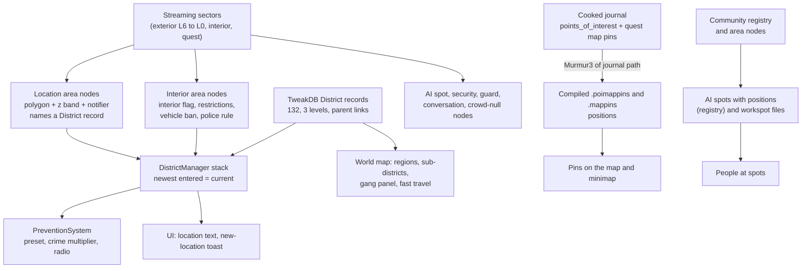

# Places: districts, points of interest, interiors, spots and how a place's character is recorded

**Maturity: Draft.** What Cyberpunk 2077 records about *places*: the district tree and the polygons that tell the game where V is, the points of interest and quest pins that sit on the map, interiors and their rules, AI spots and workspots, what makes a place public or private, and where (and whether) wealth, danger and gang influence are written down. Consolidated on 22 October 2026 from game 2.31 (base game and Phantom Liberty): the TweakDB blobs, the cooked journals, the world's compiled map resources (`.poimappins`, `.mappins`, `.areas`), the streaming blocks, a header census of all 26,340 sector files, 117 sectors that hold district areas and 965 that hold streamable community areas (both serialised with WolvenKit), the Phantom Liberty copies of the always-loaded sectors, the decompiled 2.31 scripts and the quest-corpus database. Nothing here has been seen in the running game; the [questions for a game session](#questions-only-the-game-can-answer) say what to check.

This page answers: *what does the game say about a place, in which record or file, and how can a world index expose it so that a seed such as "private, Tyger Claw influence above 0.6, night, little police" is a query over fields the game already has?* It is input to the world index (phase W1 of the [world plan](../research/backlog/world-and-interactive-ideas.md#world-phased-plan)); the dimension list is [the last section](#12-place-dimensions-for-the-world-index-w1).

Evidence grades used on this page, besides the knowledge base's [shared grades](README.md#rules-for-knowledge-pages):

- **[resource]** is observed in extracted game data: a TweakDB record or flat (named), a node in a streaming sector, a compiled map resource or a journal entry (the class or path is named).
- **[source]** is the decompiled 2.31 game script or the RTTI dump of the scripting classes (class, function and enum names are named).
- **[offline]** is our own computation over those, never the game: joins, polygon tests, tallies. The method is stated where it matters, and the scripts that reproduce it are `places_*.py` beside the quest-corpus scripts (`research/consumers/quest-corpus/scripts`).
- **[wiki]** is the Modding Docs. **[hypothesis]** is anything the files suggest but only the game can confirm.
- **Runtime-proven: none yet.** Counts are of data entries, not of things V meets.

## Sources

| Source | Version studied | Used for |
|---|---|---|
| TweakDB blobs `r6\cache\tweakdb.bin` and `tweakdb_ep1.bin`, read with the Studio's flat reader ([`tweakdb-flats.ts`](../projects/xf-studio/authoring/src/game/tweakdb-flats.ts)) and WolvenKit's name list (as in [population §Sources](population-and-affiliations.md#sources)) | 2.31 | `District` (132), `FastTravelPoint` (245), `Vendor` (266), `RipperdocMappin`, `MappinVariant`, `DeviceContentAssignment` (470), `WorldMap*`, `Workspot*` records and the `Districts.*` flats |
| Decompiled game scripts (the 2.31 script dump), and the RTTI dump `red-dump-json` (classes and enums) | 2.31 | How the current district is chosen and used (`districtManager.script`, `preventionSystem.script`), the world map's gang panel (`worldMap.script`), the zone types (`player.script`), class layouts of the area nodes and notifiers |
| Compiled world resources `03_night_city.poimappins`, `.mappins`, `.areas`, `.location`, `.locopaths` (Phantom Liberty copies, which are supersets of the base copies), serialised with WolvenKit CLI 9.0.1 | 2.31 | Positions of points of interest and quest pins |
| Streaming blocks `blocks\all.streamingblock` (Phantom Liberty copy and Dogtown block): 26,318 descriptors with category, level and box | 2.31 | Sector boxes |
| A census of every sector file's header tables (26,340 files; each file's class table) read with `places_archive.py`, which follows the archive index and the Oodle segments ([archive format](archive-format.md)); its extraction equals WolvenKit's byte for byte on the sector tried | 2.31 | How many nodes of each class a sector holds (§5, §6, §7) |
| 117 sectors that hold a `worldLocationAreaNotifier` (109 from the Phantom Liberty archive's copy, 8 base-only), 965 that hold a `worldCompiledCommunityAreaNode_Streamable`, and the four Phantom Liberty always-loaded sectors (the community registry, the regular community areas and the AI spots), serialised with WolvenKit CLI 9.0.1 under the memory guard | 2.31 | District polygons and notifiers; interior areas; community areas and their spot ids. The manifest is [quest-corpus-d-manifest.json](../research/story-engine/quest-corpus-d-manifest.json); the serialised files are private and never tracked |
| The cooked journals `base\journal\cooked_journal.journal` and `ep1\journal\cooked_journal.journal` in the [quest corpus database](../research/story-engine/quest-corpus-statistics.md#9-how-to-query) | 2.31 | The `points_of_interest` tree, quest map-pin paths |
| WolvenKit ([GitHub](https://github.com/WolvenKit/WolvenKit), GPL-3.0, studied and run, not copied) | source `11720772`, CLI 9.0.1 | The note in `AreaShapeOutline.cs` that the outline buffer is a count, that many four-float points and a height |
| [Cyberpunk 2077 Modding Wiki](https://github.com/CDPR-Modding-Documentation/Cyberpunk-Modding-Docs), `modding-guides/world-editing/devices/custom-fast-travel-points.md` | `a54b0873` | That a fast-travel record names its district and display name |
| Other knowledge pages | — | [Population and affiliations](population-and-affiliations.md) (communities, characters, gangs, district records; this page answers its open questions 1 and 2), [open-world activities](open-world-activities.md), [player channels](player-channels.md) (map pins), [world and streaming](world-and-streaming.md) (sectors and node classes), [NPC reactions](npc-reactions.md) (district reads) |

Not studied: the area nodes that carry no district (crowd-null, guard, ambient and performance areas are counted, not read), the security areas' types (they live in device persistent state), navigation meshes, traffic and the registry's crowd pools.

## 1. The short answers

- **Where V is comes from areas, not from a district map.** 205 area nodes in the streaming sectors carry a `worldLocationAreaNotifier` that names a `District` record; each has a polygon in world metres and a vertical extent. Entering one pushes its record on a stack in `DistrictManager`; the newest entry still inside is the *current* district, and everything the game reads "by district" reads that record [resource, source]. Section 3.
- **The district tree has three levels** (132 records: 13 regions, 44 sub-districts, 75 places inside them), but **only 106 records have an area**. The region records of Watson, Westbrook, Heywood, Santo Domingo, Pacifica, the Badlands, Morro Rock, North and South Badlands have none: they exist for the world map and as fallbacks [resource]. So the numbers written on them (crime multiplier 0.7 to 0.85, gangs) are not what the game reads while V stands in Kabuki or Arroyo. Section 3.3.
- **A district's gangs feed the world map's gang panel and nothing else in the scripts** (answer to [population open question 2](population-and-affiliations.md#open-questions)). The crime multiplier is read only from the current record, which is 1.0 for 126 of 132 records; City Center's 1.2 applies on about 3 % of its footprint, because its two sub-districts cover the rest [source, resource, offline]. Section 3.3.
- **Polygons make the world queryable.** With the 37 usable location areas and 164 venue areas, every position the game files give can be assigned a district by a point-in-polygon test: all 122,792 AI spots of the registry, 702 points of interest, 4,000-odd quest map pins and the community instances of the registry (§9). The test agrees with the district code in the name of 95 % of the 349 points of interest that carry one [offline]. Section 9.
- **Points of interest are journal entries with a position.** 724 entries in 12 groups (service points, minor activities, street stories, vehicles, apartments, tarot cards and others) and 35 variants; 702 have a static position in the compiled `.poimappins`, joined by a Murmur3 hash of the journal path. The same hash joins 5,000 quest map pins to the journal, so every quest objective that has a pin can be placed; and each of the 415 journal quests carries a home `districtID` (297 are set) [resource, offline]. Section 4.
- **Interiors are areas, not only sectors.** The interior sectors (3,486 descriptors) hold the geometry; 557 `worldInteriorAreaNode`s (placed 758 times) mark the volumes that behave as indoors, and each can carry gameplay restrictions (no time skip, no jumping, no combat, club rules), a vehicle ban with a speed limit, and a police rule. About 155 placements also name a venue record. Section 5.
- **AI spots are the place's stage.** 112,366 spot nodes point at 1,645 distinct workspot files whose names read `<set>__<posture and prop>__<action>__<nn>` (`generic__stand_ground__smoke__01`); the registry stores a position and heading for 122,792 of them (97,357 in the base game), all enabled at the start; communities ask for spots by name or by *marking* (2,764 distinct tags such as `vendor_stand`, `client_sit_barstool`, `homeless`). Section 6.
- **Public versus private is a set of separate switches**, not one flag: the interior flag, the vehicle ban, the zone type (public, safe, restricted, dangerous), a security system with turrets and a guarding community, police-free and police-suppressing areas, and no-save areas. The zone types are set by device state that this page could not decode. Section 7.
- **There is no field called wealth, danger or influence.** What the game records is indirect: the light-crowd look pool and crowd tags (style), the police preset and radio (policing), the gang list (map only), the cast of the communities that stand in an area (gang presence, §9.3), the points of interest and vendors in it, and the gig tiers (street credit). Enemy level does not depend on place: 466 of 471 content assignments scale to the player. Section 8.
- **Names carry a place key.** `wat_kab`, `wbr_jpn`, `hey_gle`, `std_rcr`, `pac_cvi`, `cct_cpz` and their kin (region, sub-district) prefix fast-travel points, vendors, points of interest, content ids and node references; they match the polygon test in 95 % of the cases checked. Section 3.5.

## 2. The system map

[resource] for every box; the arrows into the stack and the prevention system are [source].

## 3. Districts and subdistricts

### 3.1 The record tree

[resource] 132 `District` records (126 in the base blob; Phantom Liberty adds Dogtown's Akebono, Capitan Caliente, Cynosure, Expo, Hideout and Brooklyn). Each has `enumName`, `localizedName`, `parentDistrict`, `gangs`, `crimeMultiplier`, `preventionPreset`, `isQuestDistrict`, `gunShotStimRange`, `explosiveDeviceStimRangeMultiplier`, `policeRadioSceneEntryPoint`, `uiIcon` and `uiState` (the first six are listed in [population §5.3](population-and-affiliations.md#53-districts)). The `enumName` is also a value of the scripting enum `gamedataDistrict`, which the map uses.

| Region record | Gangs listed | Crime multiplier | Prevention preset | Sub-districts | Places inside them |
|---|---|---|---|---|---|
| `Badlands` | Aldecaldos | 1 | `BadlandsPrevention` | 17: Biotechnica Flats, Dry Creek, Jackson Plains, Laguna Bend, Las Palapas Motel, Spaceport, Oil Fields, Rattlesnake Creek, Red Peaks, ... | 1 |
| `Brooklyn` | none | 1 | `NCPD` | none | 0 |
| `CityCenter` | none | 1.2 | `NCPD` | 2: Corpo Plaza, Downtown | 13 |
| `Dogtown` | Barghest | 1 | `KurtzArmy` | 6: Akebono, CapitanCaliente, Cynosure, Expo, Hideout, Dogtown | 0 |
| `Heywood` | Valentinos | 0.8 | `NCPD` | 3: The Glen, Vista Del Rey, Wellsprings | 9 |
| `MorroRock` | none | 1 | `NCPD` | 1: Night City International and Translunar | 0 |
| `NorthBadlands` (Northern Badlands) | none | 1 | `BadlandsPrevention` | none | 0 |
| `Pacifica` | VoodooBoys, Animals | 0.7 | `NCPD` | 2: Coastview, West Wind Estate | 7 |
| `SantoDomingo` | SixthStreet | 0.8 | `NCPD` | 2: Arroyo, Rancho Coronado | 13 |
| `SouthBadlands` (Southern Badlands) | none | 1 | `BadlandsPrevention` | 4: Edgewood Farm, Poppy Farm, Trailer Park, Arasaka Clinic | 0 |
| `Watson` | Maelstrom | 0.85 | `NCPD` | 4: Arasaka Waterfront, Kabuki, Little China, Northside | 17 |
| `Westbrook` | TheMox, TygerClaws | 0.85 | `NCPD` | 3: Charter Hill, Japantown, North Oak | 15 |
| `q307LangleyClinic` (Clinic) | none | 1 | `NCPD` | none | 0 |

Three levels, by depth: 13 regions (11 flagged `isQuestDistrict`), 44 sub-districts and 75 places inside them: bars, clinics, apartments, corporate floors, stores, estates, plus a few non-places (three cyberspace records named "Unknown"). The 75 places are the *venue* level: Lizzie's Bar, Afterlife, Judy's Apartment, V's Apartment, Arasaka Tower's nine floor groups, the Grand Imperial Mall, Totentanz. They are real, enterable interiors with their own area (§5), which is why the tree reaches below the map's two zoom levels (`WorldMap.ZoomLevelDistricts`, `ZoomLevelSubDistricts`, then pins) [resource].

What each field is read for:

| Field | Values | Read by |
|---|---|---|
| `preventionPreset` | `NCPD` 104, `BadlandsPrevention` 19, `NCPDLowSec` 4 (Northside, Rancho Coronado, West Wind Estate, the oil fields), `q000_nomad_yucca` 3, `KurtzArmy` (Dogtown), `BorderGuards` (border crossing) | `District.Initialize`: the record's own preset, else the parent's, else `NCPD` [source]. All 132 records carry one, so the parent fallback never fires with this data [resource, offline] |
| `crimeMultiplier` | 1 for 126 records; 0.7 Pacifica; 0.8 Heywood, Santo Domingo; 0.85 Watson, Westbrook; 1.2 City Center | `PreventionSystem.OnDistrictAreaEntered` copies the **current** district's value into `m_districtMultiplier` [source]. Sub-districts and venues are 1 |
| `policeRadioSceneEntryPoint` | set on 7 regions (`crime_watson_start`, `dogtown_heat_1_start`, ...) | `District.GetRadioEntryName` climbs up to two parents until it finds one, so this field does inherit [source] |
| `gunShotStimRange`, `explosiveDeviceStimRangeMultiplier` | city 30 m and 1; Badlands 45 m and 2.5; Dogtown 20 m and 0.5 | Sent to the player on entering a district (`PlayerEnteredNewDistrictEvent`): how far a gunshot or blast alarms people [source, resource]. Gunfire carries furthest in the wilds |
| `gangs` | 7 regions list 1 to 2 gangs; no sub-district or venue lists any | The world map's gang panel (§3.3) [source] |
| `uiIcon`, `uiState` | 8 regions | The world map's district view [resource, source] |
| `isQuestDistrict` | 11 regions | Not read in the scripts studied [hypothesis: quest and journal grouping; `JournalManager.GetDistrict` returns a record] |

### 3.2 How the game knows where V is

[resource] A **location area** is a `worldLocationAreaNode` (or, for interiors and apartments, a `worldInteriorAreaNode` or `worldTriggerAreaNode`) that carries a `worldLocationAreaNotifier` with a `districtID` (a TweakDB ID), `sendNewLocationNotification` and `isEnabled`, and that listens to the player's trigger channel (`TC_Player`, all 205). The node also holds an `AreaShapeOutline`: its serialised `buffer` is a point count, that many four-float points (x, y, z, 1) in the node's local space, and a final float for the height. [source] WolvenKit `AreaShapeOutline.cs` states the layout as a to-do; two independent checks confirm it: 489 of the registry's AI spots fall inside the polygons of Lizzie's Bar and none of its neighbours' interiors, and 95 % of the points of interest that carry a district code fall in the polygon of that district (§3.5) [offline]. The `height` and `points` that WolvenKit prints beside the buffer are defaults and mean nothing. The node's placement then gives position, rotation and scale: a polygon's world points are the scaled and rotated local points plus the position, and its vertical extent runs from the lowest point up by the height times the scale's z. Japantown's scale is (480, 559, 200), and its stored height of 3.09 means 619 m [offline].

[source] The prevention system's `OnDistrictAreaEntered` takes a `DistrictEnteredEvent` (`entered`, `district`, `sendNewLocationNotification`) and hands it to `DistrictManager`. The event has the same three fields as the area's notifier (`districtID`, `sendNewLocationNotification`, and an enter/exit pair), so the area is what raises it [hypothesis from the matching fields; no quest graph in the corpus raises it]. The manager keeps a **stack** of entered districts: an entry removes any earlier copy of the same record and pushes a new one on top; an exit removes that record wherever it sits; the top of the stack is the current district. A refresh then writes the record's localised name and enum name to the map's blackboard (`UI_Map.currentLocation`), flags a first visit (`m_visitedDistricts` is saved), logs telemetry, and asks the prevention system to switch preset. Nothing in the scripts picks the *smallest* area; the order of entry decides. Where areas nest, V normally enters the large one first, so the small one is on top [source, hypothesis for the usual order].

Facts about the 205 areas [resource, offline]:

| Aspect | Value |
|---|---|
| By node class | 40 `worldLocationAreaNode`, 155 `worldInteriorAreaNode`, 10 `worldTriggerAreaNode` (the four purchasable apartments) |
| Records covered | 106 of 132; 36 distinct ids on the 40 location areas |
| Where they sit | 35 of the 40 location areas are in level-6 exterior sectors (the coarse levels, whose boxes span kilometres), so a place cannot be found from the sector that streams it |
| Disabled at start | 1 (`dogtown_loc_area_map`, Dogtown's map copy); empty id: 3 (a combat-zone area, a squat's apartments and a generic area) |
| Quest notifier too | 30 areas also hold a `questTriggerNotifier_Quest`, so quests can react to the same volumes |
| Size | location areas from 21.2 km² (Rocky Ridge) down to 0.05 km²; the city's sub-districts are 0.5 (Kabuki) to 3.0 km² (Northside) |
| Vertical extent | each has a floor and a ceiling: Kabuki -20 to +200 m, City Center -73 to +638 m, the tutorial space -314 to -112 m. Without the extent, a point in Japantown's footprint would also fall in the underground tutorial's |

Polygons overlap because they are drawn by hand: the 2D footprints of neighbouring sub-districts cross at borders, and City Center's footprint (1.86 km²) contains 99 % of Downtown's and of Corpo Plaza's. A tool that wants one answer per point must pick a rule; the one used here is **the smallest area whose floor-to-ceiling band contains the point**, which stands in for "entered last" [offline].

### 3.3 What the data says about gangs, danger and the numbers on the regions

- **Gang panel.** `WorldMapDistrictLogicController.ShowGangsInfo` shows the gangs of the hovered *region*; if the hovered sub-district itself lists gangs, it shows those instead. No sub-district lists any, so the panel always shows the region's one or two gangs (Watson: Maelstrom, though Tyger Claws hold Kabuki and Little China: [population §6](population-and-affiliations.md#6-where-the-gangs-are-placement-by-district)) [source, resource]. This is the only consumer of `gangs` in the scripts.
- **Crime multiplier.** The prevention system multiplies by the *current* record's value. Because the areas that exist are the sub-districts and venues, V is almost never "in Watson" in the engine's sense: the 0.85 on Watson is unreachable, and the working value is 1.0. City Center is the exception that proves it: its own area (1.2) is presumably entered first and Downtown or Corpo Plaza is pushed over it [hypothesis for the order], leaving about 3 % of the footprint with 1.2 on top (on a 20 m grid, Corpo Plaza and Downtown cover 96.9 % of City Center's polygon, and 99 % or more of each lies inside it) [source, resource, offline]. Only a session can confirm what the player sees (session rows 1 to 3, [below](#questions-only-the-game-can-answer)).
- **Regions without areas** (Watson, Westbrook, Heywood, Santo Domingo, Pacifica, Badlands, North and South Badlands, Morro Rock) are map and fallback records. The map's `gamedataDistrict` hover works on its own geometry [hypothesis: baked into the map texture; not read here].
- **Police response is a preset lookup per leaf** (§8) and `NCPDLowSec` marks three city leaves (Northside, Rancho Coronado, West Wind Estate) and the oil fields.

### 3.4 Dogtown and the Badlands

Dogtown has one region record (`KurtzArmy` preset, Barghest, 20 m gunshot range, half the blast range), five sub-districts and one map-only duplicate named "Dogtown"; its two location areas (one disabled) cover 1.0 and 1.3 km². The Badlands region has 17 sub-districts (Rocky Ridge, 21 km², the largest area in the game) with the 45 m gunshot range and `BadlandsPrevention`; the border crossing has `BorderGuards`. `DistrictManager.IsDogTown` and `IsBadlands` test the record or its parent. In Dogtown the prevention system selects its own heat matrix (`DogTownDataMatrix`, with variants chosen by two quest facts) and sets a wanted-bar flag; in the Badlands it stops using off-traffic points for the air units' spawn points [source].

### 3.5 The place key in names

[resource, offline] A two-part code names a place in most record and node names: `wat_kab` (Watson, Kabuki), `wat_lch` (Little China), `wat_nid` (Northside Industrial District), `wat_awf` (Arasaka Waterfront), `wbr_hil` (Westbrook, Charter Hill), `wbr_jpn` (Japantown), `wbr_nok` (North Oaks), `cct_cpz` (City Center, Corpo Plaza), `cct_dtn` (Downtown), `hey_gle` (Heywood, Glen), `hey_rey` (Vista del Rey), `hey_spr` (Wellsprings), `std_arr` (Santo Domingo, Arroyo), `std_rcr` (Rancho Coronado), `pac_cvi` (Pacifica, Coastview), `pac_wwd` (West Wind Estate), `bls_nth` and `bls_sth` (North and South Badlands), `bls_ina` (a Badlands zone), `cz_con` and `combat_zone` (Dogtown's combat zones [hypothesis]). The prefix names fast-travel records (`FastTravelPoints.hey_gle_dataterm_01`), vendors (`Vendors.wat_kab_...`), points of interest (`wat_nid_ripperdoc_01`), content ids (`sts_wat_kab_04`, `ma_wat_lch_13`; the leading `sts` is a gig, `ma` a minor activity, `mq` a minor quest, `sq` a side quest, `q` a main quest) and node references. Node references also carry the city's folder path, `$/03_night_city/c_watson/kabuki/<location prefab>/...` (`c_<region>/<sub-district>`; the Badlands use grid codes `ne1`, `se2`, `sw1`), so a node with a reference names its district without a polygon test. Of 349 points of interest whose id or reference holds a code, 332 (95.1 %) fall in the polygon of the district the code names; the 17 misses are mostly between neighbouring sub-districts [offline].

### 3.6 The area table

| Area (record) | Region | km² | Floor to ceiling (m) | Fixed / streamed / background communities | AI spots | POI pins | Quest pins | Fast travel |
|---|---|---|---|---|---|---|---|---|
| Biotechnica Flats (`BiotechnicaFlats`) | Badlands | 7.36 | -18 to 260 | 32 / 5 / 3 | 571 | 10 | 40 | 0 |
| Dry Creek (`DryCreek`) | Badlands | 0.26 | 75 to 156 | 0 / 0 / 0 | 4 | 0 | 4 | 0 |
| Jackson Plains (`JacksonPlains`) | Badlands | 6.24 | -87 to 376 | 73 / 17 / 4 | 917 | 22 | 89 | 0 |
| Laguna Bend (`LagunaBend`) | Badlands | 2.55 | -170 to 725 | 11 / 1 / 1 | 159 | 3 | 40 | 0 |
| Spaceport (`NCSpaceport`) | Badlands | 3.23 | -86 to 391 | 47 / 16 / 9 | 2,204 | 2 | 93 | 0 |
| Oil Fields (`NorthSunriseOilField`) | Badlands | 4.63 | -40 to 563 | 0 / 0 / 0 | 27 | 1 | 9 | 0 |
| Rattlesnake Creek (`RattlesnakeCreek`) | Badlands | 1.86 | 38 to 262 | 12 / 0 / 0 | 129 | 3 | 12 | 0 |
| Red Peaks (`RedPeaks`) | Badlands | 3.64 | -106 to 481 | 46 / 25 / 13 | 828 | 21 | 134 | 0 |
| Rocky Ridge (`RockyRidge`) | Badlands | 21.19 | -228 to 489 | 200 / 19 / 14 | 2,805 | 42 | 249 | 0 |
| Sierra Sonora (`SierraSonora`) | Badlands | 2.82 | 0 to 697 | 9 / 1 / 0 | 163 | 1 | 25 | 0 |
| Border Crossing (`SoCalBorderCrossing`) | Badlands | 0.05 | 86 to 129 | 6 / 2 / 1 | 302 | 0 | 10 | 0 |
| Vasquez Pass (`VasquezPass`) | Badlands | 2.21 | 0 to 702 | 8 / 1 / 0 | 106 | 2 | 10 | 0 |
| Yucca (`Yucca`) | Badlands | 0.05 | 54 to 129 | 3 / 1 / 0 | 108 | 0 | 2 | 0 |
| Yucca Telecom Tower (`YuccaRadioTower`) | Badlands | 0.00 | 84 to 129 | 0 / 0 / 0 | 0 | 0 | 3 | 0 |
| City Center (`CityCenter`) | CityCenter | 1.86 | -73 to 638 | 0 / 0 / 0 | 0 | 0 | 0 | 0 |
| Corpo Plaza (`CorpoPlaza`) | CityCenter | 0.70 | -62 to 629 | 173 / 74 / 56 | 6,132 | 24 | 226 | 20 |
| Downtown (`Downtown`) | CityCenter | 1.13 | -43 to 482 | 110 / 144 / 59 | 4,313 | 34 | 124 | 8 |
| Dogtown (`Dogtown`) | Dogtown | 1.04 | -81 to 455 | 460 / 560 / 290 | 20,415 | 56 | 691 | 6 |
| Hideout (`Hideout`) | Dogtown | 0.00 | 80 to 84 | 1 / 0 / 0 | 17 | 1 | 24 | 0 |
| The Glen (`Glen`) | Heywood | 1.03 | -69 to 443 | 190 / 472 / 365 | 10,500 | 33 | 192 | 18 |
| Vista Del Rey (`VistaDelRey`) | Heywood | 0.55 | -60 to 471 | 125 / 235 / 197 | 4,957 | 26 | 116 | 11 |
| Wellsprings (`Wellsprings`) | Heywood | 1.05 | -72 to 417 | 91 / 226 / 262 | 7,183 | 23 | 68 | 11 |
| Coastview (`Coastview`) | Pacifica | 2.23 (2 polygons) | -68 to 401 | 136 / 137 / 85 | 5,293 | 29 | 186 | 7 |
| West Wind Estate (`WestWindEstate`) | Pacifica | 2.66 (2 polygons) | -368 to 403 | 74 / 104 / 39 | 1,974 | 15 | 117 | 1 |
| Arroyo (`Arroyo`) | SantoDomingo | 1.75 | -44 to 436 | 170 / 191 / 118 | 5,891 | 43 | 220 | 15 |
| Rancho Coronado (`RanchoCoronado`) | SantoDomingo | 2.17 | -18 to 437 | 193 / 264 / 214 | 7,165 | 60 | 242 | 26 |
| Arasaka Waterfront (`ArasakaWaterfront`) | Watson | 1.61 | -96 to 284 | 40 / 14 / 17 | 748 | 2 | 44 | 2 |
| Kabuki (`Kabuki`) | Watson | 0.49 | -20 to 200 | 153 / 251 / 272 | 7,497 | 47 | 244 | 11 |
| Little China (`LittleChina`) | Watson | 1.09 | -48 to 347 | 245 / 281 / 189 | 8,791 | 51 | 270 | 22 |
| Northside (`Northside`) | Watson | 3.02 | -80 to 341 | 211 / 201 / 98 | 5,256 | 54 | 236 | 11 |
| Charter Hill (`CharterHill`) | Westbrook | 0.95 | -18 to 399 | 122 / 117 / 228 | 6,528 | 22 | 109 | 11 |
| Japantown (`JapanTown`) | Westbrook | 1.42 | -132 to 487 | 265 / 436 / 258 | 10,237 | 60 | 401 | 18 |
| North Oak (`NorthOaks`) | Westbrook | 1.64 | 0 to 483 | 34 / 11 / 11 | 729 | 15 | 68 | 5 |
| Tutorials (`VR_Tutorial`) | Westbrook | 0.13 | -314 to -112 | 4 / 0 / 0 | 27 | 0 | 43 | 0 |
| Clinic (`q307LangleyClinic`) | q307LangleyClinic | 0.04 | 25 to 141 | 0 / 0 / 0 | 4 | 0 | 2 | 0 |
| outside every area | | | | 98 / 7 / 1 | 812 | 0 | 164 | 0 |

Counts are by the polygon rule above. "Communities" are registry instances whose spots mostly fall in the area (§9); "AI spots" are the registry's persistent spots; "POI pins" and "quest pins" are positioned entries of the journal's `points_of_interest` tree and of the quest map pins. Rows for the same record with two polygons (Coastview, West Wind Estate) are merged.

### 3.7 Street names and signs

[resource] 439 `GenericStreetNameSign` records give each street its name (`streetName`: McBride, Callisto, Lombarde), the district and sub-district text printed under it (`districtName`, `subDistrictName`, spelled for display: "Japan Town", "Coast View", "Northside Industrial") and a `styleStateName` that picks the sign's look per sub-district (18 styles, from `kabuki` to `west_wind_estate`, plus `badlands`). Little China has 47 streets, Arroyo 45, Rancho Coronado 43, Japantown 33, Northside 33, Kabuki 31, Vista del Rey 24, Downtown 23, Glen 22, Wellsprings 19, Charter Hill 18, Arasaka Waterfront 16, Coastview 14, Corpo Plaza 13, North Oaks 13, West Wind Estate 9, the Badlands 24. 34 `StreetSign` records hold the generic information and warning signs. These are the only street names in the records; the sign nodes in the sectors point at them [resource; the placement of each sign was not read].

## 4. Points of interest

### 4.1 The journal's POI tree

[resource] The cooked journal's `points_of_interest` folder holds the map's static markers as ordinary journal entries (`gameJournalPointOfInterestMappin`), grouped in `gameJournalPointOfInterestGroup` folders: 552 in the base game and 172 with Phantom Liberty.

| POI group | Entries | Variants (count) |
|---|---|---|
| `minor_activities` | 210 | GangWatch 116, HiddenStash 30, Resource 30, Outpost 18, HuntForPsycho 7, Zzz12_WorldEncounter 6, ExclamationMark 2, Default 1 |
| `service_points` | 160 | ServicePointFood 27, ServicePointBar 20, ServicePointGuns 19, ServicePointRipperdoc 19, ServicePointMeds 18, ServicePointClothes 16, ServicePointJunk 13, Fixer 10, ... |
| `sandbox_activities` | 114 | Zzz09_CourierSandboxActivity 106, BountyHunt 7, GangWatch 1 |
| `street_stories` | 84 | Thievery 23, ClientInDistress 21, BountyHunt 18, Retrieving 12, Sabotage 10 |
| `minor_quests` | 64 | DefaultQuest 45, HuntForPsycho 17, QuestionMark 1, Apartment 1 |
| `vehicles` | 30 | Zzz01_CarForPurchase 27, Zzz02_MotorcycleForPurchase 3 |
| `tarot_collectibles` | 25 | Tarot 25 |
| `autofixer_spots` | 18 | Zzz01_CarForPurchase 18 |
| `safehouses` | 10 | Apartment 10 |
| `apartments_buying` | 4 | Zzz05_ApartmentToPurchase 4 |
| `street_race` | 4 | Zzz18_Racing 4 |
| `dogtown_gate` | 1 | Zzz13_DogtownGate 1 |

Each entry has an `id` (`wat_kab_foodshop_04`, `thorton_galena16`), a `staticNodeRef` (a node reference such as `#mq033_death`, resolved to a world node), an optional dynamic entity reference (for pins that follow an entity: 163 of the base entries), a `mappinData` block (`typedVariant.variant`, `slotOffset`, `dynamicMappinRadius`), `notificationTriggerAreaRef` (261 of the base entries; the trigger that "discovers" the place), a `recommendedLevelID` (333 non-zero: a `DeviceContentAssignment` record, see §8) and an optional `questPath`. The 35 variants (31 in the base game) are the place *types*: the service points (food, bar, guns, ripperdoc, clothes, meds, junk, melee trainer, net trainer, prostitute, black market), fixers, gang watches, hidden stashes, resources, outposts, hunts for cyberpsychos, thievery, retrievals, sabotage, clients in distress, bounty hunts, apartments (to buy or to use), cars and motorcycles for purchase, racing, tarot cards, courier sandbox activities and the Dogtown gate. The same names are the game's `gamedataMappinVariant` enum (147 values), which also holds the interaction, quickhack and cyberspace kinds [resource, source].

### 4.2 Positions: the compiled map resources

[resource] `03_night_city.poimappins` holds one `gameCookedPointOfInterestMappinData` per placed POI: `entityID`, `journalPathHash` and `position`. The hash is **Murmur3-32 with seed `0x5EEDBA5E` of the journal path** (`points_of_interest/<group>/<id>`; the same seed the TweakDB uses for record type keys); all 537 base hashes match a journal entry [offline]. The Phantom Liberty copy of the resource holds 702 entries (the base copy 537), and its Dogtown entries hash a path that starts `ep1/`.

`03_night_city.mappins` does the same for **quest map pins**: 4,337 `gameCookedMappinData` (`journalPathHash`, `position`, `volume`), 41 `gameCookedGpsMappinData` and 5 `gameCookedMultiMappinData` (several positions for one pin), 5,378 positions in all in the Phantom Liberty copy (with the 702 points of interest). 5,013 of the 5,085 hashes resolve to a journal path (`quests/.../<objective>/<pin>`): 4,266 quest map pins, 200 multi-pins, 41 objectives and the 702 points of interest; 72 hashes (169 positions) do not [offline]. `03_night_city.areas` adds 2,305 `gameCookedAreaData` (1,849 in the base copy), each an entity id, a centre, a radius and a `gamemappinsOutlineMappinVolume`: probably the outlined search areas of objectives [resource; purpose hypothesis].

Positioned quest pins by journal family (base game and Phantom Liberty):

| Journal family | Positioned pins |
|---|---|
| `quests/main_quest` | 1080 |
| `quests/street_stories` | 836 |
| `ep1 quests/main_quest` | 657 |
| `quests/side_quest` | 617 |
| `quests/minor_quest` | 556 |
| `points_of_interest` | 538 |
| `ep1 quests/street_stories` | 215 |
| `ep1 quests/minor_quest` | 190 |
| (hash without a journal entry) | 169 |
| `ep1 points_of_interest` | 164 |
| `ep1 quests/sandbox_activities` | 160 |
| `quests/vehicle_metaquest` | 85 |
| `quests/minor_activities` | 76 |
| `quests/meta` | 35 |

This is the quest-to-place join the Story Engine lacks elsewhere: a quest's objectives, by journal path, have a position, and the polygon test gives them a district. A story window's setting is therefore queryable without reading a scene [offline]. The pins show where an objective points the player, not where the action happens.

### 4.3 Fast travel, vendors and ripperdocs

- **Fast travel.** 245 `FastTravelPoint` records (`displayName`, `description`, `district`, `showOnWorldMap`, `showInWorld`, `SubwayStation`): 159 shown on the map (mostly data terminals), 66 metro stations shown only in the world, 19 shown in both, 1 hidden; `FastTravelSystem` states a total of 159. Per district: Rancho Coronado 26, Little China 22, Corpo Plaza 20, Glen 18, Japantown 18, North Badlands 17, Arroyo 15, ... Dogtown 6 (named `combat_zone`). Twenty `FastTravelScreenData` records (a district, a time of day, a weather and a video) are the loading videos. Four `dlc6_apart` points belong to the purchasable apartments [resource]. A mod adds one with a TweakXL record that names a district [wiki].
- **Vendors.** 266 `Vendor` records, none with a district field; 146 carry the place key in the name (`Vendors.hey_gle_foodshop_01`; Japantown 22, Badlands inland 16, Kabuki 14, Little China 11, Arroyo 11, Northside 8, Vista del Rey 8, ...) and the other 120 are shared base records. Types: food 52, ripperdoc 45, skill trainer 26, gunsmith 24, vending machine 23, medical 23, clothing 18, junk 18, armour 15, kiosk 3, market 3 and others. All are `Unaffiliated` [resource].
- **Ripperdoc pins.** 19 `RipperdocMappin` records give each clinic its doctor's name and an atlas part (`ripper_kabuki2`) [resource].

### 4.4 Homes, safehouses and apartments

`apartments_buying` (4 entries, variant `Zzz05_ApartmentToPurchase`), `safehouses` (10, variant `Apartment`) and the four `*_apart` district records (Corpo Plaza, Glen, Japantown, Northside) with their trigger areas make the player's homes a closed set. Non-player homes do not exist as places: no record says who lives where [resource].

### 4.5 Quests carry a home district

[resource] Every `gameJournalQuest` has a `districtID` (a TweakDB ID of a `District` record), a `recommendedLevelID` (a `DeviceContentAssignment`) and a `type`. In the two journals there are 415 quests (360 base, 55 Phantom Liberty): 92 main quests, 90 street stories (gigs), 82 minor quests, 48 contracts, 47 side quests, 36 vehicle quests, 17 cyberpsychos and 3 courier quests. 297 of them name a district and 118 leave it empty. The tags are regions and sub-districts mixed: Watson 35, Badlands 30, Westbrook 28, Pacifica 27, Santo Domingo 21, Heywood 17, Dogtown 17, Northside 16, Kabuki 14, Arroyo 12, City Center 11, Little China 10, Rancho Coronado 10, Japantown 8, and a few each for the rest. The quest log reads it to draw the quest's district icon (`questLogElements.script`; `JournalManager.GetDistrict`) [source]. It is an editorial home, not the quest's whole footprint: for the 290 quests that have both a tag and positioned pins, the tag is the district or an ancestor of the district holding most of the quest's pins in 238 (82 %) [offline]. A story window that wants "set in Kabuki" can use the tag first and the pins second.

## 5. Interiors

[resource, offline] Two different things are called interior.

1. **Interior sectors.** 3,486 descriptors with category `Interior` (levels 0 to 4; boxes of 138 m at level 0 to 1,024 m at level 4) hold the geometry of rooms and buildings: a median of 111 objects per sector, 648 at the 90th percentile, at most 4,341. By the box centre, most of the Phantom Liberty ones (826) are in Dogtown, then Corpo Plaza (345), Japantown (289), Northside (207), Little China (165) and Arroyo (142). 866 have their centre under a venue area.
2. **Interior areas.** 557 `worldInteriorAreaNode`s (493 of them in exterior sectors: a building's volume is streamed with the street) with a `worldInteriorAreaNotifier`: `treatAsInterior`, `setTier2` and `gameRestrictionIDs`. All 557 nodes were read; they are placed 758 times. 678 placements carry the interior notifier: `treatAsInterior` is set on 641 and `setTier2` on 169; 638 placements carry at least one restriction; 637 carry a vehicle ban, 191 a police rule, and 154 also name a district record (a venue). The 54 placements with no notifier at all do nothing visible in the data [hypothesis: unused]. Restrictions, counted over placements: `NoTimeSkip` 575, `NoJump` 95, `NoCombat` 54, `InDaClub` 24, `VehicleNoSummoning` 12, the two body-carrying rules 7, `NoPhotoMode` 5, `NoCyberware` 3, `NoGrenadeOrGadget` 3, and one each of `NoQuickMelee`, `Tier2LocomotionSlow`, `NoDangerousCyberware`, a firearms rule and a quickhack-combat rule. The vehicle ban's speed limit is 30 in 612 placements, 0 in 16 and between 1 and 40 in nine; a forced dismount is set on 30. The police rule is `Deescalation` in 110 placements and `Clear` in 81; 89 plus 55 of them act always, 47 only on foot.

The restrictions are `GameplayRestriction` status effects (101 `GameplayRestrictionStatusEffect` records): `NoTimeSkip` (the wait menu is disabled), `NoJump`, `NoCombat`, `InDaClub`, `VehicleNoSummoning`, `BodyCarryingForceDrop`, `NoPhotoMode` and the rest listed above. A `worldVehicleForbiddenAreaNotifier` keeps cars out (an area speed limit, a forced dismount, a null-area switch, an inner outline and parking spots). A `worldQuestPreventionNotifier` (type `Deescalation` or `Clear`, activation on foot, in a vehicle or always) lets a place calm or clear the police [resource].

Interior status is therefore a property of a *volume*, found by the same polygon test, and it stacks: the venue (Lizzie's Bar) is inside the exterior sub-district (Kabuki), and floors of one tower share a footprint with different z bands [offline]. 8,701 of the 122,792 registry spots lie inside a venue area; the largest counts are Cynosure (1,637), the Grand Imperial Mall (1,129), Lizzie's Bar (489), the Riot club (475), Totentanz (410) and Afterlife (354) [offline].

## 6. AI spots, workspots and what people do there

- **Spots.** `worldAISpotNode` (112,366 in the effective sectors: 73,699 exterior, 37,806 quest, 861 interior) holds an `AIActionSpot` that names a `.workspot` resource, `markings` (tags), crowd white and black lists, `isWorkspotInfinite` and `isWorkspotStatic`. The registry lists **122,792 `AISpotPersistentData`** with Phantom Liberty, 97,357 without it (a global node id, a fixed-point world position, a heading and an enabled flag; all enabled at the start) [resource].
- **Workspot files.** 1,645 distinct `.workspot` files are referenced by sectors (60,022 sector-file references). A file name reads `<set>__<posture and prop>__<action>__<nn>`; the commonest postures are standing (35,709 references), sitting (13,775), kneeling (2,638) and lying (1,600); the commonest actions are stand around, sit around, smoke, use (a device), drink, eat, look at products, talk, search, pee, sleep, guard, check phone, think, play. By folder:

  | Folder under `base\workspots` | Distinct files | Sector references |
  |---|---|---|
  | `common` | 521 | 35159 |
  | `master` | 20 | 6630 |
  | `archetype` | 79 | 6442 |
  | `routine` | 37 | 2403 |
  | `synced` | 109 | 1569 |
  | `street` | 26 | 1498 |
  | `patrolling` | 25 | 1380 |
  | `bar` | 33 | 784 |
  | `quest` | 426 | 748 |
  | `nightclub` | 15 | 709 |
  | `main_characters` | 146 | 507 |
  | `market` | 4 | 358 |
  | `drone` | 3 | 274 |
  | `construction_site` | 5 | 265 |
  | other (27 folders) | 196 | 1296 |

  `WorkspotCategory` records (Any, Eating, Nervous, Sitting, Sleeping, Smoking), 7 reaction types (bumps, anger) and 13 workspot status effects are the TweakDB side [resource].
- **Markings.** A community period asks for spots by node reference (19,198 references in the 2,726 templates) or by a marking. Of 2,764 distinct markings, 148 are scene tags (`cs_goons`, `cs_ncpd`) and the rest are role and place tags: `vendor_stand` (32 periods), `homeless`, `lowlife`, `junkie`, `visitor_day`, `client_sit_barstool`, `bar_client`, `music_client`, `apartment_floor`, and place-bound ones (`lizzies_club_floor_general`, `hey_spr_vendor_spot_04`, `wbr_jpn_jig_crowd`). A marking is how a seed would say "a bar crowd" or "the market's regulars" in the game's own terms [resource].
- **Density by district** (sector box centres of level-0 exteriors, summed over their nodes): Glen has 3,294 spot nodes in 346 sectors, Kabuki 2,547 in 143, Wellsprings 2,599 in 208, Japantown 2,376 in 522, Little China 2,228, Rancho Coronado 2,032, Arroyo 1,913; Northside only 843 in 603 sectors and the Badlands tens. Smart-object nodes (140,703) and cover points (125,775) are denser still and are not workspots [offline; smart objects' purpose hypothesis: navigation links].
- **Ambient scripts of place.** 4,035 `worldInterestingConversationsAreaNode`s (conversation groups and the workspots their talkers use), 2,725 `worldCrowdNullAreaNode`s (areas where the crowd does not walk), 3,420 `worldGuardAreaNode`s (guard areas tied to community entries with a pursuit range; 2,940 of them in quest sectors), 8,369 ambient audio areas and 17 performance areas [resource].

## 7. Public versus private

No file says "public" or "private". The game has these switches, each recorded on a different thing:

| Switch | Where | What it does | Grade |
|---|---|---|---|
| Interior | `worldInteriorAreaNotifier.treatAsInterior`, `setTier2` | Indoor treatment (weather, audio and, probably, the AI's tier); `setTier2` on 169 of 678 placements | [resource]; effects [hypothesis] |
| Restrictions | `gameRestrictionIDs` on the interior notifier | No time skip (575 placements), no jumping (95), no combat (54), club rules, no summoning, no photo mode and a few cyberware and gadget rules | [resource] |
| Vehicle ban | `worldVehicleForbiddenAreaNotifier`; 577 `worldVehicleForbiddenAreaNode`s | Speed limit 0, 10 or 30, forced dismount, null area, parking spots | [resource] |
| Zone type | the quest fact `CityAreaType` (0 undefined, 1 public, 2 safe, 3 restricted, 4 dangerous) and `ESecurityAreaType` of a security area | `Player.OnZoneFactChanged` sets the player state machine's zone: **safe** forces empty hands, **public** sets the in-public-zone state that some reactions require (`ShouldBeInPublicZone`), **restricted** and **dangerous** set the zone value and an audio cue | [source] |
| Security system | `security_area_1.ent` (referenced by 1,580 sectors), `security_system.ent` (1,690), turrets, cameras (422), connected by `deviceConnections` to a `CommunityProxyPS` that stands for the guarding community | A trespass area with an access level and a response. In the two quest sectors read, one minor-activity set holds a security area, a security system wired to it, turrets and a community proxy |  [resource]; the area's type is in device state, not read |
| Police-free area | `worldPreventionFreeAreaNode` (95) | No prevention spawns inside | [resource]; effect [hypothesis] |
| Quest prevention | `worldQuestPreventionNotifier` (191 of the 758 interior placements) | Deescalates or clears heat | [resource] |
| No saving | `worldSaveSanitizationForbiddenAreaNode` (266 nodes, each with a safe-spot offset) | A place where a save would be moved or refused | [resource]; effect [hypothesis] |
| Minimap mode | `worldMinimapModeOverrideAreaNode` (10, Phantom Liberty) | Overrides the minimap | [resource] |

`gameCityAreaType` has five values (undefined, public, safe, restricted, dangerous); a **safe** zone holsters V's weapons, and the others change the music cue and, for some stimuli, whether people react [source]. Which volumes are which is not in anything decoded here; the 1,580 security areas' types are in the devices' persistent state (the `.devices`/`.psrep` resources, [world and streaming §2.3](world-and-streaming.md#23-devices-persistent-state-and-other-patches)) [hypothesis, open question 4]. Whether a door lets V in is a device state, not a place property.

## 8. How a place's character is recorded

There is no place-level wealth, danger or influence record. These are the traces:

| Character | Where it is written | Reading | Grade |
|---|---|---|---|
| **Wealth and style** | Nothing on the district. The light-crowd look pool per district (corporate 48 % in Corpo Plaza, rich 44 % in North Oaks, valentino 23 % in Vista del Rey) and the visual tags of crowd characters (`Corporat`, `Posh`, `Lowlife`, `Redneck`), from [population §3.5](population-and-affiliations.md#35-crowds-light-crowds-and-the-districts-look); the vendor mix (food, ripperdocs, trainers) and the POI mix | Derived, per area. A seed's "rich" is a query over the crowd's tag shares | [resource, offline] |
| **Gang** | (a) the region's `gangs`, for the map panel only; (b) the cast of the communities and dynamic events whose spots lie in the area (§9.3); (c) POI `GangWatchVariant` markers (116 in `minor_activities`); (d) `worldGuardAreaNode` guard areas | The placement is real, per area, and not recorded as one number | [resource, offline] |
| **Danger** | Police: the preset (`NCPDLowSec` in three city leaves and the oil fields; unit pools by heat in `DistrictPreventionData`), the radio scene, the stim ranges. Encounters: cyberpsycho and bounty POIs, gang watches, security systems, combat-zone communities. Not: enemy level | Danger is a count of hostile content in an area, plus the police preset | [resource] |
| **Level** | 470 `DeviceContentAssignment` records (one per piece of content: `sts_wat_kab_04`, `ma_wat_lch_13`) whose `powerLevelMod` is `Character.ScaleToPlayerLevel` in 466 of 471 flat sets (four use a fixed level record, one is empty). The POI's `recommendedLevelID` names one of them | Enemies scale to V's level wherever they stand. The only place-dependent gate is street credit: the gig tiers of [open-world activities §3.3](open-world-activities.md#33-which-gigs-are-available-tiers-counters-and-street-cred) (for example Watson 1, 4, 8, 15; Santo Domingo 1, 20, 35, 50) | [resource] |
| **Activity** | The POI variants in the area, the workspot mix, the markings | What can be done there | [resource] |
| **Time** | Community periods (`Morning`, `Day`, `Evening`, `Night`, clock times) and crowd densities per period, from [population §3](population-and-affiliations.md#3-crowd-and-community-spawners) | When it is busy | [resource] |
| **Ownership** | None for buildings. A security system's community is the guard; a vendor's `faction` is `Unaffiliated` | Absent | [resource] |

## 9. Joining the population to places

This answers [population open question 1](population-and-affiliations.md#open-questions): *where is each community, and in which district?*

### 9.1 The method

1. The registry (10,289 instances in the Phantom Liberty copy, which keeps all 8,540 of the base game's) gives each community a `communityId` (an entity id). Each `worldCompiledCommunityAreaNode` (Regular: 3,342 in the three always-loaded sectors; 2,510 in the base game) or `worldCompiledCommunityAreaNode_Streamable` (6,617 in 965 streaming sectors) carries that id as `sourceObjectId` and an `area` with, per entry, phase and period, the **global node ids of the AI spots** it uses [resource]. All 3,342 Regular nodes match a registry id [offline].
2. The registry's `workspotsPersistentData` maps each global node id to a position [resource].
3. Each spot is assigned a district and a venue by the polygon test (z included). A community takes the district that holds most of its spots; its centroid is also kept [offline].

| Registry (Phantom Liberty) | Instances | Pinned to a position | Of them inside a district area |
|---|---|---|---|
| `Regular` | 3,342 | 3,342 | 3,244 |
| `Streamable` | 4,080 | 3,813 | 3,806 |
| `Background` | 2,867 | 2,804 | 2,803 |
| all | 10,289 | 9,959 | 9,853 |

The 330 instances without a position (267 streamable and 63 background) have no area node in any of the 965 sectors read; why is not shown [hypothesis: their spots are named at run time]. Every one of the 6,617 streamed area nodes matched a registry instance, and each instance has one node.

### 9.2 Quality of the join

- **Coverage.** 9,959 of 10,289 instances have at least one spot or placement with a position; 9,853 of them fall inside a district area (99%); the 106 outside are mostly in the north-eastern Badlands (57 of the 98 regular ones lie 4 to 6 km east and 6 to 8 km north of the origin), where no district area is drawn [offline].
- **Agreement within a community.** The district of all its spots is one and the same for 94% of the communities; at least 80 % of the spots agree for 95%. The rest have spots in two or more areas, typically at a border or across a venue and its street [offline].
- **Venues.** 5% of the communities have most of their spots inside a venue area (a bar, a mall, a tower floor) rather than on the street [offline].
- **Independent check.** The district polygons agree with the district code in the name of 95 % of 349 points of interest (§3.5); the polygon test places 489 registry spots inside Lizzie's Bar.
- **Unit.** An instance is a community in the registry's sense (one authored area node); it may hold from one to dozens of people at a time of day [resource].

### 9.3 Gang presence by area

Entry quantity (the largest quantity of any period of an entry, summed over the communities pinned to the area) by affiliation of the character record, from the fixed and streamed communities of the registry. It is a count of authored slots, not of people met.

| Area | Entry quantity, all | Civilian and unaffiliated | NCPD | Gangs and corporations, largest first |
|---|---|---|---|---|
| Biotechnica Flats | 235 | 12% | 10% | Aldecaldos 59, Wraiths 35, Arasaka 23, Kang Tao 16, Militech 11 |
| Jackson Plains | 504 | 27% | 0% | Wraiths 92, Militech 83, Aldecaldos 43, Kang Tao 27, 6th Street 6 |
| Laguna Bend | 86 | 44% | 0% | Wraiths 23, Aldecaldos 12 |
| Spaceport | 1,420 | 62% | 0% | Orbital Air 269, Classified 153, Unknown 24, Arasaka 22, Corpbud 12 |
| Rattlesnake Creek | 109 | 0% | 0% | Militech 49, Wraiths 19, Aldecaldos 8, Arasaka 8 |
| Red Peaks | 380 | 35% | 2% | Aldecaldos 118, Wraiths 61, Valentinos 5, Arasaka 4, Militech 3 |
| Rocky Ridge | 2,079 | 21% | 1% | Aldecaldos 494, Militech 320, Wraiths 222, Scavengers 54, Arasaka 43 |
| Sierra Sonora | 68 | 3% | 0% | Wraiths 55, Militech 7 |
| Border Crossing | 332 | 26% | 1% | South California 72, NUSA (Myers) 49, Militech 39, Aldecaldos 14, Arasaka 1 |
| Vasquez Pass | 77 | 4% | 0% | Militech 28, Aldecaldos 26 |
| Yucca | 58 | 100% | 0% |  |
| Corpo Plaza | 2,886 | 58% | 3% | Arasaka 751, Maelstrom 63, Militech 26, Tyger Claws 18, Animals 14 |
| Downtown | 2,014 | 64% | 6% | Tyger Claws 101, Militech 77, Animals 58, Arasaka 56, Maelstrom 46 |
| Dogtown | 15,779 | 78% | 0% | Barghest 1909, Scavengers 395, Voodoo Boys 363, Animals 95, Tyger Claws 83 |
| Hideout | 1 | 100% | 0% |  |
| The Glen | 5,049 | 76% | 3% | Valentinos 541, 6th Street 124, Scavengers 56, Arasaka 22, Tyger Claws 20 |
| Vista Del Rey | 3,372 | 85% | 1% | Valentinos 270, Arasaka 45, 6th Street 7, Trauma Team 6, Tyger Claws 5 |
| Wellsprings | 2,881 | 85% | 3% | Valentinos 181, Animals 31, 6th Street 12, Scavengers 10, Tyger Claws 8 |
| Coastview | 2,646 | 71% | 1% | Scavengers 172, Voodoo Boys 146, Barghest 118, Animals 106, 6th Street 28 |
| West Wind Estate | 1,102 | 62% | 1% | Scavengers 135, Voodoo Boys 51, Barghest 44, 6th Street 30, Animals 24 |
| Arroyo | 2,563 | 62% | 4% | 6th Street 278, Arasaka 183, Scavengers 66, Valentinos 33, Tyger Claws 10 |
| Rancho Coronado | 3,470 | 65% | 3% | 6th Street 504, Scavengers 106, Aldecaldos 90, Valentinos 28, Arasaka 26 |
| Arasaka Waterfront | 350 | 57% | 2% | Arasaka 103, Trauma Team 4, CityCouncil 2 |
| Kabuki | 2,964 | 79% | 2% | Tyger Claws 205, The Mox 112, Scavengers 48, Militech 41, Animals 18 |
| Little China | 4,448 | 71% | 4% | Tyger Claws 327, Maelstrom 82, Scavengers 57, Militech 53, Afterlife Mercs 32 |
| Northside | 3,996 | 63% | 1% | Maelstrom 647, Tyger Claws 151, Scavengers 129, Militech 96, Arasaka 26 |
| Charter Hill | 3,192 | 87% | 2% | Arasaka 74, Militech 39, 6th Street 38, Tyger Claws 33, Animals 15 |
| Japantown | 5,802 | 75% | 2% | Tyger Claws 447, Arasaka 109, Scavengers 91, Trauma Team 16, Militech 11 |
| North Oak | 337 | 67% | 3% | Tyger Claws 32, Arasaka 29, Aldecaldos 8, Trauma Team 3, Militech 3 |
| Tutorials | 25 | 4% | 0% | Arasaka 23, Militech 1 |

What the table says [offline]:

- **Territory is by sub-district, and the record's list is a region summary.** Heywood's three leaves are Valentinos (541, 270, 181); Arroyo and Rancho Coronado are 6th Street (278, 504) with Arasaka in Arroyo; Northside is Maelstrom (647) but Kabuki and Little China are Tyger Claws (205, 327), and Japantown too (447). The Mox, listed on Westbrook's record, stand in Kabuki (112), which lies in Watson. Corpo Plaza is Arasaka (751), and Downtown's gang entries are Tyger Claws and Militech.
- **Pacifica is mixed.** Its record lists Voodoo Boys and Animals; the fixed communities of Coastview and West Wind Estate hold more Scavengers (172, 135) than Voodoo Boys (146, 51) or Animals (106, 24), and Barghest entries (118, 44) from the Dogtown side.
- **Answers to the population page's loose ends.** The Voodoo Boys, who never appear in dynamic events, stand in Dogtown (363), Coastview (146) and West Wind Estate (51). The Wraiths stand in the Badlands: Rocky Ridge (222), Jackson Plains (92), Red Peaks (61), Sierra Sonora (55) and Biotechnica Flats (35). The Badlands record lists only Aldecaldos, who lead Rocky Ridge (494) and Red Peaks (118), with Militech (320 in Rocky Ridge) and the Wraiths beside them.
- **The ambient layer is mostly civilian**: in the city, 57 to 87 % of an area's entry quantity is civilian or unaffiliated and 1 to 6 % is NCPD; the gangs and corporations are the remaining tenth to third.

### 9.4 What is still open

The registry's crowd pools (908 compiled creation data, the weighted pedestrian lists) have no positions of their own: crowds are drawn along lanes by marking, and the join above does not place them. The quest-owned `.community` files outside the open-world folders (4,033 base and 1,378 Phantom Liberty) are templates; those that the registry holds appear as instances above, and the rest are switched on from quest graphs and were not joined to places.

## 10. Phantom Liberty

Dogtown adds a region with its own preset, matrix and radio; six new district records (Akebono, Capitan Caliente, Cynosure, Expo, Hideout, Brooklyn); 172 POI entries, 114 of them the new `sandbox_activities` group (106 courier activities); 28 service points; a gate; combat zones whose areas have no district id; and the Phantom Liberty copies of `.mappins`, `.poimappins` and `.areas`, which supersede the base ones (so a reader must prefer them where the expansion is installed). Dogtown's interior sectors are the largest single block (826 by box centre), and its registry (the Phantom Liberty copy of the always-loaded sectors) adds 1,749 community instances and 25,435 AI spots to the base game's [resource, offline].

## 11. What a mod or the Story Engine can take from this

- **Add a place the game will recognise.** A new district area needs a `worldLocationAreaNode` with the notifier and a polygon, a `District` record (TweakXL) and, to appear on the map, a fast-travel record naming it; the ArchiveXL streaming-block route of [world and streaming §2](world-and-streaming.md#2-how-mods-change-the-world-additively) adds the node. The polygon buffer layout above is what an authoring tool must write [source, hypothesis for the whole recipe].
- **Read a place from the game port.** Everything in §1 is available offline as plain data; at run time the bridge has no district read (population session row 16), which is the one reading that would make the indexed model check itself.
- **Do not trust region records for the player's surroundings.** Use the leaf area's record.
- **The reference model takes the page's rule.** The simulation layer of the Story Engine places a mirrored position in the smallest outline that contains it, within the outline's floor-to-ceiling band when both are known, whichever order the districts are listed in [offline: exercised on nested outlines by the reference model's tests; the game's own order is still open question 1].

## 12. Place dimensions for the world index (W1)

These are the fields a world index can attach to a region of space, each with where the game keeps it, an example and its grade. "Resolved" means the index computes it by the polygon test or a hash join; "native" means the game stores it on the thing itself.

| # | Dimension | Source record or file | Example | Kind | Grade |
|---|---|---|---|---|---|
| 1 | **Position and elevation** | Placement transforms in sectors; positions in `.poimappins`, `.mappins`, the registry's `workspotsPersistentData` | (-1170.5, 2025.3, 7.8) | native | [resource] |
| 2 | **Streaming cell** (category, level, box, variants) | `all.streamingblock` descriptors (26,318) | `exterior_-18_3_-12_0`, L0, 219 m box | native | [resource] |
| 3 | **District path** (region, sub-district, venue) | `District` records (132) joined to polygons by the smallest-area-with-z rule | Kabuki, parent Watson | resolved | [resource, offline] |
| 4 | **Area polygon and vertical band** | `worldLocationAreaNode` / `worldInteriorAreaNode` / `worldTriggerAreaNode` + `AreaShapeOutline` buffer + placement | Kabuki, 0.49 km², -20 to 200 m | native | [resource] |
| 5 | **Place key** (region, sub-district code) | Name prefixes of records, ids, node references (`wat_kab`) | `FastTravelPoints.wat_kab_dataterm_01`; `ma_wat_nid_07` | native | [resource, offline] |
| 6 | **Content id and kind** | `DeviceContentAssignment` names (470), POI ids: `sts_`, `ma_`, `mq`, `sq`, `q` | `sts_wat_kab_04` | native | [resource] |
| 7 | **Indoor flag** | `worldInteriorAreaNotifier.treatAsInterior`, `setTier2` | Lizzie's Bar: interior, tier 2 off | resolved | [resource]; effect [hypothesis] |
| 8 | **Gameplay restrictions** | `gameRestrictionIDs` | Afterlife: `NoCombat`, `InDaClub` | resolved | [resource] |
| 9 | **Vehicle access** | `worldVehicleForbiddenAreaNotifier` (speed limit, dismount, null area, summoning) | limit value 30 in 612 of 637 bans | resolved | [resource] |
| 10 | **Police preset** | `District.preventionPreset` → `DistrictPreventionData` (heat sets, recon, spawn distance) | Northside: `NCPDLowSec` | resolved (leaf record) | [resource, source] |
| 11 | **Police suppression** | `worldQuestPreventionNotifier`, `worldPreventionFreeAreaNode` | 191 interior placements, 95 free areas | resolved | [resource] |
| 12 | **Crime multiplier** | `District.crimeMultiplier` of the leaf | 1.0 almost everywhere; City Center 1.2 | resolved | [resource, source] |
| 13 | **Sound reach** | `gunShotStimRange`, `explosiveDeviceStimRangeMultiplier` | city 30 m; Badlands 45 m; Dogtown 20 m | resolved | [resource, source] |
| 14 | **Radio scene** | `policeRadioSceneEntryPoint` (inherits up two parents) | `crime_watson_start` | resolved | [resource, source] |
| 15 | **Region gang list** | `District.gangs` (regions only; map panel) | Watson: Maelstrom | native | [resource, source] |
| 16 | **Gang presence by area** | cast of the registry communities and dynamic events whose spots lie in the area | Northside: Maelstrom 319 entries | resolved | [offline] |
| 17 | **Style and wealth** | light-crowd look pool and crowd visual-tag shares per district | Corpo Plaza: corporate 48 %, rich 31 % | resolved | [resource, offline] |
| 18 | **Population by period** | community periods and crowd densities | Kabuki `wk_04` morning density 0.072 | resolved | [resource] |
| 19 | **Zone type** (public, safe, restricted, dangerous) | `CityAreaType` fact, `ESecurityAreaType` of security areas | a gang camp: restricted or dangerous | native (undecoded) | [source]; values [hypothesis] |
| 20 | **Security installation** | `security_area_1.ent`, `security_system.ent`, turrets, cameras, `CommunityProxyPS` link | 1,580 sectors reference a security area | native | [resource] |
| 21 | **Points of interest** (group, variant, position, node ref, trigger, quest link) | journal `points_of_interest`, `.poimappins` | `wat_nid_ripperdoc_01`, ripperdoc, Northside | native | [resource] |
| 22 | **Quest footprint** (objective pins with positions) | `.mappins` joined to journal paths by Murmur3 | 5,013 resolved hashes | resolved | [resource, offline] |
| 23 | **Quest home district** | `gameJournalQuest.districtID` (297 of 415 quests) | a street story tagged Kabuki | native | [resource] |
| 24 | **Services** (vendor type, ripperdoc doctor, fast-travel point) | `Vendor`, `RipperdocMappin`, `FastTravelPoint` | `Vendors.hey_gle_foodshop_01`, food | native | [resource] |
| 25 | **Home** (apartment, safehouse) | `*_apart` records, `apartments_buying`, `safehouses` | Glen apartment | native | [resource] |
| 26 | **Spot supply** (count, workspot mix, markings, enabled) | `AISpotPersistentData`, `worldAISpotNode`, `.workspot` names, markings | Glen: 3,294 spot nodes in level-0 sectors | resolved | [resource, offline] |
| 27 | **Ambient staging** (conversation areas, crowd-null areas, guard areas) | `worldInterestingConversationsAreaNode`, `worldCrowdNullAreaNode`, `worldGuardAreaNode` | 4,035; 2,725; 3,420 | native | [resource] |
| 28 | **Level scaling** | `DeviceContentAssignment.powerLevelMod` | `ScaleToPlayerLevel` for 466 of 471 | native | [resource] |
| 29 | **Gig access** | `StreetCredTier` per district family | Santo Domingo 1, 20, 35, 50 | native | [resource] |
| 30 | **No-save and performance volumes** | `worldSaveSanitizationForbiddenAreaNode`, `worldPerformanceAreaNode` | 266 and 17 | native | [resource] |
| 31 | **Street names and signage style** | `GenericStreetNameSign` (439): `streetName`, `subDistrictName`, `styleStateName` | McBride St, Vista del Rey, `vista_del_rey` | native | [resource] |
| 32 | **Mod overlay** | a mod's added blocks, deletions and mutations (W1 as planned) | World Builder export | resolved | [wiki, source] |

Index design notes: (1) build the spatial index from the polygons first, since every other dimension is a join onto it; (2) keep the vertical band, or the underground and stacked interiors collapse into the street; (3) treat the Phantom Liberty copy of each world resource as the effective one, and the block descriptors' mount order as [world and streaming §1.2](world-and-streaming.md#12-streaming-blocks) states; (4) store the rule used to pick among overlapping areas next to the answer; (5) each dimension is conservative-boundable by region (a count over an area, a max over a polygon), which is what the level-set casting query of [DS-49](../research/story-engine/design-seeds.md) needs.

## Questions only the game can answer

For a booked session on the [runtime bridge](../projects/xf-runtime-bridge/README.md). `M` is the maintainer, `C` is Claude. `ask` puts a question to the player; `player_teleport` places V at a world point (x, y, z in metres) and `scene_read` lists nearby NPCs ([MCP reference](../projects/xf-runtime-bridge/docs/mcp-reference.md)). The maintainer picks the save; points are given so that V lands on the ground, so row 1 starts from points taken from the map's own pins.

| # | Who | Do | Expect | If not |
|---|---|---|---|---|
| 1 | C, M | `player_teleport` V to each point in turn, then `ask "Which place name does the location pop-up (or the map's location text) show?"` [Free text]. Points (x, y, z), each a service-point pin on the ground: Kabuki (-1170.5, 2025.3, 7.8); Little China (-1525.5, 1702.9, 20.1); Northside (-1899.0, 2503.2, 18.3); Japantown (-580.1, 1279.4, 33.0); Charter Hill (-229.9, -34.2, 0.9); Corpo Plaza (-1522.7, -325.5, -4.2); Downtown (-1620.6, 367.8, 8.1); Glen (-1726.6, -1247.6, 21.9); Wellsprings (-2362.6, -926.9, 12.5); Vista del Rey (-854.4, -387.3, 8.5); Rancho Coronado (254.2, -1470.2, 9.5); Arroyo (-1014.4, -1560.4, 27.1) | The sub-district names listed (Kabuki, Little China, Northside, ...), never a region name | A region name (Watson, Heywood, ...) or another sub-district: the leaf rule or a polygon is wrong, or the point is near a border. Record the point and the text. If a teleport raises no pop-up, walk 30 m and look again |
| 2 | M | Walk from Kabuki into Northside, then from Corpo Plaza into Downtown, and say what each pop-up reads, in order (`ask` [Free text]) | One pop-up per crossing, naming the sub-district entered, no region pop-up | A region pop-up or two pop-ups per crossing: regions are pushed by some other source, or nested areas fire both. Record the order |
| 3 | C | Ask the bridge chat for a `district` read (current `District` record id, crime multiplier and prevention preset; today `scene_read`, `world_state` and `player_state` carry none: [population row 16](population-and-affiliations.md#questions-only-the-game-can-answer)), then read it at the row 1 points | Kabuki: `Districts.Kabuki`, multiplier 1, preset `NCPD`; Northside: `NCPDLowSec`; no value of 0.85 anywhere in the city | 0.85 in Kabuki: the game falls back to the parent record; the leaf rule of §3.3 is wrong. Record the values per point |
| 4 | M | On the world map, hover Watson, then Kabuki, then Northside (district view and sub-district view), and `ask "Which gangs does the side panel list?"` [Free text] | Maelstrom for all three; never Tyger Claws | Another list: the panel reads other data than `District.gangs`. Record it |
| 5 | M, C | Walk into Lizzie's Bar (Kabuki), the Afterlife (Little China) and Totentanz (Northside); in each `ask "Can you draw a weapon? Is any message shown?"` [Yes, No, Message shown] | Drawing is blocked or a message shows (`NoCombat` on these venues) | Weapons draw freely: `NoCombat` restricts something else (for example NPC combat). Record what changed |
| 6 | M | Open the wait (time skip) menu in the Riot club (Little China) and in Lizzie's Bar; `ask "Is waiting allowed?"` [Yes, No] for each | Riot club: No (`NoTimeSkip`); Lizzie's Bar: Yes | The same answer in both: the restriction list is mis-assigned. Record both |
| 7 | M | In the Fourth Wall Braindance Studio (Japantown) press the photo mode key | Photo mode refuses (`NoPhotoMode`) | It opens: the flag acts elsewhere. Record |
| 8 | C, M | `player_teleport` next to three pins: the ripperdoc `wat_nid_ripperdoc_01` (-1689.5, 2384.9, 17.8), the ripperdoc `hey_spr_ripperdoc_01` (-2362.6, -926.9, 12.5) and the hidden stash `ma_wat_kab_05` (-1010.6, 1661.0, 19.6); `ask "Is there a map marker here, and which icon?"` [Free text]; then walk 150 m away and look at the map again | The ripperdoc pins show a ripperdoc icon from the start; the stash shows its marker only after the trigger `#ma_wat_kab_05_tr` fires (you come close) | The stash marker is there from the start: the trigger only raises a notification. Record which markers exist before discovery |
| 9 | M | Open the world map zoomed on Kabuki and count the fast-travel icons; do the same in Japantown and Little China (`ask` [Free text]) | Kabuki 11; Japantown 14; Little China 14 (the metro-only points are not on the map) | Other counts: `showOnWorldMap` is not the whole rule (some points show only when unlocked). Record the counts |
| 10 | C, M | Extends [population rows 4 and 5](population-and-affiliations.md#questions-only-the-game-can-answer): in Northside, then Kabuki, walk five minutes in daylight and `scene_read {parts: ["npcs"], radius: 40, max_npcs: 32}` four times along the way; count `record` names by faction | Northside: Maelstrom is the commonest gang; Kabuki: Tyger Claws and The Mox, as in the area table of §9.3 | A different mix: dynamic events and street casts dominate over fixed communities there. Record the tally |
| 11 | C | In Lizzie's Bar at night (`world_time_set`, with the player's agreement), `scene_read` the NPCs and compare each position with the registry's spots, for example (-1199.2, 1568.2, 22.9), (-1197.8, 1561.2, 22.9), (-1195.7, 1563.4, 28.4), (-1193.1, 1588.9, 22.9), (-1192.0, 1575.4, 26.9) | Seated and standing NPCs lie within 1.5 m of a listed spot | NPCs elsewhere: the registry's positions are not the usage positions (the workspot moves its user). Record the offsets |
| 12 | M | Go through the Dogtown gate; `ask "What does the location pop-up say? Does the wanted bar change style?"` [Free text]; hover Dogtown on the map and read the gang panel | "Dogtown" (not "Pacifica"); a different wanted-bar style; the panel lists Barghest | The pop-up names a Pacifica place: the Dogtown area is disabled or smaller than its polygon. Record where it changes |
| 13 | C, M | Walk into any gang camp that has turrets or a security zone and `ask "Is a restricted-area or danger warning shown? What does it say?"` [Free text]; repeat in a public plaza | A zone cue (text or music) only in the camp | No cue anywhere: the zone fact is not shown to the player. Record |
| 14 | C | Find the vehicle ban: drive a car toward the door of Lizzie's Bar or the Afterlife (both carry a vehicle ban with a speed-limit value of 30) and `ask "Does the car stop, slow or warn you?"` [Stops, Slows, Warns, Nothing] | Slows or stops at the venue border | Nothing: the notifier acts only on foot-to-car transitions. Record |

## Open questions

1. **The usual entry order** where areas nest, and whether any rule other than the stack decides the current district (session rows 1 to 3).
2. **The vertical extent rule**: whether `height` times the scale's z is the game's rule for exterior location areas, or whether they are tested in 2D.
3. **How the map picks the hovered region and sub-district** (`gamedataDistrict`), given that the regions have no area: probably the map texture; not read.
4. **Which volumes are public, safe, restricted or dangerous**: the 1,580 security areas' types, and what sets the `CityAreaType` fact.
5. **Effects of the flags** `treatAsInterior`, `setTier2` and the prevention-free areas.
6. **Crowd lanes**: where the weighted pedestrian lists (the `crowdCreationRegistry`) actually walk, which decides the street population by district.
7. **Quest-owned communities**: where they place the named cast.
8. **The 26 records with no area** (the nine regions, and 17 places: Akebono, Brooklyn, NCX, Santa Clara, the map-only Dogtown record and a dozen shops, garages and cafés in Arroyo, Rancho Coronado, Northside and the Glen): whether a script or a quest pushes them, or whether they are unused.
9. **The doors and triggers that lead into interior areas**, and what `treatAsInterior`'s 37 unset placements are for.

**Shadow mapping [offline, 27 October 2026]:** the reference host uses Holotable's
real district polygons, with the existing writer's schematic XY grid inside
Kabuki. The grid's thin display slab does not bound street elevation; two sampled
heights inside the real district band map to the same schematic cell. Northside
and Little China retain real district bindings but have no simulated cells in
this slice. The named recording stays in Little China, so its summary explicitly
counts every V observation as a real district without a simulation cell. Neither
the absent cell nor the schematic box is a measured navigable game surface.
Evidence: [mapping tests](../projects/xf-story-engine/reference/test/shadow/shadow.test.ts)
and [shadow host notes](../projects/xf-story-engine/reference/SHADOW.md).

## S1 world import v0

**S1 import checkpoint [offline, 28 October 2026].** The optional Story Engine
[world importer](../projects/xf-story-engine/reference/WORLD-IMPORT.md) clips an
origin-anchored 200 m grid to Kabuki's actual outline/Z band: **25 blocks**, plus
**three venue cells**, retaining all seven venue volumes. Their XY footprint
unions total **4,228.52 m²**; stacked volumes are not counted twice. Clipping
uses binary64 arithmetic for simple input rings without holes. Disconnected
components remain separate polygons; artificial cut-line bridges are not used
as membership boundaries. Gap regressions cover all four clipping directions,
and a private real-input check rejects 14 exterior samples accepted by the prior
implementation. These finite checks do not establish robustness for arbitrary
self-intersecting outlines, holes or numerically degenerate inputs. Venue
membership takes precedence and includes height. Geometric neighbours do not
establish traversability. The observer emits the polygons, with extra zone items
for additional volumes, rather than replacing them with bounding boxes. Existing
stand-in/shadow layouts remain schematic. Evidence: synthetic geometry/import
tests, a private real import, and a complete offline S1 day whose spool passed
Holotable's independent validator. These checks establish importer behaviour,
not the game's live location-stack or walking routes.

## Related pages

[Population and affiliations](population-and-affiliations.md) · [Open-world activities](open-world-activities.md) · [Player channels](player-channels.md) · [World and streaming](world-and-streaming.md) · [NPC reactions](npc-reactions.md) · [Quests and story](quests-and-story.md) · [P2 game-substrate plan](../research/story-engine/p2-game-substrate.md) · [Design seeds](../research/story-engine/design-seeds.md) · [World and interactive ideas](../research/backlog/world-and-interactive-ideas.md)
