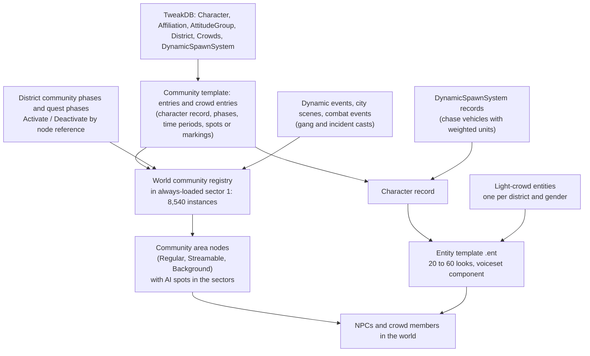

# Population and affiliations: who appears where, and why

**Maturity: Draft.** How Cyberpunk 2077 decides which people exist in the open world: the community templates and crowd pools that spawn them, the TweakDB character records behind each one, the affiliation, attitude and district records that group them, how gangs are spread over the districts, what a character record does and does not say about an NPC, and which NPCs are meant to last. Consolidated on 22 October 2026 from game 2.31 (base game and Phantom Liberty): the game's TweakDB blobs read offline, 2,727 community templates, the world's community registry, the light-crowd entity templates and English texts, with the Modding Docs and a community guide as cross-checks. Nothing here has been seen in the running game; the [questions for a game session](#questions-only-the-game-can-answer) say what to check.

This page answers: *what can a game port read, coarsely and without running the game, to know who lives where in Night City (their faction, place, kind, gender, look and permanence), so that the simulation mirrors the game instead of inventing a population?*

Evidence grades used on this page, besides the knowledge base's [shared grades](README.md#rules-for-knowledge-pages):

- **[resource]** is observed in extracted game data: a TweakDB record or flat (named), a community template, the world registry or an entity template.
- **[wiki]** is the Modding Docs. **[community]** is a published guide's claim, checked only against our own counts where stated.
- A flat's *name* is graded [resource] for where it is and what it holds, and [hypothesis] for what the engine does with it, until the game confirms it.
- **Runtime-proven: none yet.** Counts are of data entries, not of people met in the world.

## Sources

| Source | Version studied | Used for |
|---|---|---|
| TweakDB blobs `r6\cache\tweakdb.bin` (base game) and `tweakdb_ep1.bin` (with Phantom Liberty), read with the Studio's flat reader ([`tweakdb-flats.ts`](../projects/xf-studio/authoring/src/game/tweakdb-flats.ts)) | 2.31 | Character, affiliation, attitude, district, crowd-settings, prevention, street-cred and dynamic-spawn records. 176,198 records in the base blob and 193,354 in the Phantom Liberty blob. The blob holds record IDs and flat values but no names, so names come from the next row |
| WolvenKit's TweakDB name list `tweakdbstr.kark` and reader (source `11720772`; [WolvenKit](https://github.com/WolvenKit/WolvenKit), GPL-3.0, studied and run, not copied) | 9.0.1 | 196,216 record names, 3,333,134 flat names. A record's type is its `Murmur3-32` key (seed `0x5EEDBA5E`) of the class name without `gamedata` and `_Record` ([source] `TweakDBReader.cs`); that key typed 176,196 of the 176,198 base records here [resource] |
| RTTI dump of the scripting classes (`gamedata*_Record`) | 2.31 | Which record classes exist (963) and what their getters are. Credited in the [community credits](../docs/community-credits.md) |
| Game resources via WolvenKit CLI 9.0.1 (same tool and settings as areas A and B): 2,727 `.community` templates (base `open_world/community` 711, `city_scenes` 1,171, `dynamic_events` 191, `mini_world_stories` 37, `vendors` 12, `police_system` 1; Phantom Liberty `openworld/community` 604), their 93 phases and 22 quest graphs, 32 light-crowd entity templates and 6 appearance files, 15 debug spawner templates, three CSV tables, and `always_loaded_1.streamingsector` (the world community registry) | 2.31 (JSON header game version 2310) | Spawn templates, the registry, light crowds. 2,900 files. How they were made, with commands and a SHA-256 for every file, is in [the corpus manifest](../research/story-engine/quest-corpus-c-manifest.json); the serialised files are private and never tracked |
| English on-screen texts, three NPC entity templates (`citizen__homeless_man`, `citizen__corporat_wa`, `gang__maelstrom_ma`), and the other two always-loaded sectors | 2.31 | Display names behind `LocKey#` numbers; where a template keeps a voice component; counts of area nodes. Examined in a scratch folder, not kept |
| [Cyberpunk 2077 Modding Wiki](https://github.com/CDPR-Modding-Documentation/Cyberpunk-Modding-Docs), `modding-guides/world-editing/ai-and-npcs/creating-communities.md`, `for-mod-creators-theory/files-and-what-they-do/crowds-random-npcs.md` and `.../file-formats/.community-files.md` | `a54b0873` | What a community, entry, phase, period and marking are; that communities spawn almost every non-crowd NPC; that registration lives in the streaming sectors |
| Mila Grish, [Cyberpunk 2077 gangs](https://eip.gg/cyberpunk-2077/guides/cyberpunk-2077-gangs/) (EIP.gg, published 19 September 2020, updated 7 September 2022) | read 22 October 2026 | [community] Which gang each guide entry places in which district; used only to compare with our counts |
| Other knowledge pages | — | [World and streaming](world-and-streaming.md) (communities, registry nodes, spawners), [NPC reactions](npc-reactions.md) (district record, crowd tags), [NPC direction](npc-direction.md) (crowd records, dynamic entities), [open-world activities](open-world-activities.md) (how quests switch communities on), [save files](save-files.md) |

Not studied: the 4,033 base and 1,378 Phantom Liberty quest-owned `.community` files outside `open_world` (side quests, minor quests, main quests), the streamable community area nodes in the streaming sectors (positions), the 4,221 population spawner nodes, traffic, and the Phantom Liberty registry.

## 1. The short answers

- **Crowd and community spawners.** Almost every NPC comes from a *community*: a template of named *entries*, each a character record with phases and time periods that say how many appear and at which AI spots or markings. Pedestrian crowds are *crowd entries* in the same templates: weighted lists of character records per time of day, with a density. Nothing is spawned by a quest from scratch; quests switch existing communities on and off by node reference [resource, wiki]. Section 3.
- **The world holds 8,540 community instances** in one registry in the first always-loaded sector: 2,510 `Regular` (story and fixed characters), 3,476 `Streamable` (street population by area) and 2,554 `Background` (pedestrian filler), sharing 3,394 templates, with 30,736 entries. 90 % of the entries resolve to a character record, the rest to vehicles [resource]. Section 3.2.
- **Character records are the population vocabulary.** 6,668 records of type `Character` with Phantom Liberty (4,820 in the base blob). Each says faction (`affiliation`), attitude group, kind (`isCrowd`, `priority`, `rarity`, `quest`), whether it is `savable`, its entity template (the body and wardrobe), a name key and, for 195 of them, a voice tag [resource]. Section 4.
- **Factions are 43 `Affiliation` records** (34 in the base blob), each marked as a gang, a corporation or neither by its `animWrappers`. Attitudes between groups are separate: 356 `AttitudeGroup` and 274 `Attitude` records (value `Friendly`, `Neutral` or `Hostile`) [resource]. Section 5.
- **Districts are 132 `District` records** (126 base) in a parent tree. Only the eight big ones list `gangs`, and only a few: Watson `Maelstrom`; Westbrook `TheMox` and `TygerClaws`; Heywood `Valentinos`; Santo Domingo `SixthStreet`; Pacifica `VoodooBoys` and `Animals`; Badlands `Aldecaldos`; Dogtown `Barghest`. City Center has none [resource]. Section 5.3.
- **Gang placement by district** is readable three ways that mostly agree: the district record, the cast of each district's *dynamic events* (Kabuki and Little China Tyger Claws, Northside Maelstrom, Heywood Valentinos, Arroyo and Rancho Coronado 6th Street, Pacifica Scavengers and Animals), and a community guide [resource, community]. They disagree at one point worth knowing: the Watson record names only Maelstrom, but Tyger Claws outnumber Maelstrom in Watson's dynamic events 85 to 58. Section 6.
- **A character record gives faction, kind, attitude, name key, permanence and the template path. It does not give gender, and for 97 % of NPCs not a voice.** Gender is in the entity template's name and body (`_ma`, `_wa`, `_mb`); appearance is a pool of 20 to 60 looks in the template, narrowed by the community entry or by 80 records that fix one [resource]. Section 7.
- **Persistent versus ephemeral** is carried by flags, not by a field called that: pedestrian filler has `isCrowd` 1, `priority` Crowd and `savable` 0; story and fixer characters have `savable` 1 and the `Quest` priority or a quest affiliation. 91 % of `Background` registry entries are not savable, against 12 % of `Regular` ones [resource]. What the save actually keeps of NPCs is not shown by the files and needs the game. Section 8.
- **A port reads about a dozen record types**, listed with example flats in [the record paths the game port reads](#9-the-record-paths-the-game-port-reads). The Studio's reader decodes flats by ID today; reading population needs it to enumerate records and use the name list too.

## 2. The system map

[resource] for every box except the arrows into "NPCs", which are the expected run-time effect [hypothesis].

## 3. Crowd and community spawners

### 3.1 One template, two kinds of list

[resource] A `.community` file holds one `communityCommunityTemplate` with two lists:

| List | Element | What it carries |
|---|---|---|
| `entries` | `communitySpawnEntry` | `characterRecordId` (a TweakDB record, usually `Character.*`, sometimes `Vehicle.*`), `entryName` (the handle quests use), `phases`, `spawnInView` |
| | `communitySpawnPhase` | `phaseName` (`default` unless a quest switches it), `appearances` (look names, usually `default`), `alwaysSpawned`, `timePeriods` |
| | `communityPhaseTimePeriod` | `hour` (`Morning`, `Day`, `Evening`, `Night`, or a clock time such as `_22_00`), `quantity` (0 to 100), `spotNodeRefs` (named AI spots) or `markings` (a tag on a group of spots), `categories`, `isSequence` |
| `crowdEntries` | `gameCrowdTemplateEntry` | `entryName`, `markings` (the region of crowd lanes it fills) and `phases` |
| | `gameCrowdTemplateEntryPhase` and `gameCrowdPhaseTimePeriod` | a `density` per time of day and `charactersData`: a list of `characterRecordId` with a `weight` |

Across the 2,727 templates read: 15,591 entries and 403 crowd entries. Of 25,802 entry time periods, 93 % are named `Day` (13,716), `Night`, `Morning`, `Evening` or `Midnight`; the rest are clock times (`_6_00`, `_22_00`, `_18_00` the commonest). A typical entry has one phase (15,038 of 15,591); 501 periods are ordered sequences. 8,153 periods have quantity 0 (an entry that exists but spawns nobody until a quest sets it) and 11,914 have quantity 1.

[wiki] The Modding Docs describe the same structure: an entry is "one NPC template", phases are used by quests to switch setups, and periods say how many to place, where and when; a quantity below the number of spots picks spots at random each time the sector loads (`creating-communities.md`). They also say that communities spawn almost all NPCs that are not crowd NPCs. The wiki's `.community files` page calls the files leftovers the game does not read, with registration done in the streaming sector. The registry of section 3.2 does hold the same templates: the entry-name set of 1,160 of 1,171 city-scene files, 653 of 703 district-community files, all 191 dynamic-event files and all 12 vendor files appears as a registry template (the Phantom Liberty files are not in the base registry). So the files are the authoring source of what the registry holds [resource, offline].

A crowd entry's weights are not normalised (Kabuki's `wk_04` morning list has 19 characters whose weights sum to 3.5); a density applies to its marking region (Kabuki `wk_04`: Morning 0.072, Day 0.144, Evening 0.18, Night 0.108 [resource]). The unit of density is not shown [hypothesis: people per lane length].

### 3.2 The registry: what the world actually holds

[resource] `base\worlds\03_night_city\_compiled\default\always_loaded_1.streamingsector` holds one `worldCommunityRegistryNode` with:

| Part | Count | Reading |
|---|---|---|
| `communitiesData` | 8,540 | One item per community instance: a community ID, an area type, a shared `template` and `entriesInitialState` (which entries start active, and in which phase) |
| Area type `Regular` | 2,510 | Fixed communities in always-loaded sectors, matched by 2,510 `worldCompiledCommunityAreaNode`s (785, 1,265 and 460 in the three always-loaded sectors) that bind each entry to spot IDs |
| Area type `Streamable` | 3,476 | Communities tied to streamed areas (the wiki's streamable community areas); their area nodes are in the streaming sectors, not read here |
| Area type `Background` | 2,554 | Filler communities of pedestrians |
| Distinct templates | 3,394 | Instances share templates, so one authored template can fill many places |
| Entries (instance-weighted) | 30,736 | 27,714 character entries, 2,940 vehicle entries (parked and ambient cars, trains, drones), 82 unresolved |
| `entriesInitialState` | 30,986 | 11,011 start active, 19,975 start inactive (switched on by a quest or phase) |
| `crowdCreationRegistry` | 908 creation data | The compiled crowd pools; 274 crowd entries in 84 communities also sit in the templates |
| `spawnSetNameToCommunityID` | 329 | Named characters (`#padre_holo`, `#panam`) whose presence is a spawn set |
| `workspotsPersistentData` | 97,359 | Every AI spot with a world position, all enabled at the start |

Instance-weighted entries by the faction of their character record (base game; resolved through the Phantom Liberty blob): Civilian 9,797, Unaffiliated 8,278, Arasaka 1,270, NCPD 1,075, Tyger Claws 1,067, Valentinos 1,005, Militech 783, 6th Street 761, Maelstrom 621, Scavengers 604, Aldecaldos 581, Unaffiliated corporate 564, Wraiths 400, Animals 297, Voodoo Boys 173. By gender word in the entity template name: `_ma` 13,297, `_wa` 8,148, big male `_mb` 715, no marker 5,359. An entry is a slot with a quantity, not a person; a census of people needs the quantities per time of day and the spots' positions.

### 3.3 What switches communities on

[resource] Each district has a community phase under `base\open_world\community\<region>\<district>\phases` that activates its communities by node reference (`questCommunityTemplate_NodeType`, action `Activate`, `spawnerReference` such as `#wat_kab_com`); Kabuki's has 13 spawn-manager nodes, the first of which activates `#wat_kab_com`. One global phase (`open_world_global_commuinity_phase`, spelled so in the file) starts the 12 district phases together and waits on a few facts. Some district phases pause on facts such as `ce_wat_kab_02_active`, the flag of a combat event. [open-world activities §7](open-world-activities.md#7-how-activities-spawn-their-people) shows how gigs and hustles switch the same nodes; this is the ambient layer under them.

### 3.4 The ambient layers

| Layer | Files | What it adds | Cast |
|---|---|---|---|
| District communities (`open_world/community`) | 711 base, 604 Phantom Liberty | Street life, vendors, ripperdocs, parking, homeless spots, per-district crowd regions | Almost all civilians; gangs are rare (Aldecaldos 180 in the Badlands, Arasaka 18 on Corpo Plaza) |
| Dynamic events (`open_world/dynamic_events`) | 191 | Small incidents per district | Gang-heavy: the main source of gang-by-district placement (section 6) |
| City scenes (`open_world/city_scenes`) | 1,171 | Scripted street vignettes; 113 template phases | Mostly the NCPD and gangs by scene template (`cs_goons`, `cs_ncpd`, `cs_civ_observer`) |
| Mini world stories | 37 | One-off story spots | Mixed |
| Vendors | 12 | Customers around food shops | Civilians |
| Combat events (area B) | 256 phases | Fights that re-arm on a game-time timer | Switched through communities not in these files |

### 3.5 Crowds, light crowds and the districts' look

[resource] Pedestrians are drawn from the weighted crowd lists. In the 877 weighted time-of-day lists of the base districts (169 distinct character records), the commonest records are `Character.HomelessMan` (in 597 lists), `HomelessFemale` (524), `JunkieMale` (517), `HomelessManBig` (504), `JunkieFemale`, `LowlifeMale` and `LowlifeWoman`.

A cheaper kind, the *light crowd*, is a set of 32 entity templates, one per district and gender (`crowd__watson_kabuki_ma`, `crowd__city_corpoplaza_wa` and so on, 14 districts plus a parade and a samurai-fan set). Each carries 21 to 59 looks from `crowd__districts_ma.app` or `_wa.app`, named by style and number, so a district's character is its look pool. Share of the pool by style, in per cent:

| District | casual | dirty | punk | corporate or corpo casual | rich | teen | valentino | other |
|---|---|---|---|---|---|---|---|---|
| Corpo Plaza | 16 | 0 | 0 | 48 | 31 | 5 | 0 | 0 |
| Japantown | 27 | 0 | 7 | 24 | 23 | 13 | 0 | 6 (hooligan) |
| North Oaks | 16 | 0 | 0 | 39 | 44 | 0 | 0 | 0 |
| Kabuki | 33 | 22 | 18 | 0 | 0 | 16 | 0 | 11 (older casual) |
| Northside | 19 | 34 | 23 | 0 | 0 | 1 | 0 | 22 (older casual, hooligan, cowboy) |
| Arroyo | 38 | 28 | 16 | 3 | 0 | 1 | 1 | 13 (older casual) |
| Rancho Coronado | 33 | 27 | 5 | 4 | 0 | 3 | 0 | 28 (older casual, hooligan, cowboy) |
| Vista del Rey | 34 | 14 | 7 | 0 | 0 | 17 | 23 | 5 (older casual) |
| Coastview | 32 | 29 | 20 | 0 | 0 | 5 | 0 | 14 (older casual) |

So Heywood's crowd literally wears Valentino colours and the corporate districts wear suits; a port can read a district's *style* from the pool rather than from a table [resource; effect in game hypothesis]. Records pointing at these templates: 50, among them `Character.LightCrowd_<district>_<ma|wa>` (isCrowd 1, savable 0, priority Crowd).

The share of pedestrian draws carrying a visual tag gives a *wealth reading* the district records lack ([NPC reactions](npc-reactions.md#5-what-a-script-can-read) proposed it): City Center draws are 22 % `Corporat` and 15 % `Posh`; Westbrook 12 % `Corporat` and 4.5 % `Posh`; Heywood 29 % `Lowlife`; Watson 17 % `Lowlife`; Santo Domingo 15 % `Lowlife` and 5 % `Redneck`; Pacifica 17 % `Lowlife` and 7 % `Redneck`. The weighting is by crowd-entry density per region folder, an approximation [resource, offline].

### 3.6 Chases and other dynamic spawns

[resource] `DynamicSpawnSystem.*` holds 222 `DynamicVehicleData` records (a `vehicleRecord` and a `unitRecordsPool` of `WeightedCharacter` records: a `character` and a `weight`). Names carry the faction: `gang_chase_*` (Tyger Claws 26, 6th Street 22, Maelstrom 22, Valentinos 21, Wraiths 12, Animals 8), `courier_chase_*` (Tyger Claws 12, Scavengers 10, Valentinos 10, Maelstrom 10, Voodoo Boys 10, 6th Street 9, Animals 7, Wraiths 7, Kang Tao 4, corporate 4, Militech 4, Arasaka 3, Kurtz 2, ambush 5), 10 `mini_world_story_gang_chase_*` and 3 `gig_chase_*`. These are what the gang-retaliation phase in [open-world activities §4.4](open-world-activities.md#44-outcomes-failure-and-optional-steps) spawns. `Passengers.*` (125 records) fill car seats the same way.

## 4. Character records and archetypes

[resource] 6,668 records of type `Character` with Phantom Liberty (4,820 in the base blob); 6,582 are named `Character.*` (4,734 base). The rest of the family is nested: `…_inlineN` records of archetype, equipment, bounty and stat types hang off a character (16,850 records under the `Character.` prefix in all).

| Flat | What it holds | Seen in the 6,582 `Character.*` records |
|---|---|---|
| `affiliation` | A `Factions.*` record | 43 distinct; Unaffiliated 1,255, Civilian 675, Scavengers 593, Barghest 504, Tyger Claws 480, Arasaka 454, NCPD 354, Maelstrom 279 |
| `baseAttitudeGroup` | A group name matching `AttitudeGroup.name` | `friendly` 979, `neutral` 781, `civilian` 554, then one `…_ow` (open-world) group per faction: `scavenger_ow` 384, `tygerClaws_ow` 233, `kurtz_army_ow` 132, `valentinos_ow` 128 |
| `isCrowd`, `isLightCrowd`, `priority`, `savable`, `rarity`, `quest` | Kind and permanence (section 8) | `isCrowd` 859; `priority` Regular 4,317, Quest 1,759, Crowd 506; `savable` 0 in 625; `quest` set in 2,728 (MainQuest 1,046, StreetStory 962, SideQuest 324, MinorQuest 226, MinorActivity 170); `isLightCrowd` is 0 in every record, the light crowd is chosen by template |
| `characterType` | `NPCType.*` (9 records) | Human 6,217, Drone 198, Android 113, Mech 51, Cerberus 2, Chimera 1 |
| `rarity` | `NPCRarity.*` (8) | Normal 3,308, Weak 971, Rare 790, Trash 724, Elite 616, Officer 84, Boss 72, MaxTac 17 |
| `archetypeData`, `archetypeName` | Combat role: an `ArchetypeData` record whose `type` is an `ArchetypeType` (28 named: `GenericMeleeT1`, `HeavyRangedT3`, `NetrunnerT2`, `TechieT3`, …) | 2,416 have none (civilians); the rest mostly point at the record's own `_inlineN` archetype |
| `visualTags` | Look and role tags (93 distinct) | `Grunt` 1,418, `Lvl1`/`Lvl2`/`Lvl3`, faction names, `Biker`, `Gangster`, `Netrunner`; crowd ones `Lowlife`, `Posh`, `Corporat`, `StreetVendor`, `Youngster` |
| `tags` | Behaviour tags | `Invulnerable` 327, `Immortal` 87, `Cyberpsycho` 55, `TriggerPrevention` 34 |
| `entityTemplatePath` | The `.ent` (a resource hash) | 6,469 of 6,505 resolve to a path in the archives |
| `appearanceName`, `crowdAppearanceNames` | Fix one look, or a list | 80 and 61 records; all others leave the template's pool open |
| `displayName`, `fullDisplayName`, `alternativeDisplayName` | `LocKey#` numbers | 2,617 and 1,163 have a non-empty key |
| `voiceTag` | A voice name | 195 records, 85 distinct tags (`v` 71, `smasher` 7, `kurtz` 6, …) |
| `genders` | `GenderEntity` records | 85 records, all player-like puppets (`TPP_Player`, `Player_Puppet_*`, `*_Puppet_Photomode`, V replacers) |
| `communitySquad`, `squadParamsID`, `securitySquad` | Squad behaviour | `Squad_Basic` for communities; faction squads such as `FactionSquads.TheMoxSquad` |
| `crowdMemberSettings` | A `Crowds.*` movement package | `DefaultCrowdPackage` in 6,178; `ManCivilianSettings` 198; `WomanCivilianSettings` 130 |
| `reactionPreset`, `sensePreset`, `holocallInitializerPath`, `lootDrop`, `vendorID` | Reactions, perception, calls, loot, shop | `Ganger_Aggressive` 3,723; `Civilian_Neutral` 529; `NoReaction` 1,461 |
| `persistentName` | A fixed object name | 75: the 40-odd photo-mode puppets (`PhotomodePuppet`), V's replacers and a few quest characters |

**Naming.** Named characters carry the quest or the person (`Character.Judy`); street characters carry the quest or hustle that owns them plus faction, role, weapon and gender (`Character.q003_meat_factory_officer_maelstrom_grunt2_ranged2_ajax_ma`, `Character.sts_wat_nid_07_enemy_grunt_handgun`); crowd members are plain nouns (`HomelessMan`, `CorpoWoman`, `ProstituteFemale`, `LightCrowd_japantown_wa`). A name is not a specification [hypothesis for meaning].

**Phantom Liberty rewrites the templates.** 3,072 of the 4,734 base records point at a different entity template in the Phantom Liberty blob (`citizen__homeless_man` becomes `ep1\…\citizen__ep1_homeless_man`); no affiliation differs. 1,848 records are new, mostly Dogtown's Barghest (504, up from 5) and Voodoo Boys (213, up from 72) [resource]. A port must read `tweakdb_ep1.bin` when it exists; which one the game prefers when both are present is the engine's [hypothesis].

## 5. Faction, affiliation and district records

### 5.1 Affiliations

[resource] 43 `Factions.*` records, each with `localizedName`, `iconPath` and `animWrappers`; the wrapper names the class (`Gang`, `Corpo`, `Civilian`, or empty). A faction therefore says *gang or corporation* but nothing about territory, size or enemies.

| Record | Name | Class | Character records (base / with PL) | World census entries | Dynamic-event entries |
|---|---|---|---|---|---|
| `Factions.Unaffiliated` | No Affiliation | none | 752 / 1,255 | 8,278 | 50 |
| `Factions.Civilian` | Civilian | civilian | 577 / 675 | 9,797 | 89 |
| `Factions.Scavengers` | Scavengers | gang | 279 / 593 | 604 | 76 |
| `Factions.Barghest` | Barghest | gang (`Kurtz`) | 5 / 504 | 39 | 0 |
| `Factions.TygerClaws` | Tyger Claws | gang | 460 / 480 | 1,067 | 127 |
| `Factions.Arasaka` | Arasaka | corporation | 430 / 454 | 1,270 | 12 |
| `Factions.NCPD` | NCPD | corporation | 329 / 354 | 1,075 | 29 |
| `Factions.Maelstrom` | Maelstrom | gang | 270 / 279 | 621 | 58 |
| `Factions.UnaffiliatedCorpo` | No Affiliation | corporation | 238 / 277 | 564 | 23 |
| `Factions.Valentinos` | Valentinos | gang | 248 / 259 | 1,005 | 88 |
| `Factions.SixthStreet` | 6th Street Gang | gang | 206 / 232 | 761 | 56 |
| `Factions.VoodooBoys` | Voodoo Boys | gang | 72 / 213 | 173 | 0 |
| `Factions.Militech` | Militech | corporation | 192 / 209 | 783 | 0 |
| `Factions.Animals` | Animals | gang | 199 / 208 | 297 | 17 |
| `Factions.Wraiths` | Wraiths | gang | 157 / 164 | 400 | 0 |
| `Factions.Aldecaldos` | Aldecaldos | gang | 78 / 78 | 581 | 9 |
| `Factions.AfterlifeMercs` | Afterlife Mercs | corporation | 70 / 74 | 54 | 0 |
| `Factions.KangTao` | Kang Tao | corporation | 46 / 49 | 66 | 0 |
| `Factions.TheMox` | The Mox | gang | 38 / 38 | 76 | 4 |
| `Factions.TraumaTeam` | Trauma Team | corporation | 27 / 27 | 101 | 0 |

The remaining 23 records have under 30 character records each (Zetatech, Biotechnica, NetWatch, News54, Orbital Air, Classified, Night City Council, android variants of three gangs, and a few with no characters). "World census" counts registry entries as in section 3.2; "dynamic-event entries" count entries in the 191 base dynamic-event templates. The wrapper for Arasaka is spelled `Araska` in the record.

### 5.2 Attitudes

[resource] Who is hostile to whom is a table of pairs, not a property of a faction. `AttitudeGroup` records (356; 280 base) have `name`, `parent`, `defaultAttitude`, `attitudeToSelf` and `isState`; `Attitude` records (274; 230 base) have `group1`, `group2` and `value` (`Friendly` 95, `Neutral` 100, `Hostile` 78). Most groups belong to one quest (`Group_ina_08_Wraiths`, `Group_q301_border_kurt_front`) and inherit from a general open-world group (`Group_6thStreet_OW`, `Group_Militech_OW`). `Attitude_Civilian_Player`, `Attitude_Maelstrom_Player` and `Attitude_PoliceHostile_Maelstrom_OW` show the player and police pairs. How the engine resolves a pair that has no record is not shown [hypothesis].

### 5.3 Districts

[resource] `District` records have `enumName`, `localizedName`, `parentDistrict`, `gangs`, `crimeMultiplier`, `preventionPreset`, `isQuestDistrict`, `gunShotStimRange`, `explosiveDeviceStimRangeMultiplier`, `policeRadioSceneEntryPoint`, `uiIcon` and `uiState`. 13 have no parent; 11 of those are flagged `isQuestDistrict`. Two levels sit below them (a district such as Kabuki, then places such as Lizzie's Bar or an apartment), 132 records in all. The script reads the current one through `DistrictManager` ([NPC reactions §5](npc-reactions.md#5-what-a-script-can-read)).

| District | `gangs` | `crimeMultiplier` | Prevention preset | Sub-districts |
|---|---|---|---|---|
| Watson | Maelstrom | 0.85 | `NCPD` (Northside: `NCPDLowSec`) | Kabuki, Little China, Northside, Arasaka Waterfront |
| Westbrook | The Mox, Tyger Claws | 0.85 | `NCPD` | Japantown, Charter Hill, North Oaks |
| City Center | none | 1.2 | `NCPD` | Corpo Plaza, Downtown |
| Heywood | Valentinos | 0.8 | `NCPD` | Glen, Vista del Rey, Wellsprings |
| Santo Domingo | 6th Street | 0.8 | `NCPD` (Rancho Coronado: `NCPDLowSec`) | Arroyo, Rancho Coronado |
| Pacifica | Voodoo Boys, Animals | 0.7 | `NCPD` (West Wind Estate: `NCPDLowSec`) | Coastview, West Wind Estate |
| Badlands, North and South Badlands | Aldecaldos (Badlands only) | 1 | `BadlandsPrevention`, `BorderGuards` at the border crossing | Yucca and about 20 others |
| Dogtown (Phantom Liberty) | Barghest | 1 | `KurtzArmy` | Akebono, Expo, Cynosure and others |

Seven `DistrictPreventionData` presets give each a `heat1` to `heat5` set of unit pools (107 pool and 93 vehicle-pool records), a `recon` set, an input-lock time (7 s) and a `spawnOriginMaxDistance` (65 m; 80 for border guards). Police response is therefore a per-district-preset lookup [resource]; the units themselves are `Character.*` records with `NCPD` affiliation.

**What the game reads while V stands somewhere.** The table lists the region records. The game's *current* district is the newest of the sub-district and venue areas V has entered, and those records hold the default crime multiplier 1.0 and a preset of their own; the region's `gangs` feeds only the world map's gang panel. The areas, their polygons and what each field is read for are in [places §3](places.md#3-districts-and-subdistricts).

`StreetCredTier.*` (35 records) hold `streetCredRequirement` for the gig tiers of [open-world activities §3.3](open-world-activities.md#33-which-gigs-are-available-tiers-counters-and-street-cred): Watson 1 / 4 / 8 / 15, Westbrook 1 / 10 / 20 / 35, Heywood 1 / 8 / 16 / 30, City Center 1 / 9 / 18 / 32, Santo Domingo 1 / 20 / 35 / 50, Pacifica 1 / 12 / 30 / 42, Badlands 1 / 5 / 11 / 18, and vehicles 6 / 12 / 19 / 26 / 34 / 42 / 50 [resource].

## 6. Where the gangs are: placement by district

Three independent readings of "which gang lives where":

| District | District record `gangs` | Dynamic events (gang entries, base game) | Ambient district communities | [community] Mila Grish's guide |
|---|---|---|---|---|
| Watson: Kabuki | Maelstrom (Watson) | Tyger Claws 34, Maelstrom 5, The Mox 4 | Militech 22, The Mox 8 | Maelstrom (north), The Mox, Tyger Claws |
| Watson: Little China | Maelstrom (Watson) | Tyger Claws 46, Maelstrom 5 | Militech 36, Tyger Claws 9 | Tyger Claws |
| Watson: Northside | Maelstrom (Watson) | Maelstrom 48, Scavengers 8, Tyger Claws 5 | Militech 30 | Maelstrom |
| Westbrook: Japantown | The Mox, Tyger Claws | Tyger Claws 24 | Tyger Claws 5 | Tyger Claws |
| Westbrook: Charter Hill | The Mox, Tyger Claws | Arasaka 6, Tyger Claws 4, 6th Street 4 | none | Tyger Claws, 6th Street |
| Heywood: Glen | Valentinos | Valentinos 30 | Aldecaldos 4, Valentinos 3 | Valentinos, 6th Street |
| Heywood: Vista del Rey | Valentinos | Valentinos 33, 6th Street 3 | Valentinos 2 | Valentinos |
| Heywood: Wellsprings | Valentinos | Valentinos 22 | Aldecaldos 1, Arasaka 1 | Valentinos, Scavengers (south) |
| Santo Domingo: Arroyo | 6th Street | 6th Street 19, Scavengers 11 | Arasaka 28, 6th Street 6 | 6th Street |
| Santo Domingo: Rancho Coronado | 6th Street | 6th Street 30, Scavengers 14 | Aldecaldos 15, 6th Street 5 | 6th Street |
| Pacifica: Coastview | Voodoo Boys, Animals | Scavengers 21, Animals 10 | Scavengers 2, Animals 2 | Voodoo Boys (Pacifica as a whole: Animals south, Scavengers north) |
| Pacifica: West Wind Estate | Voodoo Boys, Animals | Scavengers 19, Aldecaldos 9, Animals 4 | none | Pacifica-wide only |
| City Center: Downtown | none | Tyger Claws 13, Animals 3 | Afterlife Mercs 8 | none |
| City Center: Corpo Plaza | none | Arasaka 6 | Arasaka 18 | none |
| Badlands | Aldecaldos | no dynamic events | Aldecaldos 180, Wraiths 4 | Aldecaldos, Wraiths |
| Dogtown (Phantom Liberty) | Barghest | not studied | Barghest 39 (a Pacifica border community in the base files) | not covered |

[resource, community] What this supports:

- **Gang territory is a property of the sub-district**, and the dynamic events carry it. The district record is coarse: it lists one to two gangs for a whole region, and it lists Watson's as Maelstrom while the events say Tyger Claws hold Kabuki and Little China and Maelstrom hold Northside (the guide agrees). The record's `gangs` is the *region's* signature gang; what the engine reads it for is not shown [hypothesis: UI, prevention or scanner text].
- **Voodoo Boys and Wraiths never appear in the dynamic events** although they have 213 and 164 character records and 173 and 400 world-census entries. Their entries sit in fixed communities; where, the folder tally does not say (open question 1).
- **The ambient communities are overwhelmingly civilian** (a district's 250 to 1,400 entries hold single-digit to low-hundreds gang entries), so a gang member met on the street comes from a dynamic event, a chase, a combat event or a hustle, not from the pedestrian layer.
- **Positions are the missing half, and [places §9](places.md#9-joining-the-population-to-places) supplies them.** These counts are by authoring folder. The join through each community's spots (the registry's `workspotsPersistentData`) and the district polygons gives the gang table by area in [places §9.3](places.md#93-gang-presence-by-area).

## 7. What a character record tells us

| Question | Where it is | Confidence |
|---|---|---|
| Which faction? | `affiliation`, plus `visualTags` and `baseAttitudeGroup` | [resource]. Reliable for gangs and corporations; `Civilian` and `Unaffiliated` both mean "no faction" (1,930 records) |
| Hostile or friendly to V? | `baseAttitudeGroup`, then the `Attitude` table | [resource]. The group is a default; quests change it |
| Crowd member or a person? | `isCrowd`, `priority`, `rarity` Trash, `crowdMemberSettings`, `savable` | [resource]. 859 `isCrowd`; 506 priority Crowd; 724 Trash |
| Gender? | Not in the record (`genders` is for player-like puppets). The template path ends `_ma`, `_wa`, `_mb` (big male), `_mba`/`_wba`, `_mm`, `_mf`; crowd record names say Man, Woman, Male, Female | [resource]. Of 6,582 records: `_ma` 2,814, `_wa` 1,422, `_mb` 493; 1,637 templates have no marker (quest characters, drones, androids, vehicles) and 113 do not resolve |
| Body, clothes, face | `entityTemplatePath` to a `.ent` with 15 to 60 named looks; the community entry's `appearances` or the record's `appearanceName` narrow them | [resource]. Look names are style-and-number (`homeless_ma_06`, `maelstrom_ma_04`, `corporat_wa_02`); selection among them at spawn is not shown [hypothesis: random] |
| Voice | `voiceTag` for named characters (195 records, 71 of them `v`). The entity template carries a voiceset component but no tag | [resource]. For the other 97 % the voice comes from somewhere else; the likely route is the appearance-to-voice mapping ([NPC reactions](npc-reactions.md#3-how-an-npc-picks-and-plays-a-voice-line)) [hypothesis] |
| A name to show | `displayName` and `fullDisplayName` keys (English text in the on-screen texts): `Character.Judy` is "Judy" and "Judy Alvarez" | [resource]. Empty for crowd and most street characters |
| Combat role and strength | `archetypeData` (type and tier), `rarity`, `characterType`, level scaling through the stat groups | [resource]. Fine detail is out of scope for a coarse mirror |
| Is it a story character? | `quest` affiliation (MainQuest, SideQuest, StreetStory, MinorActivity), `persistentName`, a `spawnSet` name | [resource] |
| Child? | `isChild` (40 records) | [resource] |
| Where does it live? | Nothing in the record; the community entries that name it and the spots they use | [resource] |

Display names, age, job, personality and relationships are not in these records. A character record is a *casting type*, not a person: `Character.HomelessMan` appears hundreds of times, and its looks, positions and moods are drawn per spawn.

## 8. Persistent and ephemeral

[resource] Kind flags correlate strongly with where a record appears:

| Registry area type | Character entries | `isCrowd` | `savable` 0 | `priority` Crowd | Story-linked (`quest` set) |
|---|---|---|---|---|---|
| Regular (always loaded) | 10,567 | 27 % | 12 % | 12 % | 48 % |
| Streamable | 7,881 | 56 % | 36 % | 35 % | under 1 % |
| Background | 9,266 | 94 % | 91 % | 90 % | 3 % |

Among all 6,582 records, `isCrowd` and `savable` combine as: crowd and not savable 531, crowd and savable 328, not crowd and savable 5,629, neither 94. The 506 `Crowd`-priority records are 94 % not savable. `savable` presumably decides whether a spawned NPC's state is written to a save [hypothesis from the name and the correlation]. Fixers and named characters are spawn sets whose presence is a quest fact (`reggie_default_on`; [open-world activities §3.2](open-world-activities.md#32-meeting-a-fixer)) [resource].

What the other sources say:

- [wiki] A community with fewer people than spots picks spots at random each time the sector loads, so street population is re-rolled by loading, not remembered.
- [resource] [Save files](save-files.md) lists what a save keeps: the persistency stream of devices, doors, vehicles and containers, script systems, facts and the inventory. No NPC puppet node is documented there; that NPCs come back from the registry at load, with `savable` records keeping their own state, is the reading that fits [hypothesis].
- [source] Mod-spawned NPCs are ephemeral unless a spec asks otherwise ([NPC direction](npc-direction.md)). Chase and courier units are spawned by `DynamicSpawnSystem` and are not in a sector [resource].

So for the simulation: the **persistent layer is small and nameable** (spawn sets, `quest` characters, vendors, fixers, `persistentName`), and the **street population is a function of district, time of day and a draw**, which the engine already regenerates. Mirroring should record only the first and sample the second.

## 9. The record paths the game port reads

The Studio's `TweakDbBlob` reads flats by ID from either blob: `lookup(ids)` decodes 12 value types (names, strings, IDs, ID arrays, resource hashes, locale keys, ints, bools, floats, name arrays, vectors) without indexing the file. An ID is the CRC-32 of the record name plus its length; a field's ID continues that CRC over `.field`, so any field of any record is reachable from the record's name ([source] [`tweakdb-flats.ts`](../projects/xf-studio/authoring/src/game/tweakdb-flats.ts)). What a population reader adds: (1) *enumerating* records of a class, which needs the records section (an ID and a type key per record) and the name list, and (2) a join to entity paths through the archive index (hash of the lower-cased path). Both were done here offline with scratch tooling; the Studio reader has neither yet [offline].

| Question | Record type (`gamedata…_Record`) | Flats read | Example | Count |
|---|---|---|---|---|
| Who is this? | `Character` | `affiliation`, `baseAttitudeGroup`, `isCrowd`, `priority`, `rarity`, `quest`, `savable`, `characterType`, `visualTags`, `voiceTag`, `entityTemplatePath`, `appearanceName`, `displayName` | `Character.Judy`: `Factions.TheMox`, `judy`, rarity Rare, voice `judy` | 6,668 |
| What kind of group? | `Affiliation` | `localizedName`, `animWrappers`, `iconPath` | `Factions.TygerClaws`: Tyger Claws, `['TygerClaws','Gang']` | 43 |
| Friend or foe? | `AttitudeGroup`, `Attitude` | `name`, `parent`, `defaultAttitude`; `group1`, `group2`, `value` | `Attitude_Maelstrom_Player`: Hostile | 356; 274 |
| What kind of NPC? | `NPCType`, `NPCRarity`, `NPCQuestAffiliation`, `ArchetypeData`, `ArchetypeType` | `enumName`; `type` | `NPCType.Human`, `ArchetypeType.NetrunnerT2` | 9; 8; 6; 522; 511 |
| Where? | `District` | `parentDistrict`, `gangs`, `crimeMultiplier`, `preventionPreset`, `isQuestDistrict`, `localizedName`, `enumName` | `Districts.Heywood`: `Factions.Valentinos`, 0.8 | 132 |
| How is it policed? | `DistrictPreventionData` | `heat1` to `heat5`, `recon`, `spawnOriginMaxDistance` | `PreventionData.NCPD`: 65 m | 7 |
| How do pedestrians move? | `CrowdSettingsPackageBase` | `specs` (movement patterns) | `Crowds.WomanCivilianSettings` | 14 |
| What do chases bring? | `DynamicVehicleData`, `WeightedCharacter` | `vehicleRecord`, `unitRecordsPool`; `character`, `weight` | `DynamicSpawnSystem.gang_chase_valentino_small_01_gle_04` | 222; 386 |
| What is unlocked at what rep? | `StreetCredTier` | `streetCredRequirement` | `StreetCredTier.WatsonTier4`: 15 | 35 |
| Who can V photograph? | `Character` with `persistentName` `PhotomodePuppet` | `entityTemplatePath`, `voiceTag` | `Character.Panam_Puppet_Photomode` | about 40 |

Other inputs a port needs that are *not* TweakDB: the community templates and registry (`.community`, and `worldCommunityRegistryNode` in the first always-loaded sector), the light-crowd entity templates (`crowd__<district>_<ma|wa>.ent`) and the quest phases that switch them. Modded installs add records and communities at run time (TweakXL, ArchiveXL, World Builder exports); the same reader must follow those through the generic resolver instead of a per-mod table ([design seed DS-32](../research/story-engine/design-seeds.md)).

**For the simulation's coarse fields** this gives: faction mix per district and hour (from community entries, dynamic events and crowd lists), kind (crowd, street, story), gender mix (template suffixes), style (light-crowd pools and visual tags), police preset, and which characters are persistent. It does not give: individuals, ages, jobs, homes, relationships or exact headcounts.

## Questions only the game can answer

For a booked session on the [runtime bridge](../projects/xf-runtime-bridge/README.md). `scene_read` lists the NPCs within a radius with their record name (`record`), id, position, `dead` and sight line (at most 32, within 60 m); `ask` puts a question to the player. `M` is the maintainer, `C` is Claude. The maintainer picks the saves and places; `game_saves` lists them.

| # | Who | Do | Expect | If not |
|---|---|---|---|---|
| 1 | C, M | `ask "Stand in a busy Kabuki street in daylight, then press Done."` [Done]; `scene_read {parts: ["npcs"], radius: 40, max_npcs: 32}` | Most `record` names are plain crowd nouns (`HomelessMan`, `LowlifeMale`, `WorkerMale`, `CorpoWoman`) or `LightCrowd_kabuki_*`, and are in Kabuki's weighted crowd lists | Records that are in no Kabuki list: the crowd is drawn from a wider pool or from other regions' lists; record the names |
| 2 | C, M | Row 1 again at night (`world_time_set` to 23:00, with the player's agreement) | A different mix and, in most places, a smaller count (`Night` density is under `Day` in Kabuki's lists) | The same: night changes density only in some regions; record which |
| 3 | C | At the same spot, `scene_read` three times, a minute apart | The NPC set changes gradually: crowd members churn, community NPCs (ripperdoc, vendors) stay | A frozen set: nothing streams out while V stands still. Record the radius at which it changes |
| 4 | C, M | In Little China (daylight), `ask "Walk the main street for two minutes and press Done when you have seen a gang group."` [Done, None seen]; `scene_read` when they are in range | A Tyger Claws or Maelstrom group; their `record` names carry `tyger_claws` or `maelstrom` and the affiliation is Tyger Claws more often than Maelstrom | Another gang, or none: dynamic events are not on all the time; record the incident and the hour |
| 5 | C, M | The same in Northside, then Heywood (Glen) | Northside: Maelstrom; Heywood: Valentinos | A different gang: the sub-district table in section 6 is wrong there; record the records seen |
| 6 | M | `ask "Which gang symbols or colours do you see most in Arroyo, Coastview and Japantown?"` [Free text] | 6th Street, Scavengers or Animals, Tyger Claws | Voodoo Boys in Coastview: the dynamic events miss the Voodoo Boys' fixed communities (consistent with section 6); record where |
| 7 | C, M | `ask "Look at three pedestrians in turn, pressing Done each time."` [Done]; for each, `player_look` at the `scene_read` position, then `ask "Is this person male or female?"` [Male, Female, Unclear] | The answer matches the template suffix (`_ma` male, `_wa` female) for each; I work the suffix out from the `record` offline | A mismatch: gender is not given by the template name; record the record and the answer |
| 8 | C, M | In Corpo Plaza and then Rancho Coronado, `ask "How would you describe how people are dressed?"` [Formal, Casual, Rough, Mixed] | Corpo Plaza: Formal; Rancho Coronado: Casual or Rough | The reverse: the light-crowd pools are not what V sees there. Record both |
| 9 | C | `scene_read` at Corpo Plaza and Wellsprings; count `record` names containing `Corpo`, `Posh`, `Homeless`, `Junkie`, `Lowlife` | More corporate names in Corpo Plaza, more homeless and lowlife in Wellsprings | Even: the crowd lists are not what spawns near V. Record the tallies |
| 10 | C, M | Pick a street NPC (not a vendor) with `scene_read`; `game_save` (the maintainer asks); `game_load`; `scene_read` at the same spot | The crowd members are new ids and records; vendors and fixers return with the same record | The same crowd member returns: it was saved. Record the record, its `savable` flag from section 8 and the id |
| 11 | C, M | Kill or knock down one pedestrian, leave 100 m, return after five in-game minutes | The body is gone and the spot is filled by someone new | The same body remains: a community entry that is not re-rolled. Record the record name |
| 12 | C | At a ripperdoc or fixer, `scene_read`; look at `record` | `Character.*` named for the person (compare `Character.Judy`) with a `quest` affiliation | A crowd noun: the person is a community entry with a generic record. Record it |
| 13 | M | In Dogtown, `ask "Which factions do you see on the street?"` [Free text] | Barghest (Kurtz's soldiers), few civilians | Mostly civilians: Dogtown's street layer is the crowd, with Barghest only in fixed spots |
| 14 | C | With Phantom Liberty installed, `scene_read` a Watson crowd member; compare its `record` with section 4's rewrite of `Character.HomelessMan` | The record name is unchanged and its template is the `ep1` one | A different record name: the expansion swaps records, not only templates. Record both |
| 15 | C, M | Trigger a gang chase (a gig retaliation or a courier incident); `scene_read` the chasers | `record` names matching a `DynamicSpawnSystem` unit pool for that gang (for example `gang_chase_valentino_*`) | Names not in the pools: the chase uses another source. Record them |
| 16 | C | `world_district` where the session stands, and `scene_read {npc_detail: true}` beside the NPCs of rows 1 to 15 (bridge 0.8.8, offline; [card rows](../research/runtime/runtime-bridge-test-card.md#t-the-city-walk-42-min)) | `world_district` names the district, subdistrict and place the map shows; each NPC row's `character.affiliation.name` is its `Character` record's affiliation (compare row 4's gangs) | A district that differs from the map's text, or `character: null` for a record the table in section 9 lists: record both. Still missing: the entity template path (script can't read it; the offline record-to-path join stays the source) |

**Answered so far.** Row 16 [runtime: session 15, 23 October 2026, bridge 0.8.8]:
- `world_district` agreed with the map each time: Watson / Little China with Maelstrom as the district's gang (`chain` `["LittleChina", "Watson"]`, `map.agrees` true); Kabuki after a fast travel, with no stale name in the read straight after the arrival; inside Misty's shop, Viktor's clinic, Tom's Diner and the Afterlife's entrance a third level (`LittleChina_MistysShop`, `LittleChina_VictorsClinic`, ...), gone again on the street.
- `scene_read {npc_detail: true}` on a busy Little China street: NCPD officers at 10 to 20 m with affiliation NCPD; "mq026_prophet" (Gary the Prophet, as the maintainer named him) and the food and drink vendors as Civilian, the vendors with `crowd` true. The street cops' record was `Character.q001_holo_police_officer`, an odd record for ordinary police (the prologue's hologram cop reused, or a mod's); not yet explained. Leaving `npc_detail` out leaves `character` out.

## Open questions

1. **Where each community is.** Answered in [places §9](places.md#9-joining-the-population-to-places): the registry's instances are pinned to a district through their spots. What remains is the quest-owned communities that the registry does not hold.
2. **What the district `gangs` flat feeds.** Answered in [places §3.3](places.md#33-what-the-data-says-about-gangs-danger-and-the-numbers-on-the-regions): the world map's gang panel, and nothing else in the scripts.
3. **How an entry's look is chosen** from the template's 15 to 60 appearances, and whether the community entry's `appearances` list overrides the record's.
4. **Where crowd voices come from**, given that no tag is in the record or the template.
5. **How `savable` and `priority` act on a save**, and what a loaded save restores of street NPCs (session row 10).
6. **Phantom Liberty's registry** and its container-zone communities. The registry is read in [places §9](places.md#9-joining-the-population-to-places) (10,289 instances against 8,540 in the base game; Dogtown's communities included); the container-zone templates are not joined.
7. **The 4,033 + 1,378 quest-owned communities** outside `open_world`: where they place the named cast, and how many characters each quest adds.
8. **The units of crowd `density`** and how it combines with the marking regions' lane lengths.
9. **Which blob the game prefers** when both exist, and whether TweakXL records are read the same way as the blob's.
10. **Hostile pairs without a record.** What an attitude lookup returns when no `Attitude` links two groups.
11. **The bridge reads** wanted by the population mirror: current district record, affiliation, entity template path and `savable` per NPC (row 16). Built in bridge 0.8.8 and checked in session 15: the district (`world.district`) and the affiliation with the type, rarity, archetype, attitude group and crowd flags (`scene.read` with `npc_detail`) [runtime]. Still open: the entity template path (a resource reference has no path or hash in script) and `savable`.

## Related pages

[Open-world activities](open-world-activities.md) · [World and streaming](world-and-streaming.md) · [NPC reactions](npc-reactions.md) · [NPC direction](npc-direction.md) · [Main story as game state](main-story-state.md) · [Save files](save-files.md) · [Quests and story](quests-and-story.md) · [P2 game-substrate plan](../research/story-engine/p2-game-substrate.md) · [Design seeds](../research/story-engine/design-seeds.md)
