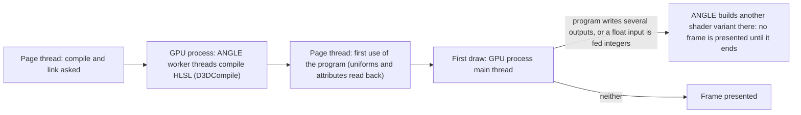

# WebGL program linking and draw-time builds in Chrome on Windows

How a WebGL 2 page's shader programs, uploads and first draws cost time in Chrome on Windows, where ANGLE translates WebGL to Direct3D 11, and what the Studio's 3D view does so that switching a V, a body or a lighting setup never freezes the page or the screen. Everything here was measured by XF Studio's own probes and traces in profiles phase 4a ([experiment 043](../experiments/043-scene-runtimes/README.md), §11–§15) on an RTX 4070 with headless Chrome 155; other GPUs and drivers may differ in size, not, as far as we know, in kind.

Grades: **[offline]** measured by our own probes, traces and tests in the browser (never the game); **[source]** read in Three.js r186's source; **[hypothesis]** not established. There is no game evidence on this page: it is about the Studio's browser preview.

## 1. Where the time goes

| Cost | Where it runs | Size | Grade |
|---|---|---|---|
| Linking a program (the HLSL compile) | ANGLE's worker threads in the GPU process | cold: 40 programs took 94 s in one blocking task before 4a ([S2](../experiments/039-view-switch-spike/README.md)); a cold V's set 25–47 s once behind progress | [offline] (043 §11) |
| Asking whether a link is done, without the extension | blocks the page until the link ends | the slowest cold program 13.2 s | [offline] (043 §11) |
| A program's first use (`getUniforms`, `getAttributes`) | the page thread, one synchronous round trip | small once linked; it waits for the link otherwise | [offline] |
| A draw-time shader build (§3) | the GPU process's main thread, inside the draw's command-buffer task | 1.1–5.9 s per skin variant on real data; 25–70 ms per integer-input vertex shader | [offline] (043 §11, §12) |
| Uploading a map | the page thread, waiting for room when the GPU process is busy | a 1024² map 141 ms while the GPU process built a shader; a 4096² map whole 35–63 ms | [offline] (043 §11) |
| Three's morph-target texture at a mesh's first draw | the page thread, inside the draw | the head's 105 targets: 50–102 ms | [offline] (043 §12, §13) |

## 2. Linking ahead, in parallel, and paced

- **KHR_parallel_shader_compile makes linking asynchronous to the page.** With it, a page links programs on ANGLE's worker threads and asks `COMPLETION_STATUS_KHR`, which never waits. Three's `compileAsync` uses it. The tested configuration (headless Chrome 155, ANGLE on Direct3D 11, an RTX 4070) offers it [offline]; whether every Chrome, GPU and backend on Windows does is unverified, so the Studio keeps a path without it (below). Without it, the page has no way to ask whether a link is done without waiting: a fence after the link signals early, because ANGLE still links on its worker threads, and the program's first use then blocks until the link ends (13.2 s) [offline] (043 §11, *The fallback*).
- **Three's own first use waits.** Three reads a program's link status and info log at its first use (`checkShaderErrors`); that read waits for the driver. Read it only once `COMPLETION_STATUS_KHR` says the link is done [source] [offline].
- **A program key includes renderer-global state.** Three keys programs on tone mapping, output colour space and the shadow map's type, and on whether a mesh receives shadows, so a program compiled ahead under other values is not the one drawn: apply the draw's renderer state, and mark each mesh as the frame marks it, before compiling [source] (043 §8, §11).
- **An unlit material's program depends on the lights too, and lives as long as its materials.** Three r186 puts the scene's light counts in every program's key (`getProgramCacheKeyParameters` pushes them whatever the material), so even a `PointsMaterial` or `LineBasicMaterial` gets one program per lighting setup. A material keeps every program it was ever given until it is disposed, and Three frees a program when the last material holding it goes [source]. So a helper made per mount (an editor's guides) and compiled ahead through stand-ins keeps only the variants its stand-ins were compiled for: one compiled while it was mounted goes with it, and the next mount links it again in its first frame. G3 measured exactly that, two programs on each warm switch to a V whose lighting was prepared while it was shown; drawing with the head's own materials removed it [offline] (043 §14, §15).
- **A render target's size isn't in any program's key.** Releasing a hidden runtime's frame-sized targets and making them again as it is shown linked nothing over eight warm switches, and the first frame uploaded only what a later frame did [offline] (043 §15). Switching between warm runtimes that each show a different makeup look (each keeping its own look's masks and merged plate) linked nothing either, and drew no composite: 16 switches, with and without KHR_parallel_shader_compile [offline] ([044 §10](../experiments/044-profile-tabs/README.md#10-p2-iii-as-built)).
- **Moving the canvas to another element links nothing.** Reparenting the renderer's host element (the canvas inside it) into another pane of another size, as the Studio does when the drawn 3D view's pane changes, and resizing the shown runtime to it, linked and made no program over six moves, drew at each pane's size within one or two frames, raised no context event and kept the warm runtime resident; a warm switch after the moves linked nothing in its first frame. The same with and without KHR_parallel_shader_compile [offline] ([044 §11](../experiments/044-profile-tabs/README.md#11-p2-iii-b-as-built); probe section 6e).
- **Window release includes the shared device after its runtimes.** Releasing a head frees that runtime's resources, while the viewport owns the shared renderer/context. Startup first settles/commits and saves pending workspace state while capture sources remain live; the persistence owner retains owned unsaved work independently of current lease permission. Only pending coarse requests under a lost lease encode once with the exact plan of the last successful save, without writing, refitting or reading today's budget/reservation, and compare with the existing last-written bytes. Equality permits release, including differences normal storage trimming omits; differing bytes or capture/encoding failure preserves recovery/export sources. Failed saves remain refused without another encoding pass. Normal autosaves retain no extra full snapshot and do no extra serialization; initially read-only sessions still retire without capture [offline: `tests/workspace-lifetime.test.ts`, `tests/workspace-persistence.test.ts`]. It then withdraws shell consumers, releases the head owner and calls viewport disposal before releasing the shared editor. The renderer device disposes Three, requests context loss and removes its canvas [source: `src/compose/studio-startup.ts`, `src/preview/browser/browser-viewport-device.ts`, `src/platform/scene/renderer-device.ts`]. A CPU stand-in verifies one device release after the runtime count reaches zero and refuses subsequent construction [offline: `tests/browser-viewport-device.test.ts`; [CORE-03 13c1](../research/authoring/core-03-plan.md#slice-13c1-as-built-29-october-2026)]. This is ownership/order evidence, not a measured GPU context count; complete mounted normal/empty/partial-start resource-baseline proof remains 13c3.
- **Makeup raster demand follows feature registration.** The browser's existing feature owner contributes its preview/raster factory and lazy worker; the host reads the same owner's per-body plate preparation. Without that contribution, head-only preparation emits head/eyes with no plate, and the head lifecycle binds no makeup surface or guide work. With it, the same device and warm-hold arithmetic run; no second raster or geometry owner is introduced. CPU regressions confirm absent-feature construction, independent head-only cache/readiness, abort/late-result refusal and byte parity against `2afdbe8d` (three synthetic output/worker/warm-hold snapshots and six optional private raster hashes). These are in-memory/file derivation results, **not new GPU timing or shell-mount evidence** [source: `src/preview/browser/preview-capabilities.ts`, `layered-preview-capability.ts`, `browser-head-attachment.ts`, `src/preview/host/preview-core-service.ts`; offline: `tests/registered-preview.test.ts`, `tests/core-preview-parity.test.ts`; [CORE-03 slice 10](../research/authoring/core-03-plan.md#slice-10-as-built-28-october-2026)].
- **Warm makeup reuse requires completed inputs.** A held canvas can predate the layer last presented when a look is edited and left before its new raster finishes. The device records the inputs actually painted into each canvas; adopting the hold compares those completed inputs and re-rasters stale or unfinished slots, keeping completed siblings. This is the CPU-side condition for the zero-raster warm switch above, not a new GPU measurement [source: `src/legacy/eye-makeup/browser/browser-preview-device.ts`; regressions in `tests/browser-preview-device.test.ts` fail without it [offline]: 044 §10, *Review fixes*].
- **A pinned inspector's editable data does not demand a runtime or raster.** Phase 3 keeps one wanted edit context per look over the existing look sessions, with a separate stable attachment for the drawn document. An unseen look edit reaches its own writer/history without replacing that attachment; acquiring or editing an unseen V's keyed character context requests no head or choice-preview device. Accepted async input retains that concrete data writer until completion even if focus or drawing changes. Its execution, progress, activity, Stop/abort and result freshness use one captured service bundle in a separate accepted-operation object that receives no live router. A completed package keeps a bounded read-only result lifetime after the editable-context want releases; root and pinned Check/Build regressions prove current results across navigation, stale results after captured content changes (including a reacquired editor), and captured Reveal receipts. Completion is published once; later result-read notifications repaint freshness without replacing a newer operation outcome. This adds no renderer, head or editable-context want. A drawn attachment settles only its own adjustments; a pinned requester's Cancel still restores its start after another look is drawn. These are source and in-memory service observations, **not new GPU timing evidence** [source: `src/library/look-edit-contexts.ts`, `src/app/profiles/profile-authoring.ts`, `src/preview/browser/browser-scene-heads.ts`; 27 October 2026 service regressions in `tests/profile-edit-contexts.test.ts`, `tests/profile-context-review.test.ts`, `tests/accepted-studio-operation.test.ts` and `tests/browser-scene-heads.test.ts`; [047 P3-ii](../experiments/047-profile-bindings/README.md#p3-ii-keyed-edit-contexts-and-routing)]. The shown-plus-one-warm runtime budget and completed-raster checks above still govern actual rendering.
- **Detached data captures stop at the application boundary.** Menus and accepted file/library work may retain a bound writer across panel retirement. Application abort releases those wants, capture subscriptions and completed-result readers, cancels pending picker/read/Check/Build/progress work and suppresses late downloads, results and feedback. The workspace first decides whether it can retire; pending commands are secured in the existing outbox before the Web Lock/channel or desktop stream ends. In-flight commands keep their original recovery IDs for retry/receipt replay. Normal handover protects remaining backups (conflicts included) before releasing; post-release retirement performs no persistence or storage settlement. Failed shutdown suspends sending/admission even if backup protection fails, so superseded replies cannot form a retry loop; values remain available for explicit recovery. Suspension is projected through the existing read-only application gate before further edits apply. The real-profile regression proves a refused opacity edit leaves the shown document unchanged and Export copy equals that state. Explicit presentation recovery retry resumes sending/editing only with a writable lease and successful protection; failed protection, lease loss or terminal shutdown refuse and preserve the copy [offline: `tests/document-outbox-recovery.test.ts`]. The shell reads the dedicated presentation status facade through `Frame`, not the aggregate snapshot; both paths share one suspension-aware reader. A real-port-to-Frame light-DOM regression proves the full recovery message and actions render immediately during an actual opacity control run, and normal status returns unchanged after recovery [offline: `tests/document-outbox-recovery.test.ts`]. The two-holder and failed-backup/in-flight regressions reproduce the pre-fix overwrite/loop and verify their absence after correction [offline: `tests/workspace-host-lifetime.test.ts`, `tests/document-outbox-lifetime.test.ts`]. Application lifetime is injected through bootstrap/mount into UI runtimes, not exposed as public presentation-port signals. That internal signal ends menu captures and suppresses late accepted feedback; normal menu dismissal still preserves accepted feedback [offline: `tests/studio-presentation.test.ts`, `tests/profile-instance-controllers.test.ts`]. Crash outcomes settle at suspension even when backup failure prevents retirement, and recovery order reserves the sequence high-water mark of older durable copies hidden from the merged view [offline: `tests/document-outbox-model.test.ts`, including the deterministic slow-clock regression and 43,600 seeded steps]. No renderer or raster owner is added [source: `src/app/profiles/panel-editing-contexts.ts`, `src/app/accepted-studio-operation.ts`, `src/app/browser/document-outbox-device.ts`, `src/app/browser/workspace-lease-device.ts`; offline: `tests/accepted-work-lifetime.test.ts`, `tests/workspace-host-lifetime.test.ts`, `tests/document-outbox-lifetime.test.ts`, `tests/profile-instance-controllers.test.ts`; [CORE-03 13c2 report](../research/authoring/core-03-s13c2-report.md)]. This is CPU ownership/durability evidence; mounted GPU/resource-baseline proof remains 13c3.
- **Several UV controllers do not imply several GPU previews.** P3-iii gives every mounted UV instance a separate CPU canvas, viewport attachment, input subscription and gesture source over its bound edit context. The existing drawn-look raster owner supplies masks only when their look matches; another look's mask is never substituted. An unseen look can edit its contours and handles without a resident head or a second raster scheduler. Instance navigation is plain session state outside Undo. Shell captures originate in the focused instance, including an unseen inspector, and each receiving menu or popover acquires its own data want before the giver releases. Controller retirement aborts its global input listeners; loaded-row DOM identities and validated instance preference keys remain separate per controller. These rules have real-controller, capture-handoff and listener-count regressions in `tests/profile-instance-controllers.test.ts`. Accepted work keeps execution/progress/Stop under its initiating file owner. These are source-level ownership boundaries; simultaneous unseen-look raster demand remains phase 5, and image handoff, browser task timings and GPU disposal still need the coordinator's browser probes [source: `src/preview/browser/panel-uv.ts`, `src/studio-ui/panels/instance-panels.ts`, `src/app/profiles/panel-editing-contexts.ts`, `src/app/studio-file-operations.ts`; [047 P3-iii](../experiments/047-profile-bindings/README.md#p3-iii-instance-composition-and-captures-code-half)].
- **Recovery preserves document identity separately from the editable chain.** P3-vi's owner status projection retains removed/purged/unavailable scene and pin references, and includes the requesting panel instance. Startup and ensure paths must distinguish an assigned removed target from an unassigned slot: they preserve its reference and create no replacement V/look. Real head-loader restart/restore tests confirm that the original V reconnects. A deleted V's old runtime is evicted rather than reused with its terminal context; Restore acquires a fresh context for the same ID. A removed look keeps its collection recovery/import surface. Pending live documents keep their existing recovery controls. Snapshot reads create no panel or graph view; a missing chooser is shown/added only by a captured action, and can bind to an existing retained scene while its assigned document needs recovery. Root and inspector imports beside a removed look retain its recovery identity; returning that document during an open picker invalidates the old import before any write. This is source/in-memory evidence from `tests/empty-choices.test.ts`, `tests/profiles-startup.test.ts`, `tests/profiles-studio.test.ts`, `tests/profile-instance-controllers.test.ts` and the independent retention model (8 seeds, 512 commands, 40 restarts), **not new renderer, raster or GPU timing evidence** [source: `src/app/profiles/targets.ts`, `profile-window.ts`, `panel-actions.ts`, `empty-choices.ts`, `panel-editing-contexts.ts`, `src/character/character-service.ts`, `src/preview/browser/browser-scene-heads.ts`; [047 P3-vi](../experiments/047-profile-bindings/README.md#p3-vi-recovery-services-code-half)].
- **Warm readiness follows shown draws too.** A look edited while shown can change its mesh/material identities after its explicit preparation. Once a full shown frame has used that topology, keeping only the earlier preparation's identities needlessly prepares it again on its first warm visit. The scene now records successful shown draws as well as explicit preparations, scoped to the context generation and actual lighting state; a topology change drops the older lighting-state records. Hidden warm-up pieces never establish this readiness [source: `platform/scene/scene-host.ts`; offline G4 T-d: five warm visits at 45–57 ms, zero links/programs/rasters, against 191 ms and a redundant preparation before the fix; [044 §15](../experiments/044-profile-tabs/README.md#15-p2-vii-as-built)].
- **A shared runtime's preparation follows its surviving destination view.** Closing the initiating view while details load must not leave preparation reading that closed view: that exception would take residency's preparation-failure fallback and show the runtime without calling `scene.prepare()`, restoring cold first-draw work. The runtime owner resolves the destination after construction and preparation waits; the hidden head rebinds its preview, settles any changed body request, and only then warms the scene. With no surviving destination, the owner aborts the existing request's signal and nothing is shown [source: `preview/browser/browser-scene-heads.ts`, `browser-head-attachment.ts`; offline, in-memory regressions in `tests/browser-scene-heads.test.ts`, 25 October 2026: closure during construction, detail loading and scene preparation, plus last-view cancellation; no new GPU timing measurement].
- **Compiling ahead covers what Three builds inside its passes.** The shadow pass picks a depth material per caster (`getDepthMaterial`), the contact prepass draws casters in their own depth materials, and Three draws a textured background with its own plane (`BackgroundMaterial`, linked inside the first studio frame: 2.3 s cold). Each has to be compiled ahead explicitly [source] [offline] (043 §11).
- **Asking for every link at once saturates the CPU.** Asking for a setup's 20–50 links together started that many `D3DCompile` jobs in the GPU process and took every core; the page's own thread then sat in tasks of 100–500 ms with nothing of its own in them. Pacing the links to a quarter of the cores (two to six at once) removed those tasks; the whole set took about 15 % longer [offline] (043 §11, 4a-v-b; `platform/scene/link-pacing.ts`).
- **A link's cost follows the code that survives.** The skin scatter's second and third targets (√albedo and metalness) need no light; computing them before the lighting code let the compiler drop it, and their programs went from 13–14 s to 4–13 ms to link [offline] (043 §12).
- **Shaders of a program compiled ahead but never used stay on the driver.** Three deletes a program's shaders at its first use; a program compiled ahead and released unused (a superseded preparation) must delete them itself (`materials/render/linked-programs.ts`) [source] [offline] (043 §11).

## 3. Builds at the first draw: several outputs and integer inputs

ANGLE on Direct3D 11 builds some shader variants not at link time but at the first draw that needs them, **synchronously on the GPU process's main thread**, inside the draw's command-buffer task (`CommandBufferService:PutChanged`). Nothing is presented while it runs, so the screen and any progress line freeze [offline] (Chrome traces, 043 §11–§12).

| Trigger | What ANGLE does | Measured | Fix |
|---|---|---|---|
| A program that writes several outputs (`layout(location = n)`, n > 0; multiple render targets) | links the pixel shader for its first output only (043 §12 names ANGLE's `GetDefaultOutputLayoutFromShader`), and builds the one for the bound targets at the first draw into them (`D3DCompile` with `SV_TARGET0–2`) | a skin scatter input: 136–148 ms under the studio setup, 1.05–1.19 s under the creator rig; the makeup plate's 5.1–5.8 s; synthetic heads up to 13–15 s | one output per program: draw once per target (`skin-scatter.ts`, `layered-material.ts`, `plate-composite.ts`) |
| A float vertex input fed integers (Three declares `skinIndex` as `vec4`; a glTF's `UNSIGNED_SHORT` joints are fed as they are) | links the vertex shader for float input, and builds another that reads `uint4` and converts at the first draw, once per program per skinned mesh | 25–70 ms each; 24 (1.3 s) on a body switch, 46 (1.9 s) on a first load | joint indices converted to floats at load (`floatJointIndices`, `materials/render/skin.ts`) |

Two things that do **not** help [offline] (043 §11–§12):

- **Binding the targets while linking.** ANGLE takes the output layout from the shader, not from the framebuffer bound at link time.
- **Drawing ahead, hidden.** The build happens inside whichever draw first needs it, whatever target that draw writes, so a hidden warm-up draw holds presentation exactly as a shown one does. Drawing the warm-up in small pieces only shortened each hold to one build.

The gates that keep it this way: `tests/single-output-programs.test.ts` checks the fragment shaders a real Three renderer assembles and the framebuffer attachments it makes, without a GPU; the T2 probe (`tests/webgl-scene-runtimes.test.ts`) records the same calls on a real context over a whole runtime's life (043 §13).

## 4. Uploads wait for a busy GPU process

A texture upload passes its texels through the GPU process's command buffer. When the GPU process is busy (building a shader, §3), the call waits for room on the page thread: a 1024² map took 141 ms to upload while a shader was built [offline] (043 §11). Large decoded maps use 512-row bands (a 4096² map whole 35–63 ms; a band 5–15 ms) [offline]. Waiting for a fence after **every band** is too restrictive when completion reports are late on a quiet context (see §8).

**PREV-196 [coordinator-reported offline measurement, 29 October 2026]:** main `f37aaa53` drew the V at 9.9 / 10.6 s; `2e57ae9f`, which reduced shell work, took 20.3 / 20.7 / 20.3 s on the same load (game at about 45% GPU throughout). The candidate asked at 1.0 s and loaded at 4.1–5.5 s, but `details:uploads` landed at 18.2 s with the page about 85% idle. No draws occurred during preparation in either build. Main sent 23–43 uploads/s; the candidate 3–5/s, with each fence taking 200–250 ms to report completion despite Chrome's own 3D-engine use staying at 1–2%. Source inspection confirms both streaming and explicit preparation marked and waited after each step. A no-draw CPU fake reproduces that latency amplification: 24 bands at fifteen-frame completion latency take 345 frames with the per-band pattern. The suggestion that shell repaints caused Chrome to report completion sooner is still **hypothesis**; these results do not establish the browser's reporting mechanism.

**Bounded upload window [source + offline CPU tests; coordinator-reported browser timing]:** merged step 1 at `19c366b7` draws the complete V at **5.6–7.7 s warm**, versus the recorded main baseline of 9.9–10.6 s. Independent review is MERGE; full suite 4,875/0, GPU 124/0 and browser/resource proofs pass. Earlier window commit `da926994` reached 6.4–6.8 s with uploads finishing 0.4 s after loaded. `platform/scene/gpu-upload-budget.ts` shares one window per renderer among streaming, detail and runtime uploads: up to 16,777,216 outstanding texels (64 MiB RGBA8), checkpointed per turn/window fill. Completion alone returns credit. An oversized indivisible fallback goes alone. The no-draw fifteen-frame-latency fake retains its 45-frame result for 24 bands, versus 345 with per-band barriers. The <2 s restart budget is still unmet.

**Later GPU work requires backlog admission [source/CPU; independent High finding on `da926994`, closed on `90648808`]:** an opening fence alone covers only work preceding the first burst. A later draw, bake or morph round can make the process busy while map credit remains. The budget separates texel checkpoints from an admission barrier. While uploaders own the renderer, `platform/scene/gpu-work.ts` observes render/compile/texture/target/clear submissions. They mark admission dirty; with no barrier pending, the next upload attempt fences that work and waits despite spare credit. Only an admitted map destination's own init/copy calls are exempt. Map-only turns retain streaming throughput; new non-map work during an admitted burst closes admission. Map draining ignores later non-map work, whose morph/draw barriers remain separate. Wrappers preserve receivers/results/errors and restore on final release. Preparation leases end in `finally`, stream leases when their queue ends, and character disposal releases live leases immediately. The coordinator confirms clean typecheck, scene runtimes 28/0 and startup-resources 8/0 on `90648808`, with both reported leaks gone.

**A pending barrier must complete before renewal [source + offline CPU tests; High on `90648808`, resolved in merged step 1]:** renewing on every dirty observation deletes the preceding fence before polling it. A draw every frame can then prevent admission even when reports are only one frame late. The merged policy retains a pending fence until completion and admits one bounded burst, even if the current frame drew after that fence. This deliberately matches the maintainer's accepted tolerance of one ordinary frame between a completed barrier and uploads; it protects against backlog, rather than certifying that no newer command exists. Observations during the wait stay dirty for a new barrier after the turn/window checkpoint, so newer work is not forgotten. New work during the burst still closes admission immediately. Three fake-fence regressions fail on `90648808` and pass after correction, including continuous draws with one/fifteen-frame reports, stable pending-fence identity, several bands per burst and deferred completion after the checkpoint. The real runtime adapter also finishes all 24 map bands while drawing every frame, within the texel bound and with zero surviving fences. Existing busy-work, spent-window, context-loss and lifecycle tests still pass. The coordinator's merged step-1 proofs are green. Strict completion and bounded-link policies remain; the step-2 overlap below has a combined warm-restart measurement, not an isolated fence timing. See the [checkpoint](../research/authoring/perf-restart-checkpoint.md).

**Overlap completion with linking [source + offline CPU tests; PREV-196 step 2 `d418e83f`]:** the details:uploads → details:drained interval also contains layered bakes and program preparation; it is not solely one fence. The final first-use fence used to be inserted after the driver links completed, adding another idle-page report delay. It is now captured after the last preparation submission and polled after linking, before synchronous uniforms/attributes. The existing shared upload owner counts map and non-map submissions in a revision: any change during the link wait requires a refreshed strict fence at the original boundary. Thus a completion from before a newer busy queue cannot skip that barrier. Pre-bake readback/error checks, morph rounds, hidden warm-up and the existing 120-frame drain bound retain their protection. The captured fence is deleted in finally and synchronously on character release, including a held link reply. With fifteen-frame reports and twenty fake link frames, the first-use test takes 35 frames; newer draw work requires the full renewed wait and takes 50. These are CPU simulation results. The coordinator measures 2.92–2.95 s for the complete warm V on `d418e83f`, uploads at 2.14 s and drained at 2.86 s, with GPU 124/0 and resource/browser proofs green before stopping for three non-GPU review fixes. That historical interval includes bake/program/link work and does not isolate the fence cost. The latest whole-V result is **3.1–3.5 s on `879a3ff5`**, blink response 0.8–1.0 s after request, typecheck clean and GPU 124/0. Native queue priority removes the ahead creator backlog; shared-read inheritance and boundary corrections are merged at main `675e5370` (MERGE review, full suite 4,936/0, scene runtimes 28/0 alone), retaining 3.1-3.5 s warm ([checkpoint](../research/authoring/perf-restart-checkpoint.md)).

**Step 3 drain decision [source + CPU-fake tests, uncommitted]:** the latest uploads-to-drained span is 2685-3310 ms. It also contains pre-bake completion, baking, program submission/link readiness and final first-use completion, so it does not isolate a 0.6 s fence. Keep strict completion before synchronous bake/error/readback and uniforms/attributes calls (G2), the existing revision refresh, link overlap and 120-frame bound. New bounded `details:maps-drained`, `details:baked`, `details:programs`, `details:linked` marks separate these costs before the existing drained mark. No barrier is replaced by elapsed time and no new fence/timer is introduced. 126 targeted tests pass; the coordinator measures the phase split before another overlap is chosen. Earlier request admission, async core validation and HTTP ETags change no GPU policy.

Three builds some textures itself inside a draw. Its morph-target texture (one float layer per target, every vertex's position and normal deltas) is filled and uploaded whole at a mesh's first draw [source] (`WebGLMorphtargets.update`, r186): 50–102 ms for the head [offline]. The Studio makes the same texture ahead, a few layers per step with each batch uploaded on its own, and hands it to Three's own map, so the draw finds it ready (`platform/scene/morph-textures.ts`; 043 §13). At the head's size (6,800 vertices, 105 targets) on synthetic data that took 11 steps of at most 8.2 ms, and the draw that followed 8–10 ms with nothing built, against 50–102 ms for Three's own build inside the draw [offline]. Three keeps the texture in a map it doesn't expose, so the Studio patches Three r186 to give each renderer its context's morph textures (`xfsMorphTextures`; [toolchain](../docs/toolchain.md#the-threejs-patch)). The first runtime on a renderer is made ahead too: its first draw took 10.6–10.8 ms (with the program's first use) after 9 steps of at most 8 ms [offline] (043 §13).

## 5. What Chrome keeps across sessions

Chrome's GPU program cache (the shader disk cache in the browser profile) keeps ANGLE's builds, the draw-time ones included. On the same profile, a second session built 1 of a body switch's 33 draw-time variants and a third session none of the creator rig's 56 [offline] (043 §12, *A kept profile*). So the costs in §1 and §3 are mostly first-session costs: a new install, a browser or driver update, or a cleared cache. Every gate is measured on a fresh profile for that reason.

## 6. The context-generation rule

A WebGL context can be lost (driver reset, GPU pressure, `WEBGL_lose_context`) and restored. Everything made in it dies with it, and some of it fails silently rather than with an error [offline] (043 §11, *4a-v-b review fixes*):

- **A program compiled before the loss never completes its link** in the restored context: a preparation polling `COMPLETION_STATUS_KHR` on it waits for ever.
- **A fence from before the loss** can read a `null` status with the context not lost; a wait on it never ends.
- **The context can be lost before its event arrives** (the browser queues it): `isContextLost()` is already true while the `webglcontextlost` handler hasn't run.
- **Three makes new internals on restore**: `renderer.properties` is replaced, its programs dropped, and its private morph-texture map made again [source].

So a *generation* is the life of one context (`platform/scene/context-generation.ts`). Anything that holds GL objects across frames, or records that the GPU holds something ready, keeps its generation's signal, checks it against the generation read again before trusting its state (reading the generation also checks the context), treats its state as gone once the check fails, never deletes a lost context's objects, and runs any wait on that state under the signal, so it ends with the generation [offline].

## 7. How it was measured

| Tool | What it shows |
|---|---|
| `G2_TRACE` in [`measure.ts`](../experiments/043-scene-runtimes/measure.ts) (043 §11–§12) | A Chrome trace of a switch on real data, categories `gpu.angle,gpu`: every `D3DCompile` with its HLSL, sorted by thread (ANGLE's workers at link time, or `CrGpuMain` inside `CommandBufferService:PutChanged` at a draw), and the GPU process's tasks. `G2_TRACE_CATEGORIES` adds the page's own. |
| `tools/gl-probe.ts` (`GL_PROBE`) | Injected before the page's scripts: each program's link (its shader name and XF defines) and how long the page first waited on it, and each upload's time and size (`window.xfsGl`). |
| The T2 probes' counted context (`tests/webgl-gl-objects.ts`) | Live GL objects by kind and who made them; links, programs made and uploads per frame; for the gate table, fragment shaders, attachments and draw buffers as the driver is asked. |
| The Long Tasks API and animation-frame times | Main-thread tasks of 50 ms or more, and the longest gap between presented frames (`tools/frame-gaps.ts`, which counts the gap that ends at the takeover). |
| A fresh Chrome profile per run | A cold program cache, so first-session costs are what is measured (§5). |

**A disposal baseline must exercise renderer reuse first** [offline]. G4's first extra scene caused lazy preparation allocations that outlived that scene (shared maps/program variants and driver allocation pools). Comparing against the untouched first scene counted those as a runtime leak. As the synthetic probe already does, G4 now opens and closes a calibration scene before its baseline, then opens and closes a separate measured scene. The measured scene must still disappear and every live GL count must return exactly; OS-memory tolerances are unchanged. The corrected real-data row returns every GL count to baseline ([044 §15](../experiments/044-profile-tabs/README.md#15-p2-vii-as-built)). Allocation stacks and stable repeated reuse distinguish this from a per-runtime leak; context loss is never used to pass disposal.

## 8. A second runtime of one V: what it costs, and what it shares

A scene runtime (one head and its V, hidden until shown) is built for each scene a tab shows, and only the shown one plus one warm one stay. A third tab showing a V that two others already hold is built from nothing, and what it costs is mostly what the renderer already holds. Measured by G4's row T-e on real data, a warm Chrome cache and a warm host, headless Chrome 155 on the RTX 4070 ([044 §16](../experiments/044-profile-tabs/README.md#16-the-cold-third-tab-t-e-95-s-to-under-1-s)) [offline]:

| Stage of the cold takeover | Before | After (three trials) |
|---|---|---|
| Click to the host being asked (core head, rig) | 0.20 s | 0.15–0.21 s |
| The V's parts loaded (files fetched, decoded, parts built) | 0.54 s | 0.15–0.18 s |
| The V's maps uploaded | **7.06 s** | 0.03 s |
| A wait for the GPU before the programs' first use | 0.31 s | 0.005 s |
| The runtime's own morph textures and maps | 0.98 s | 0.16–0.18 s |
| The rest (host answer, programs, editor parts, warm-up, presentation) | 0.4 s | 0.3–0.4 s |
| **Click to the first presented frame** | **9.5 s** (9.1–10.3 in G4) | **0.82–0.91 s** (fresh Chrome profile 0.84–0.93 s) |

- **The maps are the renderer's, not the runtime's** [offline]. 16 maps of 4096² and 16 of 2048² (and smaller) were decoded and uploaded again for every runtime, each band of 512 rows behind its own fence (about 32 ms a band, 0.29 s for a 4096² map), while the same files sat on the GPU for the other two tabs: a second whole-body runtime held about 0.9 GB of the GPU process's private bytes of copies ([043 §14](../experiments/043-scene-runtimes/README.md)). One ledger per renderer **and context generation** (`detailLedgerOf`, `character/render/character-detail-loader.ts`) owns decoded images by content-addressed file and shared textures by file, use, wrap and gamma flag. Meshes, materials, bakes and kept parts stay per runtime. Programs were already shared (a renderer-global key: the cold takeover linked 0 and made 0). The browser's memory peak over the whole T-e row (its three cold builds included) fell from 4.3–4.4 GB to 3.7–3.9 GB.
- **Shared maps have pending image users and texture owners** [offline]. Concurrent loads lease one ledger-owned fetch/hash/decode promise per file; a later CPU reader also shares the element-decode fallback with other CPU readers. Cancelling one requester leaves the others running; the final requester aborts shared work. Non-cancellable late decode answers are discarded and their bitmaps closed. Pending leases protect images until geometry and materials are built; texture references protect them afterwards. With neither kind of owner, the image and reduced bitmap are removed, including after failed geometry, unused material inputs or cancellation. Upload bitmaps close when their waiting textures upload or dispose; later texture variants can use the retained image element. Sharing lasts only while owners remain: after all leave, a request fetches/decodes again. Pool `clear()` is reusable; terminal `dispose()` aborts loads and releases late returns. The last texture reference reaches zero and fires disposal, including when a runtime closes during geometry loading. After restoration, new loads use a fresh ledger and cannot acquire dead-generation textures or parts; Three can rebuild the shown runtime's existing textures from their images. The scene host keeps a live request pending across a generation abort, waits for the device to restore the runtimes, then retries loading against the new pool. A requester cancelled before loss or while waiting never retries. [CPU integration regressions](../projects/xf-studio/authoring/tests/character-detail-context.test.ts) drive the real scene-host loader, browser device and actions: one loss gives exactly one retry and reaches `ready`, without an explicit action retry. The map lifetime guarantees are exercised by [renderer-ledger regressions](../projects/xf-studio/authoring/tests/renderer-ledger.test.ts), not established by T-h's allocation baseline alone.
- **A cold-preparation frame gap is not proof of work in the first shown frame** [offline]. Five paired synthetic runtime tests on `15427a40` and main `7d5a8b72` (Chrome 156, RTX 4070/ANGLE D3D11) missed the parallel cold-gap gate in 3/5 runs on each version; including fallback hidden warm-up, misses were 4/10 and 5/10. The branch had larger parallel spikes (median 1,200.1 ms versus 350.0 ms), so equal failure frequency does not establish equal severity. All 20 first shown frames linked/made zero programs and uploaded only the same 17 bone matrices as steady frames. The varying presentation gaps reproduce on main; their cause remains unresolved. The same branch's real-data G4 rerun took **902.1, 924.6 and 979.6 ms** for T-e with no task ≥50 ms. Its initial batch had one 57 ms task during morph-texture preparation, after detail loading; that outlier is retained rather than treated as a pass. Warm T-a/T-d and T-h passed; T-h returned every GL count exactly. These are Chrome 156 results; §8's original 0.82–0.93 s timings used Chrome 155 ([044 §16.8](../experiments/044-profile-tabs/README.md#168-gpu-validation-of-the-review-fixes), [asset-free measurements](../experiments/044-profile-tabs/gpu-validation-2026-10-26.json)).
- **A core head file is fetched and hashed once per renderer and body** [offline]. Each runtime read the 12 MB head file and its hash again: 0.09 s in one trial, 0.5 s in another, with the host unchanged (`sharedGeometryBytes`, `character/render/core-detail-loader.ts`; the record's hash keys it, so a core prepared again is another entry). The core head's own maps are still decoded per runtime (0.03–0.05 s).
- **Morph textures are made in rounds, not one geometry after another** [offline]. The head (105 targets, 23 MB) and seven small parts each went through allocate, fill, upload, every step behind its own fence: 0.7–1.0 s. All geometries now take a round together: fills (memory only) run whenever the frame's 8 ms allow, uploads only once the GPU caught up with the last round's, and one fence marks the round (`prepareRuntime`; `uploading()` on each step says which kind the next is): 0.15–0.19 s, about 15 frames, close to the CPU share a frame allows.
- **Wait for the GPU only after sending it something** [offline]. A preparation waited for a fence before the programs' first use, to keep that synchronous read from queuing behind uploads. A runtime whose maps were already uploaded sent almost nothing and still waited 0.23–0.3 s. It now waits only after sending 4 MB of texels (a bake counts as that) or more.
- **A fence on a quiet context signals late** [offline] [hypothesis for the cause]. A standalone probe on the shown canvas's context, the page idle: the first fence signalled in 2 frames, the next 29 each in 17–19 frames (about 0.29 s), in two sessions. With a command sent each frame while it waited, the timings varied: a clear of a scratch target gave 2 frames in 10 of 10 trials, a 1-texel upload 2 frames in 9 of 10, a flush or `getError` mostly 16–17. So the wait seen after a preparation's links, with the shown runtime still, is not the GPU's work. A nudge through Three (a clear of a 1-texel target on every poll of the gate) did not shorten that wait in three runs, so the cause is unresolved, and the Studio avoids the wait rather than shortening it. Any gate that polls a fence at idle should expect 0.29 s.

What remains in those measured cold-third-tab runs of one V is 0.8–0.9 s: the core head and rig per runtime (0.15–0.2 s), the host's answer (about 55 ms), the parts (0.15 s), morph textures (0.16 s, bounded by the frame's CPU share), the editor's parts (0.06 s) and the warm-up draws (0.1–0.15 s). A third tab showing a **different V** shares nothing and is still a multi-second wait [offline]: the masculine default V, cold, took 4.7–4.8 s (three trials), 3.3 s of it uploading its own maps at the same pace (about 260 MB/s: one band of 512 rows per two frames) and 0.4 s waiting for the GPU after them. The PREV-196 bounded-window candidate (§4) replaces that per-band policy; the different-V cold takeover has not been remeasured under it. Moving less data (GPU-compressed preview maps, listed in the performance track) remains another route.

- **Application release instrumentation is separate from renderer reports** [source/CPU, 29 October 2026]. CORE-03 13c3 adds a CDP init script which wraps native listener/timer/frame registrations, workers, WebGL context events and observer registration before the real entry loads. Four required browser rows retain the page while checking mounted/partial normal and empty compositions against their pre-load baselines; storage, connected-DOM writes, draw calls, callbacks, activity and history are checked after delayed replies. CPU negative controls detect deliberate registrations and their real removal. The coordinator's first run found a surviving document keydown listener in each painted mount; its accepted `6cfdbb86` checkpoint reports 8 pass, 0 fail after the listener and held-pointer fixes (coordinator-reported offline browser evidence, carried into the [13d record](../research/authoring/core-03-s13d-report.md)). Slice 13d adds empty/synthetic CDP rows; those new results remain pending. CPU proofs alone do not establish a mounted baseline. Shell lifetime now disconnects the existing dock/header/tab/filter/dial observers and removes global tips/guidance/theme/menu listeners, clearing queued feedback/focus/paint work. Facial HTTP/body replies carry the owner signal. Warm metadata and untaken files cancel on expiry; a taken file retains its independent application-bounded request, so expiry does not break a live loader. Application abort cancels both and late non-cancellable bitmap decodes close their results; geometry task boundaries check cancellation and release late parsed objects. The original warm owner at `73de0a0d` and current owner both pass the taken-file expiry regression [offline: `tests/facial-lifetime.test.ts`, `tests/warm-start-lifetime.test.ts`, `tests/shell-lifetime.test.ts`, `tests/core-startup-resources.test.ts`; [release report](../research/authoring/core-03-s13c3-report.md)]. No GPU allocation, timing or game-engine result is inferred from those CPU tests.

- **Input connection cleanup must retain its registration root** [source/CPU; coordinator-reported browser failure]. Three OrbitControls registers its Control-key handler on `canvas.getRootNode()` during connect, but rediscovers that root during disconnect. Shell withdrawal first detaches the canvas, so native disconnect misses the original document listener (and a keyup listener if Control is held). `SceneOrbitControls` now gives each connection an AbortSignal, retains the original root for held-Control cleanup, then performs native disconnect. The real-controls regressions detach before release, check both Control states, reconnect and release twice; both fail on `46e905ec` and pass with the correction ([source and regressions](../projects/xf-studio/authoring/tests/orbit-limits.test.ts)). Browser-fixture memory is reduced by completing real core/character preparation before starting Chrome and using 960×720 while retaining real assets, isolated hosts and every paint/resource/late-publication assertion. The coordinator subsequently measured approximately **5.3 GB** peak, returning to about **1.5 GB** between cases; the earlier 3–3.5 GB estimate was too low. This browser file runs as its own coordinator step under a **6 GB** guard, separate from 4 GB CPU batches ([recorded measurement](../research/authoring/core-03-s13c3-report.md)).

- **A nested resize owns a lifetime too** [source/CPU; 13c3 review correction]. DirectionDial now passes its signal into SizeBar. An application/panel abort removes the active document Escape and pointer handlers, drops transient resize state, and releases capture without restoring layout through the owner, publishing a final resize or persisting a size. Retained resize/reset/refresh entry points refuse after abort. Ordinary Escape, release, reset and remembered sizes retain their existing semantics. Three [component regressions](../projects/xf-studio/authoring/tests/ui-components.test.ts) cover active and pre-aborted retirement, including the real nested dial, late Escape/pointer input, capture release, callbacks and an independent memory writer. The integrated painted rows now arm that actual mounted grip and compare preferences after retirement. Those new Chrome rows await coordinator execution. Their optional game setup follows existing oracle policy: configured game files and a usable configured/managed WolvenKit gate the painted rows; asset-free partial starts require only Chrome. Missing setup skips normally and fails when oracles are required; both policies were exercised without a browser. This adds no game-engine or GPU claim.

## Open questions

- **Other GPUs and drivers.** Every number here is one RTX 4070 on ANGLE's D3D11 backend. Whether integrated GPUs, AMD drivers or ANGLE's Vulkan backend build the same draw-time variants is unmeasured [hypothesis: the D3D11 backend's output-layout rule is the same everywhere].
- **The first load's room prefilter** still links PMREM's programs and prefilters on the page thread (0.4 s cold, 80–100 ms warm) for the first runtime on a renderer (043 §11).
- **The cold link time itself** (25–47 s for a V under the creator rig) is behind progress, not removed: it is the performance track's.

- **Readiness text has the same optional owner as the feature's view** [source/CPU]. CORE-03 13d moves the status-bar call into eye makeup's existing view binding. An empty binding list must not read texture or viewport readiness and renders no badge. The frozen status-bar regression compares the pre-edit footer tree, wording and tooltip precedence over 26 cases; no CSS changes. A separate test-only feature/composition uses the real core's registered codec, editor, actions, history and file adapter, with abort rejecting later editor/file reads. Its 23-edge direct-import audit finds three integration files and no production importer; retained legacy placement does not imply mandatory runtime construction. These are source/CPU and text/structure parity results, not new browser/GPU or game timing evidence ([proofs and limits](../research/authoring/core-03-s13d-report.md)).
