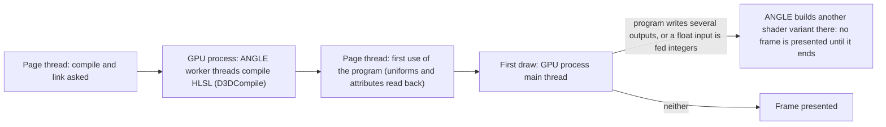

# WebGL program linking and draw-time builds in Chrome on Windows

How a WebGL 2 page's shader programs, uploads and first draws cost time in Chrome on Windows, where ANGLE translates WebGL to Direct3D 11, and what the Studio's 3D view does so that switching a V, a body or a lighting setup never freezes the page or the screen. Everything here was measured by XF Studio's own probes and traces in profiles phase 4a ([experiment 043](../experiments/043-scene-runtimes/README.md), §11–§13) on an RTX 4070 with headless Chrome 155; other GPUs and drivers may differ in size, not, as far as we know, in kind.

Grades: **[offline]** measured by our own probes, traces and tests in the browser (never the game); **[source]** read in Three.js r186's source; **[hypothesis]** not established. There is no game evidence on this page: it is about the Studio's browser preview.

## 1. Where the time goes

| Cost | Where it runs | Size | Grade |
|---|---|---|---|
| Linking a program (the HLSL compile) | ANGLE's worker threads in the GPU process | cold: 40 programs took 94 s in one blocking task before 4a ([S2](../experiments/039-view-switch-spike/README.md)); a cold V's set 25–47 s once behind progress | [offline] (043 §11) |
| Asking whether a link is done, without the extension | blocks the page until the link ends | the slowest cold program 13.2 s | [offline] (043 §11) |
| A program's first use (`getUniforms`, `getAttributes`) | the page thread, one synchronous round trip | small once linked; it waits for the link otherwise | [offline] |
| A draw-time shader build (§3) | the GPU process's main thread, inside the draw's command-buffer task | 1.1–5.9 s per skin variant on real data; 25–70 ms per integer-input vertex shader | [offline] (043 §11, §12) |
| Uploading a map | the page thread, waiting for room when the GPU process is busy | a 1024² map 141 ms while the GPU process built a shader; a 4096² map whole 35–63 ms | [offline] (043 §11) |
| Three's morph-target texture at a mesh's first draw | the page thread, inside the draw | the head's 105 targets: 50–102 ms | [offline] (043 §12, §13) |

## 2. Linking ahead, in parallel, and paced

- **KHR_parallel_shader_compile makes linking asynchronous to the page.** With it, a page links programs on ANGLE's worker threads and asks `COMPLETION_STATUS_KHR`, which never waits. Three's `compileAsync` uses it. The tested configuration (headless Chrome 155, ANGLE on Direct3D 11, an RTX 4070) offers it [offline]; whether every Chrome, GPU and backend on Windows does is unverified, so the Studio keeps a path without it (below). Without it, the page has no way to ask whether a link is done without waiting: a fence after the link signals early, because ANGLE still links on its worker threads, and the program's first use then blocks until the link ends (13.2 s) [offline] (043 §11, *The fallback*).
- **Three's own first use waits.** Three reads a program's link status and info log at its first use (`checkShaderErrors`); that read waits for the driver. Read it only once `COMPLETION_STATUS_KHR` says the link is done [source] [offline].
- **A program key includes renderer-global state.** Three keys programs on tone mapping, output colour space and the shadow map's type, and on whether a mesh receives shadows, so a program compiled ahead under other values is not the one drawn: apply the draw's renderer state, and mark each mesh as the frame marks it, before compiling [source] (043 §8, §11).
- **Compiling ahead covers what Three builds inside its passes.** The shadow pass picks a depth material per caster (`getDepthMaterial`), the contact prepass draws casters in their own depth materials, and Three draws a textured background with its own plane (`BackgroundMaterial`, linked inside the first studio frame: 2.3 s cold). Each has to be compiled ahead explicitly [source] [offline] (043 §11).
- **Asking for every link at once saturates the CPU.** Asking for a setup's 20–50 links together started that many `D3DCompile` jobs in the GPU process and took every core; the page's own thread then sat in tasks of 100–500 ms with nothing of its own in them. Pacing the links to a quarter of the cores (two to six at once) removed those tasks; the whole set took about 15 % longer [offline] (043 §11, 4a-v-b; `platform/scene/link-pacing.ts`).
- **A link's cost follows the code that survives.** The skin scatter's second and third targets (√albedo and metalness) need no light; computing them before the lighting code let the compiler drop it, and their programs went from 13–14 s to 4–13 ms to link [offline] (043 §12).
- **Shaders of a program compiled ahead but never used stay on the driver.** Three deletes a program's shaders at its first use; a program compiled ahead and released unused (a superseded preparation) must delete them itself (`materials/render/linked-programs.ts`) [source] [offline] (043 §11).

## 3. Builds at the first draw: several outputs and integer inputs

ANGLE on Direct3D 11 builds some shader variants not at link time but at the first draw that needs them, **synchronously on the GPU process's main thread**, inside the draw's command-buffer task (`CommandBufferService:PutChanged`). Nothing is presented while it runs, so the screen and any progress line freeze [offline] (Chrome traces, 043 §11–§12).

| Trigger | What ANGLE does | Measured | Fix |
|---|---|---|---|
| A program that writes several outputs (`layout(location = n)`, n > 0; multiple render targets) | links the pixel shader for its first output only (043 §12 names ANGLE's `GetDefaultOutputLayoutFromShader`), and builds the one for the bound targets at the first draw into them (`D3DCompile` with `SV_TARGET0–2`) | a skin scatter input: 136–148 ms under the studio setup, 1.05–1.19 s under the creator rig; the makeup plate's 5.1–5.8 s; synthetic heads up to 13–15 s | one output per program: draw once per target (`skin-scatter.ts`, `layered-material.ts`, `plate-composite.ts`) |
| A float vertex input fed integers (Three declares `skinIndex` as `vec4`; a glTF's `UNSIGNED_SHORT` joints are fed as they are) | links the vertex shader for float input, and builds another that reads `uint4` and converts at the first draw, once per program per skinned mesh | 25–70 ms each; 24 (1.3 s) on a body switch, 46 (1.9 s) on a first load | joint indices converted to floats at load (`floatJointIndices`, `materials/render/skin.ts`) |

Two things that do **not** help [offline] (043 §11–§12):

- **Binding the targets while linking.** ANGLE takes the output layout from the shader, not from the framebuffer bound at link time.
- **Drawing ahead, hidden.** The build happens inside whichever draw first needs it, whatever target that draw writes, so a hidden warm-up draw holds presentation exactly as a shown one does. Drawing the warm-up in small pieces only shortened each hold to one build.

The gates that keep it this way: `tests/single-output-programs.test.ts` checks the fragment shaders a real Three renderer assembles and the framebuffer attachments it makes, without a GPU; the T2 probe (`tests/webgl-scene-runtimes.test.ts`) records the same calls on a real context over a whole runtime's life (043 §13).

## 4. Uploads wait for a busy GPU process

A texture upload passes its texels through the GPU process's command buffer. When the GPU process is busy (building a shader, §3), the call waits for room on the page thread: a 1024² map took 141 ms to upload while a shader was built [offline] (043 §11). The Studio sends each upload only once a fence after the previous one has signalled (`platform/scene/gpu-gate.ts`), and a large map in bands of 512 rows (a 4096² map whole 35–63 ms; a band 5–15 ms) [offline].

Three builds some textures itself inside a draw. Its morph-target texture (one float layer per target, every vertex's position and normal deltas) is filled and uploaded whole at a mesh's first draw [source] (`WebGLMorphtargets.update`, r186): 50–102 ms for the head [offline]. The Studio makes the same texture ahead, a few layers per step with each batch uploaded on its own, and hands it to Three's own map, so the draw finds it ready (`platform/scene/morph-textures.ts`; 043 §13). At the head's size (6,800 vertices, 105 targets) on synthetic data that took 11 steps of at most 8.2 ms, and the draw that followed 8–10 ms with nothing built, against 50–102 ms for Three's own build inside the draw [offline]. Three keeps the texture in a map it doesn't expose, so the Studio patches Three r186 to give each renderer its context's morph textures (`xfsMorphTextures`; [toolchain](../docs/toolchain.md#the-threejs-patch)). The first runtime on a renderer is made ahead too: its first draw took 10.6–10.8 ms (with the program's first use) after 9 steps of at most 8 ms [offline] (043 §13).

## 5. What Chrome keeps across sessions

Chrome's GPU program cache (the shader disk cache in the browser profile) keeps ANGLE's builds, the draw-time ones included. On the same profile, a second session built 1 of a body switch's 33 draw-time variants and a third session none of the creator rig's 56 [offline] (043 §12, *A kept profile*). So the costs in §1 and §3 are mostly first-session costs: a new install, a browser or driver update, or a cleared cache. Every gate is measured on a fresh profile for that reason.

## 6. The context-generation rule

A WebGL context can be lost (driver reset, GPU pressure, `WEBGL_lose_context`) and restored. Everything made in it dies with it, and some of it fails silently rather than with an error [offline] (043 §11, *4a-v-b review fixes*):

- **A program compiled before the loss never completes its link** in the restored context: a preparation polling `COMPLETION_STATUS_KHR` on it waits for ever.
- **A fence from before the loss** can read a `null` status with the context not lost; a wait on it never ends.
- **The context can be lost before its event arrives** (the browser queues it): `isContextLost()` is already true while the `webglcontextlost` handler hasn't run.
- **Three makes new internals on restore**: `renderer.properties` is replaced, its programs dropped, and its private morph-texture map made again [source].

So a *generation* is the life of one context (`platform/scene/context-generation.ts`). Anything that holds GL objects across frames, or records that the GPU holds something ready, keeps its generation's signal, checks it against the generation read again before trusting its state (reading the generation also checks the context), treats its state as gone once the check fails, never deletes a lost context's objects, and runs any wait on that state under the signal, so it ends with the generation [offline].

## 7. How it was measured

| Tool | What it shows |
|---|---|
| `G2_TRACE` in [`measure.ts`](../experiments/043-scene-runtimes/measure.ts) (043 §11–§12) | A Chrome trace of a switch on real data, categories `gpu.angle,gpu`: every `D3DCompile` with its HLSL, sorted by thread (ANGLE's workers at link time, or `CrGpuMain` inside `CommandBufferService:PutChanged` at a draw), and the GPU process's tasks. `G2_TRACE_CATEGORIES` adds the page's own. |
| `tools/gl-probe.ts` (`GL_PROBE`) | Injected before the page's scripts: each program's link (its shader name and XF defines) and how long the page first waited on it, and each upload's time and size (`window.xfsGl`). |
| The T2 probes' counted context (`tests/webgl-gl-objects.ts`) | Live GL objects by kind and who made them; links, programs made and uploads per frame; for the gate table, fragment shaders, attachments and draw buffers as the driver is asked. |
| The Long Tasks API and animation-frame times | Main-thread tasks of 50 ms or more, and the longest gap between presented frames (`tools/frame-gaps.ts`, which counts the gap that ends at the takeover). |
| A fresh Chrome profile per run | A cold program cache, so first-session costs are what is measured (§5). |

## Open questions

- **Other GPUs and drivers.** Every number here is one RTX 4070 on ANGLE's D3D11 backend. Whether integrated GPUs, AMD drivers or ANGLE's Vulkan backend build the same draw-time variants is unmeasured [hypothesis: the D3D11 backend's output-layout rule is the same everywhere].
- **The first load's room prefilter** still links PMREM's programs and prefilters on the page thread (0.4 s cold, 80–100 ms warm) for the first runtime on a renderer (043 §11).
- **The cold link time itself** (25–47 s for a V under the creator rig) is behind progress, not removed: it is the performance track's.
