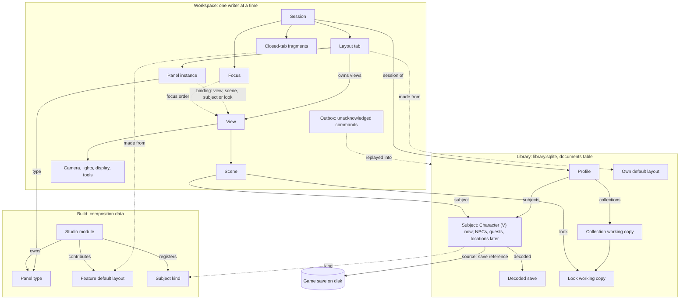

# Profiles, views and layout tabs: design

**Status:** proposed design for review (21 October 2026; revised three times after two independent reviews and the spikes, see [Review changes](#review-changes)). Nothing is built beyond the spikes: S1 and S3 pass, and S2 failed as designed, so the scene-runtime split (phase 4a) comes before tabs. The whole proposal is pre-beta work (§9). The [architecture contract](architecture-contract.md) governs throughout, and the backlog's [profiles entry](../backlog/README.md#profiles-and-multiple-vs-after-the-beta) records the product decisions this page builds on.

**What this page supersedes in the [view graph design](view-graph-design.md).** This page is the one contract for these topics:

- the Modules menu, module visibility and saved layouts (§4.2, §4.3, §4.5);
- the main view that can't be closed (§3.3 and the Close view row of §3.4);
- mirroring the main view into legacy workspace fields (§3.5 Downgrade, and the §6.4 risk row);
- the graph storing focus (§3.8);
- routing Undo by focus in a viewport (§3.6 "Which history Undo acts on", and the §6.5 deferral).

The rest of that page stays in force: nodes, linking, rendering, and View and lighting history.

Source paths are relative to `projects/xf-studio/authoring/src/` (the layout in `docs/source-layout-plan.md`); new modules are named by the folder they will join.

## Summary

- **Plain typed data.** Entity documents carry IDs and reference one another. Small typed services sit on top, each publishing a detached snapshot and a change notification:
  - a profile service and a subject registry;
  - one owner per subject kind (characters first);
  - the collection owner;
  - one profile-session owner covering tabs, the view graph and focus;
  - a focus service;
  - a pure binding resolver;
  - constraint rules.

  There is no reactive engine.
- **Nothing is "current".** No profile, session, tab or service holds a current, primary or default V, subject, look or view. Each panel and view resolves its own target through its binding. One tab can hold three panels on three different Vs.
- **Profiles are generic.** A profile holds subjects of any registered kind (characters now; NPCs, quests and locations later) and the collections it works on. It may hold none.
- **The only limits come from the game and the implementation,** each as a named rule ([Assumptions](#assumptions)).
- **Storage follows who needs a thing and how often it changes.**
  - *Library documents* hold what windows and profiles share. Related documents change together through owner commands (one transaction each), with explicit conflicts.
  - *The workspace* holds continuous presentation and an **outbox** of every mutation the library hasn't acknowledged yet. One window writes it at a time, and a takeover waits for the holder to release.

## Assumptions

These are the only invariants the model keeps. Each holds because the game or the Studio's implementation supplies it, and each is enforced as a rule or budget with a reason a person can read, never as a structural limit.

| Invariant | Source | Rule |
|---|---|---|
| A character has exactly one body gender at a time; the voice is separate | `player_wa_*` or `player_ma_*`; a save's `isMale` and `isBrainGenderMale` ([CC file chain §7, §9](../../knowledge/cc-file-chain.md#9-male-and-female-npcs-and-later-full-body-work)) | `character.body` is one of two values. Changing it is one command that clears choices the other body's catalogue lacks. |
| Each body gender has its own creator catalogue | One `.inkcharcustomization` per body gender ([CC file chain §2](../../knowledge/cc-file-chain.md#2-the-inkcharcustomization-resource)) | Choices are validated against `(installation, body)` |
| An option holds one choice at a time, by name, not index | [CC file chain §2](../../knowledge/cc-file-chain.md#identity-and-why-indices-are-not-identity) | Stored choices are `(option, definition)` or `(region, morph)`, one per option |
| A save holds one player character | One `CharacetrCustomization_Appearances` node ([CC file chain §7](../../knowledge/cc-file-chain.md#7-how-a-save-stores-cc-choices)) | A save is a source for one character; several characters may use it |
| An exported look is a creator choice, merged by name | ArchiveXL merges on `(option, definition name)` ([CC file chain §2](../../knowledge/cc-file-chain.md#identity-and-why-indices-are-not-identity)) | Export names are unique within the option (`src/character/creator-names.ts`) |
| Released builds keep reading the library | `user_version` ≤ 2, released tables never altered ([library durability](library-durability.md)) | New data only as `documents` rows |
| localStorage is synchronous and per origin; a Web Lock is released only when its holder releases it or its window ends | Browser storage and Web Locks | The outbox and session write synchronously, and the workspace lease follows §2.3 |
| One pointer: one gesture at a time | [View graph §3.8](view-graph-design.md#38-input-routing-and-focus) | A second open gesture is refused in every view |
| One GPU context per window, with frame, raster and residency budgets | [View graph §3.7](view-graph-design.md#37-rendering-and-performance); a resident subject costs about 0.47 GB VRAM head-only and 0.7–1.2 GB whole-body ([S2 §3](../../experiments/039-view-switch-spike/README.md#memory)) | Budgets: work beyond them waits and says why, and is never refused by the model (§4.5) |
| Scene runtimes on one renderer share its global state | Three's `WebGLRenderer` holds tone mapping, exposure, render target and shadow settings for every draw (S2 §5) | Each runtime's draw sets every renderer-level setting it relies on |
| A material's shader program links on its first draw, synchronously, unless compiled ahead | WebGL program linking; S2 measured a 94 s cold link on a fresh browser profile | A view or subject is prepared before it is drawn (§4.5) |

## 1. The entity model

### 1.1 Entities

| Entity | Fields | References | Owner | Stored | Scope |
|---|---|---|---|---|---|
| **Profile** | `id` (`p-<base36>`), `name`, `subjects: SubjectRef[]`, `collections: CollectionId[]`, `createdAt` | Subjects, collections | `ProfileService` (`src/app/profiles/`) | Document `profile` | Per library |
| **Subject reference** | `{ kind: SubjectKind, id }` | One subject document | n/a | In profiles and scenes | n/a |
| **Subject kind** | `kind`, `document`, `scenes: SceneKind[]`, `label(subject)`, its flyout actions | Its owner service | `compose/subjects.ts` (new) | Code | Per build |
| **Character** (kind `character`) | `id` (`c-<base36>`), `name?`, `body`, `voice?`, `source` (default, a save with `decoded: SavedVId`, or a preset with `kept?`), `choices`, `notCarried?`, `clothing?`, `ownMakeup?` | A save reference, a decoded save | `CharacterService` (`src/character/`) | Document `character` | Per library |
| **Save reference** | `{kind:"listed", folder, modified?}` or `{kind:"file", name}` | A game save | Saves host (`features/save-explorer/host/`) | In the character | n/a |
| **Decoded save** | `SavedV` as today | n/a | `CharacterService` | Document `saved-v`, ID = content hash | Per library |
| **Collection** | `xfs/collection-2` identity (`collection.id`), name, look order, `removed` (the last 20, each with when), package plan, `saved?: { revision }` | Its looks | `CollectionService` (`src/library/collection-service.ts`) | Working copy: document `collection-working`. Named versions: the released collection tables. | Per library |
| **Look** | Parts and memory (with its Undo history); `state: "live" \| "removed"` | n/a | `CollectionService` | Document `look-working`, ID `<collection>/<look>` | Per library |
| **Look reference** | `LookRef = { collection, look }` | One look | n/a | In scenes, bindings and actions | n/a |
| **Session** | `xfs/profile-session-1`: `tabs`, `views: ViewGraphData`, `focus`, `closed: TabFragment[]` (the last 5), `seq` | Its profile | `ProfileSessions` (`src/app/profiles/`, successor of `src/app/layout-library.ts`) | Workspace `profiles.sessions[profileId]` | Per profile, per workspace |
| **Layout tab** | `id` (`t-<base36>`), `name`, `origin?`, `dock: DockState`, `panels: PanelInstance[]` | Its views (each view's `tab`) | `ProfileSessions` | In the session | Per session |
| **Panel instance** | `id` (`<type>--<base36>`, never reused), `type`, `binding?`, `state?` | Its type, its binding's target | `ProfileSessions` | In the tab | Per tab |
| **Binding** | `{ policy: "follow-focus" }` or `{ policy: "pinned", target: { view } \| { scene } \| { subject } \| { look } }` | One entity | `resolveBinding` (pure) | In the panel instance | Per instance |
| **View** | `ViewRecord` plus `tab` | Scene, camera, lights, display and tools nodes | `ViewGraph` (`platform/core/view-graph.ts`), inside `ProfileSessions` | `session.views` | Per session |
| **Scene** | Display state (motion when the runtime split lands), `subject?`, `look?` (character scenes), `gen` (raised when its subject or look changes) | A subject, a look | `ViewGraph` | Graph node | Per session |
| **Camera, Lights, Display, Tools** | As in the [view graph](view-graph-design.md#31-node-types) | n/a | `ViewGraph` | Graph nodes | Per session |
| **Focus** | `views: Record<ViewId, number>` (focus sequence), `panel?`, `editing?: EditingContext` (§3.7) | Views, panels, a history scope | `FocusService` (`platform/core/focus.ts`) | In the session | Per session |
| **Outbox** | Pending owner commands: `{ id, seq, command, writes: { kind, id, base: number \| { after }, value \| tombstone }[], at, state, current? }`; per document at most one frozen (sent) entry and one open successor (§2.2) | Documents | `DocumentOwners` (`platform/core/saved-document.ts`) | Workspace keys `xfs.outbox.<workspace>.<kind>/<id>`, written synchronously, inside the workspace budget | Per workspace |
| **Receipt** | `{ command, revisions }` for a committed command ID | The documents it wrote | `DocumentStorePort.transact` | Document `xfs-receipt` | Per library; 7 days |
| **Studio module** | The manifest, plus `defaults: DefaultLayoutContribution[]` | Panel types, tools, defaults | `compose/modules.ts` | Code | Per build |
| **Panel type** | `PanelContribution` plus `owner` (§5), `context` (what it shows, §3.1), `stateInDefaults?` | Its module | `compose/views.ts` | Code | Per build |
| **Default layout** | `id`, `name`, `description`, `owner` (a module, `shared` or `user`), `fragment` | Panel types | Feature defaults: composition. Own defaults: `LayoutDefaults` (`src/app/profiles/`). | Code; own defaults as document `layout-default` | Per build; per library |

**Which look a V shows belongs to the scene, not the character.** Two scenes of one V can show two looks. Every view of one scene shows the same look, so a shared preset still updates every V wearing it.

### 1.2 Storage tiers

| Tier | Holds | Writes |
|---|---|---|
| Library documents (`documents` table) | Profiles, subjects, decoded saves, collection and look working copies, own defaults, migration records | Only through owner commands (§2.1), each one transaction checked against base revisions |
| Released library tables | Named collection versions (Save version) | Unchanged |
| Workspace (localStorage on localhost; on desktop, the host file and its localStorage mirror) | Sessions, UI preferences, the outbox | Synchronous, one writer (§2.3) |

### 1.3 Diagram



### 1.4 References, deletion and retention

- **Structural references are always valid.** View nodes, tab views and fragment keys are kept valid by `ProfileSessions` in the same commit as any edit. Only references *across* owners may dangle (a scene's subject or look, a pin, a profile's members, a tab's origin). Each such case has a defined state (§3.4) and keeps the reference, so a restore brings it back.
- **IDs are never reused.** Views, scenes, tabs and panel instances get fresh random IDs.
- **Detach and delete are different actions:**

  | Action | Effect |
  |---|---|
  | Remove subject from profile | Membership only. The document stays, and scenes keep showing it. |
  | Delete subject | Names the profiles that reference it, then writes a tombstone; references show **Restore** |
  | Delete profile | Tombstone. Subjects are detached, and its sessions are dropped when each workspace next opens. |
  | Delete own default | Tombstone, with an Undo notice. Tabs made from it keep working. |
  | Remove look | One collection command (§2.1). The look joins `removed` and its working document becomes `state: "removed"`: not bindable, and scenes showing it say "Removed" with **Restore**. When it leaves `removed` (pushed out by the 21st removal, or after 30 days), the same command that drops it writes the tombstone. |

- **Tombstones and cleanup.** A tombstone is the next revision, `{ tombstone: true, at, value }`. The host purges tombstones older than 30 days at start, in one transaction. It also purges decoded saves no character references, the look documents of purged collections, and receipts older than 7 days.
- **Retention roots:** profiles, own defaults and collections. A subject that no profile references (an orphan) is kept until deleted, and is listed under **Add a V you've used before**.

## 2. Persistence

### 2.1 Owner commands, receipts and coherent snapshots

- **Owners write; nothing else does.** Related documents change only through their owner's commands, for example:
  - `collection.addLook`, `copyLook`, `removeLook`, `restoreLook`, `reorder` and `rename`;
  - `character.create` (character plus decoded save plus profile membership);
  - `profile.addSubject`.

  Single-document edits are one-write commands.
- **Each command is one host transaction.** `DocumentStorePort.transact({ id, command, writes, forget })` takes `writes` as `{ kind, id, base, value | tombstone }[]`. All writes commit, or none do and the answer is `stale` with the current revisions.
- **Commands are idempotent by `id`** ([spike rule A4](../../experiments/038-profiles-spikes/README.md#acknowledgement-and-rebasing-rules-s1-answering-sols-medium-point)).
  - The transaction also writes a **receipt**, a `documents` row of kind `xfs-receipt` holding the resulting revisions.
  - A command whose receipt exists is answered from it and never applied twice, so a committed command whose answer was lost comes back as the window's own write, not a conflict.
  - Receipts are deleted when a later command names them in `forget`, and purged after 7 days at host start (§1.4).
- **Equal-value fallback (A5).** A replay with no receipt whose bases no longer match, but whose every target already holds exactly the replayed value, is acknowledged at the current revisions.
- **One mechanism.** The migration record (`migration/profiles-1:<token>`, §8) is the same thing: a command ID whose stored result answers a replay.
- **Coherent snapshots.** Save version and export first flush the collection's outbox entries. They then read the collection working copy and every live look in **one read transaction** (`DocumentStorePort.snapshot(refs)`). Save version writes the released tables from that snapshot in the same host transaction, and export records the snapshot's revisions in its manifest.
- **The host thread never checkpoints.**
  - A committed look writes about 320 KB (about 80 WAL pages), so SQLite's default autocheckpoint (1,000 pages) would run on the host thread about every 12 commits, at 67–184 ms on a D:-like drive.
  - The library owner raises `wal_autocheckpoint` well above that (or sets it to 0), and the worker's flush, which already runs within 5 s, does the checkpointing ([library durability](library-durability.md#how)).
  - Phase 1 repeats the S1 latency run on the data drive.

### 2.2 Outbox, recovery and conflicts

**Every mutation goes through the outbox first.** That covers looks, collections, characters, profiles and defaults, so **every unacknowledged durable mutation is recoverable**. The rules are the ones S1 proved ([A1–A7](../../experiments/038-profiles-spikes/README.md#acknowledgement-and-rebasing-rules-s1-answering-sols-medium-point)):

- **An entry** is `{ id, seq, command, writes: { kind, id, base: number | { after: EntryId }, value | tombstone }[], at, state: "queued" | "conflict", current? }`. It is written synchronously before anything is sent.
- **A sent entry is frozen (A1).** From its first send, its ID, bases and values never change, and every resend reuses the ID.
- **One successor per document (A2).**
  - An edit coalesces into its document's newest entry only while that entry is unsent, or in conflict (where it updates "mine").
  - Behind a frozen entry, an edit opens one successor based on `{ after: <frozen ID> }`, and later edits coalesce into it. A document holds at most one frozen entry and one open one.
  - Multi-document commands never coalesce. They queue behind every earlier entry touching any of their documents.
- **Acknowledgement (A3).** The answer, fresh or from a receipt, removes the entry. Its revisions become the window's baseline, and every `{ after }` successor is rebased onto them, **all in one synchronous outbox write**. The command ID goes into the next command's `forget`.
- **Stale (A6).** A stale answer makes the entry a `conflict` holding the current revisions, and nothing retries.
  - Single-document successors fold into its "mine"; multi-document successors stay blocked.
  - **Use theirs** rebases later entries onto the stale base, so they go stale in turn and are never sent over theirs.
- **Conflict resolution.** The owning panel shows "Changed in another window", with **Keep mine** (an explicit command over the newer revisions), **Use theirs** and, for looks, **Keep both** (mine becomes a fork, "(this window)"; Use theirs on a look keeps mine as a fork too).
  - **Each resolution is one outbox write.** S1 caught a two-write Keep both losing "mine" when killed between the writes.
  - **Stored conflicts are shown again after a restart.**
- **Replay at start** (or after a host restart) resends each queued entry under its own ID. Receipts and the equal-value fallback turn lost acknowledgements into the window's own writes. A real conflict follows A6. Nothing is merged or written silently over another writer.
- **Storage and budget.**
  - Each document's entries live under their own key, `xfs.outbox.<workspace>.<kind>/<id>`, so a commit rewrites only its own document's entries.
  - The outbox counts against the workspace storage budget (`WORKSPACE_STORAGE_BUDGET`). One look under edit is up to 160K UTF-16 units, at most two entries per document, and two more for every dirty look while the host is unreachable.
- **The outbox can fail to write** (quota, or a failed host-file write). Then the window shows a persistent warning, "Your latest changes aren't protected on this computer", with **Export collection** and **Retry**. It keeps sending to the library and lists unprotected changes in the close prompt. Edits are never blocked, and nothing claims to be safe that isn't. S1 verified this path.
- **External changes (A7).**
  - *Detection:* held documents' revisions are checked against the library every 10 s while visible, on window focus and after a host restart, with one `revisions(refs)` read. The read hits SQLite directly, so writes by another host process or a tool are seen.
  - *What counts:* a check **skips every document that has an outbox entry**. For a clean document, only a revision above the baseline A3 set counts as external, so a receipt replay never looks external.
  - *Effect:* the newer revision is applied and its history scope cleared ("Changed elsewhere; Undo starts here").
- **Optional: history chunks.** About 88 % of a look's autosave is its Undo history (141K of 160K units; around 580 MB of WAL writes an hour at one commit every 2 s). Splitting the look-level history into immutable, content-addressed chunk documents would cut that several-fold. It is done only if phase 1's data-drive run or the write volume calls for it.

### 2.3 Flush, close and one writer per workspace

- **Flush.** `DocumentOwners.flush(signal)` resolves once the outbox is empty, or reports what is pending, in conflict or failed.
- **Desktop close** (`desktop/workspace-close.ts`) acknowledges `saved` only after the workspace capture and an empty flush. Otherwise the "close anyway?" prompt names what is unsaved, and says whether the outbox holds it.
- **Localhost** (development only) relies on the synchronous outbox. That holds for a renderer crash, because `localStorage` lives in the browser process. A kill of the whole browser or WebView process tree may lose writes still inside the browser's storage commit delay. This is unmeasured; phase 1's harness kills the process tree once to measure it (on desktop too), and the library already holds most such writes within about 10 ms.
- **One writer per workspace (proposed default).**
  - A second window opens read-only: "This workspace is open in another window." It offers **Use it here**. Read-only windows refuse every dispatch with `unavailable` and write nothing.
- **Takeover happens only after release.**
  - The holder is asked to release. It stops accepting edits at once, drains its outbox (flushes), stops its timers and callbacks, writes the workspace a last time, then releases the lease and confirms.
  - If the holder doesn't answer, the new window waits: "Waiting for the other window to finish saving. Close it to continue." The lease moves only when the holder terminates (localhost: the browser releases its Web Lock `xfs.workspace.<key>`; desktop: the host sees its page end).
  - There is no timed steal.
- **Fencing at the host, as a backstop.** Every lease carries a generation. Document commands and desktop workspace writes carry it, and the host refuses an older generation. A late write from a released window can't land.
- **The lease and takeover are the one persistence piece the spikes didn't cover.** They are phase 1's first task, with their own small harness: two windows on each host, the holder killed mid-drain, a hung holder, and a late write after release refused by fencing.

### 2.4 Compatibility

- **Library: strictly backward-safe** under [library durability](library-durability.md). There are no new tables, no altered released tables, and `user_version` stays 2. Older builds see collections only through named versions.
- **Workspace and layout data: a documented reset on downgrade.** An older build drops `profiles` when it saves. It leaves the per-document outbox keys alone, and the next upgrade replays them under A1–A7. The legacy fields are frozen at the first migration and never mirrored, so an older build opens the workspace as it was before the upgrade. The next upgrade re-runs the migration (§8).
- **Required round trip: upgrade, then edit and save in an older build, then upgrade again.**
  - Library rows the newer build wrote are unchanged.
  - The older build's named save and its edited draft come back as forks beside the working copy.
  - Nothing is lost or duplicated.
- **Forward reading** is promised only for library documents: unknown fields are kept, and unknown kinds are ignored.

## 3. Bindings, focus and history

### 3.1 Panel context and action requirements

- **A panel type declares its context:** what it shows and edits, and what it can resolve from:
  - `profile`, with no binding;
  - `view`;
  - `scene`;
  - `subject`, with its kinds;
  - `look`;
  - plus `anchor.scenes`.

  Resolution yields a **partial context** `{ view?, scene?, subject?, look? }`.
- **Each action declares its own requirements** (`requires: ["scene"]`, `["look"]`), so a panel offers each action only where its context meets them. Examples:

  | Panel | Context from a view | Pinned to a look (no scene) | Empty |
  |---|---|---|---|
  | Presets | The scene and its look; choosing runs `scene.setLook` (needs `scene`); a scene without a look lists the profile's collections | Lists the look's collection; choosing re-pins the panel to the chosen look | **Choose…** |
  | Layers and the other eye-makeup editors | The scene's look | The look | **Choose…** |
  | Character | The scene's subject | n/a (pin to a subject instead) | **Choose…** |

### 3.2 Policies (data, extensible)

| Policy | Resolves to |
|---|---|
| `follow-focus` (default) | The eligible view in the panel's own tab with the highest focus sequence. Without one, nothing: the panel shows its empty state. There is no fallback to another tab or to any "current" subject. |
| `pinned` | The named view, scene, subject or look |

### 3.3 Focus, ordering and captures

- **Ordering.** Each pointer press or keyboard focus inside a view sets `focus.views[view] = ++seq`. The counter is never truncated, and there are no ties.
- **Eligibility.** The view exists, is in the panel's tab, has a scene kind in `anchor.scenes`, shows a subject of an accepted kind, and passes the constraint rules.
- **Shown targets.** The panel header names its target whenever any of these holds:
  - the tab has more than one candidate;
  - no view in the tab shows the target;
  - the binding is pinned.

  A panel never edits an unseen subject without saying which one.
- **Focus and navigation never enter Undo.** That covers focus moves, tab switches and camera navigation.
- **Captures freeze semantic targets.** A gesture, an open menu or popover, or an asynchronous picker takes `resolver.capture(instance, signal)`. The capture records:
  - the full chain it resolved: `{ view, scene, sceneGen, subject, look }`;
  - the revision of each library document it edits.

  At dispatch the owner validates that the view still references that scene, the scene's `gen` is unchanged, and the subject and look still exist. If any check fails, the dispatch is refused with `missing_target`, for example "This view now shows another V". A capture never edits a replacement. Aborting the signal releases the capture.

### 3.4 Empty and dangling states

- **Resolution** is pure and done while painting. The presentation repaints on changes from focus, the session, profiles, subjects or looks.
- **Empty states** (no candidate, or an empty substitution slot) offer **Choose…**. It lists the views, scenes, subjects or looks of the right kind in the profile and pins the panel to the choice. **Open a 3D view** offers the profile's subjects. These routes ship with the first phase that can produce an empty state (phase 2). The full binding selector comes in phase 3.
- **Dangling pins** keep the pin and say what is missing, offering **Follow focus**, **Choose…** and, while a tombstone or removed look exists, **Restore**. The panel never retargets silently.

### 3.5 Constraint rules

Constraint rules are data: `{ id, applies, check(context): Capability }`. The resolver and picker evaluate them at bind time, and owners evaluate them again at dispatch. Every [Assumptions](#assumptions) row is one. Feature rules include, for example, "eye-makeup editors need a look with an eye-makeup part". No rule caps counts.

### 3.6 Actions name their targets

| Family | Required target | Replaces |
|---|---|---|
| `camera.*`, `preview.*`, `motion.*`, `view.*`, `pose.*` | `view` (plus `sceneGen` when it edits the scene) | The focused-view default in `src/preview/preview-actions.ts` and `src/app/view-actions.ts` |
| `scene.setSubject`, `scene.setLook` | `scene`, `sceneGen` | The draft's `selected` look |
| `character.*`, `character.setSource` (absorbs `savedV.*`) | `character`, `base` revision | `CharacterContextActions` and `SavedAppearanceActions` |
| Eye makeup's `layer.*`, `point.*`, `field.*`, `preset.*`; `collection.*` | `look: LookRef` or `collection`, `base` revision | The one live document |
| `saves.*` | `instance` | The Save Explorer's one open save |
| `tabs.*`, `profile.*` | `profile`, `tab` | The layout library's active layout |
| `history.undo`, `history.redo` | `scope` | The history service's focused scope and its `look` fallback |

Key bindings and palette commands resolve targets in the input layer, then dispatch with them named. **No application service reads focus.** A boundary test lists the families still defaulting, and the list must be empty by the end of phase 1.

### 3.7 History routing

| Scope | Holds | Persisted |
|---|---|---|
| `look:<collection>/<look>` | One look's edits | With the look's working copy |
| `character:<id>` | Creator choices, Clothing and own makeup, in order (the Clothing setting's separate Undo is retired) | Session-only |
| `view:<profileId>` | View and lighting, and session structural operations (§4.1) | Session-only |
| `doc:<id>` | Unchanged | Unchanged |

- **The editing context decides.** `focus.editing` is the scope of the last *editing* interaction: an edit, gesture or control commit in a panel or view. Focusing History, the header, a menu or another tab doesn't change it.
- **Ctrl+Z, the header's Undo and the History panel** act on the editing context and name it ("Undo layer change on Look 3"). Ctrl+Z in a 3D view undoes the look its scene shows (decided).
- **The History panel** shows the editing context's scope, with a list of the other recent scopes to switch to. It can't target itself.
- **`history-service.ts`'s unqualified `look` scope and its fallback are removed.** With no editing context, Undo is unavailable, with the reason "Nothing to undo here yet".
- **External changes clear a scope** (§2.2).

## 4. Layouts

### 4.1 One owner for tabs, graph and focus

`ProfileSessions` changes tabs, the graph and focus only through operations. Each operation is one commit and, except for focus, one `view:<profileId>` step, so Undo can never put views into a missing tab.

| Operation | Effect, atomically |
|---|---|
| New tab from a default | Instantiates the fragment with explicit substitution (§4.2) |
| Duplicate tab | The tab's fragment with fresh IDs everywhere, scenes included. Sharing with the original happens only by explicit substitution (§4.2). |
| Close tab | Removes the tab, its views, the nodes only they used, its instances and their focus entries. It pushes a closed-tab fragment (tab, views, value copies of every referenced node, instances, bindings) onto `closed` (the last 5). |
| Reopen closed tab | Restores a fragment under its original IDs. Nodes still present are relinked; nodes gone are recreated from their copies. |
| Reset to default | Pushes the current content as a fragment ("<name> before reset"), then instantiates the default into the tab |
| Add or remove a panel; change a binding; add, close or link a view | One operation each |

Undo reverses all of an operation, including pushing or popping a fragment. A session may hold no view and no tab, and an empty session shows **New tab ▸**.

### 4.2 Defaults are graph fragments

```ts
type LayoutFragment = {                                         // xfs/layout-fragment-1; every key is local
  tab: { name: string; dock: DockState };                       // dock panel IDs are panel keys; view panels are `view:<key>`
  subjects: { key: string; kinds: SubjectKind[] }[];            // slots, never actual subjects
  looks: { key: string }[];                                     // slots
  nodes: { key: string; slot: ViewSlot; kind?: string; state: Record<string, unknown>; subject?: string; look?: string }[];
  views: { key: string; title?: string; scene: string; camera: string; lights: string; display: string; tools: string }[];
  panels: { key: string; type: string; binding?: { policy: "follow-focus" } | { policy: "pinned"; view?: string; scene?: string; subject?: string; look?: string }; state?: unknown }[];
};
```

- **What a default keeps:**
  - the dock in both size classes;
  - panel types and bindings, with pins as local keys;
  - panel state, for types with `stateInDefaults`;
  - view titles and camera poses;
  - lights values, including the shown setup;
  - display and tools values;
  - **scene state** (eye shape, idle choice);
  - sharing within the fragment.
- **What it doesn't keep:** subjects and looks, which become slots, and links outside the tab, which are copied as values.
- **Instantiation makes fresh keys for every node, scenes included.** A scene starts from the fragment's saved scene state, and its subject and look slots are filled by **explicit substitution**:
  - **New tab ▸ <default>** asks, per subject slot, "Show which V?": the profile's subjects of that kind, or **Leave empty**.
  - It asks, per look slot, the profile's looks or **Leave empty**.
  - Per scene, it offers **Share the scene of ▸** (the session's existing scenes, with their subject and look), which replaces the fresh scene, along with its saved state.
  - A single candidate is named in the menu entry ("Eye makeup — V · ManualSave-12 · Look 3"), so one click fills it visibly.
- **Feature defaults** are code and read-only; a later build changes only new tabs and resets.
- **Own defaults.** **Save as default…** builds a fragment, replacing actual subjects and looks with slots. **Update "<name>"** overwrites only an own default. Saving over a feature default makes an own default.
- **Reset ▸** lists the origin first.

### 4.3 Feature focus from the tab

- **A module is active in a tab** when one of its panel instances is in the tab's dock. That set is the view-tool filter's `modules` (`platform/api/module.ts`).
- **Content still draws.** Makeup stays on V in a Poses tab.
- **The Modules menu and `UIPreferences.modules` are removed.**

### 4.4 What folds in from today

| Today | Becomes | Kept |
|---|---|---|
| `LayoutLibrary` (`src/app/layout-library.ts`) | Own defaults, plus tab 1 | Saved layouts as own defaults; the live arrangement as tab 1 |
| `SavedLayout.working` (inactive), `modules`, `autoSize`, `seen`, `UIPreferences.modules` | Removed or derived | Dropped |
| Parked panels | A panel removed through the picker parks at its place | Per tab |
| Factory layouts (`studio-ui/layout-defaults.ts`) | Eye makeup's feature default, with one character subject slot and one look slot | The slot arrangement |
| View graph, `MAX_VIEWS = 16` | Inside the session; each view has a `tab`; the limit goes (the workspace size budget bounds it) | Nodes, links, lighting setups |
| `main` view, `head` panel | Ordinary views and instances. `main` and `head` survive only as aliases in capture tools and evidence keys ("the most recently focused 3D view in the visible tab"). | n/a |

### 4.5 Scene runtimes and switching (phase 4a)

S2 ([experiment 039](../../experiments/039-view-switch-spike/README.md)) found two things:

- views of one scene already switch within budget (7–19 ms);
- a V of another subject or body fails on today's path, which releases the WebGL context, reloads the head (1.3–2.2 s warm), shows a blank pane and drops a superseding request.

Phase 4a therefore splits the scene host into one **renderer device** per window (context, scheduler, canvas, input routing) and one **scene runtime** per scene (core head, rig, character renderer, feature renderers, lighting stage). Several runtimes are resident on the device, and one view is drawn at a time. Simultaneous drawn views come later, in 4b. The rules:

- **A scene draws only when a view shows it,** including while it is being built: a runtime is created hidden. The prototype drew 2 stray frames of a bare head.
- **Prepare before switching.** A view, or a tab's views, and a resident subject are prepared while hidden: rig programs compiled asynchronously, and textures uploaded. Until the target is ready, the switch keeps the previous view drawn with progress in place, and never blocks the main thread.
- **Residency is a budget.**
  - Each subject has a measured memory cost (head only about 0.47 GB VRAM and 0.7 GB GPU-process memory; whole body about 0.7–1.2 GB VRAM).
  - Resident runtimes are the shown subject plus at most one warm one (N = 1, a tunable budget). The least recently shown is evicted first.
  - Eviction and closing a subject are ordinary disposal that **returns its memory**, with a test. The prototype leaked about 220 MB of VRAM and 200 MB of heap per disposed runtime on a shared renderer.
- **Building a runtime takes an `AbortSignal`:** the core head, rig, motion and features, not only the detail load.
- **A subject or body change never drops the person's request.** It is a per-scene subject change that supersedes any earlier one, including a reload in progress. The previous V stays drawn, with progress, until the new one is ready. It replaces `reloadHead` and its `not_ready` refusal.
- **Camera input goes to the drawn view's camera node only,** never to every runtime on the canvas.
- **Each runtime's draw sets its own renderer state** ([Assumptions](#assumptions)).

**The two defects S2 found are closed by this phase:**

- *The body switch shows the wrong V and drops the request:* closed by the superseding subject change.
- *The first-draw shader-link freeze:* closed by preparing ahead.

Both were queued as beta blockers. Phase 4a is where they are fixed and gated, so phase 2's tabs never inherit them.

## 5. Panel ownership

The owner groups are a module's label, **Shared**, **Output** or **Tools**.

| Panel (type ID) | Owner | Context | Default binding |
|---|---|---|---|
| Presets (`presets`) | Eye makeup | scene and look (§3.1) | follow-focus |
| Layers, UV map, Colour & finish, Shape, Pigment & edge, Warp | Eye makeup | look | follow-focus |
| Library (`library`) | Eye makeup (while it holds only eye-makeup collections) | look's collection | follow-focus |
| Expression, Expression sets (`expressions.*`) | Expressions | look | follow-focus |
| Poses (`poses.library`) | Poses | scene | follow-focus |
| Save Explorer (`save-explorer.explorer`) | Save Explorer | profile (its own instance state) | none |
| 3D view (`view.<id>`; `head` alias) | Shared | is a view; its scene's subject is chosen in its header | n/a |
| Character (`character`) | Shared | subject (`character`) | follow-focus |
| Camera & light, Preview quality (`lighting`, `quality`) | Shared | view | follow-focus |
| Motion (`motion`) | Shared | scene | follow-focus |
| History (`history`) | Shared | the editing context (§3.7) | none |
| Mod package (`package`) | Output | profile's collections | none |
| Activity, Settings, Help | Tools | profile | none |
| Panels (`shell.panels`, new) | Tools | its tab | none |

## 6. Presentation

The UI component track builds these. This section gives behaviour, states and accessibility only; aesthetics are the track's. Everything passes the [visual QA checklist](ui-visual-qa-checklist.md) and the UI review.

### 6.1 Layout tab strip (extends the Tab strip)

- **Place.** A full-width row between the header and the dock, replacing the Layouts button.
- **Behaviour.** Click switches tab, and `+` opens **New tab ▸**. Double-click or F2 renames, drag reorders, right-click or Shift+F10 opens the menu, and overflow uses the strip's condensing stages.
- **States.** Active, inactive, renaming, dragging, overflowing, read-only.
- **Accessibility.** `tablist` with `aria-selected` and `aria-controls`, roving tabindex, and the `tabs` key scope.

### 6.2 Tab menu

The menu has these entries:

- Rename;
- Duplicate tab;
- Reset to default ▸;
- Save as default…;
- Update "<own default>";
- Close tab;
- Reopen closed tab ▸ (newest first, "before reset" named so).

Names go in the value popover. Entries that can't run are left out.

### 6.3 Substitution menu

**New tab ▸ <default>** and **Duplicate tab** show one compact step per slot: subject, look and "share scene". Each step defaults to **Leave empty**, or to the only candidate, named. The steps are keyboard-navigable, the slot is named in each step's accessible name, and Escape cancels without creating anything.

### 6.4 Panel picker (feature-specific component: a checklist panel)

- **Place.** A floating, dockable panel opened from the header's Panels button. It replaces the Panels flyout.
- **Content.** Search, then groups: the modules, then Shared, Output and Tools. Each row has a checkbox ("in this tab"), with **Add another** and a count for further instances. Ticking adds the panel at its remembered or factory place with its type's default binding. Unticking parks it. A row a rule refuses is disabled, with the reason. Planned modules sit in a folded "Coming soon" group.
- **Accessibility.** Groups with headings, native checkboxes. Search doesn't move focus. Escape clears the search, then returns focus to the invoker.

### 6.5 Header subject slot and profile flyout (replaces the Modules button)

- **The slot shows what the window is working on now, derived, not stored.**
  - Its source is the editing context's subject (else the focused panel's), labelled by its kind ("V · Save: ManualSave-12 · Look 3").
  - With neither, it shows the profile's name.
- **Flyout.**
  - The profile, with its subjects grouped by kind. A character offers **Load another save…**, **Load a save file…**, **Use the game's default V ▸** (feminine, masculine), **Explore its save** and **Show in the focused 3D view**.
  - **Add ▸**: a V from a save, a default V, or one used before.
  - Each subject's preparation state.
  - Profiles: switch, new, rename, duplicate, delete with Undo.
- **Accessibility.** `aria-haspopup="dialog"`, and the button's accessible name is the slot's text. A non-modal popover, and Escape returns focus.

### 6.6 Binding selector (panel header)

- **The target label** names the target whenever §3.3 requires it.
- **As a menu button** it offers **Follow focus**, **Pin to ▸** (views, scenes, subjects or looks of the right kind) and **Choose…**.
- **Accessibility.** Its accessible name includes the target and the policy.

### 6.7 Keyboard

| Keys | Scope | Action |
|---|---|---|
| Alt+1 … Alt+9 | global | Tab N (Alt+9: the last) |
| Alt+PageUp / Alt+PageDown | global | Previous or next tab |
| Arrows, Home, End, Alt+Shift+arrow, Delete, F2, Shift+F10 | `tabs` | As the dock's tab strips |
| Palette | n/a | "Tab: <name>", "New tab: <default>", "Reset tab to <default>", "Save tab as default…", "Reopen closed tab", "Show/Hide <panel> in this tab", "Panels…" |

Ctrl+T, Ctrl+W, Ctrl+Tab and Ctrl+PageUp/PageDown are not used, because the browser keeps them on localhost. The bindings go into `KEY_BINDINGS` (`src/app/input-bindings.ts`).

## 7. De-singletoning

| Singleton | Replacement | Migration steps |
|---|---|---|
| `CharacterContextActions` (`src/character/character-context-actions.ts`) | **`CreatorCatalogue`** shares only installation and body data: immutable panel data, pages, swatch and icon tables, and the search index, as keyed results deduplicated in flight. **Requester state** stays per character and per panel instance: rows, search state, prefetch wants and previews. Each request carries its full character request and runs on the job scheduler with requester-scoped cancellation. **`CharacterService`** holds one `CharacterContext` per `CharacterId`. | 1. Split out the immutable data and keyed results. 2. Move rows, search, prefetch and previews to requester objects. 3. Key the context by ID. 4. Move the three stacks onto `character:<id>`. 5. Read and write the document through commands. |
| `SavedAppearanceActions` (`src/character/saved-appearance-actions.ts`) | The character's `source` and decoded save. Applying them is the work of the subject's scene runtime. | 1. `character.setSource` replaces `savedV.*` (an alias until phase 1 ends). 2. `apply` and `clear` move per scene. 3. `workspace.savedV` becomes migration input only. |
| `src/app/workspace/collection-workspace.ts`' one live look | **`LookSessions`**, keyed by `LookRef`, opened on demand and released when unused | 1. Working copies and commands in the library. 2. Look actions name `LookRef`. 3. `look` becomes `look:<collection>/<look>`. 4. `selected` becomes each scene's `look`. 5. Rastering several looks is a budget until per-look raster jobs land (phase 5). |
| `src/compose/studio-startup.ts` `liveSurface` | The root registers every layered surface. The scene feeds its look's surface, and editor adapters bind per view to its resolved look. | 1. Move the `layered` wiring into a per-scene setup (phase 1, still one drawn view). 2. Editor hooks take the captured `LookRef`. 3. A boundary test forbids naming the live feature in the root. |
| The Save Explorer's one open save | One session per panel instance | `saves.*` actions carry `instance`; a session is released on close |
| `src/preview/preview-actions.ts`, `src/app/view-actions.ts`: the focused-view default | A required `view` (and `sceneGen`), resolved by the input layer and the panels | 1. `FocusService` takes focus over from the graph. 2. Panels pass captured targets. 3. Make `view` required, with a boundary test. |

## 8. Migration into the first profile

A **resumable, atomic protocol**, `profiles-1`, runs per workspace (the normal one and `?verify=1` separately), by the lease holder:

1. **Token.** The workspace synchronously records `{ id: "profiles-1", token, state: "started" }`.
2. **One library transaction** (`/api/profiles/migrate`) takes a normalized snapshot of the workspace. A record `migration/profiles-1:<token>` returns its stored result, so a resumed run duplicates nothing (the receipt mechanism of §2.1). Otherwise it runs these steps, the rules S3 proved ([M1–M6](../../experiments/038-profiles-spikes/README.md#migration-rules-s3)):
   1. **Collections and looks first.** Identity is `collections.collection.id`; `library.selected` is legacy preset selection and is not used.
      - **Compare through the part registry (M3).** Drafts, working copies and named-version rows are all read through the part registry before comparing. Released rows are stored in the oldest schema that holds them, so their raw JSON never matches a draft's.
      - **Content, not IDs.** Collections are compared by content: look names and parts in order, in canonical key order, IDs ignored.
      - **Compare against forks too (M2).** The draft is compared against the working copy **and every earlier fork of the same collection** (`origin`), so a re-upgrade whose draft was already brought back reuses that fork rather than making another.
      - **Fork whole collections (M2).** Identical content is reused. Divergent content forks the **whole collection**, "(from this browser)", with new collection and look IDs, and an **ID map** in the result covering every look.
      - **Newer named versions come back as forks (M3).** A named version newer than the working copy's `saved.revision` (or, with no working copy, newer than the draft's `library.current` revision) is brought back.
        - With no working copy, the working copy is made from it, and a different draft forks.
        - Otherwise it becomes a fork "(saved in an older version)", which joins the profile.
      - Nothing existing is overwritten. Which of two divergent drafts keeps the original ID depends on commit order, by design.
   2. **Subjects (M4).** The whole normalized character state (source and decoded hash, body, voice, choices, kept and not-carried entries, clothing, own makeup) is compared with existing characters. Decoded saves are compared by content hash. An equal character is reused; otherwise a new one is created, with its decoded save, through `character.create`.
   3. **Profile (M5).**
      - Prefer a profile that already holds this V and collection.
      - Otherwise: with none, create "My profile"; with exactly one, use it; with several, create "From this browser".
      - Add the members. Without the first rule, each re-upgrade with several profiles would make another "From this browser".
   4. **Own defaults** from saved layouts, deduplicated by name and dock hash.
   5. **Record** the result, including the ID map, under the token.
3. **Session.** The workspace builds tab 1 and the graph from the result:
   - tab 1 holds the live arrangement, with panel IDs rewritten to instance IDs;
   - views get `tab`;
   - scenes get `subject` and `look`, through the ID map.

   It sets `state: "done"` in one synchronous write.
4. **Resume.**
   - A crash before the commit re-runs with the same token.
   - A crash after the commit returns the stored result.
   - A crash before step 3 rebuilds the session.
   - Two hosts migrating at once serialize on the library's write lock: the second sees the first's working copies and reuses or forks.
5. **Downgrade and re-upgrade.** The older build edits its frozen draft, may save a named version, and drops `profiles`. The next upgrade migrates again with a new token. It gives back:
   - the edited working copy, unchanged;
   - a fork "(saved in an older version)";
   - a fork "(from this browser)";

   all in the one profile, with one V. A second round trip with nothing edited adds only its migration record (S3).

| Kept | May be dropped |
|---|---|
| The V's whole state; looks, drafts, recovery drafts, look histories; the view graph, lighting setups, camera, motion, pose; saved layouts as own defaults; the live arrangement as tab 1 with parked places; UI preferences | Inactive layouts' working states; `autoSize` and `seen`; module visibility; the Character panel's session Undo and the Save Explorer's open save (never stored) |

No schema migration: every record is a `documents` row, and `user_version` stays 2.

## 9. Phases

The whole proposal is pre-beta. The spikes have run, and the estimate below is the post-spike one. Every phase leaves `main` green and passes the UI review where anything visible changes. The multi-subject, multi-look and multi-view service tests (3 characters of both bodies, 3 looks, 5 views, 2 tabs; three Character panels pinned to three Vs) start in phase 1 and grow with each phase.

### 9.1 Spikes

| Spike (run 21 October) | Gates | Result | Consequence |
|---|---|---|---|
| **S1** Autosave of looks to the library, with the outbox ([experiment 038](../../experiments/038-profiles-spikes/README.md)) | Commit to acknowledgement p95 ≤ 250 ms; main-thread cost per edit ≤ 4 ms; renderer and host killed at 20 points each; two windows never overwrite silently; outbox-failure warning | **Pass.** p95 9.4 ms in the browser; about 1.4 ms of main-thread work (2.7 ms with a file outbox); 0 missing mutations across about 3,100 logged; 100 real conflicts became 100 forks | The write unit (one document per look) stands. The outbox rules A1–A7 and receipts are folded into §2.1–§2.2. To come in phase 1: a data-drive latency run, the autocheckpoint change, and a process-tree kill test. |
| **S2** Switching the drawn view ([experiment 039](../../experiments/039-view-switch-spike/README.md)) | Two views of one scene: ≤ 100 ms, no reload, stable programs. Two subjects: progress shown, cancel ≤ 100 ms, no late result, warm switch ≤ 100 ms within a memory budget. | **Fail, as designed.** Views of one scene pass once their rig has been drawn (7–19 ms). Subjects fail today: a 1.3–2.2 s reload, a blank pane, a dropped request. A resident-runtime prototype passes cancel (79.5 ms) and warm switches (2.6–17 ms), but drew stray frames and leaked memory on disposal. | Phase 4 splits: **4a, scene runtimes**, moves before phase 2 (§4.5); 4b stays. A per-subject residency budget is defined. |
| **S3** Migration crash harness (experiment 038) | Kills at every step; two hosts with identical and divergent drafts; downgrade and re-upgrade; released tables byte-identical; re-runs idempotent | **Pass.** 10 kill points in both variants, concurrent hosts, the downgrade round trip, all in 14 s | The protocol stands. Rules M1–M6 are folded into §8. |

### 9.2 Phases

| # | Phase | Scope | Gates | Effort |
|---|---|---|---|---|
| 0 | Spikes | S1–S3 | Done (§9.1) | 5 (spent) |
| 1 | **Core** | **First task:** the workspace lease, release-only takeover and host fencing, with its own harness (the one unspiked persistence piece, §2.3).<br>**Model:** the profile model and subject registry; `CharacterService` and the catalogue split; `CollectionService` commands, working copies and snapshots.<br>**Persistence:** the outbox (A1–A7), idempotent `transact` with receipts, revision checks, conflicts re-shown after restart, flush and close, the warning state, tombstones and cleanup; `wal_autocheckpoint` raised.<br>**Migration:** `profiles-1` (M1–M6).<br>**IDs and history:** explicit IDs and required targets; `FocusService`, captures and the resolver; editing-context history, with the `look` fallback removed.<br>**Data contracts:** session, tab, instance and binding data, with no tab UI.<br>**De-singletoning:** every singleton in §7, with one drawn view. | The lease harness passes.<br>Single-V workflows pass scene parity and the latency budgets.<br>The multi-subject service tests pass.<br>The no-default boundary test is empty.<br>The S1 and S3 harnesses run in CI.<br>The S1 latency run on the data drive stays within budget; it decides whether history chunks are split (§2.2).<br>A WebView or browser **process-tree kill** test measures the storage commit window. | 19–23 |
| 4a | **Scene runtimes** (before phase 2) | §4.5: the renderer device and per-scene runtimes; hidden creation with an `AbortSignal`; prepare before switching, with progress; residency (shown plus one warm) and leak-free disposal; the superseding subject change replacing `reloadHead`; input to the drawn view; per-runtime renderer state | The S2 harness in CI form:<br>• warm subject switch ≤ 100 ms;<br>• cancel ≤ 100 ms;<br>• no stray frames;<br>• no late result shown;<br>• a superseding body switch shows the last choice;<br>• no main-thread link stall on a first draw;<br>• closing a subject returns its memory (test). | 7–9 |
| 2 | **Tabs and contributed defaults** | `ProfileSessions` operations with history; fragments and substitution; feature defaults; Save as default; feature focus; tab strip, tab menu and substitution menu; **Choose…** routes; Modules menu and Layouts button removed | Close, Undo and reopen restore byte-identical sessions; fragment round trip; substitution with 0, 1 and 2 candidates; **tab switch within S2's budget, on 4a's runtimes** | 8–10 |
| 3 | **Binding selector, instances, picker, empty states** | The binding selector; several instances per type; the panel picker; every empty and dangling state | Three Presets instances on three scenes edit independently; stale captures refused; picker captures in light and dark, narrow and wide | 6–7 |
| 4b | **Simultaneous views** | Several drawn views: offscreen canvas and per-view blits, per-view frame budget and timing, linking UI | View graph P4 gates; two Vs of different bodies drawn at once within budget | 5–6 |
| 5 | **Several Vs and profiles in the UI** | Add and remove subjects, the full profile flyout, profile management, several looks rastered at once | Switching profile edits nothing; two Vs wearing one look update together; raster and residency memory within budget | 6–8 |
| 6 | **Polish lane** | Tab duplication, persistent reopen history, orphan listing, tombstone, receipt and decoded-save cleanup | Cleanup purges only what the retention rules allow; duplication shares nothing implicitly | 4–5 |
| — | **Pre-beta total** | Phases 0–6 | | **60–73** (55–68 still to do) |

- **Order:** 1, 4a, 2, 3, 4b, 5, 6. Phase 2's tab-switch gate waits for 4a.
- **Where to look first if it runs over:** phase 1's lease and fencing, the one unspiked persistence piece.

## 10. Decisions and open questions

**Decided (21 October):**

- Tabs per workspace.
- The shipped tabs are fine; good defaults will be supplied.
- Ctrl+Z in a 3D view undoes the look.
- The Clothing setting's separate Undo is retired.
- Generic subjects, and nothing current.
- The whole proposal is pre-beta, spikes first (run: §9.1).

**Proposed defaults** (from coordination; confirm or change):

- one writer per workspace, with release-only takeover (§2.3);
- library strictly backward-safe, with a documented workspace reset on downgrade (§2.4).

**Open:**

| # | Question | Proposed default |
|---|---|---|
| Q1 | Once looks autosave to the library, does the explicit Save remain? | Yes, as **Save version** (Ctrl+S): a named point older builds read |
| Q2 | Orphaned subjects: keep until deleted, or clean up after a time? | Keep until an explicit delete. Deleted items purge after 30 days. |

## Review changes

**Round 1** (13 findings, 21 October):

- `LookRef` and library working copies;
- explicit conflicts;
- one writer per workspace;
- a migration protocol;
- one session owner with closed-tab fragments;
- no immortal `main`;
- unique instance IDs;
- deterministic focus;
- fragment defaults;
- deletion and retention;
- a documented downgrade reset;
- a narrower catalogue split;
- spikes and re-estimates.

Coordination added generic subjects, nothing current, and game-sourced [Assumptions](#assumptions).

**Round 2** (re-check, 21 October):

| Point | Change |
|---|---|
| Recovery covered only the last sent look values | An outbox of every unacknowledged owner command, newest values included, written synchronously; a defined failure warning (§2.2) |
| Migration could overwrite another host's working copies | In-transaction comparison of working copies: identical reused, divergent forked with an ID map; concurrent and downgrade tests in S3 (§8) |
| Related documents lacked atomic writes | Owner commands as one host transaction (`transact`); coherent snapshots for Save version and export; the removed-look lifecycle (§1.4, §2.1) |
| Timed takeover | Takeover only after acknowledged release or holder termination; host generation fencing as a backstop (§2.3) |
| Change feed ordering, cross-host writes | The feed replaced by periodic revision checks that read SQLite, with an acknowledgement baseline (§2.2) |
| Scene identity from subject | Fresh scene keys; sharing only by explicit **Share the scene of** substitution (§4.2) |
| Captures froze only the view | Captures hold the semantic chain plus `sceneGen` and document revisions, validated at dispatch (§3.3) |
| Panel context and action needs conflated | Partial contexts and per-action requirements; **Choose…** routes ship with phase 2 (§3.1, §3.4) |
| History routing circular | Editing context; the `look` fallback removed; focus and navigation never recorded (§3.7) |
| Data contracts late; runtime gates thin | Session, tab and binding data in phase 1; S2 gates for different subjects, bodies, cancellation and late results (§9) |
| Supersession too narrow | Superseded view-graph passages listed at the top |
| Scope | The whole proposal is pre-beta, in the maintainer's order |

**Round 3** (the spikes, 21 October; [experiment 038](../../experiments/038-profiles-spikes/README.md), [experiment 039](../../experiments/039-view-switch-spike/README.md)):

| Item | Change |
|---|---|
| Outbox rules | A sent entry is frozen; one successor per document; acknowledgement removes the entry and rebases its successor in one synchronous write; stale becomes conflict; revision checks skip documents with outbox entries (§2.2) |
| Commands | `transact` takes command IDs; receipts are `documents` rows purged after 7 days; the equal-value fallback; one mechanism with the migration record (§2.1, §1.4) |
| Conflicts | Each resolution is one outbox write; stored conflicts are shown again after a restart (§2.2) |
| Outbox storage | One key per document, counted in the workspace budget (§1.1, §2.2) |
| SQLite checkpoints | `wal_autocheckpoint` raised so the worker's flush checkpoints; a data-drive latency run in phase 1 (§2.1) |
| History chunks | Optional; decided by the data-drive run (§2.2) |
| Process-tree kill | Phase 1 measures a WebView or browser process-tree kill (§2.3, §9.2) |
| Migration | Compare through the part registry, against forks too; fork whole collections; newer named versions return as their own fork; prefer an existing profile (§8) |
| S2 | Phase 4 split into 4a (before phase 2) and 4b. New rules: no drawing while hidden, prepare before switching, residency budget and memory returned, `AbortSignal` on runtime creation, a superseding subject change, input to the drawn view, per-runtime renderer state (§4.5). The two S2 defects (wrong V and a dropped request on a body switch; the first-draw link freeze) close in 4a. |
| Lease and takeover | Flagged as phase 1's first task, with its own harness (§2.3) |
| Estimates | Phase 1 is 19–23; 4a is 7–9; 4b is 5–6; the pre-beta total is 60–73 (§9.2) |
| Assumptions | Added: the residency budget, renderer state shared between runtimes, and synchronous program linking |

## Related pages

- [View graph design](view-graph-design.md) (superseded passages listed above)
- [Architecture contract](architecture-contract.md) and [presentation boundary](ui-architecture-boundary.md)
- [Library durability](library-durability.md)
- [CC file chain](../../knowledge/cc-file-chain.md): the game invariants in [Assumptions](#assumptions)
- [Feature-module platform](feature-module-platform.md) and [component library](ui-component-library.md)
- [Save editor design](../save/save-editor-design.md), [selectors design](selectors-design.md) and [input bindings](input-bindings.md)
