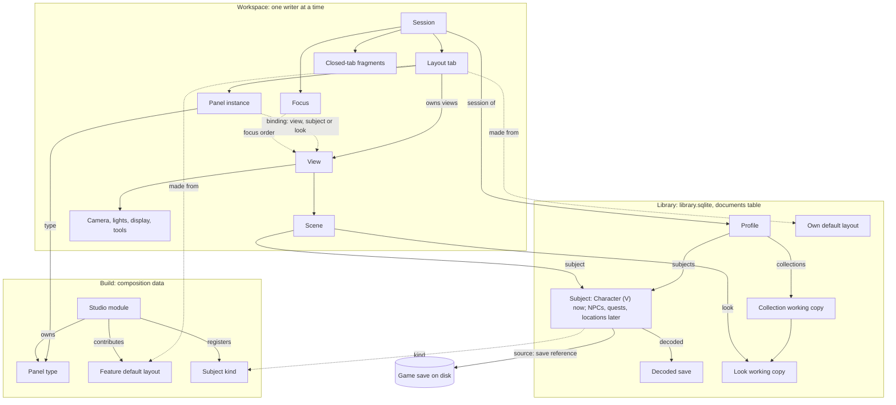

# Profiles, views and layout tabs: design

**Status:** proposed design for review (21 October 2026, revised the same day after an independent review; see [Review changes](#review-changes)). Nothing is built. It turns the profile direction of 21 October into a model and phases, and supersedes three parts of the [view graph design](view-graph-design.md): the Modules menu (§4.2), module visibility (§4.3) and saved layouts (§4.5). The rest of that page stays in force: the graph's nodes, linking, rendering and View and lighting history. The [architecture contract](architecture-contract.md) governs throughout, and the backlog's [profiles entry](../backlog/README.md#profiles-and-multiple-vs-after-the-beta) records the product decisions this page builds on.

Source paths are relative to `projects/xf-studio/authoring/src/` (the subsystem layout in `docs/source-layout-plan.md`). New modules are named by the folder they will join, for example `src/app/profiles/`.

## Summary

- **Plain typed data.** Entity documents carry IDs and reference one another. Small typed services sit on top, each publishing a detached snapshot and a change notification:
  - a profile service and a subject registry;
  - one owner per subject kind, starting with characters;
  - one profile-session owner covering tabs, the view graph and focus;
  - a focus service;
  - a pure binding resolver;
  - constraint rules.

  There is no reactive engine.
- **Nothing is "current".** No profile, session, tab or service holds a current, primary or default V, subject, look or view. Each panel and view resolves its own target through its binding. One tab can hold three panels on three different Vs, or two views of one V beside a third V's view.
- **A profile is generic.** It holds a set of *subjects* of any registered kind and the collections it works on. Characters are the first kind: V now, NPCs later. Quest projects and locations come later. A profile may hold no subject at all.
- **The model has no count limits.** Its only limits come from the game and its frameworks, and each is a named validation rule (see [Assumptions](#assumptions)).
- **Storage follows who needs a thing and how often it changes.**
  - *Library documents* hold what windows and profiles share: profiles, subjects, decoded saves, looks' autosaved working copies and own default layouts. They live in the existing `documents` table, with explicit conflict handling.
  - *The per-browser workspace* holds continuous presentation: tabs, docks, the view graph, panel instances, bindings and focus. One window at a time writes it, with a visible takeover.
- **Before the beta:** one profile, normally one V, and one visible 3D view at a time, in its tab. Every service, action and document is keyed by ID from phase 1. Service tests drive several subjects and views, so several of each side by side is UI work later, not a remodel.

## Assumptions

These are the only invariants the model keeps. Each holds because the game or the Studio's implementation supplies it, and each is enforced as a validation rule with a reason a person can read, never as a structural limit.

| Invariant | Source | Rule |
|---|---|---|
| A character has exactly one body gender at a time, feminine or masculine. The voice is separate. | The player entity is `player_wa_*` or `player_ma_*`, and a save stores `isMale` and `isBrainGenderMale` separately ([CC file chain §7, §9](../../knowledge/cc-file-chain.md#9-male-and-female-npcs-and-later-full-body-work)) | `character.body` is one of two values; changing it is one action that clears choices the other body's catalogue lacks (today's behaviour) |
| A body gender has its own creator catalogue, and a character's choices are valid only against its body's catalogue | One `.inkcharcustomization` per body gender ([CC file chain §2](../../knowledge/cc-file-chain.md#2-the-inkcharcustomization-resource)) | Choices are validated against the catalogue for `(installation, body)` |
| An option holds one choice at a time, identified by name, not index | Option types and identity ([CC file chain §2](../../knowledge/cc-file-chain.md#identity-and-why-indices-are-not-identity)) | Stored choices are `(option, definition)` or `(region, morph)` pairs, one per option |
| A save holds one player character | One `CharacetrCustomization_Appearances` node per save ([CC file chain §7](../../knowledge/cc-file-chain.md#7-how-a-save-stores-cc-choices)) | A save reference is a source for one character; several characters may reference the same save |
| An exported look is a choice of a creator option, merged by name | ArchiveXL merges choices on `(option, definition name)` ([CC file chain §2](../../knowledge/cc-file-chain.md#identity-and-why-indices-are-not-identity)) | Export names are unique within the option, under the shared name rule (`src/character/creator-names.ts`) |
| The library stays readable by released builds | `user_version` never above 2, released tables never altered ([library durability](library-durability.md)) | New data goes only into `documents` rows |
| One pointer: one gesture at a time | The Studio's input model ([view graph §3.8](view-graph-design.md#38-input-routing-and-focus)) | The editors refuse a second open gesture in any view |
| One GPU context per window, with a frame and raster budget | [View graph §3.7](view-graph-design.md#37-rendering-and-performance) | These are *budgets*: a view or look beyond them waits, says why, and is never refused by the model |

## 1. The entity model

### 1.1 Entities

| Entity | Fields | References | Owner | Stored | Scope |
|---|---|---|---|---|---|
| **Profile** | `id` (`p-<base36>`), `name`, `subjects: SubjectRef[]` (ordered set, may be empty), `collections: CollectionId[]`, `createdAt` | Subjects, collections | `ProfileService` (`src/app/profiles/`) | Library document `profile` (`xfs/profile-1`) | Per library |
| **Subject reference** | `{ kind: SubjectKind, id }` | One subject document | n/a | Inside profiles and scenes | n/a |
| **Subject kind** | `kind`, `document` (its document kind), `scenes: SceneKind[]` (scenes that can show it), `label(subject)` (the header slot's title and detail), its flyout actions | Its owner service | Composition (`compose/subjects.ts`, new) | Code | Per build |
| **Character** (kind `character`) | `id` (`c-<base36>`), `name?`, `body`, `voice?`, `source` (`{kind:"default"}`, `{kind:"save", save: SaveRef, decoded: SavedVId}`, or `{kind:"preset", name, kept?}`), `choices`, `notCarried?`, `clothing?`, `ownMakeup?` | A save reference, a decoded save | `CharacterService` (`src/character/`, successor of `character-context-actions.ts`) | Library document `character` (`xfs/character-1`) | Per library |
| **Save reference** | `{kind:"listed", folder, modified?}` or `{kind:"file", name}` | A game save on disk | Saves host (`features/save-explorer/host/`) | Inside the character | n/a |
| **Decoded save** | The `SavedV` as today | n/a | `CharacterService` | Library document `saved-v`, ID = content hash | Per library |
| **Collection** | `xfs/collection-2` identity (`collection.id`), name, look order, removed looks, package plan; `saved?: { revision }` (the last named version) | Its looks | `CollectionService` (`src/library/collection-service.ts`) | Working copy: library document `collection-working`. Named versions: the released collection tables, as today. | Per library |
| **Look** | Parts and memory (with its Undo history), as today | n/a | `CollectionService` | Library document `look-working`, ID `<collection>/<look>` | Per library |
| **Look reference** | `LookRef = { collection: CollectionId, look: LookId }` | One look | n/a | Inside scenes and look actions | n/a |
| **Session** | `xfs/profile-session-1`: `tabs`, `views: ViewGraphData`, `focus`, `closed: TabFragment[]` (the last 5), `seq` (the focus counter) | Its profile, by key | `ProfileSessions` (`src/app/profiles/`, successor of `src/app/layout-library.ts`) | Workspace `profiles.sessions[profileId]` | Per profile, per workspace |
| **Layout tab** | `id` (`t-<base36>`), `name`, `origin?: DefaultLayoutRef`, `dock: DockState` (wide and compact), `panels: PanelInstance[]` | Its views (each view's `tab`) | `ProfileSessions` | Inside the session | Per session |
| **Panel instance** | `id` (`<type>--<base36>`, unique for good), `type`, `binding?`, `state?` (presentation state, for example the Save Explorer's open save) | Its panel type, its binding's target | `ProfileSessions` | Inside the tab | Per tab |
| **Binding** | `{ policy: "follow-focus" }` or `{ policy: "pinned", target: { view } \| { subject } \| { look } }` | A view, subject or look | Resolved by `resolveBinding` (pure) | Inside the panel instance | Per instance |
| **View** | As today (`ViewRecord`), plus `tab: TabId` | Scene, camera, lights, display and tools nodes | `ViewGraph` (`platform/core/view-graph.ts`), inside `ProfileSessions` | `session.views` | Per session |
| **Scene** | As today (display state; motion when view graph P3 lands), plus `subject?: SubjectRef` and, for a character scene, `look?: LookRef` | A subject, a look | `ViewGraph` | Graph node | Per session |
| **Camera, Lights, Display, Tools** | Unchanged from the [view graph](view-graph-design.md#31-node-types) | n/a | `ViewGraph` | Graph nodes | Per session |
| **Focus** | `focus.views: Record<ViewId, number>` (the sequence at which each view was last focused), `focus.panel?: InstanceId` | Views, a panel instance | `FocusService` (`platform/core/focus.ts`) | Inside the session | Per session |
| **Studio module** | The manifest, as today, plus `defaults: DefaultLayoutContribution[]` | Panel types, view tools, defaults | `compose/modules.ts` | Code | Per build |
| **Panel type** | `PanelContribution` as today, plus `owner` (§5), `reads` (`profile`, `view`, `scene`, `subject` or `look`), `subjects?: SubjectKind[]`, `anchor?: { scenes: SceneKind[] }`, `stateInDefaults?: boolean` | Its module | `compose/views.ts` | Code | Per build |
| **Default layout** | `id`, `name`, `description`, `owner` (a module ID, `shared` or `user`), `fragment: LayoutFragment` | Panel types | Feature defaults: the composition. Own defaults: `LayoutDefaults` (`src/app/profiles/`). | Feature defaults are code. Own defaults are library documents `layout-default`. | Feature: per build. Own: per library |

**Which look a V shows belongs to the scene, not the character.** Two scenes of one V can show two looks, to compare them. Every view of one scene shows the same look, so a shared preset still updates every V that wears it. A character document therefore never points into look storage.

### 1.2 Storage tiers

| Tier | Holds | Why | Writes |
|---|---|---|---|
| Library documents (`documents` table) | Profiles, subjects, decoded saves, collection and look working copies, own defaults, migration records | Shared across windows, hosts and profiles; durable (WAL, daily backups); survives clearing browser data | Through held documents with explicit conflict handling (§2.1); looks autosave when each edit commits |
| Released library tables | Named collection versions (Save version) | Older builds read them | Unchanged |
| Workspace (localStorage on localhost, the host file on desktop) | Sessions (tabs, graph, focus, panel instances), UI preferences, and a *recovery copy* of look edits the library hasn't confirmed | Synchronous and unload-safe; changes on every drag | One writer per workspace (§2.3) |

**The recovery copy is not a second source of truth.** It holds, per look, the last value sent and the revision it was based on. At start, it is either replayed as one compare-and-set write, when its base equals the library's revision (the write simply never arrived), or offered as a fork "(recovered in this window)" when the library moved on. It is never merged and never replayed silently over another writer. This differs from the reverted workspace journal, which merged a journal into a whole workspace. Phase 0's spike S1 confirms the difference with a crash harness before anything is built on it.

### 1.3 Diagram



### 1.4 References, deletion and retention

- **Structural references are always valid.** A view's node references, a tab's views and a fragment's local keys are kept valid by their one owner (`ProfileSessions`), in the same commit as any edit. Only references *across* owners may dangle: a scene's subject or look, a binding's pinned target, a profile's subject or collection, a tab's origin. Each dangling case has a defined state (§3.4) and keeps the reference, so a restore brings it back.
- **IDs are never reused.** Views, tabs and panel instances get fresh random IDs, so a pin can never revive against a different thing.
- **Detach and delete are different actions:**

  | Action | Effect |
  |---|---|
  | Remove *subject* from profile | Membership only. The document stays, and scenes showing it keep showing it. |
  | Delete subject from the library | Offered with the profiles that reference it named. Writes a tombstone (below), so references show "This V was deleted" with **Restore**. |
  | Delete profile | Tombstone. Its subjects are detached, not deleted. Its sessions in each workspace are dropped when that workspace next opens. |
  | Delete own default | Tombstone, with an Undo notice. Tabs made from it keep working, and Reset no longer lists it. |
  | Remove look | The collection's removed list, as today (the last 20), and **Restore** where it is shown |

- **Tombstones and cleanup.** The document store gains `remove(kind, id, revision)`. It writes the next revision as a tombstone value `{ tombstone: true, at, value }`, which is a row change, not a schema change. The host purges tombstones older than 30 days at start, in one transaction. It purges decoded saves that no character references (tombstones included). Look and collection working copies go with their collection's purge.
- **Retention roots:** profiles, own defaults and collections. A subject that no profile references is an *orphan* and is kept. The profile flyout lists orphans under **Add a V you've used before**, and only an explicit delete removes one.

## 2. Persistence

### 2.1 Conflicts and refresh (library documents)

Today `savedDocument` (`platform/core/saved-document.ts`) answers a stale write by retrying over the latest revision, which silently overwrites the other window. That is replaced by explicit states:

| State | Meaning | What the person sees |
|---|---|---|
| `clean` | The value is the stored revision | Nothing |
| `saving` | A write is out; newer edits coalesce behind it | Nothing (status only after 2 s) |
| `conflict` | The store answered `stale`: someone else wrote first. The local value is kept unsaved and nothing retries. | The owning panel's notice: "Changed in another window." The actions are **Keep mine** (an explicit write over the newer revision), **Use theirs** (the newer value; for a look, mine is kept as a fork "(this window)") and, for looks, **Keep both**. |
| `failed` | The write failed (host gone) | Plain status with **Retry**; edits stay in memory and in the recovery copy |

- **Refresh.** The document store port gains `changes(cursor, signal)`, a long-poll over the host's write sequence. It answers the `(kind, id, revision)` of rows written since the cursor, and a fresh cursor and host identity after a host restart; on a new identity the page rechecks every held revision. A newer revision of a `clean` held document is applied at once. A `saving` or unsaved one goes to `conflict`.
- **History invalidation.** Applying an external revision clears that entity's history scope (`look:…`, `character:…`) and says so once: "Changed in another window; Undo starts here." No step ever replays values the other window replaced.

### 2.2 Flush contract

- `DocumentOwners.flush(signal): Promise<FlushReport>` resolves once every held document is `clean`. Otherwise it lists each document still `saving`, in `conflict` or `failed`. The workspace's own flush stays synchronous.
- **Desktop close** (`desktop/workspace-close.ts`): the renderer answers the host's flush request only after the workspace capture and `flush()` both finish, and acknowledges `saved` only when the report is empty. On `failed`, the existing "close anyway?" prompt names what is unsaved ("2 looks have changes not saved to your library"). The recovery copy still holds those edits, so closing anyway loses nothing the next start can't offer back.
- **Localhost** (development only) flushes on `pagehide` with `keepalive` as best effort, and relies on the recovery copy.

### 2.3 One writer per workspace (proposed default)

- **One writer.** A workspace (normal, or `?verify=1`) has one writer window. A second window opens read-only, with one plain line: "This workspace is open in another window." It offers one action, **Use it here**. Read-only windows refuse every dispatch with `unavailable` and that reason, and write neither the workspace nor documents.
- **Takeover.** The new window asks the holder to flush (the same flush as closing) and waits up to 2 s, then takes the lease. The old window becomes read-only, with its own **Use it here**.
- **Leases.**
  - *Localhost:* a Web Lock `xfs.workspace.<key>` (released by the browser when a window closes), with takeover by `steal` after a `BroadcastChannel` flush request.
  - *Desktop:* the host holds the lease for its workspace file and hands it over through its existing flush request.
- **Why not separate workspaces per window?** It is simpler, the desktop app is the public product with one window, and localhost is for development.

### 2.4 Compatibility

- **Library: strictly backward-safe** under [library durability](library-durability.md). There are no new tables, no altered released tables, and `user_version` stays 2. Older builds don't read the new `documents` kinds. They see collections only through their named versions.
- **Workspace and layout data: a documented reset on downgrade, with no downgrade protection.** An older build drops the `profiles` field when it saves. On the next upgrade the migration (§8) runs again, reuses matching subjects (no duplicates), and rebuilds the tabs from the workspace's legacy fields. Those legacy fields are frozen at the first migration and never mirrored, so an older build opens the workspace as it was before the upgrade.
- **Required test: upgrade, then edit and save in an older build, then upgrade again.**
  - Every library row the newer build wrote is unchanged.
  - The older build's named save shows as a newer collection version, offered as a fork beside the working copy.
  - Nothing is lost or duplicated.
- **Forward reading** (a newer build's data in this build) is promised only for library documents: unknown fields are kept on write, and unknown kinds are ignored. Workspace parsers may drop what they don't know, and the reset rule covers it.

## 3. Bindings and focus

### 3.1 What a panel binds to

A panel type declares what it `reads`:

- `profile`: no binding;
- `view` or `scene`;
- `subject`, of the kinds in `subjects`;
- `look`.

It also declares which scene kinds it can project from (`anchor.scenes`). The resolver walks **view → scene → subject and look**. It can also start from a pinned subject or look, which needs no view. For example, three Character panels can be pinned to three Vs in a tab that has no 3D view.

### 3.2 Policies (data, extensible)

| Policy | Resolves to |
|---|---|
| `follow-focus` (default) | The eligible view in the panel's own tab with the highest focus sequence. Without one, nothing: the panel shows its empty state with **Choose…** (§3.4). There is no fallback to another tab or to any "current" subject. |
| `pinned` | Its named view, subject or look, whatever has focus |

A later policy adds a case to the resolver and a value to the union, and nothing else changes.

### 3.3 Focus, ordering and freezing

- **Ordering is deterministic.**
  - Each pointer press or keyboard focus inside a view sets `focus.views[view] = ++seq`. The counter is never truncated, so any eligible view can win, and ties can't happen.
  - Eligibility: the view exists, is in the panel's tab, its scene kind is in `anchor.scenes`, its subject's kind is in `subjects`, and the constraint rules pass.
  - Focus inside a panel sets `focus.panel`, which drives the header slot (§6.4) and Undo routing (§3.7).
- **The resolved target is shown when it isn't obvious.** The panel header names its target ("V · ManualSave-12", "Look 3") whenever any of these holds:
  - the tab has more than one eligible candidate;
  - the target isn't shown by a view in the panel's tab;
  - the binding is pinned.

  A panel never edits an unseen subject without its header saying which one.
- **Targets freeze during interactions.** A gesture, an open menu or popover, and an asynchronous picker (a file dialog, the saves list) take `resolver.capture(instance, signal)` when they start. Every dispatch they make uses the captured target, even if focus moves meanwhile. A captured target that is gone at dispatch is refused with `missing_target`. Aborting the signal releases the capture.

### 3.4 Re-resolution and empty or dangling states

- **Resolution is pure and done while painting.** `resolveBinding(instance, session, documents)` answers `{ view?, scene?, subject?, look? }` or a state. The presentation repaints on changes from focus, the session, profiles, subjects or looks, so there is no cache to go stale.
- **No candidate under `follow-focus`:** an empty state with one next step. **Choose…** pins the panel to a view, subject or look of the right kind; **Open a 3D view** offers the profile's subjects.
- **A pinned target is deleted or gone:** the pin is kept, and the panel says what is missing ("The 3D view this panel was pinned to was closed", "This V was deleted"), offering **Follow focus**, **Pin to ▸** and, while a tombstone exists, **Restore**. The panel never silently retargets.

### 3.5 Constraint rules

Modules and the platform register rules as data: `{ id, applies, check(target): Capability }`. The resolver and picker evaluate them at bind time, and the owning service evaluates them again at dispatch. Every [Assumptions](#assumptions) row is such a rule. Feature examples:

- eye makeup's editors need a character scene with a look;
- the UV map needs that look's eye-makeup part.

No rule caps how many instances, views or subjects exist.

### 3.6 Actions name their targets

| Family | Required target | Replaces |
|---|---|---|
| `camera.*`, `preview.*`, `motion.*`, `view.*`, `pose.*` | `view` | The focused-view default in `src/preview/preview-actions.ts` and `src/app/view-actions.ts` |
| `scene.setSubject`, `scene.setLook` (choosing a preset) | `scene` | The draft's `selected` look |
| `character.*`, `character.setSource` (absorbs `savedV.*`) | `character` | `CharacterContextActions`' and `SavedAppearanceActions`' single state |
| Eye makeup's `layer.*`, `point.*`, `field.*` and `preset.*` | `look: LookRef` (and `collection` for collection commands) | The one live document |
| `saves.*` | `instance` | The Save Explorer's one open save |
| `tabs.*`, `profile.*` | `profile` (and `tab`) | The layout library's implicit active layout |
| `history.undo`, `history.redo` | `scope` | The history service's focused scope |

Dispatch revalidates every target and refuses a missing or stale one with `missing_target`. Key bindings and palette commands resolve targets in the input layer, from focus and the focused panel's binding, then dispatch with the target named. **No application service reads focus.** While a family migrates, its target may stay optional. A boundary test lists the families still defaulting, and the list must be empty by the end of phase 3.

### 3.7 History scopes

There is one history service (`platform/core/history-service.ts`).

| Scope | Holds | Persisted |
|---|---|---|
| `look:<collection>/<look>` | One look's edits | With the look's working copy (its memory), as `look` is today |
| `character:<id>` | One character's creator choices, Clothing and own makeup, in order. The Clothing setting's separate Undo is retired (decided). | Session-only, as today |
| `view:<profileId>` | View and lighting, plus every session structural operation (§4.1) | Session-only |
| `doc:<id>` | Unchanged | Unchanged |

- **Ctrl+Z routing:** Ctrl+Z acts on the scope of the focused panel's resolved target. In a 3D view it acts on the look that view's scene shows (decided).
- **Scope lifetime:** a scope lives while its entity exists. An external change clears it (§2.1).

## 4. Layouts

### 4.1 One owner for tabs, graph and focus

`ProfileSessions` owns each session as one document. Tabs, the view graph and focus change only through its operations, and each operation is **one commit and one `view:<profileId>` history step**. So Undo can never restore views into a missing tab or leave focus on a closed view. The `ViewGraph` becomes its internal component, and nothing else edits the graph's structure.

| Operation | Effect, atomically |
|---|---|
| New tab from a default | Instantiates the default's fragment (§4.2) with explicit subject substitution |
| Duplicate tab | Copies the tab's fragment with fresh IDs. Scenes are linked; every other node is copied. |
| Close tab | Removes the tab, its views, the nodes only they referenced, its panel instances and their focus entries. It pushes a **closed-tab fragment** (the tab, its views, a value copy of every node they referenced, panel instances, bindings and focus entries) onto `closed`, keeping the last 5. |
| Reopen closed tab | Restores a fragment under its original IDs, which are never reused. Each node still present is relinked, and each one gone is recreated from its value copy. Pins inside the fragment resume. |
| Reset to default | Pushes the tab's current content as a closed-tab fragment ("<name> before reset"), then instantiates the default into the same tab |
| Add or remove a panel, change a binding, add, close or link a view | One operation each |

Undo of an operation reverses all of it, including pushing or popping the fragment. Closed-tab fragments persist with the session, while the history is session-only. A session may hold no view, and the last tab can be closed: an empty session shows a blank tab with **New tab ▸**.

### 4.2 Defaults are graph fragments

A default layout is a `LayoutFragment` (`xfs/layout-fragment-1`) with local keys:

```ts
type LayoutFragment = {
  tab: { name: string; dock: DockState };                        // dock panel IDs are panel keys; view panels are `view:<key>`
  subjects: { key: string; kinds: SubjectKind[] }[];             // slots, never actual subjects
  looks?: { key: string; subject: string }[];                    // a look slot per subject slot, when a scene shows one
  nodes: { key: string; slot: ViewSlot; kind?: string; state: Record<string, unknown>; subject?: string; look?: string }[];
  views: { key: string; title?: string; scene: string; camera: string; lights: string; display: string; tools: string }[];
  panels: { key: string; type: string; binding?: { policy: "follow-focus" } | { policy: "pinned"; view?: string; subject?: string; look?: string }; state?: unknown }[];
};
```

- **What a default keeps:**
  - the dock in both size classes;
  - panel types and bindings, with pins as local keys;
  - panel state, for types with `stateInDefaults`;
  - view titles;
  - camera poses;
  - lights values, including the shown setup's definition;
  - display and tools values;
  - scene display state (eye shape, idle choice);
  - sharing *within* the fragment (two views using one camera key).
- **What it doesn't keep:** subjects and looks, which become slots, and links to nodes outside the tab, which are copied as values.
- **Subject substitution is explicit.** **New tab ▸ <default>** asks for each subject slot ("Show which V?"), listing the profile's subjects of that kind and **Leave empty**.
  - When the profile has exactly one candidate, the menu names it in the entry ("Eye makeup — V · ManualSave-12"), so one click fills it and the choice is still visible.
  - A filled slot's scene links to an existing scene of that subject in the session when there is one, so the new tab shows the same look and rig. Otherwise it gets a new scene with its look slot empty: Presets offers "Choose a look".
  - An empty slot leaves the view with an empty state.
- **Feature defaults** are code, read-only, and never stored. A later build's change reaches only new tabs and resets.
- **Own defaults** are library documents. **Save as default…** builds the fragment from the tab, replacing actual subjects with slots. **Update "<name>"** overwrites only an own default, only on that explicit command. A feature default can't be overwritten: saving over one makes an own default, and the menu says so.
- **Reset to default ▸** lists the tab's origin first, then every other default.

### 4.3 Feature focus from the tab

- **A module is active in a tab** when at least one of its panel instances is in the tab's dock (docked, floating or collapsed). That set is the view-tool filter's `modules` (`platform/api/module.ts`), so the derivation of view tools, summaries and hints is unchanged.
- **Content still draws.** Makeup stays on V in a Poses tab.
- **The Modules menu and `UIPreferences.modules` are removed.**

### 4.4 What folds in from today

| Today | Becomes | Kept |
|---|---|---|
| `LayoutLibrary` (`src/app/layout-library.ts`) | Own defaults, plus the first tab | Each saved layout's name and saved dock, as an own default. The active layout's live arrangement becomes tab 1. |
| `SavedLayout.working` (inactive layouts), `modules`, `autoSize`, `LayoutLibrary.seen`, `UIPreferences.modules` | Removed or derived | Dropped |
| Parked panels (`DockTree.parked`) | A panel removed through the picker parks at its place, and adding it again returns it there | Per tab |
| Factory layouts (`studio-ui/layout-defaults.ts`) | Eye makeup's feature default, built by the same slot rules with one character subject slot | The slot arrangement |
| View graph | Inside the session, each view with `tab` | Nodes, links, lighting setups. `MAX_VIEWS = 16` goes; the workspace size budget bounds the graph instead. |
| `main` view, `head` panel | Ordinary views and instances. `main` and `head` remain only as aliases: in capture tools and evidence keys `head` means "the focused tab's most recently focused 3D view". | n/a |

## 5. Panel ownership

Owner groups are a module's label, or one of three cross-cutting groups: **Shared** (subjects, the 3D view and history), **Output** (what leaves the Studio) and **Tools** (the app itself).

| Panel (type ID) | Owner | Reads | Default binding |
|---|---|---|---|
| Presets (`presets`) | Eye makeup | look (its collection); choosing sets the scene's look | follow-focus |
| Layers, UV map, Colour & finish, Shape, Pigment & edge, Warp (`layers`, `uv`, `finish`, `shape`, `edge`, `warp`) | Eye makeup | look | follow-focus |
| Library (`library`) | Eye makeup, while it holds only eye-makeup collections | look (its collection) | follow-focus |
| Expression, Expression sets (`expressions.controls`, `expressions.sets`) | Expressions | look | follow-focus |
| Poses (`poses.library`) | Poses | scene | follow-focus |
| Save Explorer (`save-explorer.explorer`) | Save Explorer | profile (instance state: its open save) | none |
| 3D view (`head` alias, `view.<id>`) | Shared | is a view; its scene's subject is chosen in its header | n/a |
| Character (`character`) | Shared | subject (`character`) | follow-focus |
| Camera & light (`lighting`), Preview quality (`quality`) | Shared | view | follow-focus |
| Motion (`motion`) | Shared | scene | follow-focus |
| History (`history`) | Shared | the focused panel's scopes, and `view:<profileId>` | follow-focus |
| Mod package (`package`) | Output | profile (its collections) | none |
| Activity, Settings, Help (`activity`, `settings`, `help`) | Tools | profile | none |
| Panels (`shell.panels`, new) | Tools | the tab it serves | none |

Preview quality's makeup texture size becomes a section eye makeup contributes once panels take section contributions.

## 6. Presentation

The UI component track builds these. This section gives behaviour, states and accessibility only; aesthetics are the track's. Everything passes the [visual QA checklist](ui-visual-qa-checklist.md) and the UI review.

### 6.1 Layout tab strip (extends the Tab strip component)

- **Place.** A full-width row between the header and the dock. It replaces the Layouts button.
- **Behaviour.** Click switches tab. Hovering or making a tab active shows its close mark. `+` opens **New tab ▸**. Double-click or F2 renames in place, drag reorders, and right-click or Shift+F10 opens the tab menu. Overflow uses the strip's condensing stages, and the active tab always stays visible.
- **States.** Active, inactive, renaming, dragging, overflowing, and read-only (§2.3: tabs switch, but nothing edits).
- **Accessibility.** `tablist` with an `aria-label`. Tabs carry `aria-selected` and `aria-controls`. Roving tabindex, and the `tabs` key scope applies.

### 6.2 Tab menu

The menu has these entries:

- Rename;
- Duplicate tab;
- Reset to default ▸ (origin first);
- Save as default…;
- Update "<own default>" (when the origin is one);
- Close tab;
- Reopen closed tab ▸ (the fragments, newest first, with "before reset" ones named so).

Names go in the existing value popover. Entries that can't run are left out unless the reason teaches something.

### 6.3 Panel picker (feature-specific component: a checklist panel)

- **Place.** A floating, dockable panel opened from the header's Panels button. It replaces the Panels flyout and opens where it was last.
- **Content.**
  - A search field, then groups: the modules in registry order, then Shared, Output and Tools.
  - A row has a checkbox ("in this tab"), icon, title, description as its tooltip, and stage tag. A row is marked "collapsed" when that is its state.
  - Ticking adds the panel at its remembered or factory place with the type's default binding, and reveals it. Unticking parks it.
  - A row refused by a rule is disabled, with the rule's reason.
- **After the beta:** a per-type count and **Add another**.
- **Planned modules** sit in a folded "Coming soon" group, closed by default.
- **Accessibility.** Each group is a `group` with a heading, and rows are native checkboxes. Search filters without moving focus. Escape clears the search, then returns focus to the invoker when the picker is floating.

### 6.4 Header subject slot and profile flyout (replaces the Modules button)

- **The slot shows what the window is working on now, derived, not stored.**
  - Its source is the focused panel's resolved subject, labelled by its kind's `label`, for example "V · Save: ManualSave-12 · Look 3". A later quest project would supply "Quest · The Heist rewrite".
  - With no focused target it shows the profile's name.
  - It never implies a current subject: it follows focus.
- **Flyout, before the beta.**
  - The profile's name.
  - Its subjects grouped by kind, each with its kind's actions. A character offers **Load another save…**, **Load a save file…**, **Use the game's default V ▸** (feminine, masculine), **Explore its save** and **Show in the focused 3D view**.
  - **Add ▸**: a V from a save, a default V, or a V you've used before (the orphans).
  - Each subject row shows its preparation state (ready, preparing, failed with **Try again**).
- **Flyout, after the beta:** profiles (switch, new, rename, duplicate, delete with Undo) and **Manage profiles…**.
- **Accessibility.** The button carries `aria-haspopup="dialog"`, and its accessible name is the slot's text. The flyout is a non-modal popover: subjects are labelled regions, actions are buttons, and Escape returns focus.

### 6.5 Target label and binding selector (in a panel's header)

- **Before the beta:** a target label naming the resolved target whenever §3.3 requires it.
- **After the beta:** the label becomes a menu button. It offers **Follow focus**, **Pin to ▸** (views, subjects or looks of the right kind, with titles) and **Choose…** in empty states. Its accessible name includes the target and the policy.

### 6.6 Keyboard

| Keys | Scope | Action |
|---|---|---|
| Alt+1 … Alt+9 | global | Tab N (Alt+9: the last) |
| Alt+PageUp / Alt+PageDown | global | Previous or next tab |
| Arrows, Home, End, Alt+Shift+arrow, Delete, F2, Shift+F10 | `tabs` | As the dock's tab strips |
| Palette | n/a | "Tab: <name>", "New tab: <default>", "Reset tab to <default>", "Save tab as default…", "Reopen closed tab", "Show <panel> in this tab", "Hide <panel> from this tab", "Panels…" |

Ctrl+T, Ctrl+W, Ctrl+Tab and Ctrl+PageUp/PageDown are not used, because the browser keeps them on localhost. The bindings go into `KEY_BINDINGS` (`src/app/input-bindings.ts`).

## 7. De-singletoning

| Singleton | Replacement | Migration steps |
|---|---|---|
| `CharacterContextActions` (`src/character/character-context-actions.ts`): one V's context with three private Undo stacks | **`CreatorCatalogue`** shares only what depends on the installation and body: immutable panel data, pages, swatch and icon tables, and the search index, as keyed results deduplicated in flight. **Requester state** stays per character and per panel instance: open rows, the search query and its view, prefetch wants and preview requests. Each request carries its full character request (choices, clothing) and runs on the job scheduler keyed by those inputs, with cancellation scoped to the requester. **`CharacterService`** holds one `CharacterContext` per `CharacterId` over its document. | 1. Split out the immutable catalogue data and keyed results, with behaviour unchanged. 2. Move rows, search, prefetch and previews to requester objects (`AbortSignal` per requester). 3. Key the context by ID: `snapshot(character)`, `dispatch({ …, character })`. 4. Move the three stacks onto `character:<id>`. 5. Read and write the document instead of `preview.character`. |
| `SavedAppearanceActions` (`src/character/saved-appearance-actions.ts`) | The character's `source` and decoded save. Applying them is the work of the subject's scene runtime. | 1. `character.setSource` replaces `savedV.*`, which stays as an alias until phase 3 ends. 2. `apply` and `clear` move to the scene runtime per subject. 3. `workspace.savedV` becomes migration input only. |
| `src/app/workspace/collection-workspace.ts`' one live look (`DocumentModel.live`, `CollectionDraft.selected`, `core.document`) | **`LookSessions`**: open look documents keyed by `LookRef`, opened on demand when a binding or a scene resolves to a look, and released when nothing does. | 1. Look working copies in the library (phase 1). 2. Every look action names its `LookRef`. 3. `look` becomes `look:<collection>/<look>`. 4. `selected` becomes each scene's `look`. 5. Rastering several open looks at once is a budget, not a limit: pre-beta the budget fits the looks shown, and others wait with a reason until per-look raster jobs land (view graph P6). |
| `src/compose/studio-startup.ts` `liveSurface` | The root registers every layered surface without choosing one. The scene runtime feeds the surface of its scene's look, and the on-head editor adapter is created per view and bound to its resolved look. | 1. Move the `layered` wiring into the per-scene runtime (phase 3's minimum split). 2. Editor hooks take the `LookRef` from the resolved binding. 3. A boundary test forbids naming the live feature in the root. |
| The Save Explorer's one open save (`features/save-explorer/`) | One session per panel instance, keyed by its globally unique instance ID, with its state in the instance's `state` | 1. `saves.*` actions carry `instance`. 2. The service keys sessions by instance and releases a session on close. 3. **Explore its save** opens an instance on the subject's save reference. |
| `src/preview/preview-actions.ts` and `src/app/view-actions.ts`: actions defaulting to the focused view | A required `view`, resolved by the input layer and the panels | 1. `FocusService` takes over focus; the graph's `focused` goes. 2. Panels pass resolved targets, and key bindings resolve in the input layer. 3. Make `view` required. A boundary test checks that no application service reads focus. |

## 8. Migration into the first profile

A **resumable, atomic protocol**, migration ID `profiles-1`, runs per workspace (the normal one and `?verify=1` separately) by the window that holds the lease:

1. **Token.** The workspace synchronously records `profiles.migration = { id: "profiles-1", token, state: "started" }` before any host call.
2. **One library transaction** (host route `/api/profiles/migrate`, one `LibraryDatabase.write`) is given a normalized snapshot of the workspace. If a record `migration/profiles-1:<token>` exists, it returns that record's result, so a resumed run duplicates nothing. Otherwise, in order:
   1. **Collections first.**
      - The collection's identity is `collections.collection.id` (`xfs/collection-2`). `library.selected` is the legacy preset selection and is not used.
      - The draft becomes the `collection-working` and `look-working` documents, based on `library.current` when that names the same collection.
      - If the library holds a newer named version of that collection, the draft becomes a fork, "(from this browser)", and nothing is overwritten.
      - Recovery drafts (`previous`, `older`) stay in the workspace, as today.
   2. **Subjects.**
      - Normalize the character state from `savedV` (written as `saved-v`; source `{kind:"save", save:{kind:"file", name:"Imported V"}}`, since no folder is stored) and from `preview.character`.
      - Compare the **whole** state with every existing character: source and decoded hash, body, voice, choices, kept and not-carried entries, clothing and own makeup.
      - An equal one is reused. Otherwise a new character is created.
   3. **Profile.**
      - With no profile, create "My profile".
      - With exactly one, use it.
      - With several (possible only after the beta), create "From this browser".
      - Add the subject and collection to the chosen profile, unless they are already there.
   4. **Own defaults:** one per saved layout, deduplicated by name and dock hash.
   5. **Record** the result under the token.
3. **Session.** From the result, the workspace builds tab 1 and the view graph:
   - tab 1 holds the active layout's live arrangement, its panel IDs rewritten to instance IDs;
   - every view gets `tab`;
   - each character scene gets `subject` and `look = { collection, look: draft.selected }`.

   It then sets `state: "done"`, in one synchronous workspace write.
4. **Resume rules:**
   - A crash before step 2 commits re-runs it with the same token.
   - A crash after the commit returns the stored result.
   - A crash before step 3 rebuilds the session.
   - Another workspace (another host) migrates with its own token and reaches the same subjects through the whole-state comparison.
5. **Legacy fields** are left frozen (§2.4).

| Kept | May be dropped |
|---|---|
| The V's whole state; looks, drafts, recovery drafts and look histories; the view graph, lighting setups, camera, motion, pose; every saved layout as an own default; the live arrangement as tab 1 with parked places; UI preferences | Working states of inactive layouts; `autoSize` and `seen`; module visibility; the Character panel's session Undo and the Save Explorer's open save (never stored) |

No schema migration: every new record is a `documents` row, nothing rewrites rows, and `user_version` stays 2.

## 9. Phases

Effort is in agent-days. Every phase leaves `main` green and passes the UI review where anything visible changes. Phase 0 turns the risky assumptions into measurements before the estimates are trusted.

| # | Phase | Scope | Tests | Risks | Effort |
|---|---|---|---|---|---|
| 0 | **Spikes** | **S1** look working copies in the library: write cost per committed edit on the 2K reference recipe, conflict, fork and recovery-copy replay, a kill harness, and a Sol review of every data-loss path. **S2** switching the drawn view on the one scene host: no V reload or shader recompile, and the time it takes. **S3** a crash harness for the migration protocol. | The spikes' own harnesses | S1 failing: fall back to keeping looks in the workspace before the beta. Scenes (workspace) may reference them, and profiles list only collections with a named version. | 4 |
| 1 | **Persistence foundation** | Held-document states, the change feed, `flush` and the desktop handshake, tombstones and cleanup; the single-writer lease and takeover on both hosts; collection and look working copies with `LookRef` and the recovery copy | Two windows: conflict keeps both edits; external change clears history; a kill at every write point; takeover; downgrade round trip (§2.4) | Write volume on large looks (from S1) | 9–11 |
| 2 | **Profiles, subjects, characters** | `ProfileService`, the subject-kind registry (character only), `CharacterService`, the catalogue split, the character scope, the migration protocol | Migration from every workspace fixture, resumed at every step, plus two hosts; three characters edited independently; catalogue requests from two characters never cancel each other | First-paint V time now waits on a library read: issue it first and budget it in the performance track | 7–9 |
| 3 | **Targets, focus, minimum runtime split** | `FocusService` with sequence and freezing; the resolver; constraint rules, game invariants included; required targets; `LookSessions`; per-subject scene services out of the head attachment, and the S2 view switch; Save Explorer per instance; `MAX_VIEWS` removed | Headless service tests with 3 characters, 2 looks, 5 views and 2 tabs: three Character panels pinned to three Vs, follow-focus ordering, freezing during a gesture, dangling pins; the no-defaults boundary test | A wide mechanical change across actions: one commit per family | 9–11 |
| 4 | **Sessions and tabs** | `ProfileSessions` atomic operations with history; closed-tab fragments; fragment defaults and substitution; reset and save-as-default; feature focus; the tab strip and tab menu; Modules menu and Layouts button removed | Close, reopen and Undo restore byte-identical sessions; template round trip; substitution with 0, 1 and 2 candidates; `?verify=1` run | Tab switch time against the "no perceivable wait" goal (S2) | 8–10 |
| 5 | **Picker, ownership, header slot** | `owner`, `reads`, `subjects` and `anchor` on every panel; the picker; the header slot and pre-beta flyout; target labels | Golden ownership table; picker add and remove with remembered places; light and dark, narrow and wide captures | Clutter: folded groups and search | 3–4 |
| — | **Beta cut-off** | Phases 0–5: one profile, any number of subjects in the model, one visible 3D view at a time | | | **40–49** |
| 6 | Several views visible | View graph P3–P4 (several drawn views, linking UI), binding selector, several instances per type | View graph P3–P4 gates | GPU budget | 10–12 |
| 7 | Several profiles; more subject kinds | Profile management; several looks rastered at once; the next subject kind when a module brings one | Switching profile edits nothing | Raster memory | 8–10 |

Order: phase 0, then 1, then 2 and 3, which overlap once phase 2's character keying lands, then 4, then 5. The profile model and de-singletoning (phases 2–3) stand on the persistence foundation (phase 1), because both depend on its conflict and identity rules. The estimate is about twice the first draft's 19 days, which left these persistence, migration and runtime risks unpriced.

## 10. Decisions and open questions

**Decided (21 October):**

- Tabs stay per workspace; desktop is the public product.
- The shipped tabs are fine, and good starting-point defaults will be supplied once this lands.
- Ctrl+Z in a 3D view undoes the look.
- The Clothing setting's own Undo is retired.
- Profiles are generic over subjects, with no V-centric assumption.
- Nothing is current.

**Proposed defaults** (from coordination; confirm or change):

- one writer per workspace, with **Use it here** (§2.3);
- library strictly backward-safe, with a documented workspace reset on downgrade (§2.4).

**Open:**

| # | Question | Proposed default |
|---|---|---|
| Q1 | Once looks autosave to the library, does the explicit Save remain? | Yes, as **Save version** (Ctrl+S): a named point in the collection's history that older builds read. Autosave makes it optional for safety. |
| Q2 | Subjects no profile references (orphans): keep until deleted, or clean up after a time? | Keep until an explicit delete, and list them under **Add a V you've used before**. Only deleted items purge, 30 days after deletion. |

## Review changes

The independent review (21 October) found 13 issues, and the coordination notes added three principles. What each changed:

| Finding | Change |
|---|---|
| 1 Shared characters referenced browser-local looks | `LookRef`; looks' working copies in the library, owned by `CollectionService`; the workspace keeps only a recovery copy; looks belong to scenes, not characters; scopes keyed by `LookRef` (§1.1, §1.2, §7) |
| 2 `savedDocument` overwrote silently | Explicit conflict states, a change feed, history invalidation, and an awaitable flush in the desktop close handshake (§2.1, §2.2) |
| 3 Workspaces weren't window-isolated | One writer per workspace, with a visible takeover (§2.3) |
| 4 Migration lacked a protocol | Token, one library transaction, a stored result, whole-state comparison, collections first; `library.selected` not used (§8) |
| 5 Tabs and graph history were uncoordinated | `ProfileSessions` owns tabs, graph and focus with one commit per operation; closed-tab fragments keep node values (§4.1) |
| 6 Immortal `main` | Removed; `main` and `head` are aliases only (§4.4) |
| 7 Instance IDs collided | `<type>--<base36>`, unique for good (§1.1) |
| 8 Focus underspecified | A sequence counter, eligibility, no cross-tab or subject fallback, target labels, frozen targets (§3.3) |
| 9 Templates couldn't round-trip | Graph fragments with local keys and explicit subject substitution; what a default keeps is listed (§4.2) |
| 10 Deletion undefined | Detach versus delete, tombstones, retention roots, orphans; structural references always valid (§1.4) |
| 11 Forward compatibility overstated | Library strictly safe; documented workspace reset; the required round-trip test; legacy fields frozen, not mirrored (§2.4) |
| 12 Catalogue sharing too wide | Immutable data and keyed results shared; requester state and cancellation separate (§7) |
| 13 Dependencies and estimates | Phase 0 spikes; the minimum runtime split moved to phase 3; multi-subject service tests; `MAX_VIEWS` removed; re-estimated at 40–49 days (§9) |
| Q5, generic profiles | Subjects of registered kinds; the header slot labels by kind (§1.1, §6.4) |
| Nothing current | No primary, active or default subject or view anywhere; per-binding resolution; empty states choose explicitly (§3) |
| Only game limits | The [Assumptions](#assumptions) table; everything else is a rule or budget |

## Related pages

- [View graph design](view-graph-design.md): nodes, linking, rendering, View and lighting history; §4.2, §4.3 and §4.5 are superseded here
- [Architecture contract](architecture-contract.md) and [presentation boundary](ui-architecture-boundary.md)
- [Library durability](library-durability.md)
- [CC file chain](../../knowledge/cc-file-chain.md): the game invariants in [Assumptions](#assumptions)
- [Feature-module platform](feature-module-platform.md) and [component library](ui-component-library.md)
- [Save editor design](../save/save-editor-design.md), [selectors design](selectors-design.md) and [input bindings](input-bindings.md)
