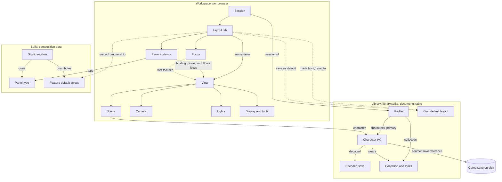

# Profiles, views and layout tabs: design

**Status:** proposed design for review (21 October 2026); nothing built. It turns the profile direction of 21 October into a model and phases, and supersedes three parts of the [view graph design](view-graph-design.md): the Modules menu (§4.2), module visibility (§4.3) and saved layouts (§4.5). The rest of that page, the graph's nodes, linking, rendering and View and lighting history, stays in force. The [architecture contract](architecture-contract.md) governs throughout, and the backlog's [profiles entry](../backlog/README.md#profiles-and-multiple-vs-after-the-beta) records the product decisions this page builds on.

Source paths are relative to `projects/xf-studio/authoring/src/`. Flat modules are cited by their current `src/<name>.ts` paths: the wave-3 source-layout move (`docs/source-layout-plan.md`) rewrites such paths in Markdown when it lands, so this page follows the new subsystem folders without an edit. New modules are named by the folder they will join in that layout (for example `src/app/profiles/`). Folders that stay where they are (`platform/`, `studio-ui/`, `compose/`, `features/`) are written without the `src/` prefix.

## Summary

- **The model is plain typed data.** Entity documents carry IDs and reference one another. Small typed services sit on top: a profile service, a character service, the layout-tab owner, a focus service, a pure binding resolver and constraint rules. Each publishes a detached snapshot and a change notification. There is no reactive engine.
- **A profile is the top of the graph.** It names its Vs (characters), the collection it works on, and, through its per-browser session, its layout tabs. Each tab owns its views and panel instances.
- **Views and data are decoupled.** A view shows a scene, and a scene shows a character. Panels bind to a view, either *pinned* to one or *following focus*, and reach their data by projecting from it: view, then scene, then character, then look. Nothing in the model limits how many views, scenes, characters or panel instances exist.
- **Storage follows who needs a thing and how often it changes.** Durable things that more than one window or profile shares, and that change through discrete actions, are library documents: profiles, characters, decoded saves and the person's own default layouts. These use the existing `documents` table, so there is no schema change. Per-window presentation that changes continuously stays in the per-browser workspace: tabs, dock arrangements, the view graph, panel instances, bindings and focus.
- **Before the beta:** one profile, one V, and one visible 3D view at a time (one per tab, each with its own camera). Every service, action and document is keyed by ID from the start, so several Vs and views side by side are UI work later, not a remodel.

## 1. The entity model

### 1.1 Entities

| Entity | Fields | References | Owner | Stored | Scope |
|---|---|---|---|---|---|
| **Profile** | `id` (`p-<base36>`), `name`, `characters: CharacterId[]` (ordered), `primary: CharacterId`, `collection?: CollectionId`, `createdAt` | Characters, the collection it works on | `ProfileService` (new, `src/app/profiles/`) | Library document, kind `profile`, schema `xfs/profile-1` | Per library |
| **Character (V)** | `id` (`c-<base36>`), `name?`, `body`, `source` (`{kind:"default"}`, `{kind:"save", save: SaveRef, decoded: SavedVId}`, or `{kind:"preset", name, kept?}`), `choices: CharacterChoice[]`, `notCarried?`, `clothing?`, `ownMakeup?`, `look?: LookRef` | Save reference, decoded save, the look it wears | `CharacterService` (successor of `src/character-context-actions.ts`) | Library document, kind `character`, schema `xfs/character-1` | Per library; profiles reference it |
| **Save reference** | `{kind:"listed", folder, modified?}` or `{kind:"file", name}` | A game save on disk (outside the Studio) | Saves host (`features/save-explorer/host/`) | Inside the character | n/a |
| **Decoded save** | The `SavedV` (`eye-artistry/saved-v-1`) as today | None | `CharacterService` | Library document, kind `saved-v`, ID = content hash | Per library. Written once per load, so the character document stays small (below) |
| **Collection, Look** | Unchanged (`xfs/collection-2`; a look's parts and memory) | Looks within a collection | `CollectionService` (`src/collection-service.ts`) | Draft in the workspace, revisions in the library, as today | Unchanged |
| **Session** | `schema: "xfs/profile-session-1"`, `tabs: Tab[]`, `active: TabId`, `views: ViewGraphData`, `closedTabs?: Tab[]` (the last 5) | Its profile (by key) | `LayoutTabs` (successor of `src/layout-library.ts`) | Workspace, `profile.sessions[profileId]` | Per profile, per browser |
| **Layout tab** | `id` (`t-<base36>`), `name`, `origin?: DefaultLayoutRef`, `dock: DockState` (wide and compact, as today), `panels: PanelInstance[]`, `focus: { mru: ViewId[] }` | Its views (those whose `tab` is its ID), its default layout | `LayoutTabs` | Inside the session | Per profile, per browser |
| **Panel instance** | `id` (the panel type's ID for the first instance, `<type>--<n>` for later ones), `type: PanelTypeId`, `binding?: Binding`, `state?: JsonValue` (the instance's own presentation state, for example the Save Explorer's open save) | Its panel type; a view, through the binding | `LayoutTabs` | Inside the tab | Per tab |
| **Binding** | `{ policy: "follow-focus" }` or `{ policy: "pinned", view: ViewId }` | A view | Resolved by `BindingResolver` (pure) | Inside the panel instance | Per instance |
| **View** | As today (`ViewRecord`), plus `tab: TabId` | Scene, camera, lights, display and tools nodes | `ViewGraph` (`platform/core/view-graph.ts`), one per session | `session.views` (`xfs/view-graph-1`) | Per profile, per browser |
| **Scene** | As today (eye shape, normals, motion when P3 of the view graph lands), plus `character: CharacterId` | Character | `ViewGraph` | Graph node | Per profile; one per character by default, so every view of a V shares its rig and GPU content |
| **Camera, Lights, Display, Tools** | Unchanged from the [view graph](view-graph-design.md#31-node-types) | None | `ViewGraph` | Graph nodes | Camera and tools per view; lights and display shared within the profile by default |
| **Focus** | `tab.focus.mru` (most recent first, at most 8) | Views | `FocusService` (new, `platform/core/focus.ts`) | Inside the tab | Per tab |
| **Studio module** | The manifest, as today, plus `defaults: DefaultLayoutContribution[]` | Panel types, view tools, default layouts | Composition (`compose/modules.ts`) | Code | Per build |
| **Panel type** | `PanelContribution` as today, plus `owner: OwnerGroup` (§4), `anchor?: { scenes: SceneKind[] }` and `reads: "profile" \| "view" \| "scene" \| "character" \| "look"` | Its module | Composition (`compose/views.ts`) | Code | Per build |
| **Default layout** | `id`, `name`, `description`, `owner` (a module ID, `shared` or `user`), `template: LayoutTemplate` | Panel types | Feature defaults: composition. The person's own defaults: `LayoutDefaults` (new: `default-layouts.ts` beside the layout library) | Feature defaults are code (read-only). The person's own are library documents, kind `layout-default`, IDs `u-<base36>` | Feature: per build. Own: per library |

**Why characters and profiles live in the library.** Profiles anchor shared things (backlog decision), and a V must look the same in the desktop app and a localhost tab. Character edits are discrete clicks, not drags. They save through `savedDocument` (`platform/core/saved-document.ts`): the value changes at once and is written in the background, newest last, with a revision guard, so a second window's write comes back `stale` instead of overwriting. Two measures keep the last click on close:

- Pending document writes flush on `pagehide` with `keepalive`, as the diagnostics log already does. The character document stays small enough for that limit because the decoded save has its own document.
- The desktop close handshake waits for pending document writes as it waits for the workspace file.

**Why tabs and the view graph stay in the workspace.** They change on every drag and need the synchronous, unload-safe store. This is the lesson of the dropped workspace unification (21 October): localStorage on localhost and the desktop file with its close handshake both stay as they are. Window sizes also differ between hosts. The person's own default layouts are the shared, explicit form of a tab.

### 1.2 Diagram



### 1.3 Rules

- **References are by ID, and every reference may dangle.** A reader treats a missing target as a state ("This V is no longer in your library"), never as damage, and keeps the reference so an Undo or a later sync can restore it.
- **Unknown data is kept.** Documents and sessions from a newer build keep unknown fields and unknown panel, view and node kinds as stored, as the view graph and layout library already do.
- **No count limits in the model.** Any number of views per scene, scenes per character, characters per profile or instances per panel type can exist. Product limits are constraint rules (§2.5) and budgets (the view graph's four visible views), each with a reason a person can read.

## 2. Bindings and focus

### 2.1 What a panel binds to

A panel type declares what it reads (`reads`) and, when it projects from a view, which scene kinds it can anchor to (`anchor.scenes`). The resolver walks one projection chain: **view, then scene, then character, then look.** A panel that reads `profile` (Mod package, Settings, Activity, Help, the panel picker) has no anchor and no binding.

### 2.2 Policies (data, extensible)

| Policy | Meaning |
|---|---|
| `follow-focus` (default) | Resolves to the most recently focused view in this tab whose scene kind it can anchor to. If there is none, it uses the most recent such view in the profile's other tabs. A panel that reads a character or look then falls back to the profile's primary character. |
| `pinned` | Resolves to the named view, whatever has focus. |

`Binding.policy` is a string union in a data field. A later policy, for example `{ policy: "character", character }` to pin to a V rather than a view, adds a case to the resolver and changes nothing else.

### 2.3 Focus routing

- `FocusService` owns focus. A pointer press or keyboard focus inside a view panel moves that view to the front of its tab's `mru`. The graph's stored `focused` field remains as a mirror for older readers only.
- **Keyboard shortcuts and palette commands** with a view scope (`head.front`, Front view) take their target from the focus service *in the input layer*, then dispatch with the target named. **No application service reads focus.**
- **Undo and Redo** act on the scope of the focused panel's resolved target (§2.6). The header's Undo names that scope ("Undo layer change", "Undo creator change").

### 2.4 Re-resolution and dangling targets

- **Resolution is a pure function.** `resolveBinding(instance, tab, session, profile)` returns `{ target: { view?, scene?, character?, look? } }` or `{ state: "none" | "dangling", view? }`. The presentation calls it while painting, as capabilities are checked today, and repaints when the focus service, the graph, the profile or a character publishes a change. Nothing is cached that could go stale.
- **Pinned target deleted.** The binding stays pinned and keeps the view ID, and the panel shows an empty state: "The 3D view this panel was pinned to was closed." It offers two actions: **Follow focus** and **Pin to ▸** (the candidate views). It never silently retargets, which could edit the wrong V. If the view comes back, through Undo of the close or Reopen closed tab, the pin resumes.
- **No candidate under `follow-focus`.** The panel shows an empty state with one next step: "Open a 3D view of your V" for a view reader, or the profile flyout's V source for a character or look reader.

### 2.5 Constraint rules

Modules register rules as data: `{ id, applies: PanelTypeId[], check(target): Capability }`. The resolver and the picker evaluate them at bind time, and the owning service evaluates them again at dispatch. Examples:

- eye makeup's editors need a `character` scene;
- the on-head editor allows one open gesture across all views (today's rule, now stated as a rule).

No rule caps how many instances or views exist.

### 2.6 Actions name their targets

| Family | Target field (required) | Replaces |
|---|---|---|
| `camera.*`, `preview.*`, `motion.*`, `view.*`, `pose.*` | `view` | The focused-view default in `src/preview-actions.ts` and `src/view-actions.ts` |
| `character.*`, plus `character.setSource` (absorbs `savedV.load`, `savedV.restore` and `savedV.clear`) | `character` | The single context in `CharacterContextActions` and `SavedAppearanceActions` |
| Eye makeup's `layer.*`, `point.*`, `field.*` and `preset.*` | `look` (and `collection` for preset commands) | The draft's `selected` look |
| `saves.*` | `instance` | The Save Explorer's one open save |
| `tabs.*` (successor of `layouts.*`) | `profile`, `tab` | The library's implicit active layout |
| `history.undo`, `history.redo` | `scope` (`look:<id>`, `character:<id>`, `view:<profileId>`, `doc:<id>`) | The service's focused scope |

Dispatch revalidates every target and refuses a missing or stale one with `missing_target`. While a family migrates, its target may stay optional with a default of the profile's primary character or the active tab's first view. A boundary test lists the families still defaulting and must reach zero by the end of phase 2.

### 2.7 History scopes

There is one history service (`platform/core/history-service.ts`).

- **`look:<lookId>`, one per open look.** It is persisted in the look's memory in the draft, as `look` is today. Its stack already travels with the look, so the change is the scope's name, not its data.
- **`character:<characterId>`.** This is the Character panel's one Undo: creator choices, Clothing and the V's own makeup, in order. It moves off `CharacterContextActions`' three private stacks and is session-only, as today.
- **`view:<profileId>`**, View and lighting as today, one per profile.
- **`doc:<id>`**, unchanged.

A scope exists while something references its entity and is dropped when the entity is deleted. Undo of a delete restores the entity, not the steps.

## 3. Layouts

### 3.1 Tabs

- **A tab is live and always saved.** Every change is part of the tab, autosaved with the workspace. There is no "save changes" and no working-state versus saved split. **Reset to default ▸** takes the place of Revert.
- **New tab ▸** offers a blank tab, every feature default (grouped by owner, with the stage tag) and the person's own defaults. A tab made from a default records it as its `origin`.
- **Duplicate tab** copies the tab with new view IDs. Its views link to the original's scene and lights and get copies of camera and tools, so the copy starts identical and then diverges.
- **Close tab** closes the tab's views. Nodes nothing else references are collected, as in the graph today. The notice offers Undo, and **Reopen closed tab** keeps the last five. The `main` view is never closed: it is parked (kept in the graph with no tab, not drawn), because the legacy mirror needs it, and the next tab that needs a V view adopts it.
- **At least one tab** always exists. Closing the last tab replaces it with the profile's first feature default.
- **How a tab references its views:** each view record carries `tab`. A tab's dock holds the view panels (`head` for `main`, `view.<id>` for the others). Panel instances bind to views by ID.

### 3.2 Defaults

- **Feature defaults** are code data: `DefaultLayoutContribution { id: "<module>.<name>", module, name, description, order, template(catalogue) }`. They are read-only and never stored. A feature changing its default in a later build changes only what *new* tabs and resets get. Existing tabs are never updated.
- **Own defaults** are library documents (`layout-default`). **Save as default…** snapshots the tab under a new name. **Update "<name>"** overwrites only an own default, and only on that explicit command. A feature default can never be overwritten: saving over one makes an own default, and the menu says so.
- **The template** (`xfs/layout-template-1`) is position-independent:
  ```ts
  type LayoutTemplate = {
    views: { key: string; scene: "primary"; framing: "face" | "body" | { pose: CameraState }; lights?: "shared" | "own" }[];
    panels: { key: string; type: PanelTypeId; binding?: { policy: "follow-focus" } | { policy: "pinned"; view: string /* a template view key */ } }[];
    dock: DockState; // panel IDs are template keys; view panels are `view:<key>`
  };
  ```
  Instantiation makes fresh view and panel IDs, frames each camera, links lights to the profile's shared lights node unless `own` is set, and maps the template's keys into the dock.
- **Reset to default ▸** lists the tab's origin first, then every other default, and replaces the tab's dock, panels and views with a fresh instance. The notice offers Undo, which keeps the previous tab in memory, as layout delete does today.

### 3.3 Feature focus from the tab

- **A module is active in a tab** when at least one of its panel instances is in the tab's dock (docked, floating or collapsed; not closed or parked). The view-tool filter (`ViewToolFilter.modules` in `platform/api/module.ts`) is that set, so the derivation of view tools, summaries and hints is unchanged.
- **Content still draws.** Makeup stays on V in a Poses tab: renderers follow the look, not the tab.
- **The header's Modules menu and `UIPreferences.modules` are removed.** A module's preview stage now shows on its panels and defaults in the picker and the New tab menu.

### 3.4 What folds in from today

| Today | Becomes | Kept data |
|---|---|---|
| `LayoutLibrary` in `UIPreferences.layouts` (`src/layout-library.ts`) | Own default layouts (library) plus the first tab | Every saved layout's name and saved dock, as an own default. The active layout's live arrangement becomes tab 1. |
| `SavedLayout.working` | Dropped for inactive layouts | The active layout's working state is the live arrangement, which tab 1 keeps |
| `SavedLayout.modules`, `UIPreferences.modules` | Derived feature focus | Dropped |
| `SavedLayout.autoSize`, `LayoutLibrary.seen` | Dropped: every tab already keeps an arrangement per size class | Dropped |
| Parked panels (`DockTree.parked`) | A panel removed through the picker parks at its place, and adding it again returns it there | Kept per tab |
| Factory layouts (`studio-ui/layout-defaults.ts`) | Eye makeup's feature default ("Eye makeup"), built from the same slot rules | The slot arrangement |
| View graph (`views` in the workspace) | `session.views`, with `tab` on each view | All nodes, links and lighting setups |
| `?verify=1` | Its own sessions in its own workspace, and its own profile and character documents in `verification.sqlite` | Isolation unchanged |

## 4. Panel ownership

Owner groups are a module's label, or one of three cross-cutting groups: **Shared** (the V, the 3D view and history, used by every feature), **Output** (what leaves the Studio) and **Tools** (the app itself).

| Panel (ID) | Owner | Reads | Default binding |
|---|---|---|---|
| Presets (`presets`) | Eye makeup | look (its collection) | follow-focus |
| Layers (`layers`) | Eye makeup | look | follow-focus |
| UV map (`uv`) | Eye makeup | look | follow-focus |
| Colour & finish (`finish`) | Eye makeup | look | follow-focus |
| Shape (`shape`) | Eye makeup | look | follow-focus |
| Pigment & edge (`edge`) | Eye makeup | look | follow-focus |
| Warp (`warp`) | Eye makeup | look | follow-focus |
| Library (`library`) | Eye makeup (the collection's saved versions and recovery) | look (its collection) | follow-focus |
| Expression (`expressions.controls`) | Expressions | look | follow-focus |
| Expression sets (`expressions.sets`) | Expressions | look | follow-focus |
| Poses (`poses.library`) | Poses | scene | follow-focus |
| Save Explorer (`save-explorer.explorer`) | Save Explorer | profile (instance state: its open save) | none |
| 3D view (`head`, `view.<id>`) | Shared | is a view | n/a |
| Character (`character`) | Shared | character | follow-focus |
| Camera & light (`lighting`) | Shared | view | follow-focus |
| Motion (`motion`) | Shared | scene | follow-focus |
| Preview quality (`quality`) | Shared | view | follow-focus |
| History (`history`) | Shared | look and view scopes | follow-focus |
| Mod package (`package`) | Output | profile | none |
| Activity (`activity`) | Tools | profile | none |
| Settings (`settings`) | Tools | profile | none |
| Help (`help`) | Tools | profile | none |
| Panels (`shell.panels`, new) | Tools | the active tab | none |

Two calls in this table:

- **Library is eye makeup's** while it holds only the eye-makeup collection. It moves to Shared when the library holds other features' work.
- **Preview quality is Shared** because most of it is per-view rendering. Its makeup texture size becomes a section eye makeup contributes once panels take section contributions.

## 5. Presentation

The UI component track builds these components. This section gives behaviour, states and accessibility only; aesthetics are the track's, and every piece passes the [visual QA checklist](ui-visual-qa-checklist.md) and the UI review.

### 5.1 Layout tab strip (extends the Tab strip component)

- **Place.** A full-width row between the header and the dock. It replaces the header's Layouts button.
- **Behaviour.** Click switches tab. Each tab shows its name and, when hovered or active, a close mark. The `+` button opens the New tab menu. Double-click or F2 renames in place. Drag reorders. A right-click or Shift+F10 opens the tab menu. Overflow follows the strip's existing condensing stages; the active tab always stays visible.
- **States.** Active, inactive, renaming, being dragged, overflowing. A tab whose default has changed since it was made gets no badge: defaults never push into tabs.
- **Accessibility.** `role="tablist"` with an `aria-label`. Each tab is a `tab` with `aria-selected` and `aria-controls` on the dock. Roving tabindex. The `tabs` key scope's bindings apply (arrows, Home and End, Alt+Shift+arrow to reorder, Delete to close).

### 5.2 Tab menu (composes the Menu)

The menu has these entries:

- Rename;
- Duplicate tab;
- Reset to default ▸ (origin first, then defaults grouped by owner);
- Save as default…;
- Update "<own default>" (only when the origin is an own default);
- Close tab;
- Reopen closed tab ▸.

Names are entered in the existing value popover, never `prompt`. Each entry is actionable: an entry that can't run is left out rather than shown disabled, unless the disabled reason teaches something.

### 5.3 Panel picker (new feature-specific component: a checklist panel)

- **Place.** A floating panel that the person can dock, opened from the existing header Panels button. It replaces the Panels flyout, and it opens where it was last.
- **Content.** A search field, then groups in this order: the modules (registry order), then Shared, Output and Tools. Each row has a checkbox ("in this tab"), the panel's icon and title, its description as the tooltip, and the module's stage tag. A row whose panel is in the tab but collapsed or parked says so ("collapsed"). Ticking adds the panel at its remembered or factory place and reveals it. Unticking removes it, parking its place. A row a constraint refuses is disabled, with the rule's reason.
- **Later** (no change to the data): a count when a type has several instances ("2 in this tab"), and **Add another** on rows of types that allow it.
- **Planned modules** sit in a folded "Coming soon" group at the end, closed by default.
- **Accessibility.** Each group is a `group` with a heading. Rows are native checkboxes. Search filters without moving focus. Escape clears the search, then returns focus to the invoker when the panel is floating.

### 5.4 Profile flyout (replaces the Modules button, same place in the header)

- **Before the beta.** The button shows the V: "Your V" with its source, for example "Save: ManualSave-12" or "Default V (feminine)". The flyout shows:
  - a V card: the source, the save's date, and whether the V's preparation is ready, preparing or failed (with Try again);
  - then actions: **Load another save…** (the saves list), **Load a save file…**, **Use the default V ▸** (feminine or masculine), **Open the Character panel** and **Explore this save** (opens or reveals a Save Explorer instance on it);
  - when the profile holds more than one V (only after a migration that found two, §7), the other Vs as rows, with **Use this V**.

  No profile name is shown while there is one profile.
- **After the beta.** A profile list (switch, new, rename, duplicate, delete with Undo), each profile's Vs (add, remove, set primary), and **Manage profiles…**.
- **Accessibility.** The button has `aria-haspopup="dialog"`. The flyout is a non-modal popover whose V card is a labelled region and whose actions are buttons. Focus moves to the first action, and Escape returns focus to the button.

### 5.5 Binding selector (new, in a panel's header; after the beta)

A compact control naming the resolved target ("3D view 2 · follows focus"). Its menu offers **Follow focus** and **Pin to ▸** (candidate views with their titles). It is hidden while the tab offers only one candidate, so before the beta it never shows. Accessibility: a menu button whose accessible name includes the target and the policy.

### 5.6 Keyboard

| Keys | Scope | Action |
|---|---|---|
| Alt+1 … Alt+9 | global | Switch to tab N (Alt+9: the last) |
| Alt+PageUp / Alt+PageDown | global | Previous or next tab |
| Arrows, Home, End, Alt+Shift+arrow, Delete, F2, Shift+F10 | `tabs` (strip focused) | As the dock's tab strips |
| Palette | — | "Tab: <name>", "New tab: <default>", "Reset tab to <default>", "Save tab as default…", "Show <panel> in this tab", "Hide <panel> from this tab", "Panels…" |

Ctrl+T, Ctrl+W, Ctrl+Tab and Ctrl+PageUp/PageDown are not used because the browser keeps them on localhost. The bindings go into `KEY_BINDINGS` (`src/input-bindings.ts`) and the Help reference.

## 6. De-singletoning

| Singleton | Replacement | Migration steps |
|---|---|---|
| `CharacterContextActions` (`src/character-context-actions.ts`): one V's context, three private Undo stacks | `CreatorCatalogue`, one per body: the panel, pages, searches, swatches, prefetch and prepared files, all shared because they depend on the installation, not the V. `CharacterService`, one owner holding a `CharacterContext` per `CharacterId`: origin, choices, kept entries, clothing and own makeup, read from and saved to the `character` document. | 1. Split the catalogue state out, unchanged in behaviour (tests stay green). 2. Key the per-V state by ID; `snapshot(character)`, `dispatch({ …, character })`. 3. Move the three stacks onto the history service as `character:<id>`, keeping the panel's one ordered Undo. 4. `showSave` becomes an update of the character's scenes. 5. Read and write the document instead of `preview.character`. |
| `SavedAppearanceActions` (`src/saved-appearance-actions.ts`): one shown save | Folded into the character: the source and decoded save are character fields; applying them to a head is the character scene's runtime work | 1. `character.setSource` replaces `savedV.*`, which stays as a thin alias until phase 2 ends. 2. The port's `apply` and `clear` move to the scene binding (per scene, keyed by character). 3. `workspace.savedV` becomes a migration input and a legacy mirror only. |
| `collection-workspace.ts`' one live look (`DocumentModel.live` with `CollectionDraft.selected`; `core.document`) | `LookSessions`: one owner of open look documents keyed by `LookId`, opened on demand when a binding or a scene resolves to the look and released when nothing does. Editor memory is already per look. | 1. Name the look in every look action (§2.6). 2. The history scope `look` becomes `look:<id>`. 3. `selected` becomes what the primary character wears (`character.look`): choosing a preset is `character.wear`. 4. One open look at a time remains a *limit of the raster budget*, recorded as a rule, until per-look raster jobs land (view graph P6). |
| `src/studio-startup.ts` `liveSurface`: the root wires the one live feature's surface to the preview device and the on-head editor | The root registers every layered surface (`STUDIO_LAYERED_SURFACES`) without choosing one. The scene runtime asks `LookSessions` for the look its character wears and feeds that look's surface. The on-head editor adapter is created per view and bound to the view's resolved look. | 1. Move the `layered` wiring out of the root into the head attachment's per-scene setup, driven by the scene's character's look. 2. Editor hooks take the look ID from the resolved binding. 3. The boundary test forbids naming the live feature in the root. |
| The Save Explorer's one open save (`features/save-explorer/`) | One session per panel instance: `SaveExplorerService.session(instance)`, with its open source and selected node in the instance's `state` | 1. `saves.*` actions carry `instance`. 2. The service keys its sessions by instance and releases a session when the instance closes. 3. **Explore this save** opens an instance on the character's save reference. |
| `src/preview-actions.ts` (and `src/view-actions.ts`): actions default to the focused view | Required `view` on every view-scoped action. The input layer and panels resolve it (focus service, binding resolver). | 1. Add the focus service; the graph's `focused` becomes its mirror. 2. Panels pass their resolved view; key bindings resolve in the input layer. 3. Make `view` required and delete the default. A boundary test checks that no application service calls `focused()`. |

## 7. Data migration into the first profile

The migration runs once, at the first start of the build that has profiles, per workspace (the normal one and `?verify=1` separately):

1. **If the library has no `profile` document,** create `p-…` "My profile". Then create character `c-…` from the workspace:
   - `preview.character`: origin, choices, kept entries, clothing and own makeup;
   - `savedV`: written as a `saved-v` document, with the source `{ kind: "save", save: { kind: "file", name: "Imported V" } }`, because today's workspace keeps no folder name;
   - the body, from `initialBodyGender`;
   - `look`, the draft's selected look.

   The profile also gets `collection = library.selected`.
2. **If a profile exists already** (a second browser or the desktop app migrating later): when this workspace's V equals the primary character's (same source and choices), use it. Otherwise add this V as a second character, named "V from this browser", so nothing is lost. The profile flyout lists it with **Use this V**.
3. **Build the session.**
   - Tab 1 takes the active layout's live arrangement (`uiPreferences.layout`). It is named after the active layout, or "Eye makeup" for an untouched workspace, and its `origin` is the eye-makeup feature default.
   - The view graph is the workspace's `views`, or the default graph from `preview`. Every view gets `tab: t1`, and the main scene gets `character: c-…`.
   - Every saved layout becomes an own default (its name and saved dock).
4. **Write** `profile: { active, sessions }` into `xfs/workspace-2` as an additive field. **Keep writing the legacy fields** (`preview` and `views` mirrored from tab 1's main view, `savedV` and `preview.character` mirrored from the primary character, `uiPreferences.layout` from the active tab) until the beta, so an older build opens the workspace as it was.

| Kept | May be dropped |
|---|---|
| The V: its source, decoded save, choices, kept preset entries, clothing and own makeup | Saved layouts' working states for layouts that weren't active |
| Looks, drafts, recovery drafts and look histories (untouched: keyed by look already) | `autoSize` and `seen` (switching layouts by window size) |
| The view graph, lighting setups, camera, motion and pose | `UIPreferences.modules` and per-layout `modules` (replaced by feature focus) |
| Every saved layout, as an own default | The Character panel's session Undo (it was never stored) |
| The live arrangement, as tab 1, with parked places | The Save Explorer's open save (it was never stored) |
| UI preferences: theme, hints, research tools, expanded, scroll, sizes, choice sizes and layouts, easings, control sizes, tours | |

The library gets no schema migration: `profile`, `character`, `saved-v` and `layout-default` are rows in the existing `documents` table, so `user_version` stays 2 and no table is altered. Rows are only added, so there is no pre-migration copy (`rewritesRows` is not set). The workspace keeps its schema, with the additive field and mirrored legacy fields.

## 8. Phases

Effort is in agent-days. Every phase leaves `main` green (suite, type check, build) and ships through the UI review where anything visible changes.

| # | Phase | Scope | Tests | Risks | Effort |
|---|---|---|---|---|---|
| 1 | **Profile and character model** (pre-beta) | `ProfileService`, `CharacterService` over the document store; `CreatorCatalogue` split; character history scope; `character.setSource` absorbing `SavedAppearanceActions`; the §7 migration (steps 1, 2 and 4, character part); `pagehide` keepalive flush and the desktop handshake for pending documents. The Character panel and the V look exactly as before. | Migration from every workspace fixture (V lossless, idempotent, the two-browser case); a stale write from a second window; the character scope's Undo order matches UI-81; a refused stale `character` target; a kill during a character save loses at most the in-flight click; the older-build reader opens the mirrored workspace | The V's source is known only after a library read at startup, which risks first-paint V time. Mitigation: issue the read first, in parallel with preparation, and measure it in the performance track's budget. Restore order (save, optics, details, motion, camera) must hold. | 5 |
| 2 | **Targets everywhere** (pre-beta) | `FocusService`; the pure `BindingResolver` and constraint rules; required targets on view, look, character and saves actions; `LookSessions` and `look:<id>` scopes (one open look still); `liveSurface` wiring moved per scene; Save Explorer sessions per instance | Resolver table tests (each policy, dangling, no candidate, fallbacks); a boundary test that no application service reads focus or defaults a target; per-scope Undo routing; the existing suite unchanged apart from the added target fields | Wide mechanical change across actions and descriptors (the action catalogue regenerates). Keep each family a separate commit. | 5 |
| 3 | **Layout tabs and defaults** (pre-beta) | `LayoutTabs` (session, tabs, close, reopen, duplicate); feature defaults as data (Eye makeup; Poses, Expressions and Save Explorer for the New tab menu); own defaults in the library; reset and save-as-default; derived feature focus; Modules menu and Layouts button removed; the tab strip and tab menu; one visible 3D view, which is the active tab's view, with its own camera | Dock round trip per tab and size class; template instantiation and save-as-default round trip; reset with Undo; migration of the layout library; feature focus derived from panels; tab switch redraws with the tab's camera; `?verify=1` run (new tab, reset, close, reopen, reload) | Switching the drawn view on the one scene host must not reload V or recompile shaders: measure switch time against the "no perceivable wait" goal. Parked `main` adoption. | 6 |
| 4 | **Panel picker, ownership and profile flyout** (pre-beta) | `owner`, `anchor` and `reads` on every panel contribution (§4); the picker panel; the Panels button opening it; the profile flyout (pre-beta content) | Golden ownership table from the registry; the picker adds and removes with remembered places; a refused constraint shows its reason; light and dark captures, narrow and wide | Picker clutter with many modules: folded groups and search | 3 |
| — | **Beta cut-off** | Phases 1–4: one profile, one V, one visible 3D view per tab, one instance per panel type | | | **19** |
| 5 | Several views visible | View graph P3–P4 (scene host split, several visible views, linking UI); binding selector; several instances per type; pinning | View graph P3–P4 gates; per-instance bindings | GPU budget, as in the view graph design | 10–12 |
| 6 | Several profiles and Vs | Profile management; several characters, each with its own scenes; per-look raster jobs (several open looks); the flyout's full content | Profile switch edits nothing; two Vs wearing one look update together | Raster memory with several open looks | 8–10 |

Phases 1 and 2 can overlap after phase 1's step 2. Phase 3 needs phase 2's focus service and resolver. Phase 4 can start with phase 3 once the panel contribution fields exist.

## 9. Open questions, with proposed defaults

| # | Question | Proposed default |
|---|---|---|
| Q1 | Should tabs follow a profile between the desktop app and a localhost tab? | No. Tabs are per browser (synchronous, unload-safe autosave; window sizes differ); own defaults are shared through the library. Revisit with the desktop-only workspace idea. |
| Q2 | Which tabs does a new profile, or a migrated one, open with, and which feature defaults ship? | One tab, "Eye makeup". The New tab menu offers Poses, Expressions and Save Explorer defaults, each with its stage tag. |
| Q3 | Ctrl+Z in the 3D view: the look, or View and lighting? (deferred since 27 September) | The look being edited on the head, as today; View and lighting keeps its own commands and Camera & light's focus. |
| Q4 | Retire the Clothing setting's own Undo (`character.undoClothing`) now that the Character panel has one ordered Undo? | Retire it. The panel's Undo already steps clothing changes in order. |
| Q5 | Show the profile's name before there is a second profile? | No. The flyout shows the V; profiles appear with the second one. |

## Related pages

- [View graph design](view-graph-design.md): nodes, linking, rendering, View and lighting history; §4.2, §4.3 and §4.5 are superseded here
- [Architecture contract](architecture-contract.md) and [presentation boundary](ui-architecture-boundary.md)
- [Library durability](library-durability.md): the documents table, the owner and the compatibility rules
- [Feature-module platform](feature-module-platform.md) and [component library](ui-component-library.md)
- [Save editor design](../save/save-editor-design.md) and [selectors design](selectors-design.md)
- [Input bindings](input-bindings.md)
