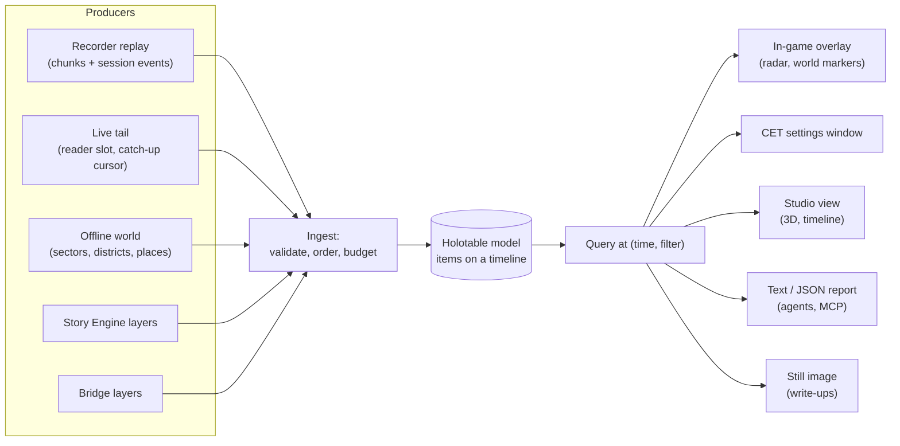
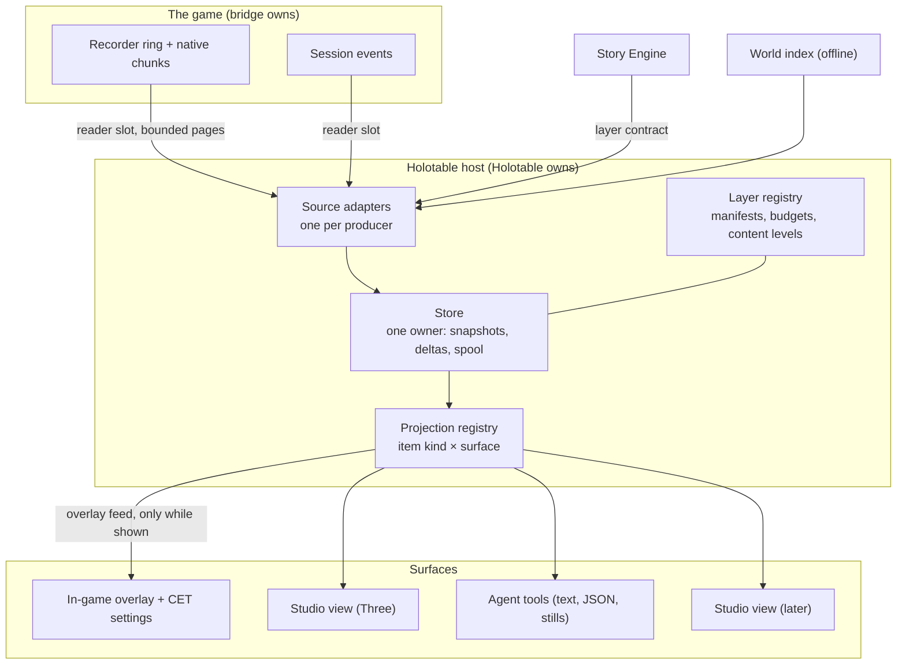

# Holotable: a live view of the game world (phase 1 proposal)

**Status:** proposal for review, 26 October 2026. It answers the [research brief](../backlog/briefs/live-world-view.md) for phase 1. Nothing here is built. Design and spec, the full bridge wants list and the proof of concept follow, each after this step is reviewed. Grades follow the [knowledge rules](../../knowledge/README.md#rules-for-knowledge-pages): **[source]** read in our code or docs, **[resource]** read in game data, **[hypothesis]** expected but unchecked.

**In one paragraph.** Holotable is a private window onto what the game and our own systems believe is happening right now: a flat-shaded, low-polygon bird's-eye view of V, the people and vehicles around her, the camera, what she saw and heard, what the bridge is doing, and what the Story Engine thinks the city looks like, all on one timeline you can scrub. Its core is not a renderer. It is **a typed, time-indexed model of the world, fed by producers and read by projections**. Every surface is a projection of that model: a **translucent overlay inside the game** that never takes input and shows and hides on one key, so play carries on underneath it; a **CET window** that configures it; a **Holotable view in XF Studio** (an early-access module behind a flag) with the full 3D view and the timeline; a text report an agent reads; a still image in a session write-up. Live data rides the bridge's existing bounded streams through a read-only connection; Holotable never polls the game. The first version works entirely offline, by replaying recorded sessions.

## Contents

1. [The value](#1-the-value)
2. [The core idea: the model is the product, views are projections](#2-the-core-idea-the-model-is-the-product-views-are-projections)
3. [Architecture and decoupling](#3-architecture-and-decoupling)
4. [Presentation](#4-presentation)
5. [Data sources and fidelity](#5-data-sources-and-fidelity)
6. [The performance constraint](#6-the-performance-constraint)
7. [First-cut bridge wants](#7-first-cut-bridge-wants)
8. [The Story Engine's contribution and the spoiler switch](#8-the-story-engines-contribution-and-the-spoiler-switch)
9. [Coordination](#9-coordination)
10. [What else matters](#10-what-else-matters)
11. [Phase 2 requirements from review](#11a-phase-2-requirements-from-review) and the [phased plan](#11-phased-plan)
12. [Open questions for the maintainer](#12-open-questions-for-the-maintainer)

## 1. The value

What Holotable gives that nothing else does today is **one place where every belief about the world is drawn together, against time, with its evidence**. Today each belief lives in its own log: the recorder's JSONL chunks, the session event stream, `game_catchup` pages, supervisor receipts, witness reports, the Story Engine's record. Reading them means reading text and doing spatial arithmetic in your head, which the project's own rule asks us to stop doing ([visual communication](../../AGENTS.md#working-with-the-maintainer) and "give agents their own view of the game").

| Who | Use | What they see |
|---|---|---|
| The maintainer, during a session | **Confirm what scripts believe.** "The runner thinks the actor is at the stall; is it?" | V, XF actors with their handles and roles, the supervisor's hold radius, the plan step each actor is on |
| The maintainer, after a session | **Replay and diagnose.** Scrub to the moment something went wrong and see who was where, what V's camera could see, which event fired | The whole session on a timeline, every item clickable with "why": the record ids it came from |
| The bridge chat | **Debug the bridge's own work.** Placement choices, sight lines, contact alerts, coverage gaps, where the recorder lost samples | Bridge layers: probes, sight rays, road boundaries, safe points, recorder gaps drawn as gaps in the trail |
| The Story Engine chat | **See the simulation against the game.** Heat bands per cell, regimes, presence, declared incidents and whether V witnessed them, plans and their reports | Story layers over the same base, with **drift** marked: where the engine's mirror disagrees with what the bridge observed |
| Agents | **Their own view of the game.** Ask "who is within 20 m of V and outside her view?" (answered with its coverage limits, §11a) or "what changed in the last 30 s?" without a screenshot | A text and JSON projection of the same model, plus rendered stills for vision checks |
| Test design | **Plan before playing.** Lay out where a scene will run, check sight lines and spawn points against geometry offline | The base layer with candidate points, before any game time is booked |

The strongest single case is **post-mortem replay**. Session 15 ended in a watchdog crash after about twelve minutes of district reads; Borg sessions produce thousands of records per run. A scrubbable picture of those minutes, with every item citing its record, turns an evening of log reading into a few minutes of looking.

## 2. The core idea: the model is the product, views are projections

Everything Holotable shows is **derived from data by a pure function**. No view holds state of its own beyond its viewpoint and selection, and no interaction changes anything but the model's view state (which time, which selection, which layers, which filter). This is the property that lets the same work produce an out-of-game 3D window, an in-game minimap, an agent's text report and a still image for a write-up, and lets a layer from a new producer appear in all of them without code in any of them.

**The three kinds of data are separate and plain:**

| Kind | What it is | Example |
|---|---|---|
| **Items** | Typed, versioned records on a timeline, each anchored in the world and citing its source | `actor a2 at (x,y,z), yaw 140°, plan step "approach", seq 1394, cites recorder 1:1394` |
| **Layer manifests** | What a producer publishes: its item kinds, their schemas, content level, rate budget | `story.bands: kind cell-band, content structure, ≤ 2 batches/s` |
| **Projection specs** | How an item kind is drawn or written in each surface, as data | `cell-band → 3D: extruded polygon, height by band, colour token band.<name>; text: "<cell>: <band>"` |

Projections are registered per item kind and surface, with a generic fallback (a labelled marker at the anchor, a JSON row), so an unknown kind still appears. Styles are tokens resolved by theme, so light and dark, colour-blind palettes and the in-game look come from one table.

**Interaction is typed actions over view state**, the same pattern as the Studio's action registry ([architecture contract](../authoring/architecture-contract.md)): `select(itemId)`, `scrub(t)`, `follow(entity)`, `toggleLayer(id)`, `setContentLevel(layer, level)`, `explain(itemId)`. Each surface binds its own input to the same actions, so a key in the desktop window, a click in the in-game panel and an agent's MCP call all do the same thing. Version 1 is read-mostly: no action reaches the game. Later write-back (dropping a pin, proposing a seed) goes as a typed request to the producer that owns the data, never as a view editing the model.

## 3. Architecture and decoupling

**The base layer exists without the Story Engine.** It is fed by the bridge (V, actors, camera, events, incidents, supervisor) and by offline world data (districts, areas, streaming boxes, later collision and proxy geometry). The Story Engine is one producer among several; switching it off removes its layers and nothing else.

**One owner per subsystem**, as the [architecture contract](../authoring/architecture-contract.md) asks:

| Subsystem | Owns | Hands out |
|---|---|---|
| Source adapter (one per producer) | Its connection or file reader, its cursor, its rate budget, its `AbortSignal` | Validated batches of items |
| Store | Every item, its time index, snapshots every N seconds plus deltas, the spool to `local/holotable/` | Read-only snapshots at a time, iterators over a window |
| Layer registry | Manifests, content levels, the spoiler switch, per-layer budgets and drop counters | The effective layer set |
| Projection registry | Specs per item kind and surface, style tokens | Draw lists, rows, labels |
| Each surface | Viewpoint, selection, input binding | Typed actions |

**Plain data, explicit state.** Item schemas are versioned (`xfh/item-1`), producers' manifests declare their own kinds, and the store rejects what doesn't validate with a counted, visible reason. Time and randomness are injected so replays are deterministic in tests. Cancellation is `AbortSignal` throughout.

**The layer contract (host side, Holotable owns it).** It adopts the Story Engine's six requirements, which the bridge also agreed:

1. **Time on every item:** a snapshot plus deltas with a monotonic sequence per producer, scrubbable; a world generation (from the bridge's cursor) marks save loads, so a timeline can branch at a load rather than pretend continuity.
2. **Citations:** each item names the record ids it came from (`recorder:<run>:<seq>`, `event:<sid>:<seq>`, `se:<record id>`), so selecting it can answer "why".
3. **Anchors:** a position, an entity id or a region (polygon with a vertical band, box or cell id).
4. **A content level per layer:** `structure` or `full` (§8).
5. **Opt-in, bounded, droppable publishing:** a producer publishes only when Holotable subscribes, within its declared budget; the host may drop whole batches and says so, and dropping never blocks the producer.
6. **Read-mostly in version 1.**

It adds three of its own: a **schema per item kind** declared in the manifest; **stable entity ids** across producers (the bridge's actor handles and entity ids, the engine's ids, joined by a mapping item rather than by guesswork); and a **coordinate frame** fixed to the game's world metres, with Z up as the game stores it.

**Boundary with the bridge.** The bridge's extension system (XF Core) is game-side and the bridge's. The layer contract is host-side and Holotable's. A bridge layer reaches Holotable the same way any producer does.

### 3.1 Where each part runs, and how they connect

The rule is that it **just works**: nothing to start in the right order, no addresses to type, no ports, no firewall prompts, and each piece useful on its own.

| Part | Runs in | Works without |
|---|---|---|
| **The in-game overlay and its base layers** | The game: the bridge's native canvas draws; Holotable's own CET module reads the bridge's read-only snapshot of what it observes (V, XF actors, incidents, supervisor holds, recorder gaps) and turns it into canvas primitives through the shared projection specs, which ship with the mod as data | Any other XF program. Install the mod, press the key, it draws |
| **Extra layers** (the Story Engine, later others) | Their own processes | — They add layers to the overlay when they run, and their layers simply aren't there when they don't |
| **The headless Holotable service** (store, bridge observer, Story Engine items, projection specs) | Its own process, started on demand by whichever client needs it first | The Studio and the game: it replays recordings offline, and attaches to the game by itself when it runs |
| **The external view** | XF Studio, as an early-access module behind a flag | The game (replay) |
| **Agent tools** | Beside the bridge's MCP server, reading the headless service | The Studio |

**The connection is the bridge's own local named pipe, not a network socket.** The bridge already opens a token-protected pipe that accepts only processes of the same Windows user on the same machine, with a fresh key each game session, and it already has read-only observer slots ([MCP guide, the safety model](../../projects/xf-runtime-bridge/docs/mcp.md#the-safety-model)). The headless Holotable service connects to it the way the MCP server's `--read-only` mode does, finding the running game through the bridge's session file. A TCP socket, even on localhost, would be reachable by other local programs, can trigger firewall prompts and adds an address to configure; a localhost web server adds a URL that non-technical users don't understand. Neither is needed.

**What the person sees** in the Studio's Holotable view is plain state, never an error: "Waiting for Cyberpunk 2077", "Connected", "The XF bridge is off in this mod profile" with the one next step, and "Replaying a recording" when offline. It reconnects by itself after a load, a restart or the kill switch's Reconnect.

The split of the in-game work is agreed in outline with XF · Runtime bridge (§4); the canvas schema and the snapshot's shape are settled in phase 2 (§7).

## 4. Presentation

| Option | For | Against |
|---|---|---|
| **Own desktop window** (a small desktop app) | A second monitor or a strip of the 3840×1600 display beside the game; no game frame cost; full Three rendering; easy for agents to render offscreen | Another window to arrange; must never steal focus or flash |
| **A view inside XF Studio** (chosen) | One app and one design system; reuses the view graph, docking, floating panels and theme; the Studio already reserves a `location` scene kind ([view graph §5.2](../authoring/view-graph-design.md#52-world-non-v)) | Must not clutter the Studio before it is useful: hence early access behind a flag until it has baseline useful functionality, with the data side outside the Studio |
| **Plain browser page** | Zero install | Needs a local server and a URL, which confuses people who aren't technical; no stable window to place |
| **In-game translucent overlay** (ImGui, no input) | Seen without looking away, while playing; markers can sit on the people and places they describe | Costs some game frame time; must be strictly bounded so it never repeats the watchdog lesson |
| **CET window** | Rich controls in game | CET's overlay blocks game input while open: right for settings, wrong for watching |
| **A combination** | Each surface where it is best | More surfaces to keep consistent, which the data-driven core makes cheap |

**Decision (the maintainer, 26 October): the in-game overlay first; the external view as an early-access XF Studio module behind a flag; the data side headless.** All from one model. **Early access is short:** the module leaves it as soon as it has baseline useful functionality (the proof of concept's replay with citations, §11), and from then on it is ordinary ongoing iteration. Sub-features that are still experimental after that (for example story layers, the scene pre-flight, the test-card overlay) are switches in the module's own settings, each marked early access there, not reasons to hold the whole module back.

1. **The in-game overlay is the primary surface.** A translucent overlay drawn over the game while it is being played: a radar inset (top-down, V-centred, turning with her heading) and, one key press away, world-anchored markers projected onto the scene itself (corner brackets on an actor with an id and plan-step chip, an incident ring on the pavement, a hold radius), the "tapping into the matrix" view. It **never takes input**, so the game keeps playing normally underneath it. **One key shows and hides it** and a second switches between radar only and radar with markers. It is drawn by the bridge's own native Dear ImGui host, the same one that draws the XF box today, which is already click-through, themed from the Studio's tokens, aware of frame generation, hidden for captures and covered by the kill switch ([style guide, in-game surfaces](../../projects/xf-studio/authoring/public/style-guide.html#ig-overlay)).
2. **CET's window configures it.** CET's overlay blocks game input while open, which is wrong for watching but right for settings, so the duality sits there: layers on and off, content level and the spoiler switch, radar range and plate opacity, which markers draw in the world, and the two keys. Changing a setting while CET is open shows its effect on the overlay at once; closing CET returns to play with the overlay still drawn.
3. **The external view is an XF Studio module.** A `holotable` feature module, at the early-access stage and off unless its experiment flag is on, so nothing reaches the 1.0 interface. It fills the `location` scene kind the view graph already reserves ([view graph §5.2](../authoring/view-graph-design.md#52-world-non-v)) and contributes, through the composition lists only, the 3D bird's-eye view, its layers, inspector and timeline panels, and a Holotable layout tab. That gives one app, one design system (its controls come from the component library, specified to the UI component track rather than built in the feature), docking, light and dark, and a floating panel for a second monitor or a strip of the 3840×1600 display. It never takes focus from the game. It is the first surface built (§11), because offline replay needs nothing else.

   **Integration, agreed with XF · Studio (26 October):**
   - **Slot.** `features/holotable/` owns the `location` scene kind, the view, the three panels and a layout default. While flagged it is wired only through `compose/experiments.ts` (`browserExperiments`, so the feature isn't even imported until its experiment is on); after the flag lifts, through `compose/modules.ts`, `views.ts` and `layout-defaults.ts`. Off-limits: `studio-main.ts`, `studio-startup.ts`, the shell, `studio-ui/components/` and `style-guide/` (UI track only), `studio.css`, and the view-graph core; any view-graph change goes to XF · Studio as a spec.
   - **Data.** The port is a typed interface in `features/holotable/` (domain side, cancelled with `AbortSignal`); its adapter sits in `features/holotable/host/`, as `saves/host` and `installation/host` sit beside their domains. The host owns the service's lifetime: it starts the headless service on demand as a child process over a stdio pipe (no port in the shipped app) while the module is active, deduplicates starts, and stops it when nothing wants it. Port 4341 is a development override only. The browser side reaches it through the host's API like every other device.
   - **Lifting the flag** is a Studio release step: Holotable sends the evidence (offline replay with citations working; captures in light and dark, narrow and wide), it passes XF · Studio's UI/UX review and one Sol review, and XF · Studio flips it in a normal merge. The module's own settings carry the sub-feature switches.
   - **Order and timing.** The work is not a widening (the maintainer started it) and stays flag-gated until the replay proof. On the Studio's side it ranks after the beta blockers, so the viewer starts on existing library components and the UI track builds the new ones after its beta-blocker work. Scene runtimes are on `main` and `location` is reserved, so the scene kind can be built now. The layout tab waits for the profiles work's contributed-defaults API; until then the view opens as a panel.
   - **Module settings need platform work.** Settings groups are a fixed list today, so the module's sub-feature switches need a platform contribution point (a module contributes its own Settings group while active) and a switch row carrying a `stage-tag`. Both are XF · Studio's to build, from Holotable's component spec.
   - **Components** are specified to XF · Studio, which runs the UI component track. Already in the library: `stage-tag` (the per-switch early-access tags), `scrub-slider` and `slider-with-value` (the keyboard slider's basis), `record-list` and `light-list` (the layer list's switch rows), `tab-strip` and `group-section`. New: the timeline scrubber (lanes, gaps, the save-point fork), hold-to-confirm, and confirm-in-place. The translucent plate token belongs to the bridge's in-game styling spec (Studio tokens → ImGui), requested there and reviewed by XF · Studio.
4. **The data side is headless.** The store, the bridge observer, the Story Engine's items and the projection specs run as a Holotable service of their own (`projects/xf-holotable/`), not inside the Studio, so agent tools (`holo_query`, `holo_report`, `holo_still`: text, JSON and rendered stills of the same model) work with the Studio closed. The Studio module is one viewer of that service, through a typed port in the Studio's host layer. Neither opens a port the person sees (§3.1).
5. **A thin standalone window stays possible** on the same service if the Studio ever can't host the view; nothing above depends on it.

**How the overlay works: the bridge draws, Holotable decides what** (agreed in outline with XF · Runtime bridge, 26 October; the schema follows in phase 2):

- **The bridge owns a world-space canvas (`canvas@1`) in its native host.** Its content is plain primitives (line, polyline, point, box, circle, label, and a screen-space panel), each anchored at a world position, at an entity id (resolved on the game thread each tick, capped) or on the screen, with a layer id, colour tokens, an opacity and a time to live. The bridge snapshots the camera on the game thread each tick and projects on the render thread, so nothing makes game calls per frame. Hard caps on primitives, anchors and bytes are the bridge's to enforce. It also owns the two keys (through the same route as its stop key, rebindable in CET) and a `canvas.visible` event.
- **The radar is a canvas view, not a second feed.** Each layer declares `views: world`, `radar` or both. The radar is a canvas-owned screen panel (position, size, range in metres, heading-up or north-up, set from Holotable's CET window) that transforms world primitives top-down around V and clips them, so a producer sends each primitive once; labels and chips stay world-only unless a layer asks. Primitive notes from the bridge: dashes are split into segments by the host, ground rings are projected polylines at the anchor's ground height, filled ground polygons have at most 8 vertices, points are screen-sized dots, styling is by colour token only, and an entity bracket is sized from the entity's bounds where the game gives them (unproven until a session checks it).
- **Caps** (agreed): per producer 256 primitives, 4,096 vertices and 64 KB per snapshot; across all producers about 1,024 primitives and 16,384 vertices, refused with the cap named; at most 64 entity anchors resolved per tick, the rest holding their last position for a short time.
- **Holotable owns the content.** Its projection specs, and the interpreter that turns observations into canvas primitives, are Holotable's. **Standalone in game**, Holotable's own CET module runs that interpreter a few times a second (in CET's update, not its draw), reading a read-only snapshot the bridge exposes to Lua (V, XF actors, incidents, supervisor holds, recorder gaps), and submits primitives to the canvas. The Studio view runs the same specs in 3D. Nothing of Holotable's lives in the bridge's module, and nothing of the bridge's in Holotable's.
- **Other producers may also feed the canvas directly**, but only as a projection of items they also publish to Holotable's model under the same contract, so nothing appears in game that replay, the Studio view and agents can't see (§11a, requirement 1). A new `display` access class changes only XF's own drawing, never the game, so read-only connections may use it: `canvas.feed {layer, items, ttl}` takes bounded batches per producer, is dropped while the canvas is hidden (producers subscribe to `canvas.visible`), and tells a backlogged producer to resend a snapshot rather than queueing.
- **The projection specs are the shared language.** An item kind's style token, label template, priority and content level are one table, read by the Studio view's renderer, by Holotable's in-game interpreter and by the agent report. A new producer's layer appears everywhere without new drawing code.
- **Later**, when XF Core exists, the canvas becomes a core service and Holotable's module a plugin of it; only the manifest changes.
- **One design question for the in-game styling spec**: the canvas plate is translucent (the mock-up shows 72 %), where the XF box's plate is 97 %. That is a new value in the bridge's in-game token table (Studio tokens → ImGui), requested from XF · Runtime bridge and reviewed by XF · Studio, not invented in Holotable's code.

**The look follows XF Studio's design system, "Night-shift instrument"**, in both themes, and earns its cyberpunk feel from precision rather than franchise tropes (the style guide rules out glitch text, neon outlines and fake terminals):

- **Graphite wireframe city on the neutral stage.** Terrain as a fine wire mesh following the ground, roads as flat strips, buildings as flat-shaded volumes with crisp edges, fading with distance: our take on the game map's top-down default, but orbitable, zoomable and layered. In the light theme it reads like an architect's white model; in the dark, like a night-time survey.
- **Colour means one thing each.** Cyan (`--signal`) is live data and selection: XF actors, what V saw (solid) or heard (dashed), the selected item. Yellow is only for commitment and focus, as everywhere in XF. V is the stage's strongest neutral; warning and danger tints carry heat bands and drift, always with words.
- **Data draws above geometry.** Markers, rings and labels are never hidden behind buildings, with leader lines to monospaced labels: an instrument, not a scene.
- **Instrument chrome.** Edge ticks, a scale bar and a north mark on the stage; Bahnschrift capitals for eyebrows; Cascadia Mono for every value, coordinate and record id; bevelled corners as the only ornament.
- **In game**, corner brackets frame an actor, and a bevelled chip names it; the radar is a bevelled plate with the same wireframe seen from above, turning with V.

The [mock-up](mockup.html) is interactive and data-driven itself: one small model (seeded terrain and buildings, items on a timeline, layers) drives the in-game view, the radar, the CET window, the Studio view and the agent's text, so a layer switch, a scrub or the content switch changes them all together. Its terrain, buildings and people are generated stand-ins; the real base layer comes from game data (§5.2).

## 5. Data sources and fidelity

### 5.1 Live, from the bridge (all read-only)

| Source | What it gives | Rate and bound | Grade |
|---|---|---|---|
| Recorder channels `v`, `actors`, `camera` | V's position, vitals, vehicle, busy reason; up to 16 selected actors' position, yaw, AI command; camera basis, FOV, aspect | 10 Hz target on 100 ms game-update deadlines, explicit drops and missed deadlines | [source] ([MCP guide](../../projects/xf-runtime-bridge/docs/mcp.md#source-recorder-0814)) |
| Recorder channels `incidents`, `supervisor`, `contacts`, `subtitles`, `voice`, `face`, `ui` | Witness reports, supervisor interventions, contact receipts, lines and their widgets, face submissions, UI state | Event-driven, 1 Hz coverage heartbeats | [source] |
| `game_catchup` with a cursor | Everything since the cursor, compact or detailed; replays native chunks beyond the ring; explicit gaps | Bounded to 8 MiB or 1,024 rows per call; `now: false` skips the extra game-thread read | [source] ([reference](../../projects/xf-runtime-bridge/docs/mcp-reference.md#game_catchup)) |
| Session events | Every change, refusal, note and marker, with undo | Already streamed | [source] |
| A read-only reader slot | An observer connection with its own cursor; never disturbs the writer | Three slots by default (0–8) | [source]; runtime latency uncommissioned |

`scene_read`, `world_probe` and `world_district` exist too, but each is a game-thread request, and Holotable never calls them on a timer. Their results are answers to whoever asked, not session events (which record changes, refusals, lifecycle and notes), so Holotable can draw them only if they are published: want 15 asks for that.

**Catch-up needs its full form for drawing.** By default `game_catchup` coalesces polled snapshots and keeps only the last 24 events per channel, which is right for a coordinator's turn and wrong for a trail. Holotable reads with `detail: true`, keeps the returned cursor exactly, and tells two things apart on the timeline: *behind* (the page reported `more` or a backlog, so the next page fills it) and *a gap* (drops, invalid samples or missed deadlines, which no page will fill).

### 5.2 Offline, from game data

| Source | Gives | State | Grade |
|---|---|---|---|
| Streaming block descriptors (26,318) | Sector boxes by category and level: the "what is loaded near here" skeleton | Readable today with the native reader | [resource] ([world and streaming §1.2](../../knowledge/world-and-streaming.md#12-streaming-blocks)) |
| District records and area polygons with vertical bands | District, sub-district and venue outlines; restrictions; police presets; the place dimensions | Resolved offline for the place work | [resource] ([places §12](../../knowledge/places.md#12-place-dimensions-for-the-world-index-w1)) |
| Points of interest, map pins, services, AI spots | Markers and spot supply | Read offline | [resource] |
| Collision actors (boxes, spheres, capsules) | The cheapest true solid geometry: flat-shaded primitives exactly in the requested style | Needs the W0 sector reader | [source] layout; reader not built |
| Building, road and terrain proxy meshes | A low-polygon city silhouette by construction | Needs mesh decoding (reader phase 4) | [resource] node counts; fit for the look [hypothesis] |
| Navigation tiles | Walkable surface | Format unread | [hypothesis] |

**How to get "lidar or splat-like" geometry cheaply**, in rising cost:

1. **Polygons and boxes** from data already read: district outlines extruded by their vertical band, streaming boxes as wireframes. Enough for a first replay.
2. **Accumulated samples**, kept in two honest kinds: **where things were** (V's and actors' positions, which trace pavements, stairs and rooftops actually used: free space, not surfaces) and **surface hits** (a ground probe's hit, a sight ray blocked by static geometry: confirmed collision). They draw differently, so a trail of footsteps is never mistaken for a scanned wall. Over a session they build the sparse "lidar" picture from what was observed and nothing else.
3. **Collision primitives** near V from W0: true solids, flat-shaded.
4. **Proxy meshes** for the skyline once meshes decode: the game's own low-poly stand-ins.
5. **Detail meshes** only for a small radius, only if a use case needs them. The brief's aesthetic does not.

## 6. The performance constraint

Session 15's watchdog crash is the hard rule: **Holotable adds no polling of its own, and every piece of in-game work it causes is bounded and measured.** It observes what the recorder and the session already produce; the canvas does real per-tick work (a camera snapshot, capped anchor resolution, Holotable's CET interpreter), so that whole path, hidden state included, gets a budget and a measurement, not a promise. Concretely:

- **No timers against the game.** No `scene_read`, `world_probe`, `world_district` or `player_state` on an interval, ever. A watchdog-safe design is one where the view's refresh rate and the game's work are unrelated.
- **Ride the recorder.** The recorder already samples on its own bounded deadlines. Holotable reads its ring and chunks through a reader slot with `game_catchup {cursor, now: false, detail: true}`, so its reads cost what the recorder's pages cost and no more. Until a push stream exists (§7, want 1), the reader asks at most once a second, backs off when `more` is false, and stops when the view is hidden.
- **Bounded everywhere.** Each adapter has a byte and row budget per second, and a dropped batch is counted and shown as a gap, never silently interpolated.
- **Level of detail by distance and by zoom** on the host side only: far actors become dots, far events become counts.
- **The in-game overlay draws, it never reads per frame.** The bridge snapshots the camera and resolves entity anchors on the game thread once per tick under caps, and projects on the render thread; Holotable's CET module builds primitives a few times a second from a snapshot, not from game calls; outside feeds are dropped while the canvas is hidden. Hidden costs nothing, and the frame cost is measured in the proof of concept.
- **Kill switches.** Holotable's own "stop feeding" disconnects every adapter at once. The bridge's kill switch and a save load end its reader cleanly, as for every observer. Disconnecting a reader never changes the writer's state or leases ([MCP guide](../../projects/xf-runtime-bridge/docs/mcp.md#timeline-between-coordinator-turns-0814-autonomous-candidate)).
- **Measured, with budgets.** The proof of concept measures reader cost against the bridge's own frame and queue counters, and the load-time track's budget applies to the viewer: open on a replay with everything visible at first paint, scrubbing with no perceivable wait ([performance](../backlog/performance.md)).

## 7. First-cut bridge wants

Ranked by value to Holotable. "Native" means RED4ext or plugin work, not only tools-side TypeScript. Wants 10–13 are the bridge's own proposal (A–C in §4), which Holotable accepts. They go into the bridge's capability registry as `demand` entries under consumer `holotable` once it lands, edited only through its tool.

| # | Want | Why | Rate | Native? |
|---|---|---|---|---|
| 1 | **Push subscription for readers**: the recorder streams new records to a subscribed reader slot, with a drop policy, instead of request and response | Removes Holotable's last request loop; one copy of each record leaves the plugin once | ≤ 10 Hz batches | Yes |
| 2 | **Replay discovery**: the recorder already writes `<runtime>/recordings/<session>/run-<id>/` with chunks and a manifest ([MCP guide](../../projects/xf-runtime-bridge/docs/mcp.md#source-recorder-0814)), read by `tools/testing/recording-replay.ts`. What's missing is a way for an app to list finished runs and their sessions without knowing that path | Offline replay is the first proof of concept | n/a | No (tools) |
| 3 | **A low-rate "nearby population" channel**: positions, yaw and coarse kind for actors and vehicles near V beyond the 16 selected handles. It must come from observations the game or bridge already maintains (an event-maintained or cached set), never a repeated enumeration on the game thread, with its thread ownership stated and its cost measured before it is switched on | The bird's-eye view needs the crowd, not only our actors | 1–2 Hz, ≤ 64 entries | Yes |
| 4 | **Game time in records**: the game clock beside QPC source time (simulation time is explicitly unavailable today) | Lining up story time, the day cycle and the session | per batch | Yes |
| 5 | **Streamed-sector events**: sector load and unload ids around the observer | Tells the base layer which offline geometry the game actually has loaded, at almost no cost | on change | Yes |
| 6 | **Stable entity ids across channels and events** | Joining an actor in the recorder, an incident and a plan report without guessing | n/a | Partly |
| 7 | **Reader cost counters**: per-reader requests, bytes and game-frame time attributed to observers | Proves §6 rather than asserting it | 1 Hz | Yes |
| 8 | **The recorder outside the autonomous test build**, as a read-only diagnostic package | Holotable in ordinary test sessions, not only Borg runs | n/a | Yes (packaging) |
| 9 | **Plan reports as events** (already agreed in Agreement 8 between the bridge and the Story Engine) | Drawing plan steps on actors | on change | In progress |
| 10 | **`canvas@1`** (bridge proposal A): a world-space canvas in the native overlay host, with the primitives, anchors, caps and per-tick camera snapshot of §4 | The in-game overlay with no per-layer game-side code | per tick, capped | Yes |
| 11 | **Canvas keys and `canvas.visible`**: show/hide and mode keys through the bridge's own key route, rebindable in CET | Show and hide without opening CET | n/a | Yes |
| 12 | **A read-only Lua snapshot** for Holotable's CET module (bridge proposal B): V, XF actors, incidents, supervisor holds, recorder gaps | The overlay working with no other XF program running | a few Hz | Partly |
| 13 | **The `display` access class and `canvas.feed`** (bridge proposal C), usable from read-only connections | Story Engine and other producers drawing in game | 1–4 Hz, bounded batches | Partly |
| 14 | **The headless service as a read-only observer**: confirmed possible today through `command-api.ts` with `readOnly: true`; the bridge plans to raise the default observer slots from 3 to 6 after measuring, since the runner, the Story Engine and Holotable each want one | The Studio view and agent tools without setup | n/a | No (tools) |
| 15 | **Published probe and scene results**: an `observe.result` session event (bounded, with the command, the caller's cid and the result) whenever a writer calls `world_probe`, `scene_read` or `world_district`; agreed by the bridge, adding no game-thread work since the results already exist | Drawing what sessions already asked, at no extra game cost | on call | No (tools and plugin event) |

## 8. The Story Engine's contribution and the spoiler switch

These concepts have a place in space or time and would render. The list comes from the Story Engine's public specification ([S1 §9](../story-engine/spec/simulation.md#9-what-s1-exposes)) and was checked and extended by XF · Story Engine on 26 October. The engine's core concepts are its own; Holotable only draws what it publishes.

| Engine concept | Anchor | Drawn as | `structure` shows |
|---|---|---|---|
| **Level of detail**: what is open at which detail around the vantage (the engine's core principle, never visible until now) | Nested regions, each with a detail level | Nested translucent volumes, finer detail brighter | Everything |
| Heat bands per cell (`band(cell)`: quiet, elevated, hot, flashpoint) | Cell region | Ground tint and a low extrusion, height by band | Everything |
| Regimes over a scope | District or cell | Hatched overlay with its kind | Everything |
| Faction presence per leaf (`presence`) | Area polygon | Stacked bars at the area's centroid | Everything |
| Refuge (`refuge(leaf)`) | Area polygon | Outline style: solid, dashed, none | Everything |
| Declared and witnessed incidents | Position | Ring at the place: solid when V saw it, dashed when heard, faint when unwitnessed with its reason | Rings by kind |
| **People**: residents (bound ones on their entity, coarse ones in their region), ties as links, groups with leader seats, goals as arrows to their targets | Entity or region; pairs | Marks, links and arrows | Counts per area, group shapes and seat counts |
| **Norms**: compliance and refusal per group and stall | Group, place | Small gauges at the place | Compliance |
| **Intentions against the protagonist**: rung, warned, presented | Group, protagonist | A ladder marker on the group | Only once the warning has been presented to the player |
| **Rumours**: beliefs spreading across ties | Ties, areas | Spread over time along links | Believer counts per area |
| **Record events with cause links** | Position, time | Arcs between events over the timeline | Events and arcs without content |
| **Stories**: live pattern instances (each juncture matched, ready or pending, bound to people and places), threads, the director's candidates and its gate decisions ("why this wasn't sown") | The places and people bound | A marker with juncture counts by state; threads as linked markers | Markers and counts, no pattern name |
| **Scene bindings**: each scene's role bindings, phase and rung, joined to the bridge's plan steps by scene id (the plan layer itself is the bridge's) | Entities | Phase and rung on the actors the bridge's plan layer already marks | Phase and rung |
| **Divergence**: a belief that differs from the engine's own record (its perspectives) | Believer and subject | A line between them | Nothing |
| **Drift**: where the engine's mirror places someone against where the bridge observed them | Entity | An offset mark from the mirrored to the observed position | Everything |

**Content levels.** Every layer declares `structure` or `full`, and the right-hand column above is the Story Engine's own split. `full` adds names, roles, goals, kinds of ties, beliefs and divergence, pattern ids and bindings, candidates and gate reasons, and every state of an intention. Structure shows the engine working without telling the story; full is for analysis.

**How the engine publishes.** Typed items, never drawing: Holotable's projection specs draw them, so the engine has no drawing code. In play the engine is one producer to Holotable's host; in game its layers reach the canvas through Holotable's CET module, not through `canvas.feed` (how its typed items reach that module when the headless service isn't running is a phase 2 question for the three chats). Offline, the reference model's harness can write the same items to a spool file from an M3 run, giving the proof of concept real engine data before anything runs in game.

**Citations** take the form `se:<kind>:<id>`, the kind being `event`, `node`, `edge`, `frame` (goals and intentions), `belief`, `seed`, `inst` (a pattern instance), `sow` (a sowing decision) or `stage`. A selection asks the engine "why?" with the id, and it answers in the world's terms or, for analysis, with its draw trace.

**Time and saves.** Engine items carry game time (the record's clock), the engine's window index and cumulative play time in their branch, and a branch id equal to the save's identity. On a load the engine replays to the saved state and continues on a new branch, so **Holotable forks the timeline at the save point, not at the moment of loading**; the bridge's world generation marks the load and maps onto the engine's branch id.

**Drift is Holotable's to compute**, since it holds both streams and the engine stays off the bridge's samples: the engine publishes its mirror's positions with the observation time each rests on, so the comparison lines up. When game truth overrides the simulation, the engine also publishes that reconciliation as an event, so drift the engine noticed shows beside drift Holotable measured.

**The switch** (the brief makes it optional; this proposes it because the Story Engine asks for a content level per layer anyway):

- **Default: structure**, every time Holotable opens, and after every save load.
- **One global switch, "Show story content"**, plus per-layer overrides for analysis of one layer at a time.
- **Hard to flip by accident:** a press-and-hold (or a typed confirmation from an agent tool), never a single click or a keyboard shortcut alone.
- **Always visible state:** a chip in the corner, quiet in structure mode and clearly marked in full mode; stills and reports say which level they were made at, so a full-content still is never mistaken for a safe one.
- **Agents** get structure by default too; a tool call asks for full explicitly and the answer is labelled.

## 9. Coordination

**Recommendation: its own coordinator chat**, which now exists as XF · Holotable.

| It owns | It depends on |
|---|---|
| `projects/xf-holotable/` (the headless service: store, adapters, projection specs and their interpreters, agent tools; the CET module); the Studio's `features/holotable/` module, by agreement with XF · Studio; `research/live-world-view/`; `local/holotable/` (ignored spools and replays); `experiments/046-*`; port 4341 for development only (the shipped app opens no port); **the layer contract and the projection spec format** | XF · Runtime bridge: recorder, catch-up, session events, a reader slot, the wants in §7. XF · Story Engine: its layers through the contract. The world index (W0–W1) for base geometry: not yet built and with no owner; Holotable can start on what the native reader already reads |

It is not a bridge track, because its most valuable parts (the model, the contract, the projections, the agent surface) are host-side and serve several producers; and its external view lives in the Studio as an early-access module behind a flag, so it reuses the Studio's shell without slowing the Studio's 1.0 work. XF · Studio owns the Studio product, so the module's slot, timing and components are agreed with it.

## 10. What else matters

- **Truth versus belief is the real subject.** The most useful thing Holotable can show is disagreement: the engine's mirror against the bridge's observation, the runner's expectation against the recorder, the supervisor's last safe point against where V is. Make drift a first-class item kind, not an afterthought.
- **Time is three clocks.** QPC source time, game time and the engine's simulation time differ, pause differently and reset on loads. The store keeps all three where known and the timeline says which it shows.
- **Loads branch the timeline, at the save point.** A save load starts a new world generation and a new engine branch; the fork is drawn where the save was made, not where it was loaded, and branches show side by side rather than spliced.
- **Gaps are data.** Recorder drops, missed deadlines and reader drops are drawn as gaps in trails and as shaded spans on the timeline, so absence is never read as proof.
- **The test-card companion.** A session's card rows (expected positions, regions, sight conditions) can be loaded as a layer and checked against the replay automatically: green where the observation matched, red where it didn't.
- **Guiding the maintainer in game.** The overlay can show "walk to the marked spot" as a world marker and on the radar, drawn from the same layers, replacing typed coordinates in session questions.
- **Overlay in captures.** Screenshots for evidence must be clean, so captures hide the overlay for their frame (as photo mode's menu is hidden today) unless a capture asks for it; a capture with the overlay on is itself useful evidence of what the systems believed at that instant.
- **Agents' vision.** Rendered stills of a projection are cheaper and clearer for a vision model than a game screenshot when the question is spatial ("is the actor between V and the door?").
- **Pre-flight for scenes.** Before booking game time, lay a planned scene over offline geometry: spawn points, sight lines, walking routes. This reuses the base layer with no live data at all.
- **Privacy.** Recordings are positions, ids and lines from a private test save. They stay in `local/holotable/`; anything published (a still in a public write-up) passes the private-path check and carries its content level.
- **Size.** A 30-minute run at 10 Hz with 16 actors is tens of thousands of samples, small for the store; the spool keeps snapshots so opening a long replay is instant.
- **Later write-back.** Dropping a pin to ask the engine "what would happen here?" or nudging a seed is attractive, but it is a producer's action, routed to that producer with its own permission, and out of scope for version 1.

## 11a. Phase 2 requirements from review

An independent review (GPT-6.1 Sol, high effort) of this proposal found gaps that phase 2's design must close. Each is a requirement on the spec, not yet a design:

1. **One semantic publishing contract.** Every producer publishes typed items to Holotable's model; game-side drawing is a projection of those items. A direct `canvas.feed` without the matching items is not allowed, so replay, agents and the Studio view never miss what the game showed.
2. **Feed ownership.** Canvas content is scoped by connection, producer, world generation and sequence, with atomic replacement, withdrawal on disconnect and a bounded time to live, so two producers can't collide on a layer and a late batch can't restore an obsolete drawing.
3. **Separate lifecycles.** Transport (the pipe), source (the recorder) and canvas each have their own states. A load, the kill switch or the writer leaving stops the recorder, and reconnecting an observer never restarts it silently; the Studio view says "waiting for a recording" rather than looking connected and empty. Handover invalidates actors and incidents explicitly.
4. **Whole-path budget.** The frame cost covers parsing, allocation, label formatting and dash expansion, not only primitive counts, and is measured with the overlay shown and hidden.
5. **Anchor lifetimes.** Entity mappings are scoped to a world generation and time-bounded, with explicit unresolved, stale and removed states, and fair scheduling when more than 64 anchors compete. A held last position fades as it ages, so it never looks current.
6. **A versioned spec language.** The projection specs are a small, bounded language with a version; the Lua and TypeScript interpreters negotiate it, recordings pin the spec hash they were made with, and a shared set of conformance fixtures runs against both interpreters.
7. **Comparable times.** Items keep occurrence, acquisition and publication times, the mappings between clocks and their uncertainty. Drift compares only observations that are compatible and fresh enough, since the engine may publish with a lag.
8. **Epochs and baselines.** A producer's stream has epochs, snapshot baselines and deletions; when a delta batch is dropped, dependent state is marked incomplete until the next snapshot, instead of drawn as if whole.
9. **Fail-closed content levels.** `structure` is a schema, not a filter: ids, kinds, citations, fallback labels and cached draw lists carry only what that level allows, the effective level is enforced on every output, and a per-layer override can never leave a "Story hidden" chip showing story.
10. **Categorical reads drawn as categories.** The engine's reads are categories with `maybe`, not quantities: presence never draws as a percentage bar, and unknown, stale, unavailable and hidden each look different from a "no".
11. **Evidence that outlives the record.** "Why" keeps bounded evidence beside each citation and says when it was resolved, is unavailable, or has aged out of the engine's ring.
12. **A named owner of the model.** The store runs headless (beside the bridge's tools, not inside the Studio view), so agent tools work with no window open. Each client has its own query context: the Studio view can scrub; **the in-game overlay is always live** and never follows a scrub.
13. **Honest agent answers.** Questions such as "unseen by V" answer in bounded claims (outside the view cone, seen unobstructed, unknown) with the coverage limits and citations, never a bare yes or no.
14. **Observer slots are finite.** Running out of read slots, or being paced behind writer work, shows as its own waiting state, never as "the game isn't running"; reconnection backs off within a bound; the pipe's credentials stay in the app's data side, never in its web view.
15. **Audit the fixture first.** The proof of concept names its recording and lists which channels it actually has (incidents are optional; session events are a separate feed; a crashed run may lack its manifest) before promising layers.
16. **Offline geometry is an estimate.** Variants, installed mods and doors change the world; offline geometry records which installation and profile it came from, and scene pre-flight results are labelled as estimates.
17. **Privacy beyond paths.** Recordings hold dialogue, comments and story content; they get a retention and deletion rule, exports get content-aware redaction, and agent tools follow the bridge's disclosure rule that their results leave the machine through the AI client.

The [mock-up](mockup.html) already follows several of these: one evaluated snapshot per render, the in-game overlay pinned to the live moment, trails broken at missing samples, and a keyboard route for every action.

## 11. Phased plan

| Phase | Delivers | Rough size | Needs |
|---|---|---|---|
| **1. Proposal** (this document) | Value, presentation, architecture, data, wants, coordination | done | — |
| **2. Design and spec** | The item and manifest schemas (`xfh/item-1`, `xfh/layer-1`), the projection spec format, the store's snapshot and spool format, the adapter interface, the agent tools' shapes, the replay file format; confirmed bridge wants filed in the capability registry; Story Engine checks the contract against its needs | 3–5 days of design | Bridge and Story Engine reviews |
| **3. Proof of concept: offline replay** (the module leaves early access here) | Load one recorded Borg run, and a spool of engine items from a reference-model run, in the Studio's Holotable view (through the headless service); draw V's trail, the actors, the camera frustum, incidents, supervisor events and gaps over district polygons; scrub; select any item and see its citations; the same model answers `holo_report` as text | 1–2 weeks | Want 2 (findable chunks); no game time |
| **4. Live, in game** | The in-game overlay (radar first, then world markers) with its show/hide and mode keys and its CET settings window, fed live through a reader slot; the Studio view follows the same session; reader and overlay frame cost measured | 1–2 weeks | Wants 1 (or a rate-limited catch-up), 7, 10–12; one booked session |
| **5. Base geometry and story layers** | Collision primitives and proxies near V; the Story Engine's structure layers in both surfaces; drift markers | 2–4 weeks | W0 reader; the engine's publisher |
| **6. More** | Test-card overlay; scene pre-flight on offline geometry; each starts as an early-access switch in the module's settings | 1–2 weeks each | — |

Phase 3 comes before the in-game work because it needs no game time and no new bridge code, and it builds the model, store and projection specs that the overlay then only interprets. **The smallest proof of concept that shows the value** is phase 3 on one Borg run: a two-minute scrub through a session the chats have already analysed by hand, where every marker answers "why" with a record id. If it is faster to understand than the logs, the case is made.

## 12. Open questions for the maintainer

1. **Name.** "XF Holotable" for the tool, following the mod branding default? The bridge's capability registry will use the consumer id `holotable`.
2. **Spoiler switch.** Is structure-by-default, press-and-hold to show content, the behaviour you want, or would you rather it simply be off?
3. **The overlay's keys.** Any preference for the show/hide and mode keys? Otherwise phase 2 picks two the game leaves free and the CET window lets you rebind them.
4. **World markers by default?** Should the overlay open as radar only, with markers on people and places one key press away, or with both on?
5. **Where the Studio's Holotable view sits by default.** A floating panel on a second monitor, or a strip of the ultrawide beside the game? This sets its layout tab's default.
6. **Recorder outside Borg runs** (want 8). Should ordinary test sessions record by default so every session can be replayed and drawn?

**Knowledge used:** [world and streaming](../../knowledge/world-and-streaming.md), [places](../../knowledge/places.md), the bridge's [MCP guide](../../projects/xf-runtime-bridge/docs/mcp.md) and [reference](../../projects/xf-runtime-bridge/docs/mcp-reference.md), the [Story Engine hub](../story-engine/README.md) and [S1](../story-engine/spec/simulation.md), the [architecture contract](../authoring/architecture-contract.md) and [view graph design](../authoring/view-graph-design.md), the [world ideas](../backlog/world-and-interactive-ideas.md), and the [style guide](../../projects/xf-studio/authoring/public/style-guide.html) with its in-game surfaces section. None found wrong.
