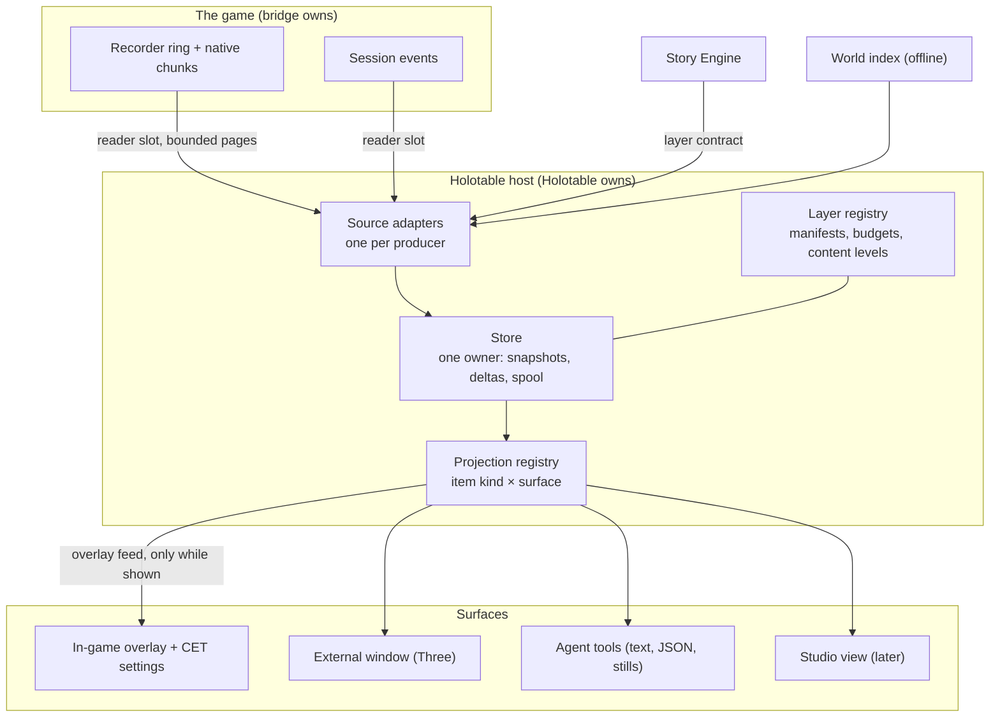

# Holotable: a live view of the game world (phase 1 proposal)

**Status:** proposal for review, 26 October 2026. It answers the [research brief](../backlog/briefs/live-world-view.md) for phase 1. Nothing here is built. Design and spec, the full bridge wants list and the proof of concept follow, each after this step is reviewed. Grades follow the [knowledge rules](../../knowledge/README.md#rules-for-knowledge-pages): **[source]** read in our code or docs, **[resource]** read in game data, **[hypothesis]** expected but unchecked.

**In one paragraph.** Holotable is a private, game-external window onto what the game and our own systems believe is happening right now: a flat-shaded, low-polygon bird's-eye view of V, the people and vehicles around her, the camera, what she saw and heard, what the bridge is doing, and what the Story Engine thinks the city looks like, all on one timeline you can scrub. Its core is not a renderer. It is **a typed, time-indexed model of the world, fed by producers and read by projections**. Every surface is a projection of that model: a **translucent overlay inside the game** that never takes input and shows and hides on one key, so play carries on underneath it; a **CET window** that configures it; an **optional external window** with the full 3D view and the timeline; a text report an agent reads; a still image in a session write-up. Live data rides the bridge's existing bounded streams through a read-only connection; Holotable never polls the game. The first version works entirely offline, by replaying recorded sessions.

## Contents

1. [The value](#1-the-value)
2. [The core idea: the model is the product, views are projections](#2-the-core-idea-the-model-is-the-product-views-are-projections)
3. [Architecture and decoupling](#3-architecture-and-decoupling)
4. [Presentation](#4-presentation)
5. [Data sources and fidelity](#5-data-sources-and-fidelity)
6. [The performance constraint](#6-the-performance-constraint)
7. [First-cut bridge wants](#7-first-cut-bridge-wants)
8. [The Story Engine's contribution and the spoiler switch](#8-the-story-engines-contribution-and-the-spoiler-switch)
9. [Coordination](#9-coordination)
10. [What else matters](#10-what-else-matters)
11. [Phased plan](#11-phased-plan)
12. [Open questions for the maintainer](#12-open-questions-for-the-maintainer)

## 1. The value

What Holotable gives that nothing else does today is **one place where every belief about the world is drawn together, against time, with its evidence**. Today each belief lives in its own log: the recorder's JSONL chunks, the session event stream, `game_catchup` pages, supervisor receipts, witness reports, the Story Engine's record. Reading them means reading text and doing spatial arithmetic in your head, which the project's own rule asks us to stop doing ([visual communication](../../AGENTS.md#working-with-the-maintainer) and "give agents their own view of the game").

| Who | Use | What they see |
|---|---|---|
| The maintainer, during a session | **Confirm what scripts believe.** "The runner thinks the actor is at the stall; is it?" | V, XF actors with their handles and roles, the supervisor's hold radius, the plan step each actor is on |
| The maintainer, after a session | **Replay and diagnose.** Scrub to the moment something went wrong and see who was where, what V's camera could see, which event fired | The whole session on a timeline, every item clickable with "why": the record ids it came from |
| The bridge chat | **Debug the bridge's own work.** Placement choices, sight lines, contact alerts, coverage gaps, where the recorder lost samples | Bridge layers: probes, sight rays, road boundaries, safe points, recorder gaps drawn as gaps in the trail |
| The Story Engine chat | **See the simulation against the game.** Heat bands per cell, regimes, presence, declared incidents and whether V witnessed them, plans and their reports | Story layers over the same base, with **drift** marked: where the engine's mirror disagrees with what the bridge observed |
| Agents | **Their own view of the game.** Ask "who is within 20 m of V and unseen by her?" or "what changed in the last 30 s?" without a screenshot | A text and JSON projection of the same model, plus rendered stills for vision checks |
| Test design | **Plan before playing.** Lay out where a scene will run, check sight lines and spawn points against geometry offline | The base layer with candidate points, before any game time is booked |

The strongest single case is **post-mortem replay**. Session 15 ended in a watchdog crash after about twelve minutes of district reads; Borg sessions produce thousands of records per run. A scrubbable picture of those minutes, with every item citing its record, turns an evening of log reading into a few minutes of looking.

## 2. The core idea: the model is the product, views are projections

Everything Holotable shows is **derived from data by a pure function**. No view holds state of its own beyond its viewpoint and selection, and no interaction changes anything but the model's view state (which time, which selection, which layers, which filter). This is the property that lets the same work produce an out-of-game 3D window, an in-game minimap, an agent's text report and a still image for a write-up, and lets a layer from a new producer appear in all of them without code in any of them.

**The three kinds of data are separate and plain:**

| Kind | What it is | Example |
|---|---|---|
| **Items** | Typed, versioned records on a timeline, each anchored in the world and citing its source | `actor a2 at (x,y,z), yaw 140°, plan step "approach", seq 1394, cites recorder 1:1394` |
| **Layer manifests** | What a producer publishes: its item kinds, their schemas, content level, rate budget | `story.bands: kind cell-band, content structure, ≤ 2 batches/s` |
| **Projection specs** | How an item kind is drawn or written in each surface, as data | `cell-band → 3D: extruded polygon, height by band, colour token band.<name>; text: "<cell>: <band>"` |

Projections are registered per item kind and surface, with a generic fallback (a labelled marker at the anchor, a JSON row), so an unknown kind still appears. Styles are tokens resolved by theme, so light and dark, colour-blind palettes and the in-game look come from one table.

**Interaction is typed actions over view state**, the same pattern as the Studio's action registry ([architecture contract](../authoring/architecture-contract.md)): `select(itemId)`, `scrub(t)`, `follow(entity)`, `toggleLayer(id)`, `setContentLevel(layer, level)`, `explain(itemId)`. Each surface binds its own input to the same actions, so a key in the desktop window, a click in the in-game panel and an agent's MCP call all do the same thing. Version 1 is read-mostly: no action reaches the game. Later write-back (dropping a pin, proposing a seed) goes as a typed request to the producer that owns the data, never as a view editing the model.

## 3. Architecture and decoupling

**The base layer exists without the Story Engine.** It is fed by the bridge (V, actors, camera, events, incidents, supervisor) and by offline world data (districts, areas, streaming boxes, later collision and proxy geometry). The Story Engine is one producer among several; switching it off removes its layers and nothing else.

**One owner per subsystem**, as the [architecture contract](../authoring/architecture-contract.md) asks:

| Subsystem | Owns | Hands out |
|---|---|---|
| Source adapter (one per producer) | Its connection or file reader, its cursor, its rate budget, its `AbortSignal` | Validated batches of items |
| Store | Every item, its time index, snapshots every N seconds plus deltas, the spool to `local/holotable/` | Read-only snapshots at a time, iterators over a window |
| Layer registry | Manifests, content levels, the spoiler switch, per-layer budgets and drop counters | The effective layer set |
| Projection registry | Specs per item kind and surface, style tokens | Draw lists, rows, labels |
| Each surface | Viewpoint, selection, input binding | Typed actions |

**Plain data, explicit state.** Item schemas are versioned (`xfh/item-1`), producers' manifests declare their own kinds, and the store rejects what doesn't validate with a counted, visible reason. Time and randomness are injected so replays are deterministic in tests. Cancellation is `AbortSignal` throughout.

**The layer contract (host side, Holotable owns it).** It adopts the Story Engine's six requirements, which the bridge also agreed:

1. **Time on every item:** a snapshot plus deltas with a monotonic sequence per producer, scrubbable; a world generation (from the bridge's cursor) marks save loads, so a timeline can branch at a load rather than pretend continuity.
2. **Citations:** each item names the record ids it came from (`recorder:<run>:<seq>`, `event:<sid>:<seq>`, `se:<record id>`), so selecting it can answer "why".
3. **Anchors:** a position, an entity id or a region (polygon with a vertical band, box or cell id).
4. **A content level per layer:** `structure` or `full` (§8).
5. **Opt-in, bounded, droppable publishing:** a producer publishes only when Holotable subscribes, within its declared budget; the host may drop whole batches and says so, and dropping never blocks the producer.
6. **Read-mostly in version 1.**

It adds three of its own: a **schema per item kind** declared in the manifest; **stable entity ids** across producers (the bridge's actor handles and entity ids, the engine's ids, joined by a mapping item rather than by guesswork); and a **coordinate frame** fixed to the game's world metres, with Z up as the game stores it.

**Boundary with the bridge.** The bridge's extension system (XF Core) is game-side and the bridge's. The layer contract is host-side and Holotable's. A bridge layer reaches Holotable the same way any producer does.

### 3.1 Where each part runs, and how they connect

The rule is that it **just works**: nothing to start in the right order, no addresses to type, no ports, no firewall prompts, and each piece useful on its own.

| Part | Runs in | Works without |
|---|---|---|
| **The in-game overlay and its base layers** | The game, inside the bridge's CET module and plugin. It keeps a small model of what the bridge itself observes (V, XF actors, incidents, supervisor holds, recorder gaps) and interprets the shared projection specs, which ship with the mod as data | Any other XF program. Install the mod, press the key, it draws |
| **Extra layers** (the Story Engine, later others) | Their own processes | — They add layers to the overlay when they run, and their layers simply aren't there when they don't |
| **The external window** | Its own desktop app | The game: it replays recordings offline. With the game running it attaches by itself |
| **Agent tools** | The bridge's MCP server (or a Holotable module beside it) | The external window |

**The connection is the bridge's own local named pipe, not a network socket.** The bridge already opens a token-protected pipe that accepts only processes of the same Windows user on the same machine, with a fresh key each game session, and it already has read-only observer slots ([MCP guide, the safety model](../../projects/xf-runtime-bridge/docs/mcp.md#the-safety-model)). The external app connects to it the way the MCP server's `--read-only` mode does, finding the running game through the bridge's session file. A TCP socket, even on localhost, would be reachable by other local programs, can trigger firewall prompts and adds an address to configure; a localhost web server adds a URL that non-technical users don't understand. Neither is needed.

**What the person sees** in the external window is plain state, never an error: "Waiting for Cyberpunk 2077", "Connected", "The XF bridge is off in this mod profile" with the one next step, and "Replaying a recording" when offline. It reconnects by itself after a load, a restart or the kill switch's Reconnect.

The exact message shapes, which side owns the in-game model, and how other producers' layers reach the overlay are to be settled with XF · Runtime bridge in phase 2 (§7).

## 4. Presentation

| Option | For | Against |
|---|---|---|
| **Own desktop window** (a small desktop app) | A second monitor or a strip of the 3840×1600 display beside the game; no game frame cost; full Three rendering; easy for agents to render offscreen | Another window to arrange; must never steal focus or flash |
| **A view inside XF Studio** | Reuses the view graph, docking and theme; the Studio already reserves a future `location` scene kind ([view graph §5.2](../authoring/view-graph-design.md#52-world-non-v)) | Couples an R&D tool to a product in its polish lane before 1.0; the Studio's release discipline would slow both |
| **Plain browser page** | Zero install | Needs a local server and a URL, which confuses people who aren't technical; no stable window to place |
| **In-game translucent overlay** (ImGui, no input) | Seen without looking away, while playing; markers can sit on the people and places they describe | Costs some game frame time; must be strictly bounded so it never repeats the watchdog lesson |
| **CET window** | Rich controls in game | CET's overlay blocks game input while open: right for settings, wrong for watching |
| **A combination** | Each surface where it is best | More surfaces to keep consistent, which the data-driven core makes cheap |

**Recommendation: in game first, with an optional external window, all from one model.**

1. **The in-game overlay is the primary surface.** A translucent ImGui overlay drawn over the game while it is being played: a radar inset (top-down, V-centred, rotating with her heading) and, optionally, world-anchored markers projected onto the scene itself (an actor's role and plan step above their head, an incident ring on the pavement, a sight ray, a hold radius), the "tapping into the matrix" view. It **never takes input**: it is drawn with no-input window flags while CET's own overlay is closed, so the game keeps playing normally underneath it. **One key shows and hides it** (bound like the bridge's kill key, default to be chosen so it clashes with nothing in the game's own bindings), with a second key cycling its modes (radar only, radar plus world markers, off). It is themed as the in-game UI rules require ([in-game UI theming](../../AGENTS.md#working-with-the-maintainer)).
2. **CET's window configures it.** CET's overlay blocks game input while open, which is wrong for watching but right for settings, so the duality sits there: layers on and off, content level and the spoiler switch, radar range and opacity, which markers draw in the world, key bindings, the external window's address. Changing a setting while CET is open shows its effect on the overlay at once; closing CET returns to play with the overlay still drawn.
3. **An optional external window**: a small desktop app (`projects/xf-holotable/`), built on the same stack as the Studio's desktop app (Electrobun: a native window around a web view, Three for drawing, Bun for the data side). This is where the full 3D bird's-eye view, the timeline scrubber, replay and "why" inspection live, for a second monitor or a strip of the 3840×1600 display. It opens off to the side and never takes focus from the game. It is also the only surface needed for offline replay, so it is the first one built (§11), but it is optional while playing. **It runs no server and opens no port** (§3.1).
4. **The agent surface from day one**: MCP read tools (for example `holo_query`, `holo_report`, `holo_still`) that return the text, JSON and rendered-still projections of the same model, serving the "agents get their own view of the game" rule.
5. **A Studio view when the Studio has a world scene kind** and has reached 1.0. Nothing above depends on it.

**How the overlay stays cheap and data-driven** [hypothesis for the in-game parts, to be confirmed in phase 2 against CET's and the bridge's source]:

- **Base layers come from what the bridge already observes in game**; layers from outside producers arrive as a compact **overlay feed**: a bounded list of world-anchored draw items (anchor, shape, style token, label, priority), sent over the bridge's pipe at a low rate (1–4 Hz, at most a few hundred items) and only while the overlay is visible. Hidden means no feed and no cost.
- **Per frame, the game side only projects and draws.** World-to-screen uses the active camera's matrix, which the game already has; the radar is a 2D transform of the same items. No queries, no world reads, no allocation growth per frame; a fixed item cap and a per-frame time cap, beyond which lower-priority items are dropped and counted.
- **Moving things stay smooth without more feed.** V's own position and heading come from the frame (the overlay is drawn in her frame anyway); actors between feed batches are interpolated host-side by timestamp, or shown at their last position with an age fade.
- **The overlay and the external window share projection specs.** An item kind's style token, label template and priority are the same table in both; the in-game renderer is a small interpreter of that table, not a second implementation of each layer. A new producer's layer therefore appears in game without game-side code.
- **Where it is drawn.** Two routes exist: CET's per-frame draw callback (ImGui windows drawn while the CET overlay is closed are shown without capturing input) or an ImGui context inside our own plugin. CET is the low-risk start, since the bridge already ships a CET module and CET owns the D3D12 hook; our own context stays an option if CET's frame cost or draw order prove limiting.

**The look.** Flat-shaded polygons and visible edges, on a dark ground with a faint metric grid, as the brief asks: district and area polygons as low extruded plates; collision boxes and building proxies (when decoded) as grey wireframe volumes; V as a bright chevron with a fading trail; actors as capsules coloured by role or affiliation; the camera as a translucent frustum; sight lines and sound radii as thin rays and rings; story fields as soft height or colour over the ground. Points sampled from probes and sight rays build up a sparse point cloud over a session, which gives the "lidar" feel for free. A small static [mock-up](mockup.html) shows the layout.

## 5. Data sources and fidelity

### 5.1 Live, from the bridge (all read-only)

| Source | What it gives | Rate and bound | Grade |
|---|---|---|---|
| Recorder channels `v`, `actors`, `camera` | V's position, vitals, vehicle, busy reason; up to 16 selected actors' position, yaw, AI command; camera basis, FOV, aspect | 10 Hz target on 100 ms game-update deadlines, explicit drops and missed deadlines | [source] ([MCP guide](../../projects/xf-runtime-bridge/docs/mcp.md#source-recorder-0814)) |
| Recorder channels `incidents`, `supervisor`, `contacts`, `subtitles`, `voice`, `face`, `ui` | Witness reports, supervisor interventions, contact receipts, lines and their widgets, face submissions, UI state | Event-driven, 1 Hz coverage heartbeats | [source] |
| `game_catchup` with a cursor | Everything since the cursor, compact or detailed; replays native chunks beyond the ring; explicit gaps | Bounded to 8 MiB or 1,024 rows per call; `now: false` skips the extra game-thread read | [source] ([reference](../../projects/xf-runtime-bridge/docs/mcp-reference.md#game_catchup)) |
| Session events | Every change, refusal, note and marker, with undo | Already streamed | [source] |
| A read-only reader slot | An observer connection with its own cursor; never disturbs the writer | Three slots by default (0–8) | [source]; runtime latency uncommissioned |

`scene_read`, `world_probe` and `world_district` exist too, but each is a game-thread request. Holotable does not call them on a timer. Their results appear when a session's own writer calls them (they are in the session events), and Holotable draws them from there.

### 5.2 Offline, from game data

| Source | Gives | State | Grade |
|---|---|---|---|
| Streaming block descriptors (26,318) | Sector boxes by category and level: the "what is loaded near here" skeleton | Readable today with the native reader | [resource] ([world and streaming §1.2](../../knowledge/world-and-streaming.md#12-streaming-blocks)) |
| District records and area polygons with vertical bands | District, sub-district and venue outlines; restrictions; police presets; the place dimensions | Resolved offline for the place work | [resource] ([places §12](../../knowledge/places.md#12-place-dimensions-for-the-world-index-w1)) |
| Points of interest, map pins, services, AI spots | Markers and spot supply | Read offline | [resource] |
| Collision actors (boxes, spheres, capsules) | The cheapest true solid geometry: flat-shaded primitives exactly in the requested style | Needs the W0 sector reader | [source] layout; reader not built |
| Building, road and terrain proxy meshes | A low-polygon city silhouette by construction | Needs mesh decoding (reader phase 4) | [resource] node counts; fit for the look [hypothesis] |
| Navigation tiles | Walkable surface | Format unread | [hypothesis] |

**How to get "lidar or splat-like" geometry cheaply**, in rising cost:

1. **Polygons and boxes** from data already read: district outlines extruded by their vertical band, streaming boxes as wireframes. Enough for a first replay.
2. **Accumulated samples**: every position, probe hit and sight-ray end the session produces becomes a point; over a session they trace pavements, stairs and rooftops V actually used. Free, and honest: it shows only what was observed.
3. **Collision primitives** near V from W0: true solids, flat-shaded.
4. **Proxy meshes** for the skyline once meshes decode: the game's own low-poly stand-ins.
5. **Detail meshes** only for a small radius, only if a use case needs them. The brief's aesthetic does not.

## 6. The performance constraint

Session 15's watchdog crash is the hard rule: **Holotable adds no game-thread work of its own.** It observes what the recorder and the session already produce. Concretely:

- **No timers against the game.** No `scene_read`, `world_probe`, `world_district` or `player_state` on an interval, ever. A watchdog-safe design is one where the view's refresh rate and the game's work are unrelated.
- **Ride the recorder.** The recorder already samples on its own bounded deadlines. Holotable reads its ring and chunks through a reader slot with `game_catchup {cursor, now: false}`, so its reads cost what the recorder's pages cost and no more. Until a push stream exists (§7, want 1), the reader asks at most once a second, backs off when `more` is false, and stops when the view is hidden.
- **Bounded everywhere.** Each adapter has a byte and row budget per second, and a dropped batch is counted and shown as a gap, never silently interpolated.
- **Level of detail by distance and by zoom** on the host side only: far actors become dots, far events become counts.
- **The in-game overlay draws, it never reads.** Its feed arrives from the host only while it is visible, capped in items and rate; its per-frame work is projection and drawing within a fixed time cap, measured in the proof of concept. Hidden costs nothing.
- **Kill switches.** Holotable's own "stop feeding" disconnects every adapter at once. The bridge's kill switch and a save load end its reader cleanly, as for every observer. Disconnecting a reader never changes the writer's state or leases ([MCP guide](../../projects/xf-runtime-bridge/docs/mcp.md#timeline-between-coordinator-turns-0814-autonomous-candidate)).
- **Measured, with budgets.** The proof of concept measures reader cost against the bridge's own frame and queue counters, and the load-time track's budget applies to the viewer: open on a replay with everything visible at first paint, scrubbing with no perceivable wait ([performance](../backlog/performance.md)).

## 7. First-cut bridge wants

Ranked by value to Holotable. "Native" means RED4ext or plugin work, not only tools-side TypeScript. These will go into the bridge's capability registry as `demand` entries (consumer id `orrery` for now) once phase 2 confirms them.

| # | Want | Why | Rate | Native? |
|---|---|---|---|---|
| 1 | **Push subscription for readers**: the recorder streams new records to a subscribed reader slot, with a drop policy, instead of request and response | Removes Holotable's last request loop; one copy of each record leaves the plugin once | ≤ 10 Hz batches | Yes |
| 2 | **Recorder chunks findable for replay**: a documented, stable copy of each run's chunks and manifest beside the session folder, or a tools command that exports a finished run | Offline replay is the first proof of concept | n/a | No (tools) |
| 3 | **A low-rate "nearby population" channel**: positions, yaw and coarse kind for every actor and vehicle within a radius, not only the 16 selected handles, with a distance cap | The bird's-eye view needs the crowd, not only our actors | 1–2 Hz, ≤ 64 entries | Yes |
| 4 | **Game time in records**: the game clock beside QPC source time (simulation time is explicitly unavailable today) | Lining up story time, the day cycle and the session | per batch | Yes |
| 5 | **Streamed-sector events**: sector load and unload ids around the observer | Tells the base layer which offline geometry the game actually has loaded, at almost no cost | on change | Yes |
| 6 | **Stable entity ids across channels and events** | Joining an actor in the recorder, an incident and a plan report without guessing | n/a | Partly |
| 7 | **Reader cost counters**: per-reader requests, bytes and game-frame time attributed to observers | Proves §6 rather than asserting it | 1 Hz | Yes |
| 8 | **The recorder outside the autonomous test build**, as a read-only diagnostic package | Holotable in ordinary test sessions, not only Borg runs | n/a | Yes (packaging) |
| 9 | **Plan reports as events** (already agreed in Agreement 8 between the bridge and the Story Engine) | Drawing plan steps on actors | on change | In progress |
| 10 | **An overlay feed into the game**: a bounded host-to-game channel carrying draw items (anchor, shape, style token, label, priority), accepted only while the overlay is visible, plus a tiny game-side interpreter that projects and draws them | The in-game overlay without game-side code per layer | 1–4 Hz, ≤ a few hundred items | Partly (CET module plus pipe message) |
| 11 | **Overlay keys**: a show/hide key and a mode key, read in play the way the bridge's kill key is, and bound in the CET window | Show and hide without opening CET | n/a | Partly |
| 12 | **The active camera's matrix available to the overlay each frame** | Projecting world-anchored markers onto the screen | per frame, local | Likely already reachable from CET [hypothesis] |
| 13 | **A home for the overlay's in-game side**: the small base-layer model and the projection-spec interpreter, inside the bridge's CET module or as a Holotable module the bridge loads, so the overlay works with no other XF program running | "Just works": install, press the key | n/a | To agree with the bridge |
| 14 | **A desktop app as a read-only observer**: the external window connects to the pipe like the MCP server's `--read-only` mode, discovering the game through the session file, with no server or port | The external window without setup | n/a | No (tools), if observers already allow it |

## 8. The Story Engine's contribution and the spoiler switch

From the Story Engine's public specification, these concepts have a place in space or time and would render ([S1 §9](../story-engine/spec/simulation.md#9-what-s1-exposes)). The engine's core concepts are its own; Holotable only draws what it publishes.

| Engine concept | Anchor | Drawn as |
|---|---|---|
| Heat bands per cell (`band(cell)`: quiet, elevated, hot, flashpoint) | Cell region | Ground tint and a low extrusion, height by band |
| Regimes over a scope | District or cell | Hatched overlay with its kind |
| Faction presence per leaf (`presence`) | Area polygon | Stacked colour bars at the area's centroid |
| Refuge (`refuge(leaf)`) | Area polygon | Outline style: solid, dashed, none |
| Declared and witnessed incidents | Position | Ring at the place, filled when V saw it, dashed when heard, grey when unwitnessed with its reason |
| Actors' roles and plans | Entity | Role label and current plan step on the actor |
| Divergence (a belief that differs from the mirror) | Entity pair | A line between believer and subject, only at content level full |
| Drift between the engine's mirror and the bridge's observation | Entity | A small offset marker from where the engine thinks someone is to where they are |

**Content levels.** Every layer declares `structure` (shapes, counts, bands, kinds, ids) or `full` (names, roles, lines, goals, beliefs). Structure shows the engine working without telling the story; full is for analysis.

**The switch** (the brief makes it optional; this proposes it because the Story Engine asks for a content level per layer anyway):

- **Default: structure**, every time Holotable opens, and after every save load.
- **One global switch, "Show story content"**, plus per-layer overrides for analysis of one layer at a time.
- **Hard to flip by accident:** a press-and-hold (or a typed confirmation from an agent tool), never a single click or a keyboard shortcut alone.
- **Always visible state:** a chip in the corner, quiet in structure mode and clearly marked in full mode; stills and reports say which level they were made at, so a full-content still is never mistaken for a safe one.
- **Agents** get structure by default too; a tool call asks for full explicitly and the answer is labelled.

## 9. Coordination

**Recommendation: its own coordinator chat**, which now exists as XF · Holotable.

| It owns | It depends on |
|---|---|
| `projects/xf-holotable/` (the external app, store, adapters, projection specs and their interpreters, agent tools); `research/live-world-view/`; `local/holotable/` (ignored spools and replays); `experiments/046-*`; port 4341 for development only (the shipped app opens no port); **the layer contract and the projection spec format** | XF · Runtime bridge: recorder, catch-up, session events, a reader slot, the wants in §7. XF · Story Engine: its layers through the contract. The world index (W0–W1) for base geometry: not yet built and with no owner; Holotable can start on what the native reader already reads |

It is not a bridge track, because its most valuable parts (the model, the contract, the projections, the agent surface) are host-side and serve several producers; and it is not a Studio view yet, because the Studio is finishing for 1.0 and Holotable should not wait for it or slow it.

## 10. What else matters

- **Truth versus belief is the real subject.** The most useful thing Holotable can show is disagreement: the engine's mirror against the bridge's observation, the runner's expectation against the recorder, the supervisor's last safe point against where V is. Make drift a first-class item kind, not an afterthought.
- **Time is three clocks.** QPC source time, game time and the engine's simulation time differ, pause differently and reset on loads. The store keeps all three where known and the timeline says which it shows.
- **Loads branch the timeline.** A save load starts a new world generation. Replays show branches side by side rather than splicing them.
- **Gaps are data.** Recorder drops, missed deadlines and reader drops are drawn as gaps in trails and as shaded spans on the timeline, so absence is never read as proof.
- **The test-card companion.** A session's card rows (expected positions, regions, sight conditions) can be loaded as a layer and checked against the replay automatically: green where the observation matched, red where it didn't.
- **Guiding the maintainer in game.** The overlay can show "walk to the marked spot" as a world marker and on the radar, drawn from the same layers, replacing typed coordinates in session questions.
- **Overlay in captures.** Screenshots for evidence must be clean, so captures hide the overlay for their frame (as photo mode's menu is hidden today) unless a capture asks for it; a capture with the overlay on is itself useful evidence of what the systems believed at that instant.
- **Agents' vision.** Rendered stills of a projection are cheaper and clearer for a vision model than a game screenshot when the question is spatial ("is the actor between V and the door?").
- **Pre-flight for scenes.** Before booking game time, lay a planned scene over offline geometry: spawn points, sight lines, walking routes. This reuses the base layer with no live data at all.
- **Privacy.** Recordings are positions, ids and lines from a private test save. They stay in `local/holotable/`; anything published (a still in a public write-up) passes the private-path check and carries its content level.
- **Size.** A 30-minute run at 10 Hz with 16 actors is tens of thousands of samples, small for the store; the spool keeps snapshots so opening a long replay is instant.
- **Later write-back.** Dropping a pin to ask the engine "what would happen here?" or nudging a seed is attractive, but it is a producer's action, routed to that producer with its own permission, and out of scope for version 1.

## 11. Phased plan

| Phase | Delivers | Rough size | Needs |
|---|---|---|---|
| **1. Proposal** (this document) | Value, presentation, architecture, data, wants, coordination | done | — |
| **2. Design and spec** | The item and manifest schemas (`xfh/item-1`, `xfh/layer-1`), the projection spec format, the store's snapshot and spool format, the adapter interface, the agent tools' shapes, the replay file format; confirmed bridge wants filed in the capability registry; Story Engine checks the contract against its needs | 3–5 days of design | Bridge and Story Engine reviews |
| **3. Proof of concept: offline replay** | Load one recorded Borg run in the external window; draw V's trail, the actors, the camera frustum, incidents, supervisor events and gaps over district polygons; scrub; select any item and see its citations; the same model answers `holo_report` as text | 1–2 weeks | Want 2 (findable chunks); no game time |
| **4. Live, in game** | The in-game overlay (radar first, then world markers) with its show/hide and mode keys and its CET settings window, fed live through a reader slot; the external window follows the same session; reader and overlay frame cost measured | 1–2 weeks | Wants 1 (or a rate-limited catch-up), 7, 10–12; one booked session |
| **5. Base geometry and story layers** | Collision primitives and proxies near V; the Story Engine's structure layers in both surfaces; drift markers | 2–4 weeks | W0 reader; the engine's publisher |
| **6. More** | Test-card overlay; scene pre-flight on offline geometry; later a Studio view | 1–2 weeks each | Studio 1.0 for its view |

Phase 3 comes before the in-game work because it needs no game time and no new bridge code, and it builds the model, store and projection specs that the overlay then only interprets. **The smallest proof of concept that shows the value** is phase 3 on one Borg run: a two-minute scrub through a session the chats have already analysed by hand, where every marker answers "why" with a record id. If it is faster to understand than the logs, the case is made.

## 12. Open questions for the maintainer

1. **Name.** "XF Holotable" for the tool, following the mod branding default? The bridge's registry calls the consumer `orrery` for now.
2. **Spoiler switch.** Is structure-by-default, press-and-hold to show content, the behaviour you want, or would you rather it simply be off?
3. **The overlay's keys.** Any preference for the show/hide and mode keys? Otherwise phase 2 picks two the game leaves free and the CET window lets you rebind them.
4. **World markers by default?** Should the overlay open as radar only, with markers on people and places one key press away, or with both on?
5. **External window placement.** A second monitor, or a strip of the ultrawide beside the game? This sets its default size and position.
6. **Recorder outside Borg runs** (want 8). Should ordinary test sessions record by default so every session can be replayed and drawn?

**Knowledge used:** [world and streaming](../../knowledge/world-and-streaming.md), [places](../../knowledge/places.md), the bridge's [MCP guide](../../projects/xf-runtime-bridge/docs/mcp.md) and [reference](../../projects/xf-runtime-bridge/docs/mcp-reference.md), the [Story Engine hub](../story-engine/README.md) and [S1](../story-engine/spec/simulation.md), the [architecture contract](../authoring/architecture-contract.md) and [view graph design](../authoring/view-graph-design.md), the [world ideas](../backlog/world-and-interactive-ideas.md). None found wrong; the recorder's replay file location for past runs is not yet documented anywhere (want 2).
